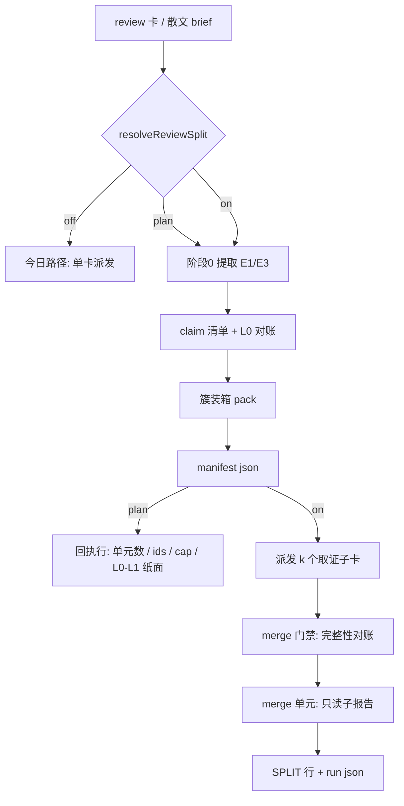

# Design: claim-driven-review-orchestration

> Key: claim-driven-review-orchestration
> 上游：`claim-driven-review`（done，四层交付 + 实测 -69% 调用 / -84% 上下文峰值）
> 选型证据：`evidence/research/design-switch-and-seams-20261022.md`

## §1 不变量

1. **默认不改变任何行为**：`MW_REVIEW_SPLIT` 缺省 `off`，off 下派发路径与 HEAD 逐字节相同。
2. **manifest 是唯一真相**：merge 的母卡 id 集只从 manifest 读，不重建。
3. **清单是导出物**：真实 review 的散文 brief 先经阶段 0 变成覆盖清单，再谈拆分。
4. **阶段 0 计费**：提取单元的 token/调用计入对照臂。
5. **merge 只能搬运**：`verdict_first_seen_at == unit`。

## §2 架构



### 2.1 模块与写入面

| 模块 | 文件 | 职责 |
|---|---|---|
| 开关 | 新 `shared/review-split.ts` | `REVIEW_SPLIT_DEFAULT`、`resolveReviewSplit()`：env > `.mw/review-split.json` > 默认，回**值 + 来源** |
| E1 提取 | 新 `shared/claim-extract.ts` | findings 行 / AC 行 / diff hunk / 反模式命中 → `Claim[]`，纯函数、幂等 |
| 装箱 | 新 `shared/claim-pack.ts` | 簇原子性 + `Σ预算 ≤ 8` + 每单元 ≥1 条机检 claim |
| manifest | 新 `shared/split-manifest.ts` | 序列化 / 校验 / sha 链（母卡 + 各子卡 + 自身） |
| PM 编排 | `pm/ui-bridge.ts` | plan 回执行、子卡派发、merge 门禁、`[review-split]` 行 |
| Python 镜像 | `autopilot/dispatch.py`（+ 新 `review_split.py`） | 同名同义的 `resolve_review_split` / 提取 / 装箱，供 conductor 通道 |
| merge 结算 | 复用 `worker/output-sections.ts` + `worker/output-writer.ts` | 11 个 token 复用、2 个显式豁免 |
| 度量 | `usage.py`、`status-model.ts` | `split_mode`、arm 级聚合、`fetches/closed` |

### 2.2 开关语义（review 专用）

`resolveReviewSplit()` 依次看：`MW_REVIEW_SPLIT`（env）→ `.mw/review-split.json` → `REVIEW_SPLIT_DEFAULT="off"`。
非法值按 `off` 并记 `split:mode-invalid:<v>` 告警（不拒绝）。生效前置条件：卡片 `type: review` 且带可机检清单；
否则记 `split:not-review:<type>` 并走原路径。

命令行（由 `mw.py` 提供，PM 与 conductor 共用）：

```
mw review-split status [--json]        # 生效值 + 来源 + 最近一次 manifest 摘要；纯只读
mw review-split set off|plan|on        # 原子写 .mw/review-split.json（写 tmp 再 rename）
mw review-split plan --task <key>      # 出一次 plan 回执行（不派发、不建子卡目录）
```

`status` 的 `--json` 形态：`{"mode":"plan","source":"config","path":".mw/review-split.json","updated":"..."}`。

- **off**：不读 diff、不写 manifest、不建子卡目录。
- **plan**：产出 `evidence/split/review-<task>-manifest.json` + 一条回执行
  `[review-split] mode=plan units=<k> claims=<n> cap=<sum> inflation=<ratio> l0=<ok|gaps> l1=<ok|gaps>`。
- **on**：同 plan，另派 `k` 张子卡 + 1 张 merge 卡。

### 2.3 manifest 形状

路径：`evidence/split/review-<task>-manifest.json`。字段一律 **camelCase**（TS 与 Python 共用同一序列化），
sha 一律 **EOL 归一化**口径（与 task.md 头部的 `card_sha256` 可直接对照，见 `shared/card-digest.ts`）。

```json
{
  "v": 1, "parent": "<task>", "mode": "plan|on",
  "parentSha256": "...", "ids": ["C-01", "..."],
  "units": [{"k": 1, "taskKey": "<task>-u1", "ids": ["C-01"], "budgetSum": 4, "slots": 1,
             "writeFace": "workers/<task>-u1", "sha256": "..."}],
  "packing": [{"cluster": ["C-03", "C-03.1"], "unit": 2, "why": "struct-atomic"}],
  "l0": {"asks": 7, "mapped": 7, "unmapped": []},
  "selfSha256": "..."
}
```

`packing` 是簇原子性的**证据**（不是装饰）：L1 的 `split:orphan-child` 只需查这一项即可判。

### 2.4 merge 门禁（两条通道共用）

派 merge 之前校验：manifest 存在且 sha 链完整 → 所有 `units[*].sha256` 对应的子卡都在
`workers/` 下且终态 → `∪子报告 id ≡ manifest.ids`。任一不满足 → 拒绝派发，回执行写 `merge-blocked:<原因>`。
conductor 侧由 `deps:` 保证时序，本门禁保证**完整性**（RQ-1：手工通道没有 join）。

### 2.5 子卡读面/写面

- `read_scope`：key 目录 + `goal.md` + 该单元每条 claim 的 `定位`（沿用 `claimReadScope`）。
- `write_face`：**必须逐单元声明** `workers/<task>-u<k>`，否则同 key serial-only 守卫把并行打回串行。
- 产出落**各自 taskDir**（writeless 角色的运行时不看 `write_face`，仍按 own taskDir + `<key>/evidence/**`）。

## §3 判决（预先定义，防止"造好就默认开"）

pilot：`1×n` vs `k` 单元（n ≥ 15，用真实待审对象），四条全过才算成立：

| # | 判据 | 计算方式 | 门槛 |
|---|---|---|---|
| 1 | 保真 | `extract:unmapped-ask` + `split:*` 计数 | 0 |
| 2 | 每断言成本 | `tokens/closed_dedup`（无真值退 `fetches/closed`） | ≤ 1.2× 单卡 |
| 3 | 墙钟 | arm 内 attempt 墙钟之和（并行取 max，串行取 sum） | ≤ 0.7× 单卡 |
| 4 | 上下文峰值 | 子单元 `final_ctx` 最大值 | ≤ 0.6× 单卡 |

不满足 → 保持 `off` + negative-result 证据 + 两周冷却。全过且用户签字 → 默认改 `plan`（`on` 仍显式）。

## §4 VC 映射

| VC | AC | 验证方式 |
|---|---|---|
| VC-001 | AC-S1 开关三档 + 默认 off + 名称带 review | 双侧平价锁 + off 逐字节用例 + `MW_REVIEW_SPLIT` 与 config 优先级两态 |
| VC-002 | AC-S1b 命令开关 + 生效范围 | `mw review-split set` 后 `status` 变值；`status` 前后 `.mw` 全树 sha 不变；非 review 卡记 `split:not-review` |
| VC-003 | AC-S2 plan 可判、零派发 | plan 回执行 + 无子卡目录断言 |
| VC-004 | AC-S3 终止条件可计算 | 报表行算术（四项各一条） |
| VC-004 | AC-E1 结构化提取幂等 | 同输入两次结果 sha 相同 |
| VC-005 | AC-E2 散文提取 | triage 单元产出过 `claimsGaps`；不过则降级 |
| VC-006 | AC-E3 范围切保底 | `fidelity=unverifiable` 上卡 + 清单交付 |
| VC-007 | AC-E4 L0 对账 | `extract:unmapped-ask` / `extract:thin` 负例 |
| VC-008 | AC-E5 阶段 0 计费 | arm 求和包含 triage 单元 |
| VC-009 | AC-001 拆分信号 | `claims:count:<n>>5` advisory/enforce 两态 |
| VC-010 | AC-002 簇装箱 + 命名 + 双通道同构 | 装箱约束负例 + 两通道 diff |
| VC-011 | AC-002a 汇合与串行守卫 | 五子卡真并行（墙钟 < 最长单元 × 2） |
| VC-012 | AC-002b manifest | 删一条 id / 改一个 sha 各一条负例 |
| VC-013 | AC-003 merge 只读子报告 | `read_scope` 越界拒绝测试 |
| VC-014 | AC-004…008 保真判据 | 每条判据的负例（RQ-2 §2 已给构造） |
| VC-015 | AC-009 反恒真 | T-07 三份真实 report 回放零误报 |
| VC-016 | AC-010/010b/010c 度量 | arm 并排报表 + `mw stats` claims 列非 0 |
| VC-017 | AC-011 灰度看门狗 | 功效声明 + retire 口径 |
| VC-018 | AC-012 零回归 | 159 + 27 全绿；无 claims 卡逐字节不变 |

## §5 风险与缓解

| 风险 | 缓解 |
|---|---|
| E2 提"好判但无意义"的断言 | E4 的 `extract:thin` + E2 交未抽项清单 + merge 回读 brief |
| 子卡被 serial-only 守卫串行化 | 逐单元 `write_face` 声明 + 墙钟判据（VC-011） |
| merge 假阳性（既有两个 token） | 显式豁免，不改判据值 |
| 拆分成本倒挂（固定开销 ×2.5） | §3 判据 2/3 直接定价；不过就保持 off |
| 母卡被当单元派发 | manifest 存在时在该 key 的上游 task 上写 `split_plan:` 标记，派发期拦 |
