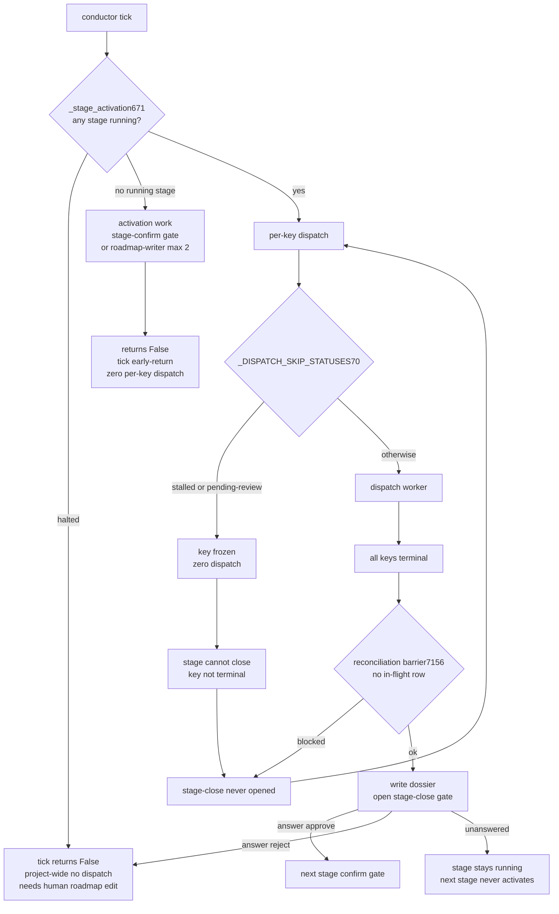

# design.md — mw-autopilot-gate-alarm-liveness

- Key: `mw-autopilot-gate-alarm-liveness`｜Phase: DESIGN｜Baseline: `cc9a46a1a`
- 上游输入（已核实存在）：`E:\CLI_workspace\FeatureMigrator\.agenticdoc\_autopilot\{handoff-serve-drift-and-silent-stall-20261013.md, reflect/stale-serve-silent-stall.md, reflect/_index.md}`
- 证据（全部终态、PM 已抽查/复现）：`evidence/research/spec-rq1..rq4-*20261013.md`（40,654 / 36,422 / 40,704 / 37,560 B）、`spec-bootstrap-declaration-20261013.md`、`design-drq1-field-registration-20261013.md`（38,778 B）、`design-drq2-monitor-state-surface-20261013.md`（32,706 B）、`design-drq3-drift-selfcheck-20261013.md`（74,196 B）、`design-drq4-auto-approve-20261013.md`（46,911 B）
- 需求锚点：`spec.md` E1–E10 / AC-001…AC-016 / P-01–P-08 / §7 已复现事实 / §8 PM 裁定 D-009…D-015

## §1 问题模型：两级主闸与四种阻塞形状

本 key 的核心因果（DRQ-4 实证，推翻"派发依赖 watch"的初始假设）：**派发本身不依赖任何窗口 watch**（launcher 只读 `_workers.parallel` 的 pending 行，`launcher.py:1856/1899`；conductor 的 11 处 `dispatch.dispatch` 无一读 watch）。真正掐住派发的是**状态机**，其开关是 `_stage_activation`（`conductor.py:671`）：

- 只有**存在 `running` stage** 才返回 `True` ⇒ 放行逐 key 派发；否则做激活动作（开 stage-confirm 门 / 派 roadmap-writer）后返回 `False` ⇒ **调用点 `:245-247` 直接 `return`，本 tick 所有逐 key 派发一行都不执行**。
- 第一行即 `if any(s.status == "halted" ...): return False`，注释明写 "pause until a human edits the roadmap" ⇒ **`halted` 无自动出口**。
- `_activate_pending_stage:692` 的 roadmap-writer **最多 2 次提案**（`used >= 2: return`），两次被拒 ⇒ 停等人工改 `_roadmap.md`。

第二级是 key 级冻结：`_DISPATCH_SKIP_STATUSES:70 = ("done", "stalled", "closed-legacy", "pending-review")` ⇒ 该 key 零派发；而 `stalled`/`pending-review` **不在**闭合终态集 ⇒ `_stage_closure:853` 永不满足 ⇒ stage 永不闭合。

**四种阻塞形状**（全部"看上去在跑、其实什么都不发生"）：

| 形状 | 触发 | 后果 |
|---|---|---|
| A 无 running stage | stage-close 已答 close、下一 stage `pending`；或 roadmap 全 closed | tick 只做 activation work，全项目零派发 |
| B key 被冻结 | key `status ∈ {stalled, pending-review}` | 该 key 零派发 + stage 永不闭合（`_stage_closure` 前置不满足） |
| C halted | stage-close 被 **reject** | 全项目零派发，只能人工改 `_roadmap.md` |
| D 预算/goal-change | `:1257`/`:1243` budget gate；`:2953` goal-change 全项目 halt | 派发被拒或 halt |

存量 56 gate 的分布正好落在 A/B：**stage-close 14 + stage-confirm 10 = 24 个 stage 级主闸**，**stalled 31 个 key 级冻结**，goal-change 1 —— **只有 1/56 不影响派发**。

## §2 设计决策

### D1 状态面优先，且必须承载 stage 主闸（AC-001 / AC-016）

- 常驻 pending-gate 行**不依赖任何事件**：数据取自磁盘（gates 目录 + `_roadmap.md` + 台账）并在读面派生 —— 依据是事件面天然会停：200/400 条尾窗、10MB×3 轮转、**cap 计数持久化**（RQ-1 实测 `gate-0024` n=1/n=2 相隔 4 秒后静默 158.3 min）、以及本次事故的 16.98 天漂移 > 12.8 天保留窗。
- 派生字段（DRQ-2，全部零落盘）：`reason` / `reminders{n,max}` / `nextDueMs` / `scopeResolved` / `queueState` / `inFlightForKey` + 既有 id/kind/stage/key/`created_at`/ageMs。读放大仅新增 1 个台账文件（实测 ≤1,117 B，对照 timeline 尾窗 512 KiB）。
- **AC-016 新增 stage 主闸行**：stage 状态（pending/running/closed/halted）+ 卡在哪道门 + 已等时长 + 被冻结 key 列表 —— 这是"派发为什么停"的直接答案，且它是本次设计里唯一能覆盖形状 A/C 的面（逐 gate 行覆盖不了"没有 gate、但没有 running stage"的情况）。
- 插入点：`monitor.ts:234 scanPendingGate` → `:335 readMonitorState`（age 在 `:427`）→ `:766 renderMonitorLines` 的 gates 段 `:879-908`。**必须修正 drop 序**：现行顺序在事故形状（keyed gate + reason）下先丢 `reason` 再丢 `age`（141→120→109 列），与 AC-001 冲突 ⇒ 改为 reason 与 age 最后丢。

### D2 提醒抑制改按 gate 所属 key，不可解析一律不抑制（AC-002）

`conductor.py:2558` 的判据是整个 `_workers.parallel` ⇒ 任意 key 有在飞工作即全项目静默。改为 per-key，并保留既有 fail-open 原则：**key/stage 不可解析 ⇒ 不抑制**（存量 JCodingAss `gate-0007`/`gate-0008` 就是 `kind: stage-close` 且 **key 为空**的实例）。被抑制也必须留可见记录（上游 P0-② 原文要求）。

**连带改造（DRQ-2 发现）**：`blocked_on_human` 有三处实现（`monitor.ts:442`、`status-model.ts:1349-1356`、`mw_common.py:3279-3291`）且都是**项目级**轴 ⇒ 必须**同批改三处**，否则面板与发射器互相矛盾。

### D3 抑制原因封闭枚举（AC-003）

六值 **不落盘、在三读面派生**：`key-in-flight / stage-terminal / cap-reached / not-due / unresolved-scope / gate-queue-unreadable`。**优先级 = 代码漏斗序**：`gate-queue-unreadable > key-in-flight > cap-reached > stage-terminal > not-due`；`unresolved-scope` 与抑制正交（是标记而非原因）。六值**不是全集**：本轮到期必须显式写 `reason=-`（不可用空值冒充"未知"）。cap 轴唯一权威输入 `_reminder_count`（`conductor.py:2512`）；TS 侧接入已存在但未使用的 `readGateReminders`（`pm-orchestrator.ts:1289`）。

**新发现并纳入本设计**：`readdir`/`readFile` 失败在 TS 三面**全部静默退化为"0 pending"** ⇒ `gate-queue-unreadable` 必须在三面真正可见（否则面板把"读不到队列"显示成"没有门禁"）。

### D4 每次发射走 fail-loud 双通道，cap 降级为"打断次数"（AC-004）

复用既有双通道封装（`conductor.py:2594-2660`：stderr + timeline `config`，含会话级去重 `_ROADMAP_ALARM_SEEN`），不新造第二条。`gate_reminder_max` 语义降级：cap 用尽后**不发中断**，但状态面照旧并显式标注"已达打断上限，仍待处理"。

### D5 漂移判据换轴：`code_digest` 为权威（AC-005 / AC-006）

- **为什么换轴**：纯 mtime 看不见**未提交删除**；纯 commit 会在"把 dirty 树提交掉"时给出**假漂移**（本仓 `packages/multi-workers` 今日即 dirty 11+9，且正是 FeatureMigrator 的 `code_dir`）。⇒ 权威判据 = **`code_digest`**（runtime 文件集 sha256，实测 71 文件 / 1,305,650 B / 7.6 ms）；mtime 供漂移起点时间；commit 供命名与 capability。
- **两个已复现的实现陷阱**：① `_git_head_short:5188` 走 `rev-parse --short HEAD`，给动态长度短 OID（今日 `cc9a46a1a`），而纯文件读给 40 位 OID ⇒ 字面永不相等 ⇒ 照抄即**永久假漂移**（**PM 原种子的错误，此处纠正**）；② `_write_pid:271` 在 `_write_serve_meta:273` **之前** ⇒ 采集必须整体前置到 `_write_pid` 前，否则一次挂死的 git 会留下"PID 在、服务没起"的假象。
- **skip 集必须加目录名 `test`**：`_mw_code_newest_mtime` 的判据是 `f.name.startswith("test_")`（basename），只跳文件不跳目录；其 71 个输入里有 **49 个（69%）是 `test/` 夹具** ⇒ 改夹具会把健康 serve 判 stale。
- **新鲜进程侧入口 4+1**（serve 不可自证）：`mw status` / `mw doctor`（drift ⇒ issue ⇒ exit 1）/ `mw update-env` A3（基线改 `meta.code_dir`）/ TS `serveStaleness`；可选 OS 探针（ctypes `GetProcessTimes`，实测与 meta 启动时间差 1.0 s）。
- **分工**：Python 拥有持久记录（stderr + timeline）+ serve 生命周期限频（限频键 `(code_dir, meta_commit, head_commit, serve_pid)`）；TS 只保留交互恢复；**Python 不自动重启**。
- **机器可检的"必须重启"**：`meta.schema < EXPECTED_SCHEMA`（存量 meta 等价 `schema=0 < 1`）。重启后复核 pending 门禁未被自动裁决意外改写 = `answered_by=conductor-auto:` 且 `answered_at > 新 serve.meta.started_at_ms`（**零新字段、零新文件**）。
- **D-009 收窄**：`code_digest` 存在且相等时，commit 不等只记 `history-only`，不告警。

### D6 `blocker_class` 走"冻结名序之外注册"先例（AC-007）

- **标量 ≠ 列表**：`blocker_class` 是标量，**必须新开平行标量集，不得复用 `_JSON_LIST_FIELDS`（`gates.py:160`）**；标量侧已有先例（`_AMBIGUOUS_SCALARS:190` + `_render_scalar:276`）。
- **登记点清单（照抄 `authorizes`，7 个代码登记点 + 3 个测试锁 + 1 个 materialize 点，Py 4 / TS 3）**。冻结名序 = `gates.py:95-139`（12 base + 26 v2 + 2 consumed），TS 镜像 `status-model.ts:660-701`；硬红断言 4 函数 / 5 条：`test_autopilot_gates.py:224`、`test_autopilot_gate_schema_v2.py:143`、`test_autopilot_contract_guard.py:187`（三处 `assert len(...) == 40`，PM 已实测）、`autopilot-gate-presentation.test.ts:227-228` + `:253`。
- **漏注册的后果（必须用测试钉死）**：Python 解析面漏 ⇒ `GateFormatError` ⇒ `enumerate/pending_gates` 整体抛 ⇒ 提醒（`:2692-2694`）/ 阶段跃迁（`:509-512`）/ goal-change 闸门（`:2905-2908`）**一起停摆**；TS 面漏 ⇒ `listGates` 剔除 + errors；**monitor `scanPendingGate` 漏 ⇒ 静默消失（比报错更危险）**。
- **缺省语义**：parser 保留 `None`（`gates.py:546` / `status-model.ts:873`），仅**判定层**折成 `judgment`（Python `gate_facts` stalled 分支 `conductor.py:6083-6091` + `auto_decision_for_rule:5831`；TS `deriveStatusModel:1467-1475`）。三条理由：解析层折会把"未知"伪装成"已知默认"；判定层折可随策略演进而无需改 schema；fail-safe 方向是"不得自动放行"。
- 写入端最小面：`mark_stalled` 的 `machine_fields`（`:5307-5322`）+ `_stamp_gate_defaults`（`:3072-3081`）闭集守卫。`gates.create()` 13 键、`gate-writer.ts`、`contract_guard.py` **零改动**。

### D7 re-attest 入口（AC-008）

**新建 gate + `context_refs` 放 `reattest-of:<id>`**（schema 零改动；`_gate_open` 已用 `context_refs` 做去重维度），配一个**不依赖 `status=="stalled"`** 的独立消费者（照 `_apply_review_decisions:3624` 成例）。不得绕过 AC 锁协议。

### D8 `stage-close` 自动放行（AC-015 中档，用户批准 D-014）

- **为什么是它**：① 它是**主闸**（形状 A/B 的根）；② 它是唯一同时满足"证据可确定性机器收集 + 非 policy"的 kind（56 gate 普查：stalled 31 / stage-close 14 / stage-confirm 10 / goal-change 1）。
- **证据收集器（已存在，复用）**：`_closure_dossier_md:979`（生成 `stage-N-close.md` 闭环 dossier）+ `_done_credentials_present:1853`（key 终态凭据）。
- **自动判据**：该 stage 全部 key 终态 + 无在飞行 + reconciliation barrier（`evidence_reconciliation_blocks:7156`）未阻断 + dossier 已写 ⇒ 自动 `approve`。留痕零新字段：`answered_by="conductor-auto:<rule_id>"` + 未被写入的 `answer_source`/`auto_policy_id` + ledger `_AUTO_AUTHORITY_KEYS:6350`。
- **回落链（必须可见）**：收集失败或判据不可用 ⇒ **回落人工 gate**，并在状态面显示缺失项（T-08 已验：JCodingAss `gate-0007` 今天可自动放行；`gate-0008` 因缺 `l3-verdict.txt`/`l3-report.md` **必须回落**）。可见性缺口三处须补齐：monitor `reason` 的 `drop: 1`、`scanPendingGate` 不读 `answer_source`、TS `GateRecord` 不读 `auto_policy_id`。
- **`stage-confirm` 不自动**（D-014②）：它是"开始一个 stage"的授权而非文书，只做可见性升级。
- **不重复既有 48h 兜底（D-014④ 核实结论，**否定**）**：`_process_deferred_reviews`（docstring `:3542`）的 48h 兜底**不是自动闭合路径** —— 它只推两条 `review-escalated` 升级信号（deadline = `expires_at` 或 `created_at + 48h`；closure = 其他 key 全终态），文档串明写 "**It NEVER closes the stage and NEVER rewrites a key**"，人答 key 的门后才由 `_apply_review_decisions` 落 `review-decided`。⇒ 与 AC-015 **互补不重复**（48h = 升级给人；AC-015 = 有确定性证据即自动闭环），**无需合并**。`GATE_DEFAULT_TTL_SEC = 48 * 3600`（`:3400`）是该 TTL 默认值。
- **现实基线**：全机 `auto-decisions.jsonl` 中 `phase:"decide"` = **0 行**（自动裁决从未在生产跑通）；6 条规则里只有 `stalled` 的 fact-plane 有生产者。基线自动批准占比 **0/53 = 0%**，等待中位 2.56 h / 均值 20.28 h / 最大 300.6 h（≥30 min 占 64%）。

### D9 claim/owner 面：conductor 自动接管（AC-014 路线①，用户裁定 D-013）

autopilot 下由 conductor 以**合成 claim-id**（`autopilot@<pid>`）接管"有工作但无 live claim"的 key，使"无人值守"不再等价于"无 owner 即跳过"（C-35 运行期实证：`claim-free repair skipped, nothing written (… 原因=index 状态 idle)`）。设计须定死四件事：**生命周期**（何时创建/续期/**失效回收** —— 合成 claim 不得反过来阻塞，即 C-35 的 stale-owner 类问题必须被覆盖）、**与人工 `switch_key` 的移交与冲突**（人接管时合成 claim 自动让路）、**`_index.parallel` 呈现**（claim 列写 `autopilot@<pid>`，且状态面区分合成/人工接管）、**"同一 key 单一写入方"如何保留**。放弃 claim-free 派发（避免拆掉既有多窗口并发保护）。

### D10 回收契约对 writeless 角色角色分流（AC-013，C-36）

- **过判**：writeless 角色（`research`/`review`）的报告天然充满**被读取**的路径名（T-08 的"未记录写入"清单 `l3-verdict.txt, auto-decisions.jsonl, gates.pending` 正是它普查时读过的路径并集，其中 `gates.pending` **磁盘上不存在**）⇒ 只认"声明的唯一交付物"为写入意向，其余按读取引用处理。
- **漏判**：交付物写入 taskDir 之外时对账本不可见（四份 RQ + 三份 DRQ 的 `trace.log` 里 `evidence/research` 出现 **0 次**，而文件都在；Exit Reason 全是 `writes=none`，累计 **8 例**）⇒ 必须覆盖 taskDir 之外的交付物写入。
- **路径污染**：未展开变量（`$dir`/`$src`/`$env:TEMPxxx`）与不可解析路径一律 `malformed`，不得作为写入证据。
- **确定性检验（本案方法学）**：复核"未记录写入"看三件事 —— 目标文件 **mtime 是否落在 worker 运行窗内**、`trace.log` 是否有对应事件、文件名**是否真实存在**。T-08 三项全否 ⇒ 假阳性。

## §3 接口契约（零新增 config 键，AC-011）

| 面 | 契约 |
|---|---|
| gate frontmatter | 新增 `blocker_class ∈ {paperwork, judgment}`（缺省 `None`，判定层折 `judgment`），**冻结名序之外注册** |
| 自动裁决 | `answered_by="conductor-auto:<rule_id>"`；复用 `_AUTO_AUTHORITY_KEYS:6350`；timeline 事件名复用既有（不新造） |
| `serve.meta` | 新增 commit / dirty / `code_digest` / `schema`；保留 `pid`/`started_at_ms`/`code_dir` 兼容旧 meta（旧 meta ⇒ `schema=0` ⇒ 判"必须重启"） |
| 状态模型 | `MonitorGate` 扩展（**不动被 `autopilot-console.test.ts:384-389` 精确锁死的 `GateView`**，走 DRQ-2 的推荐方案 B：扩 `MonitorGate` + 接通 `readGateReminders`） |
| 抑制原因 | 六值封闭枚举，派生不落盘，优先级按漏斗序 |

## §4 改动面清单（实现卡据此切分）

- **Python**（`packages/multi-workers/autopilot/`）：`conductor.py`——per-key 抑制（`:2558`）、stage 终止抑制记录（`:2562-2566`）、双通道发射（`:2688-2735`）、stage 主闸派生、stage-close 自动放行 + 回落、合成 claim（D9）、`mark_stalled`/`_stamp_gate_defaults` 的 `blocker_class`、re-attest 消费者；`gates.py`——序外标量注册 + 解析面；`config.py` 不改（AC-011）。
- **mw.py**：`serve.meta` 身份字段 + 采集前置到 `_write_pid` 前 + `mw status`/`mw doctor` 的漂移入口 + skip 集加 `test`。
- **TS**（`packages/coding-agent/src/extensions/agent-team-loop/`）：`status-model.ts`（gate 枚举 + `blocked_on_human` per-key + 不静默吞 readdir 失败）、`monitor.ts`（常驻行 + stage 主闸行 + drop 序修正 + `GateView` 不破坏）、`pm-orchestrator.ts`（接通 `readGateReminders`、无 watch 丢弃留痕、claim 呈现）、`shared/mw-runner.ts`（分工不新增周期通知）、`shared/change-ledger.ts`（角色分流/覆盖 taskDir 外/malformed）。
- **测试**：Python `test_autopilot_*.py` + `test_mw_*`；TS `test/suite/` 下的 `autopilot-console.test.ts`（不得破坏 `:384-389`）、`autopilot-config-parity.test.ts`、新的 gate-presentation/drift/ledger 回归。

## §5 验证策略

- **fail-closed 专项测试五形态**（DRQ-1）：T-A 注册/缺省/闭集；T-B Python monkeypatch 清空注册集（单文件抛 + 整队列抛）；T-C TS `Set.delete` 反事实；T-D 跨语言锁；T-E monitor 静默面防回归。
- **阻塞形状测试**（AC-016）：构造"stage-close 挂起 + 下一 stage pending"与"key stalled"，断言状态面直接显示主闸、原因与已等时长。
- **无接管测试**（AC-014）：无任何 `switch_key` 的会话下制造可派发工作 + pending gate，断言派发仍发生。
- **自动放行两分支**（AC-015）：可收集 ⇒ 自动 approve 且留痕；缺证据 ⇒ 回落人工且显示缺失项。
- **不回归**：既有两轮 QG 相关测试 + `npm run check`（全部 worker 终态后统一跑，避免与 worker 并发）。
- **运行期可度量**：自动批准占比（基线 0/53 = 0%）、必须等人响应的 gate 数、平均/中位等待时长、`gate-reminder` 事件数、漂移告警数。
- **P-07 复核纪律**：字节可信；**行号不得用于定位**（本环境 `Measure-Object -Line` 少算空行、`Select-String` 的 `LineNumber` 在本仓不可信、worker 自述又高于两者）⇒ 一律用**字符串锚**复核；"未记录写入"按 §2 D10 的三项检验判定。

## §6 风险与不做

- **风险**：stage-close 自动放行若判据写松会掩盖真问题 ⇒ 安全阀 = 判据不可用即回落 + 只放行 dossier/credentials 齐备者；合成 claim 若缺失效回收会变成新的 stale-owner（C-35 镜像）；`blocker_class` 漏注册 ⇒ 整队列 fail-closed（故有 T-B/T-C 反事实测试）。
- **不做**（本 key 排除）：`_workers.parallel` 单写入方 / `run.json` 唯一权威 / 派发写序列原子性（EPERM）；不改判据只改夹具数据（P-03）；不新增 config 键（AC-011）。
- **运营边界**：JCodingAss / FeatureMigrator 的现场修复不跟进（用户裁定；只作只读取证语料）。

## §7 开放项（进 PLAN 时逐条落卡或明确不做）

1. `stage-confirm` 是否需要"等待超时升级"的可见性文案（不自动放行）。
2. 合成 claim 的续期周期与失效判据具体取值（需与既有 host:pid 存活检查对齐）。
3. `pending-review` 出口当前需 `auto_gate_mode≠off`（T-08 靶子 T-?）—— 本 key 是否纳入自动放行范围（中档偏保守：**暂不纳入**，仅做可见性）。
