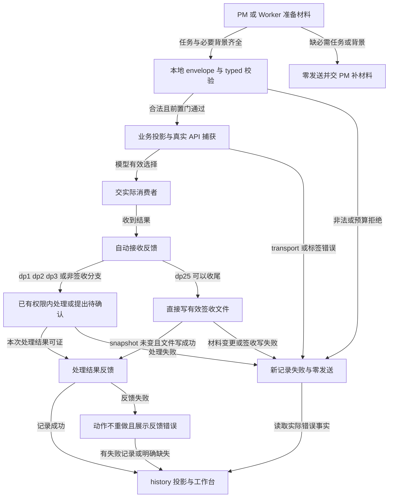
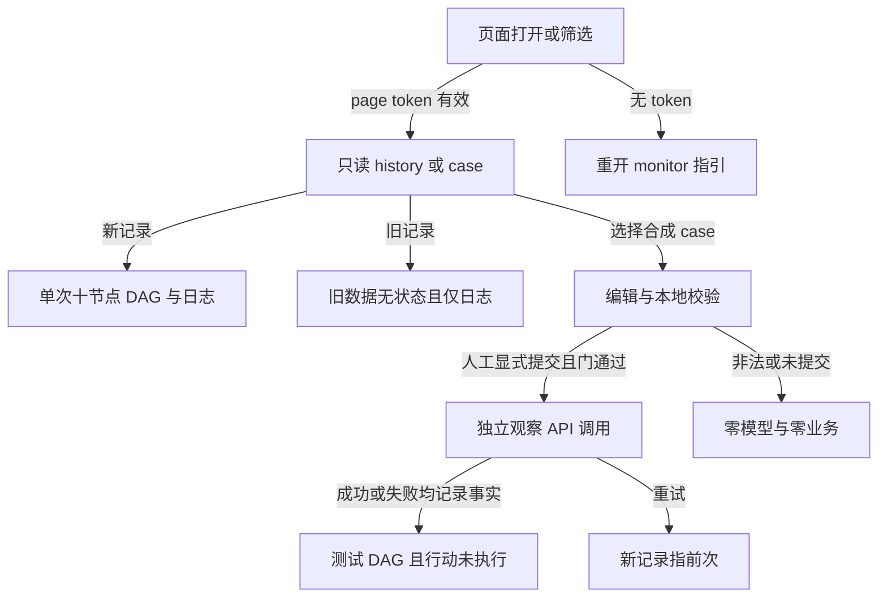

# Design: 简洁决策上下文与决策工作台

> 状态：用户审核通过（2026-10-23T00:20:59+08:00），按本设计推进实施与验证。
> 执行许可：源码实现与隔离验证；真实Jev/浏览器、build/install、commit、共享服务起停不在本次许可内。

## §0 设计前提锚定
- spec_path: `.agenticdoc/mw-decision-context/spec.md`
- spec_locked_at: 2026-10-22T23:37:55+08:00
- ac_count: 20
- ac_ids: AC-001, AC-002, AC-003, AC-004, AC-005, AC-006, AC-007, AC-008, AC-009, AC-010, AC-011, AC-012, AC-013, AC-014, AC-015, AC-016, AC-017, AC-018, AC-019, AC-020
- 继承GC1–4。三研究是静态提案，不是HTTP、浏览器或模型验证。
- 依据：evidence/research/design-contract-producers-20261022.md、design-feedback-signoff-20261022.md、design-workbench-cases-20261022.md；PM纠正在design-convergence-20261022.md。

## §1 架构选型（待审核推荐）
| ID | 推荐 | 否决方案与理由 | 留底 |
|---|---|---|---|
| D001 | 四DP registry只定义业务材料，单一allowlist投影生成model state；审计留本地envelope | 只改producer：Python仍注入身份；全局omit名单：新增字段可能意外进入模型 | RQ1 |
| D002 | 普通Agent填dp3/dp25材料，共用ask_decision扩展入口；不增加生成模型服务 | 自动文件检索答案：错误职责；Jev生成文本：不支持 | RQ1 |
| D003 | dp2仅PM主动触发，保留registry问题；PM提供任务与决策背景，worker执行情况可选 | 自动检查点、强制自评、异常阈值及改四标签方案撤回；模型返回不自动执行 | 用户修订+design-dp2-pm-revision-20261023.md |
| D004 | 唯一Python生命周期写入口，append-only、本地精确envelope、显式记录版本 | TS直接自由文本拼日志：安全/锁/reader不一致；复制archive字段承载反馈：混淆权威与行为 | RQ2 |
| D005 | 已确认：有效签收文件原子写入成功即签收成功；同次幂等、写失败只重试写入、材料变化重新判断；反馈失败单列 | 强制intent/commit及日志成功作为签收成功前提撤回；不重复模型调用，不将两文件写称整体原子 | design-signoff-minimal-20261023.md |
| D006 | 原history读链+纯workbench投影，原始技术事实保持，UI只渲染 | 第二套API/序列化：重复安全边界；前端按key/时间拼链：假关联 | RQ3 |
| D007 | 4份静态合成case离线生成、显式编辑提交；其余21DP无新增case | 页面加载自动生成调用模型；恢复重型审计模板 | RQ3 |

使用既有Python/TypeScript、文件锁、loopback服务、外部HTML/JS/CSS，不加依赖、不改pi核心、framework脚本、共享配置、dist。

## §2 核心结构
业务材料 → registry校验 → model投影 → 真实transport；本地envelope → wire与关联事实；结果 → 实际消费者 → 生命周期反馈；history折叠 → workbench投影 → 页面。
反馈不反向控制模型，也不授权业务执行。观察路径执行器固定为零，事件sink独立。

### 业务材料（字段草案，只有四DP）
| DP | model state | 原生选择问题 |
|---|---|---|
| dp1 | task_goal、task_requirements、task_deliverables，均string原文 | triage_type，coding/research/review，用户定义说明 |
| dp2 | 同三任务字段、pm_decision_background；可选worker_execution（真实完成/剩余/阻塞/尝试及时间预算） | checkpoint_action；现registry instructions/labels不改，narrow/split/direct-exec/escalate |
| dp3 | question、background{task_goal,current_state,decision_reason,constraints_impact}、handling_options[{id,label,description}] | handling，动态候选id单选 |
| dp25 | delivery_goal（含用户验收条件）、actual_completion、verification_evidence{verified,unverified}、unfinished_impact | q-conclusion，finalize/continue/user-confirm |

不是统一大schema。可验证为空的未验或未完成列表用[]表示，不把缺字段/null当空。dp3选项说明原文在state中，原生choices引用id+标题，不把完整说明塞进旧80字符label而截断。动态候选合法范围依据现有协议核实，设计默认至少2个可区分候选；单候选不调用模型，由Agent补候选或交人工。
每DP精确model键表在registry权威声明并导出TS，不手改生成物；identity/role/task/version/retry/hash只在envelope。保留本地材料快照与实际model state的区别，digest注明对象，不能用hash代实际发送证明。
不采纳研究任意400/700/160B上限。必要字段不静默裁剪；按实际transport已有预算校验整份材料，超出明确拒绝。是否调整现2000B需四完整case实测；在获证之前不预定新上限，不把旧截断继续当合法处理。

### 固定提示
- dp3：基于已有上下文先给问题原文，填写目标/现状/需决策原因/约束影响，针对问题给可区分处理候选和说明；未知标未知，不制造事实，不替Jev预选。仅材料不足才补读。
- dp25：基于已有上下文按目标验收/实际完成对应目标/已验与未验/未完成影响四部分整理；产物、证据指出具体出处，不以任务数或完成声明替证据。
- dp2：PM说明当前为何需要在收窄/拆分/直执/高风险给人之间判断，并提供任务原文和相关约束；有worker时可附真实执行情况，没有则不编造。不新增worker自评生成或检查点等待流程。

## §3 模块划分与下游认领
| 单元 | 主写面（计划时精确卡授权） | writer / reader |
|---|---|---|
| 契约/投影 | decision_points.py、decision_book.py、必要decision_context.py、生成脚本及3生成物 | registry→TS校验、producer、case、playground |
| PM dp1/dp2 | pm/ui-bridge.ts、triage-client.ts、pm/decision-tool.ts、pm-orchestrator.ts | dp1任务卡、dp2 PM材料→run envelope；移除旧dp2自动调用与自动narrow消费，watchdog告警保留；选择→PM处理 |
| 双角色dp3/dp25准备 | pm/decision-tool.ts、index.ts、worker/worker-mode.ts、decide_signoff.py | Agent工具材料→Python，原生选择→发起Agent |
| 关联/反馈/签收 | decision_wire.py、受管wire-store、mw.py、decide_signoff.py、必要decide_archive.py | consumer→lifecycle；sign结果→有效签收文件与独立反馈；history读取 |
| history/UI | decision_history.py、decision_monitor.py、dashboard.html/js/css | 完整事实snapshot→投影→DOM |
| case | scripts/build_decide_cases.py、decide_cases四文件 | 离线生成→只读case路由→编辑校验提交 |

同文件必须串行；尤其worker-mode、mw、decision_points、history不可双派。契约先稳定再producer/案例，事件先稳定再reader。TS/Python镜像、questions_version、生成物、旧有意断言同步一张认领表，不等下游红再追改。

## §4 接口与集成
### 4.1 本地envelope
`{material, meta:{record_version:2, logical_id, key, task_key?, initiator_role, retry_of?}}`，字段名为草案。一次真实决策一个新logical_id（UUID），所有attempt关联该id；重试新id指前次，重复提交同id不得重复发送。PM无task显式null，dp1在派发前预留task id而非事后猜。
meta不发给模型；actor.kind/source/answer_source与initiator_role分别记录，不用actor证明人工，不扩origin字符串承载多义角色。CLI若无法确知角色显示unknown，不冒充PM；四DP受管Agent路径要求发起角色真实。
版本标记在创建事实中持久化，新记录失败或捕获缺失仍为新数据。旧无版本数据可查但禁DAG，不以有无wire反推版本。

### 4.2 反馈
受管`mw decide lifecycle`通过stdin envelope接收`consumed/action-result/processing-result`语义，复用已有词汇consumed/executed/settled/signoff和安全schema；事件记录action label与结果依据。实际字段扩展如需有明确writer，不能把词义塞自由文本。
- consumed：消费者确实收到选择，不要求已采纳，不等完成。
- executed：明确行为已经发生（如交PM、发起澄清、写签收）；不能把文件存在等同worker真的收窄。
- settled：本次处理完成或失败，需真实消费回执；不是整个key完成。
- dp1：类型读取后，现有派发/保留类型/不一致告警处理结束反馈，不新授权改类型。
- dp2：发起PM接收收窄/拆分/直执/高风险给人选项，在已有权限内制定并落实方案后写处理反馈，模型结果不直接写steer、杀worker或执行工具。高风险选项由PM提出具体用户问题，不伪造用户同意。
- dp3：提问Agent接收选择后作已有权限内处理或提出用户授权问题，并写结果；等待用户确认只记录已提出待确认项，不伪造用户答复。
- dp25：finalize有效签收文件写入成功即签收成立，再写接收/行动与关联反馈；反馈失败独立显示，不撤销真实签收。continue/user-confirm由PM给出具体推进/待确认事项后结束本次处理，无签收。
锁内按event_id去重，不能仅按(decision_id,word)吞掉同一动作不同阶段/失败后恢复。feedback写失败返回结构化失败给caller，并写受管独立失败结果sidecar供reader；sidecar也失败则只能显示反馈缺失，不谎称reader可看到失败。动作不因日志失败重复执行，无终结事实保持处理中+节点错误/未记录。dp25例外有独立可证的有效签收文件：精确关联同次决策后主状态可为处理完成，同时DAG/日志诚实显示反馈失败或缺失，不假装链路完整。

### 4.3 dp2触发（用户修订）
仅PM通过受管decide工具主动调用dp2，材料为任务原文与PM决策背景，worker执行情况可选。未派发、无自评均合法，不虚构worker/task关联；缺必需任务或PM背景仍拒绝。
保留现registry问题：instructions="以当前进度，这一步该继续、拆小、直接执行还是上抛人？"；choices依次narrow/split/direct-exec/escalate；labels依次“收窄到剩余预算内能完成的一小块”“拆成多个任务重派”“PM 自己直接做完”“风险高到必须问人”。instructions中的“继续”不新增continue标签，不改写现问题措辞。
撤回自评artifact新writer、pending checkpoint、repeat_top≥4和research/review异常识别。既有watchdog/检查点告警保持，但不自动调用dp2。移除其旧自动narrow路径，明确认领相应回归，不删通用告警能力。
原生结果交PM：收窄若改变交付目标需用户确认；拆分需明确边界；直执需协调活worker写面后由PM执行；高风险给人提出具体风险/授权问题。模型选择本身不构成执行或用户批准。

### 4.4 dp25必要硬门与签收（用户确认最小方案）
调用前：key/claim写面合法、配置启用且budget/transport可用、四部分材料typed合法、档案链完整、现签收策略要求的来源合规、签收路径安全可写；不预判断AC全完成才请Jev复述。空档案行为沿现明确allow-empty策略核实，不由[]自动授权。
全局门不由observe越过。观察finalize只记录选择，不写生产签收。
1. 冻结本次目标/材料/验证证据及必要本地事实快照，精确关联logical_id；保留原生选择及对应快照，优先复用现有持久决策结果。不以单独rows_sha256覆盖全部材料变化。
2. finalize后锁内重核相关快照。材料已变则本次签收失败并提示重新判断；不拿旧选择签新事实。无PM二次批准。
3. 有效签收文件通过安全临时写入、fsync和原子replace落地即签收成功。文件包含同次logical_id与snapshot关联，reader校验后据此显示本次处理完成；追加关联/权威日志失败单独报告反馈失败，不改报签收失败。
4. 签收文件写失败：明确signoff_status=failed。相同决策与材料快照未变时仅重试写入，零新模型调用；选择或快照无法可信读回则拒绝重试，不猜最新结果。若现有持久记录不足以恢复，只补最小结果记录，不强制新intent/commit账本。
5. 重复同次回执：已有有效文件与logical_id/snapshot相符则返回已有签收，文件时间与字节不变、不重复签收；缺失关联反馈可幂等补写，但不重做签收。新判断用新logical_id，不能因key曾签收而跳过。
签收结果与feedback_status分列；signoff成功/feedback失败允许共存，缺失明确未记录。hash仅证完整性，重试材料校验不代替脱敏/来源可信检查。历史签收不猜对应新决策，只保留已有日志。
phase不随签收直接改DONE，仍走advance_phase现门禁；不新增commit门槛，不手改framework脚本。后续任何phase门禁阻断与本次签收成功分开呈现。

### 4.5 UI/API
- `/api/history`沿用opaque id，增加workbench列表投影和snapshot facets{keys,dps}，精确过滤、分页不影响下拉全集；旧status仅日志用，新processing_state闭集4值。
- 单条detail给完整10节点安全投影。列表不复制raw正文，UI不推断join。
- `/api/test/cases`page鉴权只读，四id固定路径映射，不收任意路径；title/note在case外壳，不进model state。
- 主表5列：key/task、问题摘要、DP、选择、状态；无+已行动等技术副状态。
- 点击新记录打开单次DAG，节点详情代码块；“日志详情”弹窗显示技术事实。旧行只有日志按钮，无DAG入口。
- 测试页4case选择器、可编辑材料、显式校验/观察提交、独立记录同DAG；其余25DP已有通用操作能力保留但不恢复复杂主表。
- 页面token仍内存，CSP外部资产/textContent，无innerHTML/eval/inline。刷新失token按既有重开流程。

## §5 Function Flow

## §6 Coverage Matrix
| 功能 | 正常 | 边界 | 异常 | 验证层 |
|---|---|---|---|---|
| 四DP材料/原生问题 | 4producer→HTTP | 多字节/选项说明/无task | missing/null/超预算/非法标签 | L1+L2本地HTTP |
| dp2 PM触发 | PM任务背景与现4选项 | 有worker/未派发/无自评 | 自动checkpoint调用0、缺必需材料拒绝、模型不自动执行 | L1+L2 faux |
| dp3双角色 | Agent生成候选并处理 | 未知/授权需问用户 | 缺背景/不可区分候选 | L1+L2 faux |
| id与反馈 | 两task同key、逐次反馈 | retry/重复event | 碰撞/写失败/无reader | L1+L2 |
| dp25 | finalize有效文件写成功 | 重复回执/写入重试/新snapshot | 文件写失败/关联反馈失败/材料变更 | L1+L2 |
| UI历史 | 5列/filter/10节点 | 旧数据/未捕获新记录 | 401/缺正文/未反馈 | L1+L2 DOM |
| case观察 | 4完整case编辑→HTTP | 空未完成/未知材料 | 缺凭证/disabled/预算 | L1+L2 HTTP |
| 安全 | known-secret脱敏 | 键/长尾/路径别名 | symlink/失败消息泄漏 | L1+L2 |
真实浏览器为另需授权的平台层，DOM shim不替代；真实Jev效果不以合成HTTP证明。

## §7 Verification Contract
每项为待执行契约，Output是必须由断言生成的证据，不是已通过结果。

| VC | 当触发时必须观察到 | Layer | Output | Source |
|---|---|---|---|---|
| VC-001 | 四真实producer发送4/4精确业务材料，来源可定位 | L2本地HTTP | [VERIFY] VC-001: producers=4/4 | AC-001 |
| VC-002 | model state审计键数0，其余21DP契约不变 | L1+L2 | [VERIFY] VC-002: audit_keys=0 | AC-002 |
| VC-003 | dp1一问、3标签及说明、无risk/reason业务 | L1+L2 | [VERIFY] VC-003: questions=1 | AC-003 |
| VC-004 | 仅PM主动触发；有worker/未派发无自评均合法；问题instructions/choices/labels保持现registry一致，自动checkpoint调用及模型造成自动任务操作/授权均0 | L2 faux+HTTP | [VERIFY] VC-004: auto_checkpoint_calls=0 | AC-004 |
| VC-005 | dp3两角色产生四背景和候选，不让Jev生成 | L2 faux | [VERIFY] VC-005: roles=2/2 | AC-005 |
| VC-006 | dp3选择精确交提问者，自动授权/执行0 | L2 faux | [VERIFY] VC-006: automatic_authority=0 | AC-006 |
| VC-007 | dp25四部分已验/未验分列进入真实HTTP | L2 HTTP | [VERIFY] VC-007: sections=4/4 | AC-007 |
| VC-008 | finalize直接写有效签收文件，二批0；文件写失败不报成功，同快照重试零新模型，重复文件字节不变；材料变化拒用旧结论 | L2故障注入 | [VERIFY] VC-008: second_approval=0 | AC-008 |
| VC-009 | continue/user-confirm实际交PM并零签收 | L2 faux | [VERIFY] VC-009: sign_writes=0 | AC-009 |
| VC-010 | 真实创建两task id不碰撞，无task为null | L2 faux | [VERIFY] VC-010: inferred_task_links=0 | AC-010 |
| VC-011 | 下拉精确过滤且主状态恰4值 | L2 DOM | [VERIFY] VC-011: state_values=4 | AC-011 |
| VC-012 | 新记录同id十节点，retry新id指前次且前次字节不变 | L2 HTTP+DOM | [VERIFY] VC-012: dag_nodes=10 | AC-012 |
| VC-013 | 请求返回匹配实际安全捕获，缺失/标记不补造 | L2 HTTP+DOM | [VERIFY] VC-013: reconstructed_bodies=0 | AC-013 |
| VC-014 | consumer自动反馈，consumed不当完成；dp25有效文件实际写成功可证完成，反馈失败独立可见，不撤销签收或伪造链路 | L2 faux+故障 | [VERIFY] VC-014: false_completions=0 | AC-014 |
| VC-015 | 技术字段在日志弹窗，主表技术列0 | L2 DOM | [VERIFY] VC-015: technical_columns=0 | AC-015 |
| VC-016 | 无v2旧数据可查，旧DAG入口0；新捕获失败不算旧 | L2 DOM | [VERIFY] VC-016: legacy_dag_entries=0 | AC-016 |
| VC-017 | 离线生成4完整case，4/4合法，读取编辑校验模型0 | L1+L2 | [VERIFY] VC-017: valid_cases=4/4 | AC-017 |
| VC-018 | 编辑实际进HTTP，观察业务执行0且生产树字节不变 | L2 HTTP | [VERIFY] VC-018: production_changes=0 | AC-018 |
| VC-019 | 合成secret值键长尾各公开面泄漏0，symlink拒绝 | L2 HTTP+DOM | [VERIFY] VC-019: secret_leaks=0 | AC-019 |
| VC-020 | missing/null/disabled/预算等门零POST，错误诚实，phase脚本外写0 | L1+L2 | [VERIFY] VC-020: refused_posts=0 | AC-020 |

## §8 AC → VC 映射表
| AC ID | VC | 路径分类 |
|---|---|---|
| AC-001 | VC-001 | 正常 |
| AC-002 | VC-002 | 正常/边界 |
| AC-003 | VC-003 | 正常/异常 |
| AC-004 | VC-004 | 正常/边界 |
| AC-005 | VC-005 | 正常/边界 |
| AC-006 | VC-006 | 正常/授权 |
| AC-007 | VC-007 | 正常/边界 |
| AC-008 | VC-008 | 正常/故障/幂等 |
| AC-009 | VC-009 | 分支 |
| AC-010 | VC-010 | 正常/边界 |
| AC-011 | VC-011 | 正常/过滤 |
| AC-012 | VC-012 | 正常/重试 |
| AC-013 | VC-013 | 正常/缺失 |
| AC-014 | VC-014 | 正常/故障 |
| AC-015 | VC-015 | 正常 |
| AC-016 | VC-016 | 历史/缺失 |
| AC-017 | VC-017 | 离线/边界 |
| AC-018 | VC-018 | 观察/隔离 |
| AC-019 | VC-019 | 安全/异常 |
| AC-020 | VC-020 | 异常/拒绝 |

## §9 非功能实现方案
- 当前凭证snapshot在受管调用unit冻结、transport pin不替caller、known-secret全边界清洗；新增材料与反馈也必须用同安全输出协议，读时当前secret不可确认则failclosed omit。
- byte_exact、redactions、truncated、text_omitted等分别展示，byte_exact=false不能说脱敏N次；usage缺失不补0。
- 使用受管wire-store安全open与deadline锁，不直接裸append_event；新目录/ledger/case/签收及最小结果记录路径父链containment+链接拒绝+打开后身份重核，纯lstat检查不声称防完TOCTOU。
- sign文件/结果或错误sidecar权限按平台核实；Windows chmod不等用户隔离。没有授权的跨平台/浏览器结果保留未验证。
- 不先增加性能SLA，facets一次snapshot计算，详细正文只单条读取；真实case预算与大快照性能实测后报告。
- TDD行为RED先于实现；测试使用tmp HOME、合成auth、env清理、读前spy和faux provider，绝不真实凭证。源码测试仅相关文件串行，完整npm check有写面风险需先协调，不以子步代全check。

## §10a 工作台可读性修订（2026-10-23用户确认）
以evidence/design-workbench-readable-revision.md为本轮权威增量，替代旧技术日志栏目/列表DAG/裸节点JSON设计。保留十节点、安全与真实事实边界；AC015 REVISED，AC021～024追加。VC021～024对应图形10节点、业务材料与实际JSON正文、本次低置信度阈值解释、完整questions编辑仅观察。此前AC20/VC20标记为历史基线，当前24项，不以旧通过声明代新验收。

## §10b 当前讨论落地增量（T12，用户确认）
- 页面顶部从当前 URL 显示 monitor 实际端口；历史默认 limit=5，下拉仍读取完整 facets。生产/观察 DAG 与节点详情固定纵向全宽，不再左右压缩。
- facets/filter/read-statistics 诊断移出正常页；API 原始事实保留，withheld 显示简短安全提示。
- 业务 state 独立主编辑器，完整 questions 独立编辑，高级 book 保留本地 contract/来源标注；notes.evidence 仅本地来源，不触发模型读文件、不整本发送。
- observation 静态 choice criteria 描述允许编辑，qid/type/选项键闭集固定；非空、无 NUL、既有字节/secret 门继续适用。dp3 criteria 仍只由 state.handling_options 派生，冲突拒绝。registry 不变，preview/send 共用正规化和 payload builder。
- 观察 DAG 详情从该 submission 的安全实际捕获提取输入 state，请求/返回沿同一 capture renderer；缺失/截断不从当前 editor 补猜。无本次策略阈值即明确未记录，不用当前配置或 confidence 猜历史阈值。
- 业务 editor 输入非法时阻止 validate/submit 发送上次合法 book；再次合法或重新加载后恢复。
- 自动安全重启归独立 mw-monitor-auto-restart，T12 不修改 service 生命周期或操作用户 monitor。

## §10 决策记录与审核点
D001–D007随整体设计用户审核通过；以下作为实施检查点，不再等待重复设计确认：
1. 四DP机器标签/业务字段草案及原生dynamic候选处理方式。
2. dp2仅PM主动触发与现四选项已由用户确认；背景可带worker执行情况，无异常阈值或自评等待。具体PM工具接线仍为设计推荐。
3. D005最小签收已确认：有效文件写成功即签收成功，同次幂等，写失败重试不重调模型，材料变化重新判断，反馈独立。强制intent/commit撤回；同一Python反馈写口仍为推荐，不能用接收当完成、不能无wire当旧。
4. 现2000B预算是否需调整须四完整case实测，禁止任意字段截断。
5. UI同history读链、5列主表/10节点/独立日志弹窗；四case完整产物在实施时交付，不把研究省略号示例冒称case。

设计签收最小结果记录/错误sidecar/dynamic选项扩展具体schema在任务契约卡冻结；任何与上述方案不同的实现先更新设计证据，不在worker范围外自行扩权。

## §11 T22 任务状态变化（用户确认合并，AC025/026）
- 并行分析：schema/writer→producer→reader/DOM串行依赖；同文件PM独占，研究可只读并行但worker隐式dp1暂停，因此PM直接读取，验证串行。
- 本地meta增加可选task_before；真实反馈增加可选task_after。记录版本仍2，缺失快照不能补推。快照为{status, observed_at, source, completed, remaining, blockers}；三个列表各string[]或null。status/source闭集见T22卡；带时区时间，未知值拒绝且不回显。无task不接受快照。
- before由producer在调用决策前冻结，record-start保存；after仅执行/结算的真实反馈写入。仅consumed不得携带after；CLI直接传单一writer。字段校验/脱敏/失败/去重沿既有wire安全路径，不进model material。
- dp1真实dispatcher在model plan调用前采集当前全局WorkerStore队列中同task、同owner行，调用完成后再采集；文件不可确认/损坏/重复/异owner/链接均unknown，不做缺失=空的猜测。after不从成功/拒绝outcome反推worker运行或完成，保留当时队列实际状态；source=worker-registry不代表子进程存活已验证。
- 普通Agent工具可显式提交当时报告，source=agent-report默认明确注明，不把报告包装成系统观察，不新增dp2/3/25业务执行或授权。
- reader只从同次creation/feedback抽取快照并当前输出脱敏；DOM默认显示决策前→实际处理→决策后→变化说明。记录来源/技术结果折叠；未记录状态不根据result或当前文件补填。主表四状态仍是本轮状态，不改成task状态。
- after须匹配唯一creation的logical_id/key/task；写侧关联读不确定时拒绝，读侧错配不归因。时间顺序按已保存before校验。新增仅投影的task_before_visibility/task_after_visibility闭集recorded/unrecorded/withheld/invalid：安全过滤不假装未记录，不写回生产历史。

| 功能 | 正常/边界/异常 | VC | Layer | Output | Source |
|---|---|---|---|---|---|
| 前后真实快照及模型隔离 | 同task/key、重试旧字节不变、报告标注、旧记录不补、队列不确定 | VC-025 | L1/L2 faux+Python writer | [VERIFY] VC-025: inferred_task_states=0 | AC-025 |
| 默认任务变化展示 | 排队≠运行/完成、null≠[]、consumed/ok/rework不推状态、secret/只读/observe | VC-026 | L2 writer→history→DOM | [VERIFY] VC-026: false_task_completions=0 | AC-026 |

当前总26AC，原24为历史基线；本节为已确认范围的实现契约，不宣称验证通过。
