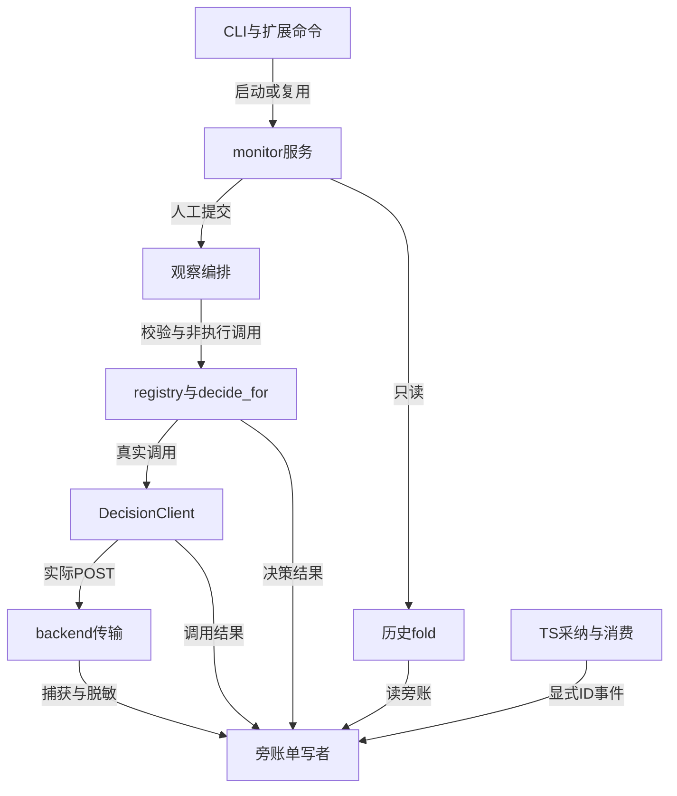
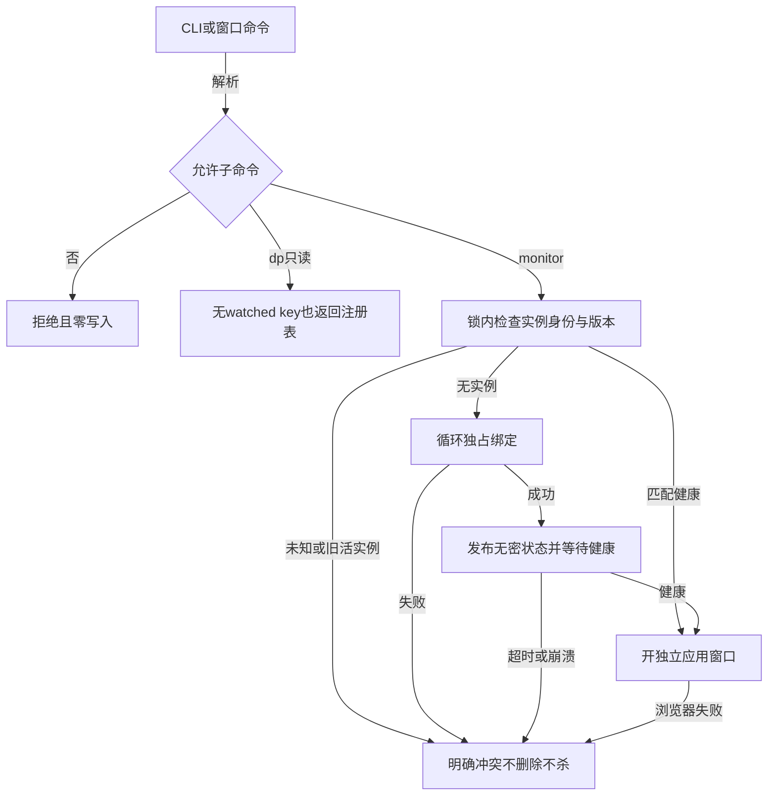
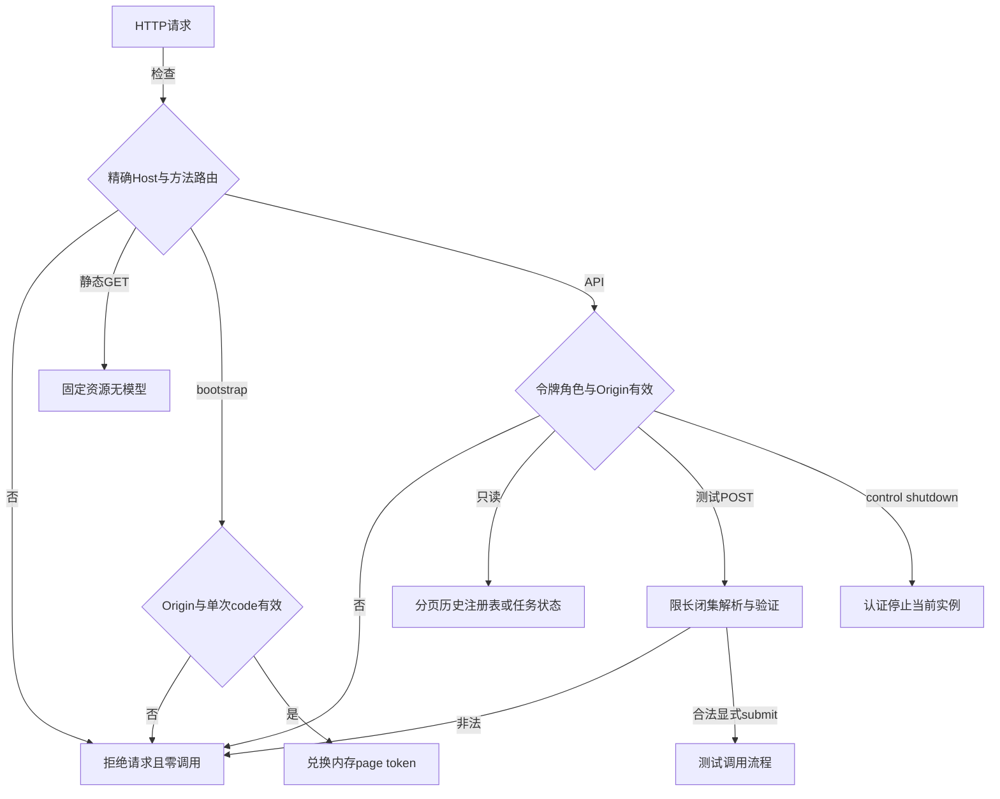
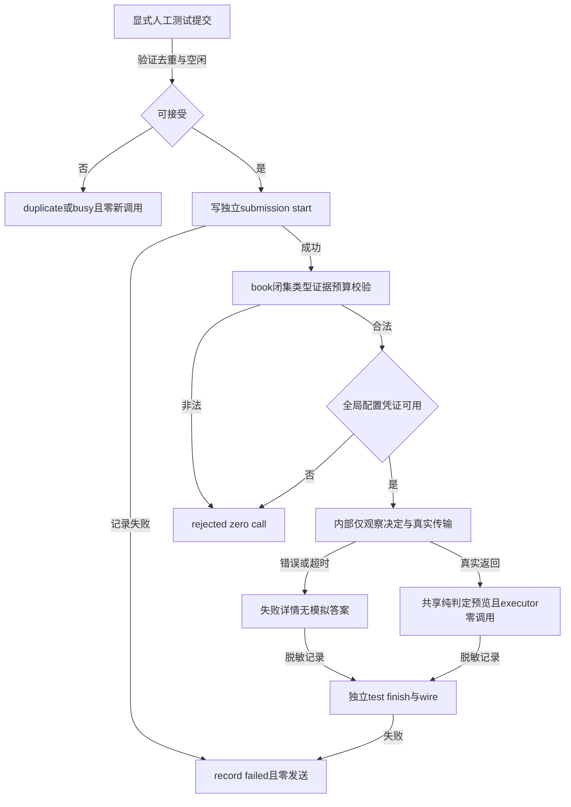
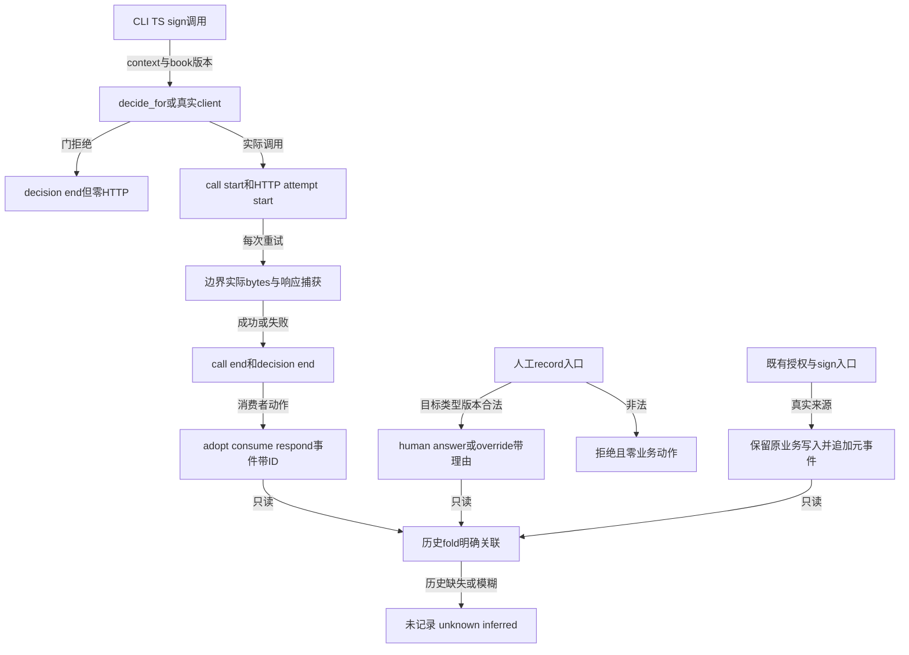

# Design: mw-decision-dashboard

> 状态：设计评审通过。五组研究完成；独立review修订后复审PASS（8/8 closed），报告已完整回读并ack。进入PLAN拆解；未完成实现验收，不得提前编码。

## §0 设计前提锚定
- spec_path: `.agenticdoc/mw-decision-dashboard/spec.md`
- spec_locked_at: 2026-10-22
- ac_count: 17
- ac_ids: AC-001, AC-002, AC-003, AC-004, AC-005, AC-006, AC-007, AC-008, AC-009, AC-010, AC-011, AC-012, AC-013, AC-014, AC-015, AC-016, AC-017
- goal：文件驱动协调、Extension API 集成、进程与凭证隔离、共享追加锁；monitor 不是任务调度器。

## 并行性分析
- 已完成 RQ1 生命周期/访问安全、RQ2 wire/吸收/来源、RQ3 输入契约/观察隔离；三组只读代码、各写唯一证据，PM 串行合并。
- 合并后的RQ4 人工回答/覆盖与dual-root、RQ5 原文安全/锁/context核查已完成；结论与修订见§4.3/3.1/9。相位文档仍由PM写。
- 后续 PLAN 按文件单写者划分：registry/book/points 同一组；wire/backend/client 同一组；monitor 服务与历史读侧分组；CLI mw.py 和 TS ui-bridge.ts 集成必须串行接线。当前另有会话修改 ui-bridge.ts，编码前必须协调，不能覆盖或提交其改动。

## §1 架构选型

### D-001 按需独立 monitor
| 方案 | 优点 | 代价 |
|---|---|---|
| A 独立 Python loopback 服务 | 无 serve/凭证也能看历史，隔离调度服务攻击面 | 自管身份、健康、窗口与停止 |
| B 挂 mw serve | 少一个进程 | serve 凭证暴露面、重启耦合、缺路由凭证时不可用 |
选择 A，不引 Electron。调研 `evidence/research/design-monitor-lifecycle-20261022.md`。
- 仅绑定 `127.0.0.1`，范围 43170..43269；项目规范路径 SHA256 决定循环起点。bind-and-hold，禁止先探测再释放；Windows 禁 reuse_address，SO_EXCLUSIVEADDRUSE；范围全占用明确失败，不杀任何占用进程。
- CLI 启动/复用使用 `.mw/decide-monitor.start.lock`，沿用 mw_common 的 O_CREAT|O_EXCL 协议，显式短重试及250ms monotonic等待预算；只在成功取得锁后release，不自动抢删不确定归属的残留锁。锁冲突明确提示；启动进程spawn/健康等待由持锁调用协调。健康最多等待 5s，调用方预算覆盖该等待及spawn，不能声称3s必返。响应健康需匹配 project_id、instance_id、protocol_version、服务代码指纹，不仅看PID/端口。健康超时不证明已死，不删未知活实例secret或杀进程；不兼容旧实例提示先停止。
- `.mw/decide-monitor.json` 无秘密，原子发布项目身份、实例、PID、端口、协议/代码指纹；`.mw/decide-monitor.secret` 放控制令牌。POSIX 0600，Windows 不把 chmod 当成用户隔离；威胁模型不抵抗同用户恶意本机进程。
- Chromium Chrome/Edge `--app=`，独立项目profile；探测支持的可执行文件，不通过shell拼接。健康成功之后开窗；启动失败不得宣称应用窗口已打开，只给明确原因/安装或选择路径与重新打开方法。普通浏览器回退需要明确声明。
- `monitor status/stop` 用实例认证；stop 仅认证当前实例 POST，不提供通用 kill/force。失败明确保留状态，不能因为HTTP无响应就误杀或清掉活实例。最后窗口关闭不等于服务停止；显式 stop 结束实例，活任务状态保持可解释。
- 崩溃恢复：启动锁内重读并验证状态仍为同一project_id/instance_id；health连接明确ECONNREFUSED且记录PID可证实不存活，才将该实例无密状态/secret移至本实例stale隔离名并重新绑定。PID不存在判定必须支持Windows；无权限/探测失败/PID复用/端口被其他进程占用/健康超时均为unknown，保留不清理且不kill。清理前再次比对实例身份，避免TOCTOU误删新实例。半发布缺PID或畸形状态不可直接猜死亡，明确诊断与人工核验恢复说明。启动锁崩溃残留也须可恢复：锁内记录owner PID/启动身份，仅在owner可证实死亡且重读身份未变时移走；旧无owner/owner未知不抢锁，提供人工确认说明。

### D-002 独立事件旁账
| 方案 | 优点 | 代价 |
|---|---|---|
| A 新旁账，不动旧 archive | 保留决策幂等与签收hash，允许1:N调用 | 新关联/fold与记录失败展示 |
| B 扩旧 decisions schema | 统一载体 | 触及封闭字段/hash/签收，调用会被decision_id折叠 |
选择 A。旧 `_ROW_FIELDS`、链及 `collect` 快照不变。调研 `evidence/research/design-wire-lifecycle-records-20261022.md`；实际复核 `decide_signoff.py:287` 的 counted/snapshots 和 `_http_post` 字节生成/响应读取。
- 生产：`.agenticdoc/_autopilot/decisions-wire.jsonl`、`decision-lifecycle.jsonl`；两者由新 `decision_wire.py` 唯一实现锁/append，不修改旧档案行形状。
- 测试：`.mw/decide-test/{calls,wire,lifecycle,evidence}.jsonl`；测试scope覆盖所有旁账（包括原triage evidence），不只archive=False。
- 不把采集变成决策门禁：生产采集 best-effort、短时锁预算，失败可见告警/返回 capture_status，不改变真实决策结果。测试提交须先成功写submission-start才允许网络；后续记录失败返回明确record-failed，不伪造成功。
- call_id 用 stdlib UUID4，标识一次逻辑 client.decide；attempt_index 每次实际 `_http_post` POST递增（包括后端Retry-After）；decision_id 保留决策级幂等；submission_id 区分页面提交/零调用拒绝；event_id 唯一追加事件。不能将预发送记录叫“确实已发”：它只证明尝试开始，是否到达上游未知。

### D-003 registry 输入契约与内部观察 seam
| 方案 | 优点 | 代价 |
|---|---|---|
| A 必填+可选 typed registry，内部decide_for seam | 单一权威、沿用真实门与传输 | 需同步生成物与身份态测试 |
| B context业务散文，monitor直连client | 局部改动小 | 无类型/必填保证、可丢事实、判定双口径 |
选择 A，context 只作可丢弃散文。调研 `evidence/research/design-dp-observation-contract-20261022.md`。
- `observation` 非空必须同时 `intent=answer`、`archive=False` 且独立record_scope；非法组合 fail-closed。仅显式人工观察可越过每DP disabled；不改变配置，生产默认参数路径保持原门顺序。
- 全局transport显式disabled/未配置/缺凭证仍零发送；页面给配置状态，不自动启用、不改变配置或环境凭证。
- 输入校验/真实state与question构造/传输/答案合法性/confidence仍复用生产；生产授权及动作资格预览来自共享纯判定，当前配置disabled须如实显示。executor永不运行；任意执行器是否最终成功是unknown，而非would-act保证。
- required/optional字段、类型、说明与元素约束从registry同时派生到book/Python/TS与两处生成物。新增21个业务契约改变身份态调用的input-incomplete语义，迁移测试/脚本，不用放宽门掩盖变化。已有dp1/2/3/25不移除字段/截断功能。

### D-004 人工来源与消费事实
选择向前记录显式事件，不以当前默认、mode、available或task头推断成功。无人工入口仅渲染历史不能满足AC-014，需增加最小**记录型**CLI入口（不是执行/授权入口），见§4.3，RQ4核查后锁定。
- 发起者 actor 与答案 answer_source 分开：人工发起ask/观察仍是模型回答；2xx不是模型有效回答证明；来源由真实backend解析类型/API/local分支与原载体提供，不能按available无条件标model。
- 本地dp3复用、refresh、pm-auto settle、自动签收是system；人工回答/覆盖、human授权调整、人工sign是human；未知身份不能按“非conductor-auto”直接认human。
- settle研究冲突已解决：pm-orchestrator.ts 的终态→recordDecisionSettle→append_settle链真实存在；只有pm-auto，不存在人工settle/override生产入口。新人工记录不假称历史已发生。

## §2 核心结构

旁账写者无上游循环import：stdlib模块，脱敏回调/捕获上下文显式传入；必须无回调也fail-closed不落原文，不能默认identity脱敏。

## §3 模块划分
| 路径（packages/multi-workers下） | 职责 | 依赖与消费者 |
|---|---|---|
| decision_wire.py 新 | context、scope、脱敏、限长、锁追加、event构造 | backend/client/points/CLI调用；history读 |
| decision_monitor.py 新 | 进程身份、端口、浏览器、认证HTTP/任务状态 | mw CLI→monitor→history/playground |
| decision_history.py 新 | 旧archive/旁账/gate/sign只读fold、分页/过滤 | monitor读取；无写入业务档案 |
| decision_playground.py 新 | book/registry校验、观察scope、去重和非执行调用 | monitor提交→内部decision链 |
| decision_dashboard.html/js/css 新 | 两页签、表单、详情、显式提交与轮询 | monitor提供固定静态资源 |
| decision_points.py / decision_book.py | typed required/optional闭集、骨架、观察seam/纯预览 | TS镜像、playground、现有调用方 |
| decision_backends.py / decision.py | 实际请求/响应捕获、逻辑call生命周期、evidence scope | 不改变HTTP返回与解析契约 |
| mw.py / decide_signoff.py | CLI入口、book快照/context、人工来源与签收元事件 | 沿用现有sign/auth流程 |
| scripts/gen_decide_registry_ts.py及两处生成物 | registry契约派生 | 现有字节锁测试 |
| TS ui-bridge/mw-runner/triage-client/decision-tool/pm-orchestrator/worker-mode | 只读命令与origin/ID透传；采纳/消费显式event | 不新增通用授权透传 |

### 3.1 项目根
这是本key实现目标而非已有保证：当前写根分散，尤其worker dp3使用cwd、settle显式archive_path。新增resolve_control_root(project_dir, require_control=True)放共享Python根解析模块，仅认可既有project/.agenticdoc/key形态或明确control证据；未知/多义/坏target配置拒绝，绝不mkdir第二套档案。远离control的独立game/partition根不能靠向上两层搜索保证发现control，调用方必须显式提供control根；target启动无法证明归属时明确拒绝，而非猜测。
TS PM从agenticdocRoot推control，worker从controlRootFromTaskPath(taskPath)推control，dp3不传process.cwd()。新monitor/record/观察与其所有写者传同一规范根和project_id；settle保留现有业务语义但检查推导档案路径属于该control，不能信任任意archive_path。HTTP不接受project/path字段或用decision_id拼文件路径。dual-root/partition以真实resolver fixture验证；book外部文件仅CLI显式输入可读取。

## §4 接口与集成

### 4.1 命令
- `mw decide monitor`：启动/复用并开独立窗口；`monitor status`：只读健康状态；`monitor stop`：认证关闭本实例。
- `/mw decide monitor` 与 `/mw decide dp list|show <id>|export`：在watched-key解析前分流；export仅stdout，不允许--write或任意路径。仅这三个dp只读子命令，不允许verify --live/on/off/set/apply/通用尾参数。
- 现有show/sign解析及授权守卫保持；monitor不替代sign，不增加act入口。

### 4.2 HTTP最小契约
固定路由，JSON请求reject unknown keys；响应统一`ok,data,error{code,message,issues},capture_status`，无API凭证。
| 方法 路径 | 权限 | 行为 |
|---|---|---|
| GET / 与固定js/css | 精确Host，无秘密数据 | 静态页面，不触发模型 |
| GET /api/health | 控制令牌 | 项目/实例/版本，复用鉴别 |
| POST /api/bootstrap | 精确Origin及一次code | 兑换page token（唯一允许返回访问令牌的响应） |
| GET /api/history 与 /api/history/<opaque-id> | page token | 全key分页、筛选与详情；路径不是任意文件路径 |
| GET /api/dps | page token | 注册表、有效授权、配置可用状态，只读 |
| POST /api/test/scaffold | page token | dp→骨架，无模型/生产写入 |
| POST /api/test/validate | page token | 解析内存book、字段issue，无模型 |
| POST /api/test/submit | page token | `{dp,book,submit_id,observe_only:true,retry_of?}`，显式调用 |
| GET /api/test/submissions/<uuid> | page token | 任务结果/阶段、测试wire详情 |
| GET /api/test/history | page token | 仅独立测试记录 |
| POST /api/shutdown | control token | 不接受page token，不执行任意命令 |
服务器从dp/书内数据生成trigger，拒绝executor、archive、act、授权修改与客户端声明actor/project/write路径。submit_id同一实例内强去重并持久化start→重复点击零新增调用；任务最多1个执行+0排队，忙返回409，不由轮询重试。失败重试必须新的submit_id并显式retry_of。

### 4.3 人工与生命周期记录入口（新增记录型CLI，待RQ4复核）
- `mw decide record answer --decision-id <id> --input-file <json>` / `record override ...`：用户显式调用，校验目标、questions_version、回答类型/候选闭集、理由及原决策/调用引用；只追加lifecycle人工事件，不调用模型、executor、不改授权，不冒充已消费。无目标拒绝、不猜最近决策。
- CLI不把ask当human answer；为ask新增调用context写者，actor=human表示显式发起，answer_source仍来自真实backend。人工record要求decision_id与ref_seq精确命中生产decide档案（answer/override均必填），questions_version同时匹配目标与当前registry；不新增allow-stale-questions逃生开关。override必须supersedes明确目标调用或档案引用，call_id存在时验证同project/decision，不接受悬空引用或客户端自报verified。
- 动态候选：questions_version不含当次候选，旧digest不能还原。新调用在生产旁账保存脱敏后的当次渲染question/candidate快照及版本（非book调用也必须保存输入材料，标input-state而不是伪造book）；目标call快照或同hash当次book快照能证明候选时校验闭集；旧材料无法验证时明确拒绝动态答案并提示材料未记录，不接受unverified候选当合法覆盖。静态旧档案可按匹配版本校验；call-only暂无人工改判入口，仍可看历史。
- HTTP不提供answer/override/授权接口；前端展示记录/理由/应答关联，并提示CLI格式。新记录只补可追溯事实，不构成业务授权；业务消费要独立写consumed/response事件。
- `mw decide record event --project <control> --input-file <json>` 是TS内部固定system事件入口，kind闭集与来源不可由输入改写；经mw-runner隐藏子进程、异步等待短预算（不照搬spawnSync阻塞20s），stdin/临时文件送脱敏有限JSON，由Python decision_wire唯一追加。失败写脱敏trace告警不改变主流程；CLI固定actor是声明性来源，不是抵抗同用户伪造的安全认证。
- dp1 task头写成功→adopted，dp2 steer落盘→adopted、worker注入+marker→consumed，dp3 sendUserMessage实际成功→steered（不声称agent已读）。真实回答产生后若有可靠ID传播则responded，无ID只保留旁证inferred，不能自动以最近调用关联。本地dp3无档案用local-decision事件明确标source=system，不套人工ref_seq校验。
- dp25 sign按signed_via/fallback记录来源；dp apply沿用既有授权守卫，追加authority-applied引用所用签收证据但不谎称该签收此刻由人签发。refresh始终system。authority=human机器升级不能证明人工。
- human来源不是“CLI调用就必然人”：内部自动调用走system入口；显式record入口记录actor_kind=human、actor_id=user-explicit（无OS身份认证的局限明确）；既有sign用signed_via/fallback精确分类。refresh始终system。
- record输入闭集schema_version/decision_id/ref_seq/questions_version/answers/reason/supersedes/call_id?/idempotency_key，body<=64KiB，reason非空<=512B且脱敏，未知键拒绝；同幂等键及相同body返回已有event，键复用不同body拒绝。校验完成再锁内check-and-append，人工写失败非零退出且不返回成功。human-answer/override行不设available/acted/outcome/settled_by；旧fold/collect/report/verdict完全不读新旁账，不能使记录变授权或自动消费。

### 4.4 事件schema与写入语义
公共：`schema_version=1,event_id,ts,kind,scope,project_id,key?,task_key?,decision_id?,call_id?,submission_id?,origin,actor{kind,id},answer_source?,capture_status`。缺失值null而不是填默认事实。
- submission-start/end：独立测试提交、本版本、校验issue、outcome、retry_of、zero_call；预检拒绝也可查，不计模型call。
- call-start/end：每次逻辑client调用id、normalized结果、客户端attempts、真实wire_attempts、reason/latency/model/transport；client disabled零POST不能称真实HTTP调用，UI分别显示逻辑call/HTTP attempts。
- attempt-start/end：call_id+attempt_index、capture_status、method、url_path（无userinfo/query秘密）、header_names（无值）、request/response文本、len、sha、status/content-type/retry-after、latency、error、usage与usage_source。
- decision-end：decision_id、call_id nullable、实际mode/intent/status/escalated_reason、archive created/replayed/skipped/failed/unknown、state_digest/questions_version、truncated路径。现有(archived,replayed)不足覆盖四态，不能由False/False猜skipped：archive=False显式skipped，明确成功分别created/replayed，归档异常捕获记录failed后沿用原异常，模块不可用/未归档原因不明记unknown；需要新增观测信号但不改变业务返回。
- book-snapshot：从加载的同一份bytes生成脱敏book正文与file版本引用；secret检测失败零发送/不落原值。HTTP书是内存文本，ref注明input-memory；不把后来磁盘文件冒充当时版本。
- lifecycle：suggested/adopted/consumed/responded/human-answer/human-override/authority-change/signoff/settled；target/supersedes关联、actor与实际reason/answer/证据/结果。建议、采纳、消费、应答、执行分列，未写事件不假报成功。旧task/trace无显式ID的关联一律inferred。
- pre-send事件仅证明attempt-started；有end且HTTP状态才证明响应，异常显示未收到响应；无end显示unfinished/未记录，不能断言上游没收到或取消无费用。

### 4.5 全25 DP输入契约
以下为设计新增业务字段，非声称现有自动生产者都已接通；DP ID已在实际DP_REGISTRY核对，之前PM称dp21/dp22简称非实际ID的判断撤回。每项描述/evidence应解释事实来源，不能替人自动填false/[]。
- dp1/dp2/dp3/dp25：保留当前REQUIRED_STATE_FIELDS与说明；dp2可选progress.writes/uniq_targets/repeat_top/trend/last_land_age_min，dp1已有history/scope.images_required等按实际使用声明。dp3 local_candidates保留已有动态enum约束。
- 统一新增边界：integer非bool，计数/规模默认>=0，`snapshot.delta_bytes`为带符号integer（新规模减旧规模，允许负数）；bool严格；string非空UTF-8最多512B（摘要/指令仍可能被总预算拒绝）。数组max_items按registry逐字段声明，新增普通数组默认32，dp17 spec.ac_ids/ac_changed为128（覆盖本key17条AC），新增普通string元素最多128B；enum按下面值闭集；整体state仍按当前2000B或内部有效预算硬校验。错误指出路径，不静默裁必填事实。已有字段既有截断/上限不在本key移除。
| DP | 新必填业务字段（全部需类型+说明+evidence） |
|---|---|
| dp4-failure-handling | failure.kind enum transient/deterministic/infra/unknown，attempt/limit integer，artifact_present bool |
| dp5-test-triage | test.failed_cases/baseline_cases/changed_paths string[]，repro_consistent bool |
| dp6-qg-verdict | qg.checks_total integer，checks_failed/blocking string[]，scope enum impl/spec |
| dp7-gate-failure | gate.name string，missing_items string[]，verdict_age_hours integer，has_config_error bool |
| dp8-scope-change | scope.requested_paths/write_scope/cross_key_conflicts string[]，requirement_delta string |
| dp9-model-select | model.requested string，available string[]，transport_status enum ok/rate-limited/unavailable |
| dp10-dependency | dependency.name/current/target string，breaking/reviewed bool |
| dp11-credential | credential.provider/kind/scope string，exposed_to string[]；凭据值禁收 |
| dp12-destructive | action.command string且脱敏，targets string[]，reversible/backup_available bool |
| dp13-commit-release | release.version_current/version_next string，staged_paths string[]，changelog_ready/ci_green bool |
| dp14-rule-conflict | conflict.user_instruction/rule_ref string，rule_strength enum hard/advisory，irreversible bool |
| dp15-autopilot-gate | gate.kind enum取已有6类门权威，pending_items/evidence_refs string[]，age_minutes integer |
| dp16-goal | goal.current_digest/proposed_delta string，alignment enum aligned/drift/conflict |
| dp17-spec-lock | spec.ac_ids/ac_changed/open_questions string[] |
| dp18-claim | claim.key/owner string，heartbeat_age_min integer，owner_active bool |
| dp19-foreign-write | write.target_path/cross_key_owner string，write_scope/foreign_paths string[]，allow_foreign_write bool（仅事实，不授权） |
| dp20-stage-close | stage.id string，tasks_done/tasks_total integer，open_blockers/evidence_refs string[] |
| dp21-refine | refine.clause string，impact_paths string[]，reversible bool |
| dp22-debug-plan | debug.signal/last_green_ref string，repro_available bool，change_scope string[] |
| dp23-snapshot | snapshot.size_bytes/delta_bytes integer，sections_changed string[] |
| dp24-pi-trust | project.path string，trust_state enum untrusted/trusted，origin enum user/clone/foreign，pending_changes bool |
每DP plus结构身份；未知路径/类型拒绝。数组元素约束、跨字段done<=total/available<=total等由registry校验，证据取自人工书输入，monitor为写者，book/state/backend为读者。合法值并不保证所有业务规模能塞入预算，超限明确拒绝；骨架是待填写占位而非可直接发送的默认事实。

## §5 Function Flow
### 5.1 命令、复用与窗口

status/stop使用同一身份链；认证shutdown成功才正常清理，不接收普通页令牌。

### 5.2 所有HTTP输入

validate/scaffold不走U；任务轮询不能触发submit；所有未知字段拒绝，不解析任意文件路径。

### 5.3 观察与异常出口

服务停止/进程被杀时start但无finish显示unfinished，无法撤销在途urllib请求，不提供虚假cancel成功。

### 5.4 生产捕获与来源补齐

采集写失败告警并返回capture_status，不回填原文；生产业务结果不能因旁账失败改变。

## §6 Coverage Matrix
| ID | 功能点 | 正常路径 | 边界 | 异常 | 层级 |
|---|---|---|---|---|---|
| F1 | 窗口只读命令 | 无watched key列25DP | export不写/旧sign | on/off/set/apply/未知参数拒绝 | L1/L2 |
| F2 | 独立应用窗口 | 健康后开2页签 | 重开复用/范围占用 | 无浏览器/旧实例/绑定失败 | L1/L2 |
| F3 | HTTP认证 | bootstrap兑换/只读/显式提交 | code重放/角色区分 | Host/Origin/token/XSS/超大体 | L1/L2 |
| F4 | 25DP契约 | 真骨架合法填写 | enum/元素/预算/optional | 身份态/未知/错类型/密钥拒绝 | L0/L1 |
| F5 | 内部观察 | 合法disabled/P0真实链 | 全局disabled/重试 | 非法/缺凭证/超时/记录失败 | L1/L2 |
| F6 | wire旁账 | 原字节边界/真实响应 | 多重重试/幂等decision | 非UTF8/半行/锁冲突/采集失败 | L1/L2 |
| F7 | 吸收与人工 | explicit ID actor answer/override | 本地决策/auto-sign/refresh | 失去消费/落盘失败/旧无ID | L1/L2 |
| F8 | 历史fold与隔离 | 跨key筛选详情 | 历史缺失/dual root/分页 | 并发尾行/未知schema/记录不可写 | L1/L2 |

## §7 Verification Contract
所有计划验证均未执行；L2本地真实HTTP不等于真实Jev。网络mock仅控制上游返回，不能mock掉被验收的内部函数或真实捕获边界；真实Jev测试单独人工显式提交，不由check/普通测试触发。

VC-001: 无watched key，窗口dp list结果DP集合等于Python CLI的25项，unknown_sub=0；on/off/set/apply与export --write拒绝、授权写入=0，原sign路由不变。
       Layer: L1/L2
       Output: [VERIFY] VC-001: dp_count=25 unknown_sub=0 forbidden_writes=0
       Source: AC-001, AC-017
VC-002: 两key、human/model/system/unknown与多状态真实载体经history API展示，默认全部且key/DP/source/status筛选精确，测试行不在生产统计。
       Layer: L1/L2
       Output: [VERIFY] VC-002: missing_rows=0 filter_mismatches=0 test_rows_in_production=0
       Source: AC-002, AC-013
VC-003: 真CLI --book→内部decide_for→本地HTTP→TS采纳/消费/应答生产入口，book版本和wire/call/decision/lifecycle ID一致；未发生环节显示未记录，不能手拼fixture事件代替接线。
       Layer: L2
       Output: [VERIFY] VC-003: explicit_links=complete false_consumption=0 pending_stages_labelled=true
       Source: AC-003, AC-012
VC-004: 观察合法书通过真实内部client/backend；本地HTTP确认请求/返回，executor spy=0；人工在实际Jev配置下显式提交并记录真实结果证据，不以本地server代替该证据。
       Layer: L2
       Output: [VERIFY] VC-004: internal_path=real executor_calls=0 jev_evidence=present
       Source: AC-004
VC-005: request/response/book/自由理由/错误含测试secret与已知配置secret，持久化和API/DOM原值出现=0；redacted/truncated/capture-failed明确，无法安全脱敏不落原文。
       Layer: L1/L2
       Output: [VERIFY] VC-005: secret_occurrences=0 capture_markers=present
       Source: AC-005, AC-016
VC-006: CLI与窗口命令在安装Chrome/Edge的当前Windows环境打开真实独立应用窗口，2页签、127.0.0.1与43170..43269；留下人工操作/窗口证据，argv单测不代替窗口验收。
       Layer: L2
       Output: [VERIFY] VC-006: app_window=true tabs=2 bind=127.0.0.1 port_in_range=true
       Source: AC-006
VC-007: 独占范围首端口则换端口，范围全占用明确失败；重复打开复用匹配实例，无浏览器/旧实例/超时不假报成功且未kill/删除活实例秘密。实例崩溃留状态/secret及带owner启动锁后，ECONNREFUSED+可证实PID死亡可安全恢复；身份变化/PID复用/权限未知/仅健康超时不误清理。两个不同control根同时启动各自实例，项目状态/令牌隔离、端口不冲突，关闭一个不影响另一个。
       Layer: L1/L2
       Output: [VERIFY] VC-007: unrelated_kills=0 false_success=0 identity_checks=pass stale_recovery=pass project_crosstalk=0
       Source: AC-007
VC-008: 隔离项目先由真实sign产生签收，再执行成功/非法/disabled/P0/429/超时测试；授权、decisions、回执、sign、生产triage/wire字节与collect计数/hash均不变，测试旁账存在。多进程fixture证明test scope不泄漏到production scope。
       Layer: L2
       Output: [VERIFY] VC-008: production_bytes_changed=0 signoff_hash_changed=0 test_records=present
       Source: AC-008, AC-010
VC-009: 全25 registry→scaffold→完整人工测试值通过check，业务字段非空；dp17完整17条AC输入及dp23负delta通过，字段max_items边界与总预算分别校验；删除必填/未知键/元素错型/enum错/超限各零HTTP；generated export与TS字节锁通过，dp2真实producer可选字段可通过。
       Layer: L0/L1
       Output: [VERIFY] VC-009: dp_count=25 identity_only_passes=0 bad_type_passes=0 mirror_drift=0
       Source: AC-009, AC-011
VC-010: 每DP disabled/P0合法观察在全局配置可用时实际POST>=1，actor=human observe_only=true，executor=0；相同授权下生产disabled实际POST=0，授权字节不变；全局disabled/未配置观察也POST=0。
       Layer: L1/L2
       Output: [VERIFY] VC-010: observe_enabled=true executor_calls=0 production_disabled_posts=0 global_disabled_posts=0
       Source: AC-010, AC-017
VC-011: 非法书/缺凭证/上游429拒绝/超时/响应错型分别返回明确outcome，无模拟答案；前两类POST=0；测试start写失败POST=0，后续采集失败record-failed但不谎称未发送。
       Layer: L1/L2
       Output: [VERIFY] VC-011: invalid_posts=0 synthetic_success=0 outcomes=explicit
       Source: AC-011, AC-016
VC-012: 同decision_id两次真实调用产生2 call_id但1生产decision，后端Retry-After与client重试每次POST有attempt；页面同submit_id重复零新调用，新retry_of保留；计数不以档案行推算。
       Layer: L2
       Output: [VERIFY] VC-012: calls=2 decisions=1 lost_attempts=0 duplicate_submit_posts=0
       Source: AC-012, AC-016
VC-013: 旧无wire/book以及无显式ID的trace样例逐项未记录、unknown/inferred；payload重建次数=0，无start-end证明时不声称已收到/未收费/已执行。
       Layer: L1
       Output: [VERIFY] VC-013: fabricated_raw=0 inferred_unlabelled=0 false_execution=0
       Source: AC-013, AC-012
VC-014: 从真实record answer/override、dp授权CLI、sign cli/tui、refresh与auto-sign入口各执行一次；event目标/理由/版本/actor正确、覆盖不覆写原记录；机器标human=0，record入口业务动作=0。
       Layer: L2
       Output: [VERIFY] VC-014: human_events=4 machine_as_human=0 override_business_actions=0
       Source: AC-014, AC-003
VC-015: 实际HTTP坏Host/Origin/跨站Sec-Fetch-Site/无token/错误角色/boot重放/超体/执行参数拒绝，模型POST=0；页面打开/轮询/刷新POST=0；XSS载荷不能运行脚本或偷取token。
       Layer: L2
       Output: [VERIFY] VC-015: unauthorized_posts=0 passive_posts=0 xss_execution=0
       Source: AC-015, AC-017, AC-005
VC-016: 用本地server比较收到的原始请求bytes与边界捕获（脱敏前内存断言，不落secret）；实际响应原bytes在解码前捕获，UTF8损坏明确decode标记，usage缺失不估计；成功/拒绝/重试/超时每attempt元数据齐全。
       Layer: L2
       Output: [VERIFY] VC-016: boundary_byte_mismatch=0 lost_attempt_metadata=0 fabricated_usage=0
       Source: AC-016, AC-003
VC-017: 生产记录写入异常与短时锁超时不改变原决策结果；半行尾、未知schema、坏JSON读侧告警不崩溃；并发其他会话写入只显示concurrent-change不归因测试污染。
       Layer: L1/L2
       Output: [VERIFY] VC-017: business_result_changes=0 reader_crashes=0 false_isolation_blame=0
       Source: AC-008, AC-011, AC-016
VC-018: dual-root/partition真实resolver从target启动与control启动均读同一历史/写同一scope；HTTP夹带project/book路径拒绝且越根读写=0。
       Layer: L2
       Output: [VERIFY] VC-018: archive_roots=1 foreign_reads_writes=0
       Source: AC-002, AC-008, AC-015

## §8 AC → VC 映射表
| AC ID | AC摘要 | 对应VC | 路径分类 |
|---|---|---|---|
| AC-001 | 无key窗口dp一致 | VC-001 | 正常/边界 |
| AC-002 | 全项目历史与筛选 | VC-002, VC-018 | 正常/部署 |
| AC-003 | 本/调用/吸收/应答关联 | VC-003, VC-014, VC-016 | 正常/缺失 |
| AC-004 | 内部真实Jev不执行 | VC-004 | 正常/部署 |
| AC-005 | 全面脱敏与安全显示 | VC-005, VC-015 | 安全/异常 |
| AC-006 | 真应用窗口和高位loopback | VC-006 | 部署 |
| AC-007 | 占用复用浏览器异常 | VC-007 | 边界/异常 |
| AC-008 | 测试隔离签收 | VC-008, VC-017, VC-018 | 正常/并发 |
| AC-009 | 25 DP业务契约 | VC-009 | 正常/类型/预算 |
| AC-010 | disabled/P0仅观察 | VC-010, VC-008 | 权限/隔离 |
| AC-011 | 明确失败与零非法调用 | VC-011, VC-009, VC-017 | 异常 |
| AC-012 | 调用幂等与消费事实 | VC-012, VC-003, VC-013 | 重试/缺失 |
| AC-013 | 旧缺失与inferred | VC-013, VC-002 | 旧数据 |
| AC-014 | 人工与机器来源补齐 | VC-014 | 正常/来源 |
| AC-015 | 外部拒绝与被动零调用 | VC-015, VC-018 | 安全 |
| AC-016 | 真实传输与异常标记 | VC-016, VC-012, VC-005, VC-011, VC-017 | 正常/重试/异常 |
| AC-017 | 无授权执行透传 | VC-001, VC-010, VC-015 | 负向/回归 |

## §9 非功能实现方案
- HTTP访问：精确Host=127.0.0.1:port，Origin只允许本实例（POST bootstrap/submit/shutdown必须），拒绝cross-site；CLI控制请求按独立control令牌允许无Origin，不能把此例外给普通page令牌。无CORS、无Cookie，自定义认证头；方法/路由闭集。
- 令牌：256bit控制密钥存本地secret，60s单次boot code可经URL fragment开窗兑换page令牌；fragment立即清除，长期令牌不进URL/argv/日志/状态，page token仅内存。boot code短时argv泄漏为明确同用户威胁边界。页令牌不能shutdown或签发code，重开走CLI控制请求；所有令牌重启失效。
- 采集安全补充（RQ5）：已知secret集合必须包含实际Authorization值、当前cfg.extras.api_key与实际解析到的timi凭证，再加环境凭证和既有模式；凭证只在内存注入，不写header值，不为采集额外遍历无关provider凭证。book/自由理由输出也使用该安全集合，不能仅依赖当前env启发式_redact。
- 成功response.read和HTTPError exc.read均在decode之前捕获；read失败与真实空body区别记录error_class=response-read，不假称空响应。原解析的errors=replace语义不被采集改变；非UTF8捕获可用latin-1字节视图，encoding/decode_errors明确，安全处理失败只留元数据。
- call_id只能由逻辑client.decide创建，_http_post只读CallState递增attempt_index，保持四参函数签名。显式WireScope传入执行线程并在其内部绑定ContextVar，finally reset；probe无CallState零写账。不采纳“ContextVar是唯一可能方案”的过度论断，只选其为最小接线方案。
- 测试必须显式构造DecisionClient(evidence_path=<独立test>)并绑定test scope，不能让decide_for自建默认client；同一scope覆盖wire/lifecycle/evidence，缺少安全test scope拒绝调用，不fallback生产。
- capture_status通过scope错误聚合、客户端观测属性、旁账及monitor HTTP信封暴露，不为了采集给冻结的decide响应dict增键；所有行无法写入时至少有脱敏告警/HTTP状态，不能承诺旁账必能标自身写入失败。
- 内容：外置固定JS/CSS、CSP default-src 'none'，script-src/style-src/connect-src 'self'，base-uri/form-action/frame-ancestors 'none'，禁inline/eval，nosniff、Referrer-Policy no-referrer；DOM只textContent，不拼innerHTML。输出secret扫描同一安全策略，敏感header值永不采集。
- 边界捕获：request从实际data，response从实际read bytes（当前HttpResponse.body是decode替换后的str，必须在_decode_bytes之前捕获）。持久化只有脱敏文本，sha明确命名captured_redacted_sha256，不能把含secret的原文hash当公开原文证明；raw_len是字节长，decode_errors/redactions/truncated均标记。
- 捕获限长：每事件默认64KiB序列化后总UTF8预算，request/response每段最多24KiB；原解析仍读取全量响应，不新增上游read cap改变功能。采集须在完整已读bytes视图上识别已知secret，再裁脱敏文本；如出于内存预算仅处理head切片，不能靠固定64B尾窗保证任意长secret安全，必须验证边界或整段omit（text_omitted=true），fail-closed优先。JSON转义后再次测行长，确定性缩减文本并重算stored_len/hash，仍超只留有限元数据。wire_len=原bytes长，stored_len=明确encoding回编码的捕获文本长，captured_redacted_sha256只hash最终存储文本；byte_exact仅无脱敏/截断/解码错误时true。state_digest只用于规范state/档案关联，不是HTTP请求字节证明。
- HTTP body最多256KiB，分页默认50最多200，无任意路径路由；reader增量读至完整行边界，损坏行/未知版本计数可见；不把坏行伪造成成功。历史刷新不触发模型。
- 追加锁：O_CREAT|O_EXCL同一文件锁、O_APPEND无缓冲os.write计数循环、fsync，锁中不执行网络。RQ5纠错：现有默认指数等待0.05*(2^20-1)=52428.75s，约14.6h，绝不能用于采集；采用显式retries=5/base_delay=0.008并加入单次acquire的monotonic deadline预算250ms（不把OS调度与fsync计入严格硬实时保证）。每逻辑调用采集失败后停止反复等锁，聚合一次告警，防多事件叠加长等待；acquire成功才release，绝不抢删活锁。锁内修复dangling tail只补换行、不删原字节；short-write后失败可见，下一追加不粘行。
- 测试scope显式绑定client与observer上下文，不依靠线程默认contextvar传播；1执行任务避免共享client竞争；测试任意失败不得fallback production路径。幂等start发布锁中进行，提交日志失败零发送。
- 运行时前后文件指纹变化不能当isolation violated归因本次调用；可显示concurrent-change，真正字节不变由隔离fixture＋写面spy证明。不能持生产锁等待网络。
- 测试无自动重试付费提交；传输原有重试预算照旧、每次attempt可查；在途停止/进程崩溃显示unfinished，上游是否收到与费用unknown。

## §10 决策记录与未冻结项
| D-ID | 选择 | 否决 | 理由 |
|---|---|---|---|
| D-001 | 独立monitor/Chromium app | serve耦合/Electron | 调度凭证与可用性隔离 |
| D-002 | 新旁账/独立test scope | 改archive schema | 幂等/签收不变 |
| D-003 | typed registry/internal seam | 散文业务事实/直连复制门 | 一份输入与判定契约 |
| D-004 | 显式人工与消费元事件 | 历史推断当事实 | 完成AC-003/014真实写者 |
- 已撤回错误PM判断：dp21-refine/dp22-debug-plan确为实际ID；HTTP attempt-start不能保证已发出；2xx/available不能无条件当model来源。
- RQ4/RQ5修订已收口；monitor统一status/stop子命令，不采用研究--status/--stop候选；HTTP统一opaque-id详情，不采用decision_id路径段。
- 不采纳研究“动态候选永远无法事后校验”：对旧缺失材料确实不可，对新增当次candidate快照可以；需PLAN优先实现快照写者与record读者。未知自定义凭证无法由现有启发式普遍识别，AC-005验证必须包含实际配置凭证、认证字段和已知模式，UI提示禁止输入任意凭据值，不能宣称任意未知字节都可识别。
- 新增字段是设计选定输入，不是假称现有自动接线；不改变业务执行器功能。待用户设计审核，推进PLAN仍须advance_phase门禁。
- 人工记录旧版本限制必须在详情/CLI错误中明确：问题版本已变，无法按当前registry校验旧答案，拒绝新增人工改判；这不表示旧记录消失，历史照常可看。骨架展示每字段max_items/长度及总state预算，不能暗示上限内所有组合都必然符合总预算。
- 独立review报告 `workers/dd-review-spec-design/report.md` 原结论CHANGES_REQUIRED，2 P1/6 P2。修订复审 `workers/dd-review-followup/report.md` PASS，8/8 closed，无新增P1/P2；已完整回读并ack。这是设计文本评审通过，不是实现/真实窗口/Jev/并发验证通过。
- PLAN接纳四条非阻塞建议：记录PID启动时间用于身份核对（unknown仍保守）；所有不自动清理出口附人工恢复指引；stale的json/secret移动非原子对，指定移动顺序及中断处理；自由文本数组元素长度逐字段声明，而非一律128B。
- 当前无代码/配置变更、无真实模型调用、无构建、无提交；真实应用窗口/实际Jev/Windows锁/双根接线仍是实施验收项，不能用研究结果宣称通过。

## 调研索引
- `evidence/research/design-initial-constraints-20261022.md`
- `evidence/research/design-monitor-lifecycle-20261022.md`
- `evidence/research/design-wire-lifecycle-records-20261022.md`
- `evidence/research/design-dp-observation-contract-20261022.md`
- `evidence/research/design-wire-safety-gap-20261022.md`（已完整回读；采集凭证盲点、默认锁14.6h、test evidence_path与返回状态通道修订；VC-R1..10纳入VC-005/008/012/015/016/017）
- `evidence/research/design-human-roots-gap-20261022.md`（已完整回读；人工记录/根解析/TS单写者传输/动态候选修订；VC-R4-1..8纳入VC-003/009/013/014/018）
