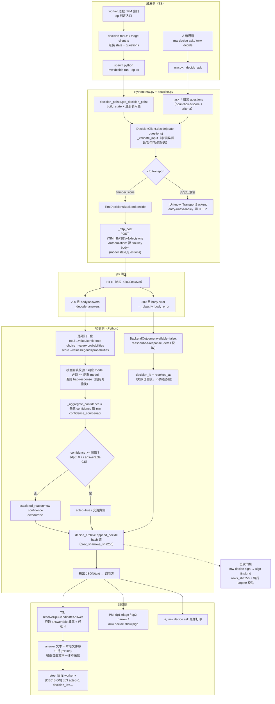

# jev 三类问题实跑报告（noul / choice / score）+ 调用链与配置现状

时间 2026-10-21 14:4x，构建 `version=0.83.0`，transport `timi-decisions`，model `jev-latest`。
状态文本取自本 key 的真实开发记录（`pm-state.md` / `achieved.md` / `decisions.jsonl`）。
原始请求/响应：本目录 `A-noul.json`、`B-choice.json`、`C-score.json`、`cases.json`。
复跑脚本：`python .agenticdoc/mw-decision-substitution/evidence/runs/jev-cases-20261021/run_cases.py`。

## 共同输入（state，逐字）

```
key=mw-decision-substitution（决策模型替换 jev）。阶段 EXECUTE，主体 T-01..T-10 全 done，FIX-A..Q 全落地；
decide 相关九套件 397 passed；packages/ai 6 passed；tsgo rc=0。
本仓决策配置：transport=timi-decisions、model=jev-latest、dp1/dp2/dp3 enabled=true mode=auto。
权威档案 .agenticdoc/_autopilot/decisions.jsonl 共 25 行：seq1-24 是 refresh 授权行，
seq25 是唯一一条真 jev 决策行（dp3-worker-clarify:mw-decision-substitution、available=true、acted=false、
escalated_reason=low-confidence、transport=timi-decisions、model=jev-latest、confidence_source=api、latency_ms=1055）。
签收门禁要求：N>=1、hash 链闭合、每行 engine=timi-decisions/jev-latest/api。
done 门禁当前 3 条 FAIL 全部指向缺失的 evidence/review/sign-final.md。
构建：mw build --install --allow-dirty 已成功；工作树仍有 9 个未提交的 tracked 改动。
已知残留：FIX-Q 的 signed_via 逻辑落在 mw.py 两个 helper（原计划 decide_signoff.py，被 write_face 头挡）；
score 型问题在 24 个注册 dp 里没有任何一个使用；per-dp 配置只有 tier/enabled/mode/note。
```

## Case A — noul（二值）

问题：`仅凭 state 中给出的档案事实，现在是否已满足 continue 签收的三项硬条件（N>=1、链闭合、每行真 jev）？`
criteria：`true` = 三项全满足且 seq25 engine 是 `timi-decisions/jev-latest/api`；`false` = 仍有条件不满足。

jev 反馈（1017 ms）：

```json
{"signoff_ready": {"value": 0.31, "confidence": null}}
```

读法：`value` 就是 `P(true)`。0.31 表示 jev 认为**大概率不满足**。

接收与应用：注册表里同类问题（dp3 `answerable`）在 TS 侧按
`if (answerable < DP3_ANSWERABLE_MIN /*0.5*/) → escalate("unanswerable")` 消费；聚合置信取各题 min，
0.31 < 0.7 → `escalated_reason=low-confidence`，交人判，模型不动作。

PM 判断：**接受这个否定**。seq25 自己就是 `acted=false` + `escalated_reason=low-confidence` 的行，
用它当"决策质量已达标"的证据本来就牵强；N=1 也只说明链路通，不说明决策可用。签收与否仍应交人。

## Case B — choice（有序多选）

问题：`done 门禁三条 FAIL 都指向缺失的 evidence/review/sign-final.md，下一步选哪条路？`
选项（带 criteria）：`sign_now` / `narrow_scope`（删 decision-scope.md 收窄范围）/ `allow_empty`（`--allow-empty` 留痕）。

jev 反馈（1024 ms）：

```json
{"gate_next": {"value": "allow_empty", "confidence": 0.30,
  "probabilities": {"allow_empty": 0.53, "narrow_scope": 0.17, "sign_now": 0.30}}}
```

接收与应用：`value` 是选中键，`probabilities` 逐项概率，`confidence` 是官方字段（不是模型自述）。
TS 消费侧**只取 id**：拿 `value` 去匹配本地候选集合，未命中就 `escalate("low-confidence")`；
命中也还有 `prob < DP3_MIN_CONFIDENCE(0.7)` 的闸。本题 0.30 → 直接上抛。

PM 判断：**不采纳**。`allow_empty` 会把"零决策"合法化，与用户裁定（continue 需 N≥1 且每行真 jev）冲突；
0.53/0.30 的低分也说明 jev 没有稳定倾向。继续走 `sign_now`，签收由人点。

## Case C — score（有序档位）

问题：`剩余工作量的档位`：`0=已可收尾（只等签名）`、`1=只差证据或文档补齐`、`2=还差实现或测试`。
（low→high = 剩余工作越多）

jev 反馈（1275 ms）：

```json
{"remaining_work": {"value": 1.7, "confidence": 0.55,
  "probabilities": {"0": 0.01, "1": 0.28, "2": 0.71},
  "legend": {"0": "已可收尾（只等签名）", "1": "只差证据或文档补齐", "2": "还差实现或测试"}}}
```

读法：`value` 是连续分（1.7，接近档位 2），`legend` 是入参档位回显，`probabilities` 是各档概率。

接收与应用：score 型答案在框架里没有消费者——**24 个注册 dp 全部是 noul/choice**（`dp1..dp24`），
score 只有 `mw decide ask --score` 这条人用通道；后端 `_score_criteria` 与答案归一化是通的，
缺的是"哪个 dp 用它 + 阈值映射"。0.55 < 0.7 同样会 `low-confidence` 上抛。

PM 判断：**部分采纳**。档位 2 的概率 0.71 与我的清点基本一致（真差的是签收与提交、不是实现），
但"档位 2"的标签在本题里指"还差实现或测试"，说明这题的问法把"收尾动作"和"实现"混在一起，
是题目设计问题不是 jev 判错——正好印证 D-044（问题文本质量决定答案质量）。

## 对照：高置信那次（可动作的一侧）

同一天同一条通道，`request-a.json` 的工单三题：`urgent` noul 0.87、`dept` choice 0.95~0.98、
`frustration` score value≈0.99 confidence 0.97。那组会因为全部 ≥0.7 而 `acted=true`。
差别不在传输，在问题是否落在一个明确判据上。

## 汇总

| case | 类型 | jev 输出 | 聚合是否过闸(0.7) | 框架动作 | PM 采纳 |
| --- | --- | --- | --- | --- | --- |
| A | noul | `value=0.31` | 否 | escalate low-confidence | 采纳（否定结论） |
| B | choice | `value=allow_empty`, `conf=0.30` | 否 | escalate low-confidence | 不采纳 |
| C | score | `value=1.7`, `conf=0.55` | 否 | escalate low-confidence（且无 dp 消费） | 部分采纳 |

三次调用 1017 / 1024 / 1275 ms，`model` 全是 `jev-latest`，无 fallback、无重试。
`usage` 仍恒为 `null`（已知残留：`mw decide ask` 没把响应的 `usage` 回填）。

## 调用与吸收流程（图）



纯文本版（同一条链，便于贴在终端里看）：

```
worker/PM ─┐
人 /mw ────┴─> mw decide run|ask ─> 注册表 build_state + questions
                                     │
                                     ▼
                        DecisionClient.decide(校验字节/题数/类型)
                                     │  cfg.transport
                       ┌─────────────┴──────────────┐
                timi-decisions                其它值 → entry-unavailable（零 HTTP）
                       │
                       ▼
   POST {TIMI_BASE}/v1/decisions  {model,state,questions}  裸 key
                       │
                       ▼
        ┌──────────────┴───────────────┐
   200+answers                    200+error / 4xx / 5xx / 超时
        │                              │
   逐题归一化                     classify → bad-response / unavailable
        │                              │
   回填 model 校验（偷换即失败）         │
        │                              │
   min(各题 confidence)                │
        │                              │
   ≥阈值 → acted=true                 │
   <阈值 → escalated low-confidence   │
        └──────────┬───────────────────┘
                   ▼
       append_decide（hash 链，失败也留痕）
                   │
      ┌────────────┴─────────────┐
  TS 消费（只取 id + 概率，      人读 / 签收门禁
  答案文本取自本地文件）
      │
  steer + [DECISION] 行
```

## 附：per-dp 的 jev 配置现状（回答第 3 问）

| 层 | 位置 | 可配字段 |
| --- | --- | --- |
| 全局 | `.mw/decide.json` | `enabled`、`transport`、`model`、`timeout_s`、`max_retries`、`max_questions`、`max_state_bytes`、`max_tokens`、`backoff_base_s`、`evidence_path`、`triage_notify_on_unavailable` |
| 逐 dp | `.mw/decide-points.json`（`mw decide dp set`） | **只有** `tier`、`enabled`、`mode`（`auto`\|`suggest`）、`note` |
| 代码常量 | `worker-mode.ts:4434/4440/4444` | `DP3_MIN_MATCH_SCORE=0.75`、`DP3_MIN_CONFIDENCE=0.7`、`DP3_ANSWERABLE_MIN=0.5` |

结论：**per-dp 只有开关/档位/模式/备注，没有 per-dp 的模型、传输、置信阈值、题面覆盖**。
也就是说"这个 dp 用 jev、那个 dp 用别的模型/更高阈值"目前做不到：transport/model 是仓级单一值，
阈值是源码常量。要加，最小改动面是给 `.mw/decide-points.json` 的行加可选
`model`/`transport`/`min_confidence`（`_DP_ROW_KEYS` + `_DP_SET_SPEC` + `decision.py` 的
`DecisionConfig.points` 读取 + TS 侧 `row.min_confidence ?? DP3_MIN_CONFIDENCE`）。
