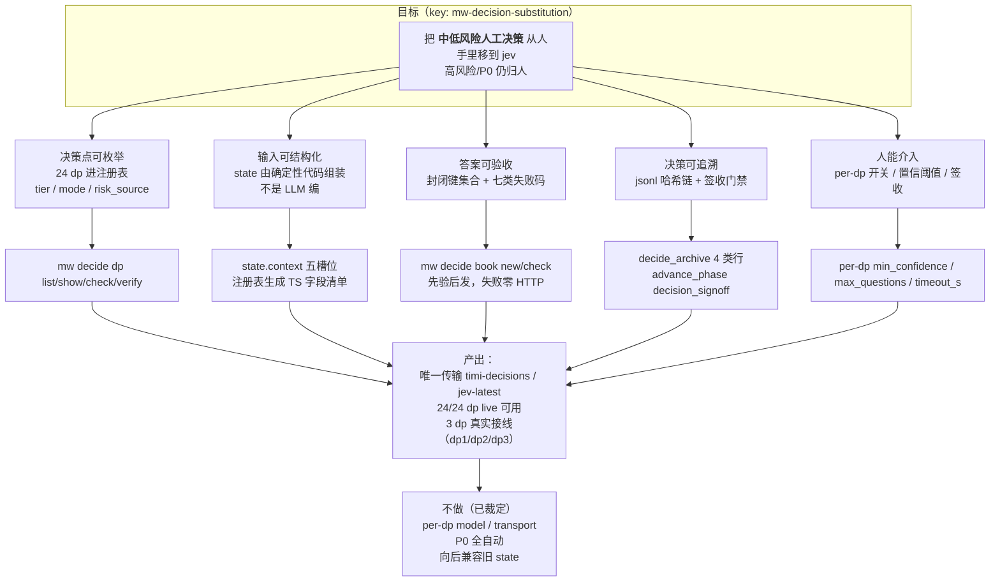
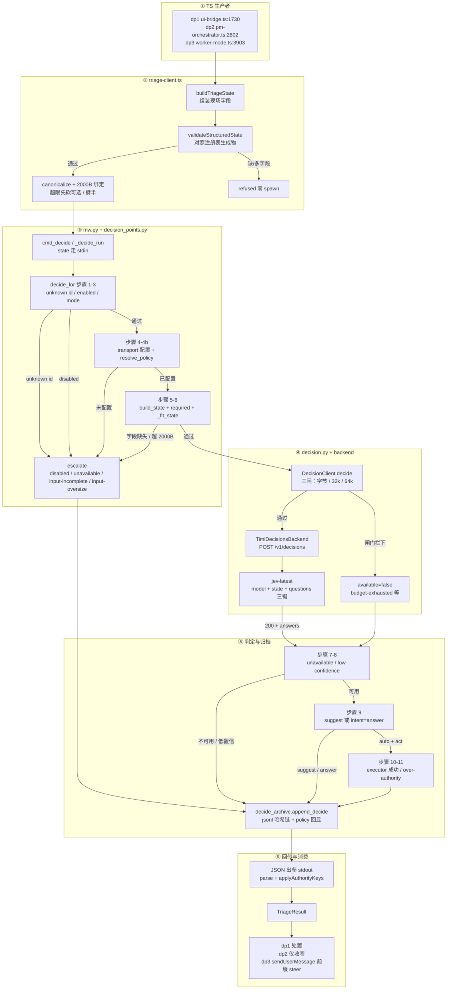
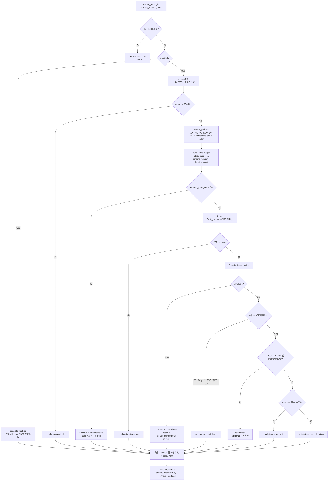
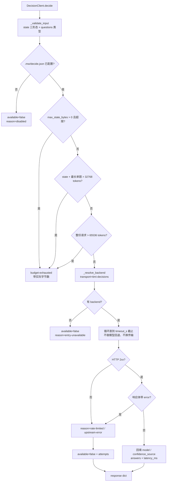
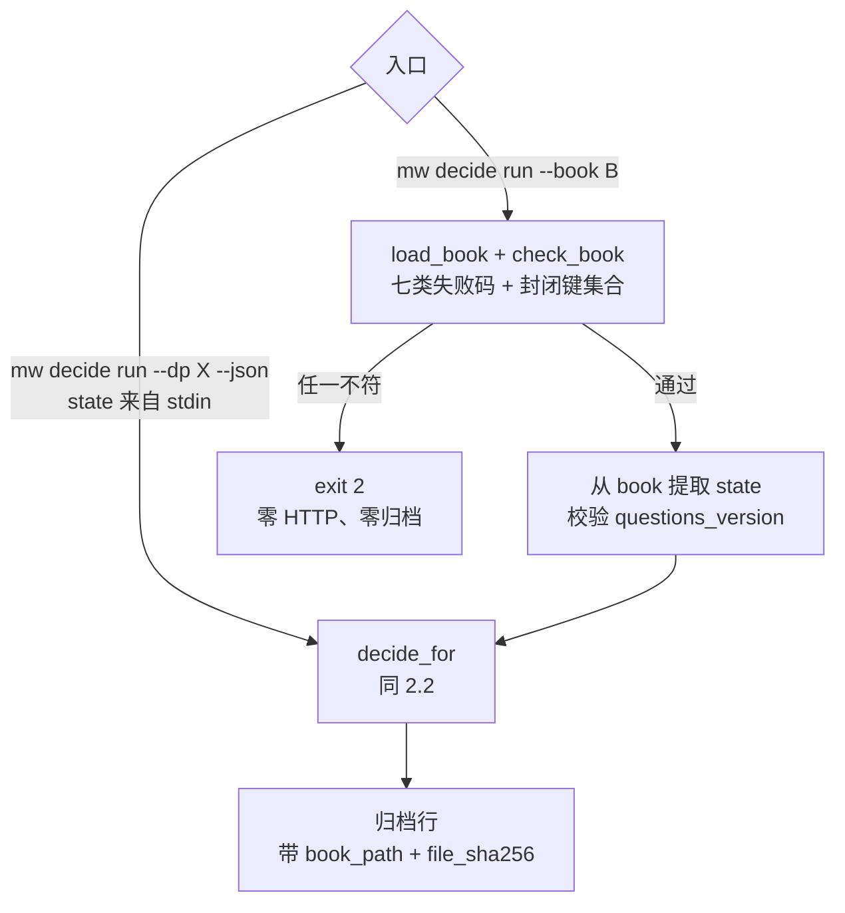
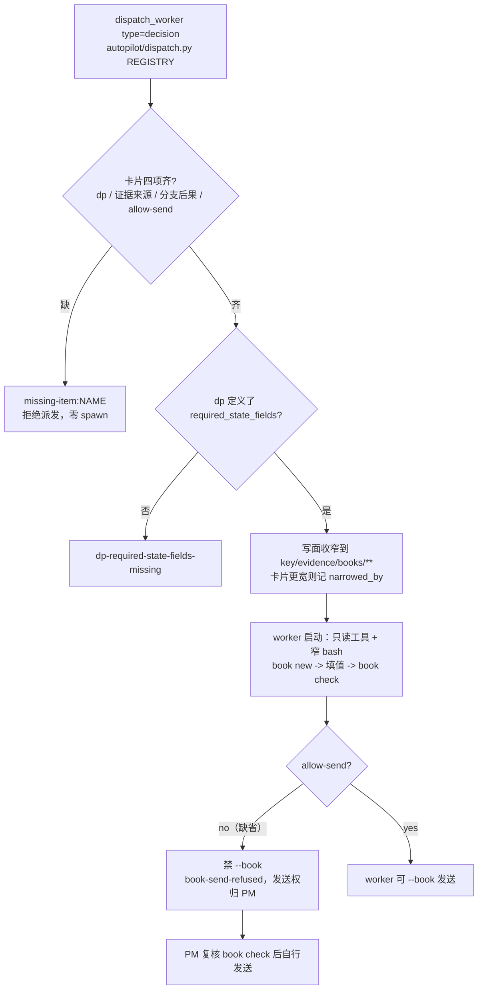
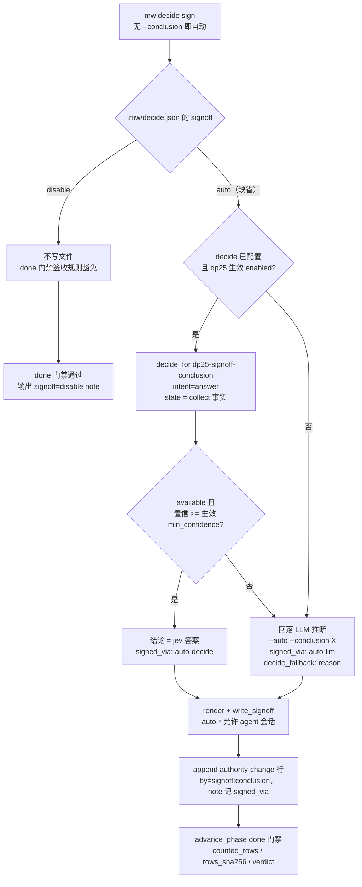
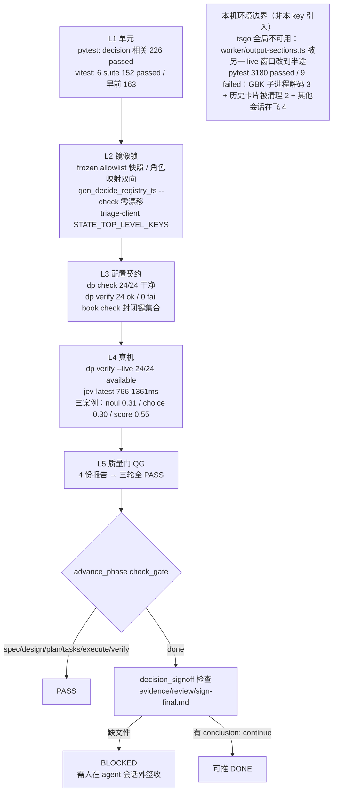
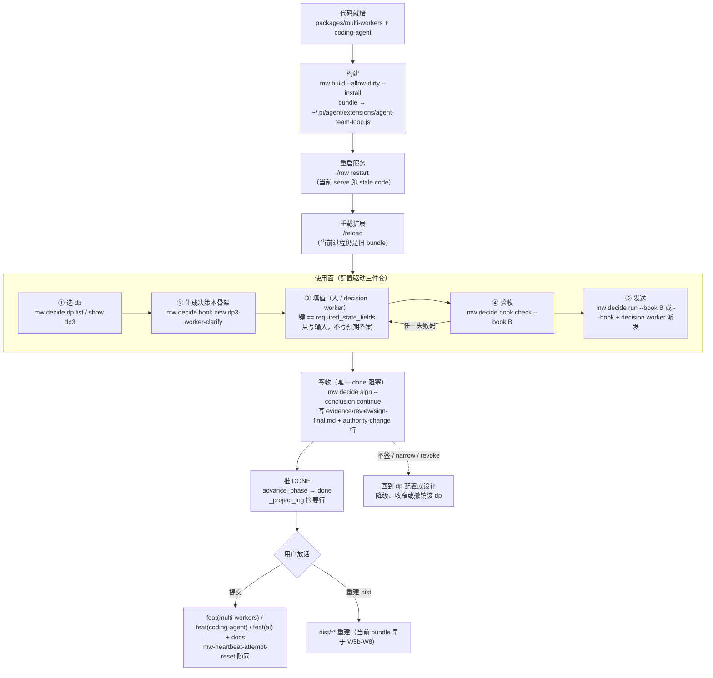
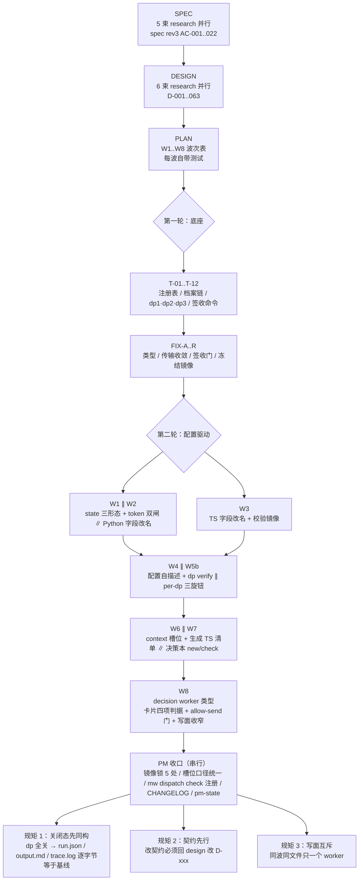

# 流程图 — mw-decision-substitution

> Key: `mw-decision-substitution` · 更新 2026-10-21 · 相位 EXECUTE（实现/验证完成，差人签收）
> HTML 版（目录 + 可渲染图 + 折叠源码）：同目录 `flowcharts.html`，浏览器直接打开。

四张图：目标、**代码实现逻辑**、验证流程、落地流程。
第 6 节保留"构建过程"（PM 视角的波次编排），与第 2 节的运行期代码逻辑区分开。

---

## 1. 目标



要点：

- **四个 dp 有真实调用方**：dp1 triage（`ui-bridge.ts:1730`）、dp2 checkpoint（`pm-orchestrator.ts:2602`）、
  dp3 worker 澄清（`worker-mode.ts:3903`）、dp25 签收结论（`mw decide sign`，W9/W11）。其余 21 个
  "已注册、可验证、未接线"——`wired` 与 `executor` 是两个维度（Python executor 只回显，真实动作在 TS/CLI 侧）。
- **签收不再是人的阻塞点**：`.mw/decide.json` 的 `signoff` 缺省 `auto` → 由 jev 出 `continue|narrow|revoke`；
  不可用或低置信才回落到 agent LLM 推断；`disable` 表示永不签收、`done` 门禁不阻塞。
- **state 不由 LLM 组装**：TS 生产者 + Python `_state_builder`，jev 只回答题面。
- **不做向后兼容**：state 字段改名后旧 state 直接 `input-incomplete`。

---

## 2. 实现流程（代码运行逻辑）

### 2.1 一次决策调用的端到端链路（流程图形式，兼容性优先）



### 2.2 `decide_for` 的判定树（11 步，含短路点）



### 2.3 客户端三层容量闸与传输（`decision.py:797`）



`_estimate_tokens` 是保守估计：非 ASCII 1 token/字符，ASCII 4 字符/token。

### 2.4 state 由谁生产（确定性代码，不经过 LLM）

| dp | 生产者锚点 | 触发器 | state 关键字段 |
| --- | --- | --- | --- |
| dp1 triage | `pm/ui-bridge.ts:446` / `:503 dispatchTaskExcerpt` / `:564` | 派发前风险分类 | `scope.file_extensions`、`progress.elapsed_minutes`、`risk_source`、`context.task_excerpt` |
| dp2 checkpoint | `pm/pm-orchestrator.ts:2161/2201/2209` | CHECKPOINT mid/high risk | `change_summary`、`context.artifact_status`、阈值来自生效 policy |
| dp3 worker 澄清 | `worker/worker-mode.ts:5057/5075 buildDp3State` | worker 提出澄清问题 | `ambiguity.question`、`local_candidates`、`context.change_summary` + `context.candidate_snippets` |
| 任意 dp | `decision_points.py:402 _state_builder` | `decide run` | `{schema_version: 2, decision_point}` + `trigger.data` setdefault + `key/task_key/questions_version` |
| 任意 dp | `decision_context.py:197 fit_context` | 发送前 | `state.context` 五槽，单源槽位表与截断规则 |

TS 侧还有一道开发期护栏：`ui-bridge.ts:461 assertStateMatchesRegistry` 对照
`shared/decide-registry.generated.ts`（由 `scripts/gen_decide_registry_ts.py` 从
`decide_registry.json` 生成，`--check` 零漂移）。缺字段或多字段都 throw——防止
"配置要求 A、代码发 B"。

### 2.5 两条入口分叉：直接 run 与决策本 run



决策本骨架由配置生成，不由人/LLM 猜：

```
decide_registry.json  ──▶  mw decide book new <dp>  ──▶  骨架（键与顺序 == required_state_fields）
                                                          │
                                        人或 decision worker 填值（只写输入，不写预期答案）
                                                          ▼
                                             mw decide book check --book B
```

七类失败码：`book-schema` / `book-state` / `book-placeholder` / `book-context` /
`book-evidence` / `book-budget` / `book-secret`。

### 2.6 `decision` worker 类型的门禁（运行时）



离线预判：`mw dispatch check --card FILE [--dp ID] [--book FILE] [--json]`
（exit 0 干净 / 2 拒绝 / 1 用法错误），判据与 `dispatch()` 拒绝时完全相同。

---

### 2.7 签收链路（`mw decide sign --key <任意 key>`，W9/W11）



判据（写进 `dp25` 的 `instructions`）：

- `continue`：N≥1 可用行 + 链闭合 + 每行 `timi-decisions/jev-latest/api`
- `narrow`：能力降级但仍要保留部分授权
- `revoke`：链断、engine 不符、或没有任何可用行

防自我背书：dp25 自己的档案行不计入签收事实；`signed_via` 只写 `auto-decide|auto-llm|cli|tui`。

---

## 3. 验证流程



| 层 | 命令 | 通过标准 |
| --- | --- | --- |
| L1 | `python -m pytest -q`（packages/multi-workers）/ `npx vitest --run test/suite/...` | 新增全绿，无新增失败 |
| L2 | `python scripts/gen_decide_registry_ts.py --check`；parity / frozen 快照测试 | rc=0，零漂移 |
| L3 | `mw decide dp check` / `mw decide dp verify` / `mw decide book check` | 0 error / 0 warning |
| L4 | `mw decide dp verify --live`、真实 worker 派发 | 24/24 `available=true`，model=jev-latest |
| L5 | QG review（4 份证据报告） | 三轮 PASS |
| 门禁 | `advance_phase check_gate(key, "done")` | 仅差 `sign-final.md` |

---

## 4. 落地流程



签收命令（必须人在 agent 会话外执行）：

```bash
python packages/multi-workers/mw.py decide sign \
  --project .agenticdoc/mw-decision-substitution \
  --conclusion continue \
  --reason "<理由>"
```

---

## 5. 当前状态

| 环节 | 状态 |
| --- | --- |
| 实现（T-01..T-12 / FIX-A..R / W1..W8） | 完成 |
| 验证 L1-L5 | 完成 |
| 门禁 spec/design/plan/tasks/execute/verify | PASS |
| 门禁 done（`decision_signoff`） | **PASS**：`mw decide sign` → dp25 → jev 答 `narrow`（confidence=0.7 api），`signed_via: auto-decide`，无 `decide_fallback` |
| 构建 + 重启 + 重载 | 待用户（bundle 早于 W5b-W8） |
| 提交 | 待用户放话 |

---

## 6. 附录：构建过程（PM 视角的波次编排，非运行期代码逻辑）



关键坑（已入 `.agenticdoc/_pitfalls.md`）：

- 卡片 `write_face:` 必须**一行一个路径**（顿号并列只解析第一条）。
- worker 整文件读 `mw.py`（1 万行）/ `worker-mode.ts`（5 千行）会 4 GB 堆 OOM。
- 派发卡片必须带 ≥1 个 `path:line` 种子锚点，否则 envelope 拒绝。
- 卡片 `###` 子标题会被提升成 `##`，吞掉后续标题。
