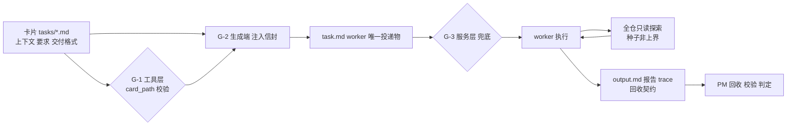

# Design: worker 任务投递与回收契约（mw-dispatch-card-gate）

- Key: `mw-dispatch-card-gate`｜日期: 2026-10-12｜基线: `6c5189831`
- 依据：4 个 spec RQ（`evidence/research/spec-{dispatch-path,card-format-corpus,dispatch-input-format,gate-layer}-20261012.md`）
- **两条总原则**：
  1. **投递优先**：机制的第一职责是把**正确、必要的上下文 + 任务内容 + 交付格式**送到 worker；限制只是副产品。
  2. **不设探索限制**：投递的是**种子**，不是上界 —— worker 可自行**启发式寻找上下文**（全仓只读，含其他 key 只读），并把发现记录下来。

## §1 必要格式（信封 Envelope）

### §1.1 通用四项（缺一即不合规）

| # | 项 | 含义 | 判据 |
|---|---|---|---|
| 1 | `type:` | 角色（决定工具集与附加项） | 头区存在；取值在词汇表内（词汇表收口见 P-08） |
| 2 | **上下文** | 为什么做（种子，见 §2） | 段非空（宽档：标题命中**或**段落语义命中，见 §6.3） |
| 3 | **要求** | 做什么 + 判据 | 同上；至少 1 条可判定判据 |
| 4 | **交付格式** | 产物路径 + 形态 + 回收判据 | 同上；含可解析路径 |

### §1.2 逐类型附加项

| type | 附加必填 | 理由 |
|---|---|---|
| `coding` | **写入允许面**（路径/目录，或显式"仅 `report.md` + 自身目录"）+ **写入禁止面** + **验收命令** + **改动历史**（见 §3.1） | 无允许面 = 无白名单；无禁止面 = 无隔离；无验收命令 = 无法判"做完"；无改动历史 = 事后无法归属 |
| `research` | **唯一证据文件路径**（声明"仅此一写"）+ 结论含**原始命令与输出** | 防越界写；结论可复算 |
| `review` | **审计目标/问题域**（要回答什么，**不是**"允许看的范围"）+ **未覆盖面声明（必填）** | 启发式发现的边界靠"声明没看哪儿"，不靠限制输入 |
| `vision` | **图片路径** + **要回答的视觉问题** | 图片能力门禁的依据 |
| `rag-research` | **检索范围** + **引用要求** | 结论可溯源 |

### §1.3 工具集（与不设限制原则一致）

| 角色 | 工具集 | 依据 |
|---|---|---|
| 写角色（`coding`） | read/write/edit/bash | 需跨文件实现 |
| `review` | read/find/grep/ls + **bash（用于执行验证）** | 上一 key 教训：`review` 无 bash ⇒ 只能静态推演、无法验证，导致返工重派 |
| `research` | read/find/grep/ls/bash（**无 write/edit**） | 只产出证据文件 |

## §2 上下文：种子 + 自由探索

### §2.1 默认投递的种子（必要项）

1. **项目锚点**：`goal.md`（路径 + 与本任务相关的要点，不整篇粘贴）；
2. **本 key 相位切片**：`spec.md`/`design.md` 中与本卡相关的**可解析引用**（`路径:行号`）；
3. **本卡**：上下文段；
4. **起点提示**：与该任务最相关的入口（文件/目录/符号）。

### §2.2 不是上界（关键）

- worker **可全仓只读探索**（read/find/grep/ls + 只读 shell），**包括读其他 key 的文档**（现有 `worker-crosskey-readonly` 语义：跨 key 读允许、写拒绝）。
- 投递物中**必须显式写明**"以上是种子，不是探索上界；请自行检索补充"，避免 worker 把种子当封闭清单。
- **写**仍 fail-closed（写面判定与隔离不变）——"不限制探索"指的是**读**。

### §2.3 可审计：报告须含「上下文来源清单」

worker 在交付物里列出：**读了什么**（路径，必要时 `路径:行号`）+ **据此做了什么决定**。这样"启发式发现"可回收、可复核，PM 也能判断下一步该补什么。

## §3 交付格式与回收契约

### §3.1 coding 的改动历史（两份、可校验）

| 产物 | 谁写 | 内容 | 用途 |
|---|---|---|---|
| `trace.log` 的写入事件 | **机器**（工具层/守卫） | 每次 `write`/`edit`/写面判定的 **path** | 客观事实 |
| `report.md` 的「改动清单」 | **worker** | 文件 + 意图 + 理由 | 说明为什么 |
| **回收校验** | PM | 报告声明的文件集 **⊆** trace 记录的写入集 | 抓"说改了 A、实际动了 B" |

### §3.2 回收契约（与交付格式对齐）

- **`output.md` 必备段**：`结论` / `证据（含原始命令与输出）` / `改动清单（coding）或未覆盖面声明（review）` / `残留与未验证` / `上下文来源清单`。
- **`_workers.parallel` 状态判据**：`done` 须四段齐备；`failed` 须有原因；`needs-clarification` 须有明确问题句。
- **动机（实测）**：4 个 worker 里 **3 个**内容齐全却因 `output.md` 只有占位段被判 `needs-clarification` ⇒ 今天"交付格式无契约、回收判据未成文"。

## §4 Gate（保证机制，次级）

| # | 层 | 触发 | 检查 | 失败动作 |
|---|---|---|---|---|
| G-1 | 工具层（同步） | `dispatch_worker` / `/worker` | `card_path` 必填、卡存在、§1 齐备 | 拒绝（指名缺失项）+ 零侧效应 |
| G-2 | 生成端（构造） | 写 `task.md` | 注入 §1 四项 + 附加项 + §2 种子 + "种子非上界"声明（复用 `applyWriteSurfaceContract` 幂等注入） | 注入失败 ⇒ 中止派发 |
| G-3 | 服务层（兜底） | `launcher.py:_poll_once` | 复核 §1 必需项（覆盖 conductor 直写与手写队列行） | 不 spawn；行 `failed` + 原因 |

- **失败方向**：默认 fail-closed；逃生舱必须**真被读取 + 留审计**（现状 `allow_foreign_write: true` 只写不读，一并修正）。
- **分级**：**新派发强制**；历史卡登记不回填（严格口径 87.2% / 99.4% 不合格 ⇒ 硬上会促人绕过）。
- **只判齐备，不判内容质量**；**不得以任何理由缩小 §2.2 的探索面**。

## §5 落点与成本

- 新增叶子层 `packages/coding-agent/src/extensions/agent-team-loop/shared/dispatch-card.ts`：`readEnvelope(cardPath) -> {ok, missing[]}`；调用点 `pm/ui-bridge.ts:2301`、`:2795`。
- 生成端注入：`pm/ui-bridge.ts:2028 writeDispatchTaskMd`。
- 服务层兜底：`packages/multi-workers/launcher.py:1267 _poll_once`（在 `:1471 _spawn` 之前）。
- 卡 hash：复用 `mw_common.sha256_eol_normalized`；一致性差集抄 `packages/multi-workers/autopilot/conductor.py:2417/2433`。
- 估计：生产代码 ~120–170 行 + 12 个字节金样本测试（含 §2/§3 的新段）。

## §6 验证

### §6.1 负例（拒绝 / 不 spawn）

无 `card_path`｜卡不存在｜缺「上下文/要求/交付格式」任一项｜`coding` 缺允许面/禁止面/验收命令/改动历史｜`review` 缺未覆盖面声明｜手写队列行缺项（服务层不 spawn，行 `failed`）。

### §6.2 正例（误拒 = 0）

现有**工具生成的** `workers/*/task.md` 全绿；四类型显式合规卡各一放行；**12 个字节金样本**逐字节断言 `task.md`（含 §2 种子段与"种子非上界"声明）。

### §6.3 宽档判据（防误拒）

「段非空」= 标题命中**或**段落语义命中（T2 宽档）。严格标题档会误拒 87.2%（卡片）/99.4%（派发卡），**不可用**。槽位词表与门槛写入 gate 常量并测试固定。

### §6.4 探索不被限制（反方向验证）

构造一个"种子未覆盖但仓库内可检索到"的问题 ⇒ worker **必须**能通过自行检索发现（给实测：检索命令 + 命中）；并验证 gate 未缩小其读面。

### §6.5 回收契约

正例：四段齐备 ⇒ `done`；负例：缺段 ⇒ 判 `needs-clarification` 并指名缺失段（不再出现"内容齐全被判 needs-clarification"）。

### §6.6 运行期（cutover 后）

一正例（合规卡）spawn 成功；一负例（无卡）工具层拒绝且存储零新增；再以手写队列行造负例 ⇒ 服务层不 spawn 且行 `failed` + 原因。
