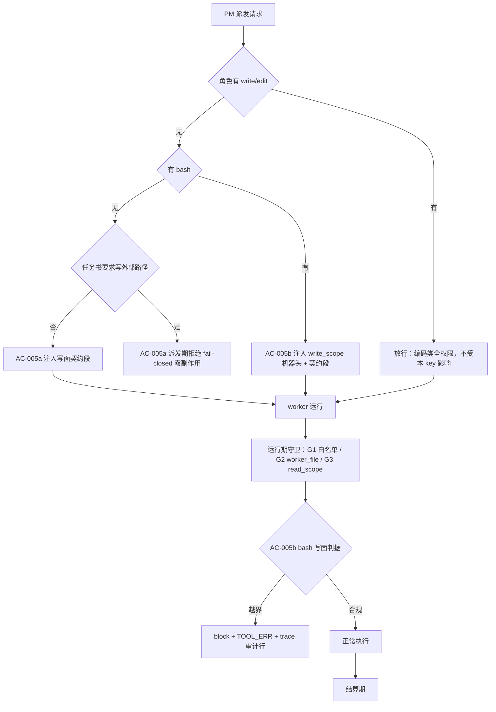
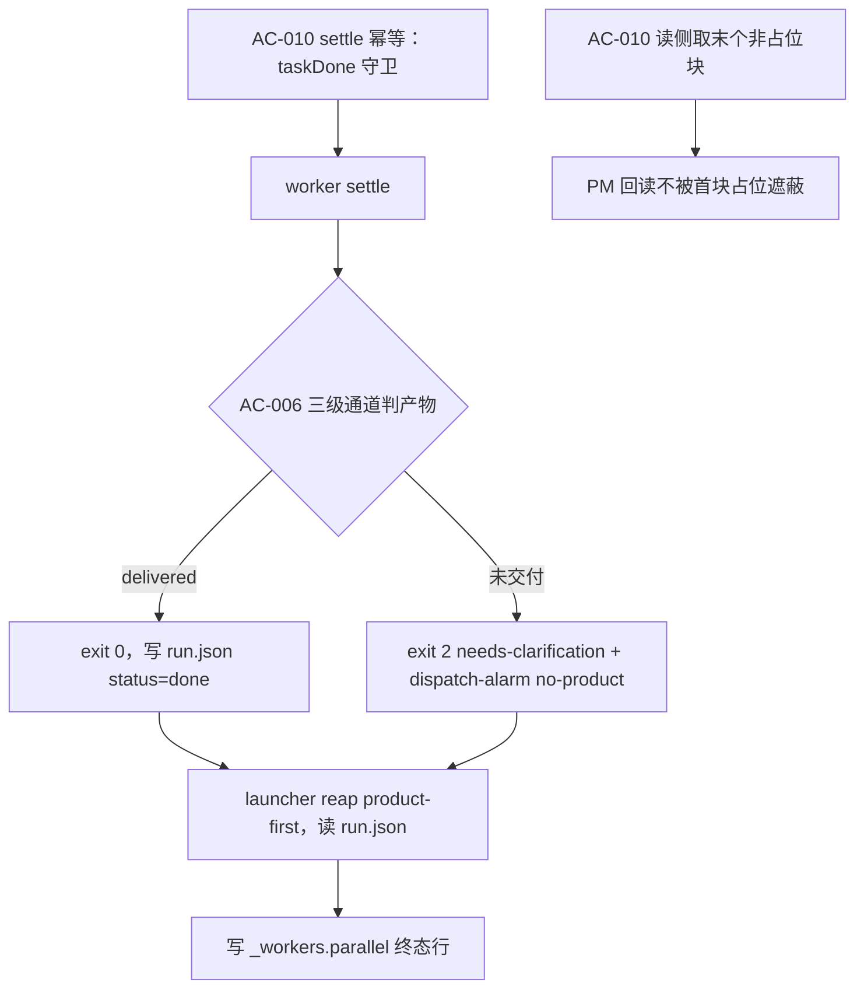

# design — mw-dispatch-settle-gates

- key: `mw-dispatch-settle-gates`｜phase: design｜HEAD: `776b82d7f`（脏树，行号以读取当刻为准）
- 上游：`spec.md`（11 条 AC：AC-001…AC-010 + AC-005b；§3.1 三级通道；§3.2 依据；决策 D1…D12）
- 证据：`evidence/research/` 6 份（spec 阶段 3 + design 阶段 3），全部含 `## PM 现场复核` 更正节
- **设计原则**：① 单一真相源（角色能力、终态集、占位符、stage 终态族都只在一处声明）；② **缺失即放行**（零回填：无 `run.json`/无 `_roadmap.md`/无记录 ⇒ 行为与今日逐字一致）；③ fail-closed 但**漏放优于误拦**（写面判据宁可漏放，不得把合规行为判成异常）。

## §1 守卫分层与权责（现状 → 本 key 增量）

**权责（D-011，不可混写）**：PM 只派发；worker 只写 `run.json` + 自己的 `pending` 行；**队列行终态由 launcher reap 写**，且改为 product-first（`run.json` 状态优先、退出码 fallback）。

## §2 设计决策

| # | 决策 | 落点与理由 |
|---|---|---|
| DD-01 | 角色能力 = `activeToolsForType`（`worker-mode.ts:115-118`）单一真相源；新增导出 `toolAllowlistTypes()` 供 parity 测试遍历 live key；Python 侧 `dispatch.registry_snapshot()`（`dispatch.py:152`）+ `mw_common.TASK_TYPE_TO_ROLE`（`:143`） | 避免硬编码角色名单漂移；两侧 parity 已有 7 处锁（`test_autopilot_l0.py:233`/`:252`、`test_mwpp_collection_parity.py:66`、`autopilot-protocol.test.ts:238` 等），扩锁为"writeless ⇒ +worker_file"集合差派生 |
| DD-02 | 写意图判定 = 写动词 + 路径（路径须在动词后 ≤32 字符）+ **5 类护栏**（否定 / 读标记 / 代码主体 / 引语复述 / PM 归因）+ 自身目录与白名单 basename 放行 + `allow_foreign_write` 逃生阀 | 语料实测：24 份真实只读任务书，收紧规则命中 2（1 真阳性 = 事故卡，1 写自身 `output.md` 走白名单）⇒ 0 假阳性；朴素正则假阳性 88%（`evidence/research/design-write-surface-20261010.md`） |
| DD-03 | **AC-005b**：新增 `write_scope:` 机器头（与 `read_scope:`/`deny_globs:` 同渲染器、同语法）；bash 写面判据拦**已知写模式**；拒绝即 `block` + `[TOOL_ERR]` + trace 审计行；**允许** = 自身 taskDir + `.agenticdoc/<key>/evidence/**`；**拒** = `pm-state.md`、`workers/_workers*`、`_index.parallel`、其他 key、`packages/**`、`.git/**`；档位 **P1**（失败模式 = 漏放） | 对称 `read-scope.ts:167-200`（scope/deny_globs/cap 四条规则 + fail-closed 形态）；拦截模式表见 §4.3 |
| DD-04 | 写面契约段：成对 marker `<!-- mw-write-surface: v1 -->`，置于 frontmatter 之后；幂等 = 字节相等不动、否则整段替换；断言 marker 计数恒 1；task.md 写盘抽**单点** `writeDispatchTaskMd`（现 `ui-bridge.ts:1411`/`:1816` 两处重复） | 幂等防"PM 手改后重复注入"；单点化是 AC-003/005a/005b 共用一个守卫的前提 |
| DD-05 | **AC-006 判定落点** = `worker-mode.ts::finishSuccess()`（`:1350`）内、`writeOutputGuarded`（`:1354`）之前，折进 `exitCode`：`delivered ? 0 : 2`；配套 `markOutcome`（`:786`）加 `2 → needs-clarification`、`recordEnd`（`:1075`）放宽 `0|1|2`；alarm 走 `recordDispatchAlarm`（`pm-orchestrator.ts:439`），`kind` 值域（`:387-397`）加 `"no-product"`、`describeDispatchAlarm`（`:409-435`）加 case；**必须用 `meta.trueAgenticdocRoot`** | 四者自洽（output.md marker / `## Questions` / `run.json.status` / `[END] exit=`）；失败/超时/拒绝路径不经 `finishSuccess` ⇒ 无重复判定；TS 目前无 `exitCode=2` 生产者，本 AC 是第一个 |
| DD-06 | launcher reap **product-first**：先 `mw_common.read_run_status(task_dir)`（`:1747`，已存在），命中 `RUN_TERMINAL_STATUSES`（`:1719`）⇒ 以 run 状态为准；否则退出码 `_exit_to_status`（`:367-373`） | `:2449-2457` 已有同样的读法（T-20 的 stale reconcile），复用同一读取器 = 单一真相源 |
| DD-07 | `hasProductEvidence()`（`pm-orchestrator.ts:487-492`，唯一调用 `:653`）**语义与实现都不动**；新增独立谓词 `hasDeliverableEvidence()`（§4.4 三级通道）供 AC-006 使用；补一条判别性测试：`trace.log`-only 任务目录**仍**必须让旧守卫拒绝 scan | 收窄旧谓词会把它从"拒绝扫描"翻成"重跑历史"（IN-3 形态）⇒ 并存不替换 |
| DD-08 | **AC-010 读侧**：新增 `shared/output-sections.ts`（`readOutputSections`/`isPlaceholderSection`/`readLastProductSection`）；**不改** `readOutputSection`（`ui-bridge.ts:344`）/`readOutputSummary`（首匹配契约被测试钉住）；只把 `readTerminalDetail` 的 4 处读点（`ui-bridge.ts:457/460/464/470`）切到末个非占位块；写侧幂等 = `finishSuccess`/`agent_settled` 入口 `if (taskDone) return;` | 保留 D-117 的追加语义（worker 自写机器行不被销毁）；占位符全集 15 个按 section 归位 |
| DD-09 | **AC-007**：`## Changed Files` 在有 `run.json.artifacts` 时改名 `## Deliverables` 并排除 `output.md`/`progress.md`；无 artifacts（当前全语料 0/30）⇒ **整段省略**；`## Exit Reason` 带 `toolCallCount` + `writes=<report.md|progress.md|none>`；28 条回归断按 DRQ-2 §5 重锚（必须改 #4/#10/#11/#19，#23 保持绿） | `artifacts` 不含源码改动（`run-store.ts:119-138`），故不能假装列出改动文件；段名无其他读者（`output-writer.ts:66` 是唯一命中） |
| DD-10 | **AC-001**：`mw doctor` 的 gates 段加 `blocked_on_human` 机器字段，三轴口径与面板同源（pending 门 > 0 ∧ 非终态行 = 0 ∧ conductor tick 新鲜）；文本在非零时追加 `BLOCKED_ON_HUMAN` 后缀；**无状态判据**（不建快照文件，doctor 仍零写盘） | 落点 `mw_common.py::_doctor_gates`（`:3064`/`:3086` 附近）+ `_gates_text_alerted`（`:3140-3146`）+ `format_doctor_text`（`:3531-3541`）；面板侧同源量见 `monitor.ts:184`/`:364-369`/`:745-753` |
| DD-11 | **AC-002**：`pending_gate_reminders`（`conductor.py:2522`）加第 4 条件（stage 终态 ⇒ 不提醒）；`_remind_pending_gates`（`:2555`）读一次 roadmap 注入 `stage_status` + `stage_of_key`；终态族 = `_STAGE_TERMINAL_RANK`（`:565`，`{closed, closed-human, halted}`）；**两级解析**：`gate.stage` → `roadmap.stage_of_key`（`roadmap.py:477-483`）；**解析不到/roadmap 缺失 ⇒ 不抑制**；`halted` 取 conductor 口径 | 8 个 gate 创建点只 4 个带 `stage=`（`:659`/`:725`/`:903`/`:3586`）⇒ 两级解析必需；现有 12 条 reminder 测试 fixture 无 `_roadmap.md` ⇒ fail-open 必需 |
| DD-12 | **AC-004**：`autopilot/dispatch.py` 的派发判据首查 `mw_common.read_run_status(task_dir)`：终态 ⇒ 不派、`running` ⇒ 不派、`None` ⇒ 零回填放行 | reader/终态集已存在（`:1747`/`:1719`），无需新概念 |
| DD-13 | **AC-003**：`/worker` 的 `foreignLiveClaimRefusal` 守卫插在 `ui-bridge.ts:1813`（`workerTaskDir`）**之前**（`:1816` 写盘、`:1819` 入队，必须零副作用）；与 `dispatch_worker`（`:1333`）共用同一判定函数；拒绝文案与守卫集合由**单一声明源**生成（防"文案写了没实现"） | 现状守卫仅 2 个调用点（`:1333`/`:1698`），文案（`:241-242`）自称 `/worker` 已拒 ⇒ 实现与文案必须同时一致 |

## §3 AC → 落点 → VC

| AC | 落点（文件） | 机制 | VC |
|---|---|---|---|
| AC-001 | `mw_common.py` | doctor gates 段第 N 字段 + 文本后缀，零写盘 | VC-001…003 |
| AC-002 | `conductor.py`（+`gates.py` 只读） | 纯判据第 4 条件 + 调用方注入 stage 事实 + fail-open | VC-004…008 |
| AC-003 | `ui-bridge.ts` | `/worker` 前置守卫 + 共用判定 + 文案单一声明源 | VC-009…011 |
| AC-004 | `autopilot/dispatch.py` | 派发判据首查 `read_run_status` | VC-012…014 |
| AC-005a | `ui-bridge.ts`（判定）+ `task.md` 渲染 | 派发期拒绝 + 契约段注入 + 逃生阀审计 | VC-015…019 |
| AC-005b | `worker-mode.ts`（bash 拦截）+ 渲染（`write_scope`） | 已知写模式 + 路径判据 + 审计行 | VC-020…024 |
| AC-006 | `worker-mode.ts` + `launcher.py` + `pm-orchestrator.ts` | 三级通道 ⇒ exitCode；reap product-first；alarm | VC-025…030 |
| AC-007 | `worker-mode.ts` + `output-writer.ts` | Deliverables/省略 + Exit Reason 努力度 | VC-031…033 |
| AC-008 | 文档 | 6 处勘误（不改码、不改已冻语义） | VC-034…039 |
| AC-009 | 报告与卡片 | [VERIFY] 带锚点 + 引用重锚 + 非空洞对照 | VC-040…042 |
| AC-010 | `output-sections.ts` + `ui-bridge.ts` + `worker-mode.ts` | 读末个非占位块 + settle 幂等 | VC-043…046 |

## §4 详细设计

### 4.1 角色能力与派发期判定（AC-003 / AC-005a）
- 判定输入：`type` → `activeToolsForType` → `{ canWrite: includes("write"|"edit"), canShell: includes("bash") }`。
- 分支：`canWrite` ⇒ 放行（编码类零影响）；`!canWrite && !canShell` ⇒ 走 DD-02 的写意图判定；`!canWrite && canShell` ⇒ 只注入契约段 + `write_scope`（不拒）。
- 拒绝形态：`ctx.ui.notify(..., "warning")` + `return`，**在任何 mkdir/write/enqueue 之前**（D-13 落点）。
- 文案必须由单一声明源生成：一个导出常量数组（守卫集合）+ 一句模板，测试断言"文案里列出的路径 = 实际守卫调用点集合"。

### 4.2 写意图判定规则（DD-02）
- 形式：`(写动词) ... (路径)`，且 `index(路径) - index(动词) <= 32`；路径未命中白名单 ⇒ 候选违规。
- 5 类护栏（任一命中 ⇒ 放行）：① 否定（`不要`/`不得`/`禁止`/`never`/`do not` 紧邻动词前）；② 读标记（`读取`/`作为输入`/`参考`/`from`/`input`）；③ 代码主体（fenced code block 内）；④ 引语复述（`"…"`/`「…」` 包裹）；⑤ PM 归因（`PM 会收录`/`由 PM` 等主语）。
- 白名单：`worker_file` 的 `WORKER_FILE_NAME_RE` basename + 自身 taskDir 相对路径 + 框架自有文件名。
- 逃生阀：`allow_foreign_write: true`（task.md frontmatter，审计可见）。

### 4.3 bash 写面判据（AC-005b，P1）
| 类别 | 判据 | 处理 |
|---|---|---|
| 允许目录 | `target` 解析后落在 `<key>/workers/<taskKey>/` 或 `<key>/evidence/` | 放行 |
| 拒绝清单 | `pm-state.md`、`workers/_workers*`、`_index.parallel`、其他 key、`packages/**`、`.git/**` | block + `[TOOL_ERR]` + trace 行 |
| 已知写模式 | 重定向 `>`/`>>`、`tee`、`cp`/`mv`/`rm`/`mkdir`/`touch`/`truncate`、`sed -i`、`git checkout|apply|clean`、`curl -o`/`wget -O`、PowerShell `Set-Content`/`Out-File`/`New-Item`/`Remove-Item`、`python`/`node` 一行脚本中的字面路径 | 提取目标路径后按上两行判定 |
| 纯读命令 | `rg`/`grep`/`ls`/`find`/`git status|log|diff`/`python` 纯读脚本 | 放行（不得误拦） |
| 无法归类 | 未命中任何写模式 | 放行 + trace 记录（P1 的漏放面，PM 抽查） |

### 4.4 结算期三级通道（AC-006）
1. `report.md` / `report-<slug>.md` 非空 ⇒ delivered；
2. 否则 `output.md` 非空且**至少一个块非占位**（不要求全部块非占位：首块常为桩块而真报告在后；占位符清单 15 项，按 section 归位。[REVISED @ 2026-10-11：T-04 实测校准，原写「全部块」，与语料 28/2 自相矛盾]）且命中任一：机器行（行首或内联）、`run.json.artifacts` 含 `output.md` 以外的产物、正文引用的 `evidence/**.md` 实存；
3. 否则 ⇒ `needs-clarification` + `dispatch-alarm(kind="no-product")`。
语料回放：**28 delivered / 2 正确 NC / 0 假阳性**。

### 4.5 回读面（AC-010）
- `readOutputSections`：按 `## <section>` 切块（保留块序）；`isPlaceholderSection`：块体去空白后 ∈ 占位符全集或 < 阈值字节；`readLastProductSection`：从末块向前取首个非占位块。
- 只切 `readTerminalDetail` 的 4 个读点；`/mw` 命令面与整文件回读零影响。

## §5 写面与串行链（同一文件同一时刻只允许一个 worker）

| 文件 | 改动 | 串行链 |
|---|---|---|
| `pm/ui-bridge.ts` | AC-003 + AC-005a 判定合流 + 单点 `writeDispatchTaskMd` + AC-010 的 4 读点 + AC-007 无关 | **链 1**（AC-010 读点与 AC-003/005a 不同函数，仍同文件 ⇒ 同链） |
| `worker/worker-mode.ts` | AC-005b 拦截 + AC-006 折 exitCode + AC-010 幂等 + AC-007 段 | **链 2** |
| `worker/output-writer.ts` / `shared/output-sections.ts` | AC-007 段 + AC-010 读函数 | **链 2**（与 worker-mode 同链） |
| `pm/pm-orchestrator.ts` | AC-006 alarm kind + `hasDeliverableEvidence`（并存） | 链 2 后（依赖谓词定稿） |
| `packages/multi-workers/launcher.py` | AC-006 reap product-first | **链 3** |
| `packages/multi-workers/mw_common.py` | AC-001 doctor 面 | **链 4** |
| `autopilot/conductor.py` | AC-002 第 4 条件 + 注入 | **链 5** |
| `autopilot/dispatch.py` | AC-004 首查 run 状态 | **链 6** |
| 文档（spec/plan/design/卡头/`evidence-requirement.md`） | AC-008 | **链 7** |

## §6 VC 体系（VC-001…VC-046）

| VC | 判据（可验证） | AC | 验证方式 |
|---|---|---|---|
| VC-001 | `mw doctor --json` gates 段含 `blocked_on_human`，三轴口径与面板同源 | 001 | 单测 + 真活 doctor |
| VC-002 | 非零时 `mw doctor` 文本含 `BLOCKED_ON_HUMAN` 后缀 | 001 | 单测 |
| VC-003 | doctor 运行不新建任何文件（零写盘） | 001 | 前后目录快照对比 |
| VC-004 | 提醒判据消费 `_STAGE_TERMINAL_RANK`（常量单一真相源） | 002 | 单测 + 源码断言 |
| VC-005 | 无 `gate.stage` 的门经 `stage_of_key` 解析到 stage（两级解析） | 002 | 单测（4 个不带 stage 的创建点各一例） |
| VC-006 | 无 `_roadmap.md` ⇒ 照旧提醒（fail-open，12 条既有测试逐字通过） | 002 | 回归 |
| VC-007 | `halted` stage 的门零提醒；面板仍显示 | 002 | 单测 + 面板断言 |
| VC-008 | 活动 stage + pending 门 + 无非终态行 ⇒ 照旧提醒 | 002 | 回归（不误伤） |
| VC-009 | `/worker --key <他人 live key>` 拒绝且零副作用（无 taskDir/无队列行） | 003 | 单测 + 目录前后对比 |
| VC-010 | 自有 claim / 未认领 / `_scratch` 放行 | 003 | 单测 |
| VC-011 | 拒绝文案列出的路径集合 == 实际守卫调用点集合 | 003 | 静态断言 |
| VC-012 | `run.json` 终态 ⇒ Python 不派发 | 004 | 单测 |
| VC-013 | `running` ⇒ 不派发 | 004 | 单测 |
| VC-014 | 无 `run.json` ⇒ 行为与今日一致（零回填） | 004 | 回归 |
| VC-015 | 无 write/edit/bash 角色 + 外部写要求 ⇒ 派发期拒绝 | 005a | 单测 + 语料回放（24 份 0 假阳性） |
| VC-016 | 读用法（`evidence/runs/` 作输入）不拒 | 005a | 单测 |
| VC-017 | `coding` 类角色零影响 | 005a | 回归 |
| VC-018 | 5 类护栏各一条正例（否定/读标记/代码主体/引语复述/PM 归因）不拒 | 005a | 单测 |
| VC-019 | 契约段注入且 marker 计数恒 1（重派/手改后不重复） | 005a | 单测 |
| VC-020 | 写 `pm-state.md`/`_workers*`/其他 key/`packages/**` ⇒ block + `[TOOL_ERR]` + trace 行 | 005b | 单测（每类一条） |
| VC-021 | 写自身 taskDir 或 `<key>/evidence/**` 放行 | 005b | 单测 |
| VC-022 | 纯读命令（`rg`/`python` 只读/`git status`）不拦 | 005b | 单测 |
| VC-023 | `write_scope` 与 `read_scope` 同渲染器、同语法（含空值与缺省） | 005b | 单测 + 渲染快照 |
| VC-024 | `coding`/`repair`/`vision` 零影响 | 005b | 回归 |
| VC-025 | 三级通道判定表逐例通过（语料回放 28/2/0） | 006 | 语料 fixture 测试 |
| VC-026 | delivered ⇒ exit 0；未交付 ⇒ exit 2（`finishSuccess` 折码） | 006 | 单测 |
| VC-027 | `markOutcome`/`recordEnd` 支持 `2 → needs-clarification` | 006 | 单测 |
| VC-028 | alarm `kind="no-product"` 写入 `auto-decisions.jsonl` 且用 `trueAgenticdocRoot` | 006 | 单测 |
| VC-029 | `hasProductEvidence` 语义不变（`trace.log`-only 仍让旧守卫拒 scan） | 006 | 判别性单测 |
| VC-030 | launcher reap product-first（run 状态优先、退出码 fallback） | 006 | Python 单测 |
| VC-031 | 无 artifacts ⇒ `## Changed Files` 整段省略（无空段） | 007 | 单测 |
| VC-032 | 有 artifacts ⇒ `## Deliverables` 且不含 `output.md`/`progress.md` | 007 | 单测 |
| VC-033 | `## Exit Reason` 含 `toolCallCount` + `writes=` | 007 | 单测 + 真活 output.md 抽查 |
| VC-034 | spec AC-021 措辞与反向用例一致 | 008 | 文档 diff + 人工 |
| VC-035 | spec §2.3 与 AC-025⑤ 不再字面冲突 | 008 | 文档 diff |
| VC-036 | plan §2.5 值域 = 1..64 | 008 | 文档 diff |
| VC-037 | design §0 `ac_count` 与 §8 映射表补到 AC-025 | 008 | 文档 diff |
| VC-038 | `evidence-requirement.md` 存在（或显式登记偏离） | 008 | 文件存在 |
| VC-039 | T-18/19/20 卡头 VC 补齐 + pm-state 1406/1407 取真值 | 008 | 文档 diff |
| VC-040 | 每条 `[VERIFY]` 数值可复算且带 `文件:行号`/测试名 | 009 | 报告抽检 |
| VC-041 | 报告引用对最终工作区重锚（无 ±1 漂移；漂移须在更正节登记） | 009 | 报告抽检 |
| VC-042 | 每条机器判据有摘除即红的对照 | 009 | 对照脚本 |
| VC-043 | 首块占位 + 末块真报告 ⇒ 回读得到真报告 | 010 | 单测（`mwg-t11` 形态 fixture） |
| VC-044 | 单块正常 `output.md` ⇒ 行为不变 | 010 | 回归 |
| VC-045 | settle 幂等：同 run 二次 settle 不追加第二块 | 010 | 单测 |
| VC-046 | `/mw` 命令面与整文件回读零影响 | 010 | 回归 |

## §7 非空洞对照计划（AC-009 / VC-042）

每条机器判据必须给出"摘除/反转该判据 ⇒ 至少一条具名用例转红"的对照记录，形态沿用上一 key 的 `*-controls.ps1`：A 组 = 摘除判据；B 组 = 反转默认（fail-open ↔ fail-closed）；C 组 = 白名单/防护栏移除。**只写脚本、不落红即为未验证**。

## §8 残留与风险

| # | 项 | 状态 |
|---|---|---|
| R-01 | AC-005b 的 P1 失败模式（漏放） | 已知边界；全量 bash 命令入 trace 供 PM 抽查；P2（OS 级隔离）不在本 key |
| R-02 | 多段 `output.md` 的根因（跨 run 追加）只做"读侧取末块 + 写侧幂等"，不改追加语义（D-117 有意） | 保留 |
| R-03 | `run.json` 在既有语料 0/30（运行身份未上线）⇒ AC-006 的 artifacts 通道只能前瞻 | 保留（DD-04 的 ②b 不得作唯一通道） |
| R-04 | R18（spawn 竞态下"刚派发的行不得被静默判终态"） | 未并入（待用户定） |
| R-05 | R21 运行时切换（`mw build --install` + 重启 9 窗口） | 待用户批准；本 key 改动在切换前均不生效 |
| R-06 | 旧模板要求只读角色写 `output.md` 与 `worker_file` 白名单矛盾（语料 1 例） | 由 AC-005a 拦（DD-02 白名单不含 `output.md`） |
