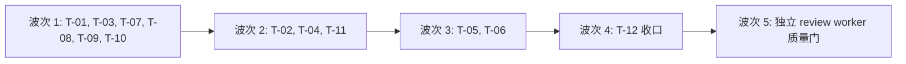

# plan — mw-dispatch-settle-gates

- key: `mw-dispatch-settle-gates`｜phase: plan｜上游 `spec.md`（11 AC: AC-001…AC-010 + AC-005b）+ `design.md`（DD-01…DD-13、VC-001…VC-046）
- 运行时前提：**R21-L 已生效**（serve 122476 / launcher 142424，`evidence/runs/r21l-cutover-20261011.md`）；**R21-H 未做**（TS bundle 仍旧）⇒ 运维约束见 §6。

## §1 范围与不变量

| 不变量 | 说明 |
|---|---|
| 单一真相源 | 角色能力（`TOOL_ALLOWLISTS`/`activeToolsForType`）、终态集（`RUN_TERMINAL_STATUSES`/`_TERMINAL_STATUSES`）、占位符集、stage 终态族（`_STAGE_TERMINAL_RANK`）各只有一处声明，改前先确认没有第二处 |
| 缺失即放行 | 无 `run.json` / 无 `_roadmap.md` / 无记录 ⇒ 行为与今日逐字一致（零回填） |
| 漏放优于误拦 | 所有新守卫的反向用例必须显式列出"哪些正常行为不得被拦"，且真跑验证 |
| 不改既有语义 | `hasProductEvidence()`、`readOutputSection`/`readOutputSummary`（首匹配）、`worker_file` 白名单、D-117 追加语义 —— 一律**并存扩展**，不改写 |
| 文件边界 | 每张卡只允许改自己列出的文件；共享大测试文件（`test/extensions/agent-team-loop.test.ts`）由 **T-12 统一重锚**，卡内不得改 |

## §2 波次与串行链

| 波次 | 卡 | 并行理由（无文件交叠） |
|---|---|---|
| 1 | T-01（`ui-bridge.ts`）· T-03（`worker-mode.ts`）· T-07（`launcher.py`）· T-08（`mw_common.py`）· T-09（`conductor.py`）· T-10（`autopilot/dispatch.py`） | 6 个互不相同的文件/包 |
| 2 | T-02（`ui-bridge.ts`，等 T-01）· T-04（`worker-mode.ts`，等 T-03）· T-11（文档，独立） | 同文件串行、跨文件并行 |
| 3 | T-05（`output-sections.ts` 新建 + `ui-bridge.ts`，等 T-02） | 本轮只放 T-05：T-05 与 T-06 都要改 `worker-mode.ts` ⇒ 必须再串一轮 |
| 4 | T-06（`output-writer.ts` + `worker-mode.ts` Exit Reason，等 T-04/T-05） | `worker-mode.ts` 独占 |
| 5 | T-12（对照脚本 + 全量回归 + 报告 + 共享测试重锚 + `npm run check`） | 独占（收口必须单线程） |
| 6 | 独立 review worker 做 QG（不复用实现者） | — |

**串行链实质**：`ui-bridge.ts` 链 = T-01 → T-02 → T-05；`worker-mode.ts` 链 = T-03 → T-04 → T-06；其余 4 张独立卡。（`packages/*` 编辑不影响 13 个他项目正在运行的旧内存代码；但**禁止任何 build/install**——见 §6。）

## §3 卡片清单

| 卡 | AC | 文件边界 | VC | 依赖 |
|---|---|---|---|---|
| T-01 | AC-003 | `pm/ui-bridge.ts` | VC-009/010/011 | — |
| T-02 | AC-005a | `pm/ui-bridge.ts`（渲染 + 判定） | VC-015…019 | T-01 |
| T-03 | AC-005b | `worker/worker-mode.ts` | VC-020…024 | — |
| T-04 | AC-006 | `worker/worker-mode.ts` + 新建 `shared/deliverable-evidence.ts` + `pm/pm-orchestrator.ts`（**仅**告警域） | VC-025…029 | T-03 |
| T-05 | AC-010 | `shared/output-sections.ts`（新建）+ `pm/ui-bridge.ts` + `worker/worker-mode.ts`（**仅** settle 幂等） | VC-043…046 | T-02 |
| T-06 | AC-007 | `worker/output-writer.ts` + `worker/worker-mode.ts`（仅 Exit Reason 行） | VC-031…033 | T-04 |
| T-07 | AC-006 | `packages/multi-workers/launcher.py` | VC-030 | — |
| T-08 | AC-001 | `packages/multi-workers/mw_common.py` | VC-001…003 | — |
| T-09 | AC-002 | `autopilot/conductor.py` | VC-004…008 | — |
| T-10 | AC-004 | `autopilot/dispatch.py` | VC-012…014 | — |
| T-11 | AC-008 | 文档（spec/plan/design/卡头/pm-state 取值） | VC-034…039 | — |
| T-12 | AC-009 | 对照脚本 + 共享测试 + 报告 | VC-040…042（+ 全 VC 复核） | 全部 |

## §4 跨卡接口契约（并行安全的前提，符号名为准，行号仅参考）

| # | 契约 | 生产者 → 消费者 |
|---|---|---|
| C1 | `write_scope:<逗号分隔相对路径或 glob>`（task.md frontmatter，与 `read_scope:` 同渲染器；缺省 = 不生成该行）。**唯一键名 `write_scope`**（下划线形式，与 `read_scope`/`deny_globs` 一致） | T-02 → T-03 |
| C2 | 写面契约段：成对 marker `<!-- mw-write-surface: v1 -->` … `<!-- /mw-write-surface: v1 -->`，紧随 frontmatter 之后，段内固定 3 行（允许写 / 不得写 / 越界后果） | T-02 → T-03 | [PM 勘误 2026-10-11]：**消费端未实现** —— `WRITE_SURFACE_MARKER` 在 `src/` 内仅出现于 `pm/ui-bridge.ts`（定义 `:1257-1258` + 渲染 `:1492-1496` + 清理 regex `:1348`），无任何 grep 消费端；幂等实际由 `applyWriteSurfaceContract` 的 regex 保证（T-02 测试可证）。该契约条目转新 key 处置。 |
| C3 | `import { activeToolsForType, TOOL_ALLOWLISTS } from "../worker/worker-mode.ts"` 为**唯一**角色能力来源；新增导出 `isWritelessRole(type)`（= `!includes("write") && !includes("edit")`）与 `isShellRole(type)`（= `includes("bash")`） | T-03 → T-01/T-02 |
| C4 | 单点写盘 `writeDispatchTaskMd(deps, {taskKey, type, body, frontmatter})`：内部完成 ①frontmatter 合并（含 `write_scope`）②契约段注入（幂等）③`mkdirSync` + `writeFileSync`；返回 `{ok, path, injected}`。调用点仅 `ui-bridge.ts` 两处（现 `:1411`/`:1816`） | T-01 → T-02/T-05 |
| C5 | 三级通道谓词：`hasDeliverableEvidence(taskDir, outputText): {delivered: boolean, channel: "report"|"output"|"artifact"|"none", detail: string}`，置于 `pm-orchestrator.ts`（**不改** `hasProductEvidence`） | T-04 产出 → T-04 自身消费 + T-07（Python 侧只读 `run.json.status`，不重判内容） |
| C6 | `dispatch-alarm` 新增 `kind="no-product"`（值域 = `pm-orchestrator.ts:387-397`）；写入路径必须用 `meta.trueAgenticdocRoot` | T-04 → T-12 断言 |
| C7 | 读面 API（新模块）：`readOutputSections(text)` / `isPlaceholderSection(title, body)` / `readLastProductSection(text)`；占位符集集中在此模块导出（**实测 16** 个；原写 15 与 `DELIVERABLE_PLACEHOLDERS` 字面量数不符） [PM 勘误 2026-10-11] | T-05 → T-05 自身（只切 `readTerminalDetail` 4 读点） |
| C8 | doctor 新增字段名 **`blocked_on_human`**（gates 段，布尔）+ 文本后缀 `BLOCKED_ON_HUMAN`（仅非零时） | T-08 → T-12 断言 |
| C9 | `pending_gate_reminders(gates, now, ..., stage_status: dict|None, stage_of_key: callable|None)`：两参数可选，缺省 ⇒ 不做抑制（fail-open） | T-09 内部（调用方 `_remind_pending_gates` 注入）；测试用关键词参数 |
| C10 | 派发判据首查 `mw_common.read_run_status(task_dir)`（已存在 `mw_common.py:1747`）与 `RUN_TERMINAL_STATUSES`（`:1719`） | T-10 内部 |

## §5 每卡证据要求（AC-009）

1. `report.md`（`worker_file mode="write"`，自身 taskDir）内必须有 `[VERIFY]` 行，格式：`[VERIFY] <VC 号>: <键=值 若干>`，数值可复算、标注**测试名或 `文件:行号`**。
2. **对照协议（非空洞，必做）**：① 记录被测文件 sha256 → ② 保存副本 → ③ 施加"摘除/反转判据"的最小逆改 → ④ 跑目标测试，**必须红**（贴失败输出） → ⑤ 从副本还原并核对 sha256 与 ①相同 → ⑥ 再跑一次目标测试**必须绿**。对照的三种形态：A 摘除判据、B 反转默认（fail-open↔closed）、C 移除白名单/护栏。
3. 反向用例（"不得拦"）必须真跑；只写在报告里不算。
4. TS 目标测试命令（在 `packages/coding-agent/` 下）：`node ../../node_modules/vitest/dist/cli.js --run test/suite/<本卡新文件>.test.ts`；Python：`python -X utf8 -m pytest packages/multi-workers/test_<本卡文件>.py -q`。
5. 新测试文件按 `<本卡号>-<slug>.test.ts` / `test_<slug>.py` 命名（**每卡一个新文件**），共享大文件留给 T-12。

## §6 运维约束（运行时）

| 约束 | 理由 |
|---|---|
| **禁止 `npm run build` / `mw build` / `mw build --install` / `mw setup --build`** | AGENTS.md 要求显式用户请求；R21-H 待批 |
| 每次经框架派发后（PM 侧）跑 `evidence/scripts/t23-normalize-whole-queue.py` | 旧 TS 派发器仍把队列写成 9 列（R21-H 未做） |
| 不 commit、不 `git add -A`、不动其他 key 的目录/进程 | 多窗口并行 |
| 不改 `packages/multi-workers/test_common.py`（既有脏状态） | 非本 key 范围 |
| `mw_common.py` / `launcher.py` 被 14 个项目共用 ⇒ 只做**向后兼容的新增**，不得改既有签名语义，不得向 stdout 打印（doctor JSON 契约） | 他项目运行中的旧内存代码不受影响，但重启会吃到新代码 |
| `npm run check`（biome 会自动改写文件）**只在 T-12 串行执行一次** | 避免并发 biome 写盘与在编文件竞争 |

## §7 收口与质量门

- T-12：跑 A/B/C 组对照脚本 + TS 目标套件 + Python 全量（对比基线 `2 failed / 655 passed`，新红=0）+ `npm run check`（exit 0）+ 重锚 `test/extensions/agent-team-loop.test.ts` 等共享断点 + 写 `evidence/runs/t12-consolidation.md`。
- 质量门：写完 `achieved.md`（每 AC 的 PASS/PARTIAL + 机器判据 + 残留）+ `evidence/quality-gate-report-*.md`，再派**独立 review worker**（type=`review`，只读，写面 = 自身 report.md）做对抗式复核；PM 逐条独立复现后才标 PASS。
