# Design: mw-dp-consolidation

> 状态: approved-for-plan；用户已对联合审核包三项答复“1.接受。2.保留。3.批准”。确认记录：evidence/design-approval-20261026.md；原审核输入字节已留底。
> 阶段状态以pm-state.md及框架门禁为准。SPEC/53AC不改；设计、VC及已列写面审核通过，仍须PLAN/TASKS/EXECUTE门禁，不是产品验证或活业务执行授权。
> RQ13/14/17及RQ18～22 done，RQ15/16原needs-clarification/exit2保留；全部终态已吸收并ack。D012采用同次模型选择预备依据，human ask保留严格隔离，框架脚本及配套测试特批面已批准。下文“暂推荐/候选/待审核”涉及原比较记录或实现名称草案时，以§10/§11本次定案及写面为准；未实施/部署，不扩真实预算或恢复授权。

## §0 设计前提锚定

- spec_path: `.agenticdoc/mw-dp-consolidation/spec.md`
- spec_locked_at: 2026-10-25T23:37:14+08:00
- locked_snapshot: `evidence/spec-locked-20261025.md`
- spec_sha256: cfe737d29aed2d0c4e79d8b02107f754f254a225bb21ea8d900eaa5ba289d006
- ac_payload_sha256: d73c3050ab0ec4a0af7ddeb169264257638cdfdfb5f34d63f734528d4a20737e
- ac_count: 53
- ac_ids: AC-001, AC-002, AC-003, AC-004, AC-005, AC-006, AC-007, AC-008, AC-009, AC-010, AC-011, AC-012, AC-013, AC-014, AC-015, AC-016, AC-017, AC-018, AC-019, AC-020, AC-021, AC-022, AC-023, AC-024, AC-025, AC-026, AC-027, AC-028, AC-029, AC-030, AC-031, AC-032, AC-033, AC-034, AC-035, AC-036, AC-037, AC-038, AC-039, AC-040, AC-041, AC-042, AC-043, AC-044, AC-045, AC-046, AC-047, AC-048, AC-049, AC-050, AC-051, AC-052, AC-053
- approval_evidence: `evidence/spec-lock-confirmation-20261025.md`
- goal: `.agenticdoc/goal.md`；文件驱动/既有文件锁、扩展API、进程/凭证/角色隔离不变，不改pi核心或goal。
- Deps: mw-decision-context；旧26AC及历史十节点验收独立保留，不用本design替其验收。新八入口上下文映射须联合设计，不回填旧历史。

### 必须继承的职责边界

八目标精确为dp-w-type/dp-pm-steer/dp-w-check-task/dp-QG/dp-gate-approve/dp-sign-key/dp-auto/dp-route。六旧职责迁移、19旧独立退出、两新增；无旧编号可调用别名，历史只读不删硬检查。

- 路由选择入口，目标DP判断业务；固定节点可直调，角色不由路由授予。
- 送审前PM note与模型理由分别保存；判断、后继请求、真实执行、回合结算、任务完成不能相互推断。
- gate四项有具体事项后果，steer/need_fix由PM组织后继请求，reject不是通用关闭；H01～H13不增加同事项重复审批。
- Worker三业务项保持fire-and-forget/权限预算有界；继续不是立即终态，终止本次执行不取消目标。
- QG正式审核、key有效finalize签收、stage整体验收关闭分别成立；同次签收判断不二次PM批准，硬门不豁免。
- 材料非法/不可用/未知无有效选择保持对应动作阻塞；授权/目标/契约/证据实质变化使受影响旧批准失效。
- H12恢复必须预授权、原因消除、机器检查及隔离于熔断链，不自批解锁；本设计不建立实际预授权/预算/限额或恢复能力。

## §1 设计问题与选型比较（定案见§10）

| 问题 | 合法候选方向 | 主要取证 |
|---|---|---|
| 八入口单一协议来源与跨语言一致性 | 现有registry扩展为材料判别/生成契约；或共享纯协议层由registry引用 | RQ13，结合RQ15/16 |
| 业务判断与gate-specific副作用消费 | 分离条件复核/效果映射并复用既有消费者；或各gate消费者内保留明确条件化处理 | RQ14 |
| PM事件/候选准备及后继处理 | 当前tool/事件上下文内串行组织；或既有文件协调中显式后继意图再由PM消费 | RQ15 |
| Worker主动判断与自动触发材料 | agent主动工具提供业务材料；或自动触发仅提示agent准备并发起合法工具 | RQ16 |
| finalize硬门及安全历史投影 | 验证签收契约/关联后适配原硬门；或共用签收验证接口被框架硬门调用 | RQ17 |
| H12受控恢复隔离 | 独立受权入口复用既有判断/硬检查；或显式恢复请求在隔离受权消费者中复核 | RQ14，结合RQ15/17 |

该表是早期取证方向；以下比较及暂推荐保留审核推理，本次批准选择以§10和确认记录为准。设计批准不是实际运行授权。Pros/Cons和推荐必须引用本轮可复查design研究，并说明未覆盖。不得将非法的中心化调度器、全入口强制路由、默认批准、人工刹车自解或新账本作为可采方案。

### D-001 活动协议与跨语言单源（已选A）

| 方案 | Pros | Cons |
|---|---|---|
| A 现有Python注册为活动协议单源，生成TS枚举/材料判别描述 | 复用现有导出/生成锁；活动表精确八名，减少手写列表漂移 | 注册/生成器/工具/测试锁须一起迁移，仍需盘点CLI和UI提交面 |
| B 独立纯协议描述文件，Python注册与TS工具共同消费 | 材料/角色/选择描述分层更清楚，不绑定业务执行器 | 新增协议文件与装载/生成路径；必须防止形成第二活动权威 |

**暂推荐A**：复用既有Python→JSON→TS链；25个旧ID全部不可新调用，六职责迁移与19独立退出另作只读解释映射，映射不参与dispatch/注册。不是保留旧dp3可调用机制。候选生成字段、文件与锁见§3/§4及design-write-scope.md，仍须用户审核。

调研：`evidence/research/design-entry-contracts-20261026.md` §5及`evidence/research/design-protocol-full-read-20261026.md`。RQ18报告三个协议主文件续读EOF；PM全文回读研究证据，不等于独立全文源码审计。生成器/其他caller及安装身份未全面核验。

### D-002 材料、身份与结果分层（已选A）

| 方案 | Pros | Cons |
|---|---|---|
| A 复用既有material/本地meta/生命周期，各入口显式投影白名单 | 不另建决策账本，沿用来源/关联和null语义 | 八入口需补齐材料和投影，不能把旧四入口覆盖当全覆盖 |
| B 新请求包统一所有业务字段，再适配到既有material/meta | 对外结构统一，类型边界直观 | 适配层增加漂移面，尤其PM note和本地身份可能误投影 |

**暂推荐A**。候选层次：业务材料包含问题、目标/事实/约束及本入口专门证据；本地meta包含key/task/真实角色、logical_id、关联与观察来源；PM送审前note作为独立业务输入保存，不能用工具外层L0说明替代；模型选择/理由/关键依据另列。真实request、executed、settled及任务终态各有独立证据，不从acted/consumed或模型文本推断。

八入口各自声明材料：w-type任务目标/要求/交付物；pm-steer任务原文、约束/收敛背景及实际存在时的worker执行；w-check-task当前任务条件、完成/未完成/阻断及有界查证计划；QG要求/证据/具体缺口/未覆盖面；gate具体事项/状态/条件证据和PM note；sign-key保持四部材料及三数组；auto现场问题/背景/已准备候选与后果约束；route实际主体/对象/具体问题。此为候选结构，不冻结字段名或改变原签收材料。

任务快照保持source/observed_at/status和completed/remaining/blockers，null未记录、[]明确无；签收verified/unverified/unfinished_impact必须数组，缺项不转null。角色检查在业务请求与实际动作处独立成立；PM不得代Worker自身判断，route不变更角色资格，vision或其他框架类型资格不以unknown猜补。

调研：RQ13 §2、RQ15、RQ16及RQ17 A5；候选跨语言闭集见§4，实际迁移一致性待VC验证。秘密/注入防护必须检查发送和保存/投影两面，不以摘要存在推断安全。

### D-003 固定选择、动态行动与独立路由（已选A）

| 方案 | Pros | Cons |
|---|---|---|
| A 固定入口各自静态枚举；auto单独动态候选契约，route静态七目标 | 不继承旧2..5/cN限制，边界直接可观测 | 需分离原dynamic_choices校验与各入口答案校验 |
| B 统一候选渲染器，由每个入口显式提供独立策略 | 渲染/合法选择校验可复用 | 全局默认策略误套旧数量/ID约束风险更高 |

**暂推荐A**。w-type精确四类型；pm-steer保持四ID；QG三ID、gate四ID、sign-key三ID；w-check-task三个技术选择ID待用户审核。auto候选ID由PM准备且可区分/唯一，选择必须属于实际提交集合，理由/依据可核，不设旧2..5/cN业务限制；正常传输资源上限另核。route七目标静态选择，路由结果只记录目标与依据，不能复用为目标业务决定，也不递归自动越角色调用。

固定节点直接目标入口；临时事项先route再由合法主体按目标合同准备请求。复合问题先拆独立对象/动作，不把拆清事项等同新增固定双审批。失败无有效选择时阻塞对应动作，不默认首候选，不偷换入口绕UNAVAILABLE。

调研：RQ13动态校验定位 `decision_points.py:1110-1205`；SPEC §1.5/AC040～043。现状限制只在使用该机制时冲突，七目标本身不需要动态机制。

### D-004 gate条件与副作用消费（已选A）

| 方案 | Pros | Cons |
|---|---|---|
| A 将判断有效性/事项条件/受限效果适配分离，复用既有消费者与锁 | 四业务选择不必压成二值状态；可集中核版本与授权 | 适配边界必须覆盖所有真实consumer，不能仅改writer |
| B 各事项consumer内部明确四分支与前置复核 | 接近既有函数，影响面局部可见 | 同类有效性/预算/重复判断可能分散漂移 |

**暂推荐A，保留事项专门条件**。队列pending/approved/rejected等技术状态与业务approve/steer/need_fix/reject分开设计；不冻结旧40字段布局，也不删既有锁/guard。决定绑定具体主体、对象、动作、实质目标/授权/契约/证据版本及送审前note。执行时重新核claim、角色、独占面、预算和硬门，版本实质变化不以旧批准放行；纯排版或无关证据不产生重复实质审核。

approve仅允许本事项note的受限动作：stage-start不授额外预算；stage-close仍需整体验收，且不批下一启动；goal仅采用获准指定版本；软额度追加不提高硬预算；受限跨key/契约变更/恢复各有独立条件。steer/need_fix保留本gate未放行，交PM准备后继；reject不统一关闭、halted或rework，获授权遗留收尾必须有明确独立依据。条件未知/非法/缺授权和硬失败均不产生业务副作用。

调研：RQ14及PM复核8～11；`gates.py:82/91`、`conductor.py:872/910`。RQ19已补conductor/xkey/config全文报告；dispatch/evidence/其他生产者未全核，不能由单文件0命中宣称全仓无字段生产者。仅复用受限低层操作，不保留旧reject/goal消费语义。

### D-005 PM后继组织与恢复（已选B）

| 方案 | Pros | Cons |
|---|---|---|
| A 当前窗口tool result/PM事件内组织后继，再核既有记录 | 简单，复用真实模型上下文，不制造第二批准 | 窗口重启或事件丢失后恢复依据不足，asked本地映射需核 |
| B PM已准备的受权后继意图以任务/证据文件保存，由既有PM消费 | 便于恢复未发起/调用失败/实际执行分层，并发去重可核 | 增加意图载体与关联检查，必须避免第二决策账本或新中心调度器 |

**暂推荐B，具体文件/接口待审核**。这是PM已准备请求的协调载体，不是框架代造候选或自动授角色/权。判断仍进既有决策账本；后继意图只引用真实父决定、目标主体、材料版本及受限动作。触发工具结果/外部PM事件只提供当前窗口上下文，不把通知本身当执行。

AC049条件满足时PM发起对应steer/auto并留下真实调用证据；未准备、角色/授权不满足、已有在途、调用失败分别保持可见。同事项去重须核真实pending/running及历史关联，未知不当空；失联重试不凭意图文件声明造成功。新request与父决定的关联、材料和幂等契约见§4，生产恢复证据仍须验证；不手写活ledger或填造decision_id。

调研：RQ15、RQ17生命周期及PM复核9/10；`pm-orchestrator.ts:2091/2294`、`decision-tool.ts:1219/1987`。现有window-local asked映射不直接当跨进程恢复能力证明。

### D-006 Worker终止、补证与vision（已选A）

| 方案 | Pros | Cons |
|---|---|---|
| A 既有队列终态加可核终止原因/任务结论类别，主动业务工具消费三选择 | 改动面较小，任务可达性和产物质量仍可区分 | PM/monitor须消费原因，不得把所有NC默认送人或返工 |
| B 增加独立不可达终态并迁移全部消费者 | 状态语义直观 | 牵动终态闭集镜像、launcher/monitor/QG及历史；需要更多回归 |

**暂推荐A**，不把状态名或exit码作为已定合同。继续不即刻终态；条件不足输出完成/未完成/阻断和证据并结束本次执行，不自动done/取消key/收窄目标。服务不可用或材料非法与三业务选择分开，保留真实失败。自动结算hook没有agent自备材料时不能冒充合法业务判断；可提示自主准备合法工具请求，不新增同步等PM链。

补证单元先给具体未知、已有权限内可实施来源、真实剩余预算依据及结束判据；不因补证重置watchdog/增加授权。结束后基于真实条件继续或终止，不能无限补证。vision语义类型与model/CLI分开，需图且有效模型能力满足才派发；未知只表示待核，不以unknown证明有能力，无能力启动0，不退coding冒充。

调研：RQ16及PM复核4～7；`worker-mode.ts:3097/4149/4431/5678`、`ui-bridge.ts:1807/1838`。预算来源全仓与图像派发前检查仍待补证，报告无字段不是不存在证明。

### D-007 finalize硬门与历史（已选A）

| 方案 | Pros | Cons |
|---|---|---|
| A 共用既有只读签收validator，硬门另核当前适用事项/实质证据有效性 | 减少重复词表/摘要验证，沿用路径安全与关联 | 框架安装镜像/跨包载入和当前受审版本绑定须设计 |
| B 框架独立实现完整签收验证契约，并用跨实现一致性测试锁定 | 无跨包运行装载耦合 | 第二validator维护成本与词表/哈希/关联漂移风险 |

**暂推荐A**。只在原已批准规则需要签收的key上要求有效finalize及对应证据；不扩强制面，不借disable/旧标签绕门。当前新判断入口为dp-sign-key；历史旧ID/词表只读解释，不能以缺logical_id自动走legacy成功放行，更不将continue/narrow/revoke代作当前必需成功。

同次sign判断仅finalize写签收；continue/user-confirm无签收文件，不再要求第二PM批准。文件及自身snapshot自洽不是当前受审对象/版本有效性的充分证据；须绑定真实判断、对应证据及受影响变更。signoff不等于done/stage关闭，其他必需硬门仍成立。dp apply旧promote/demote/权限配置不是交付签收，不因接纳finalize扩大该执行器职责。

调研：RQ17 A1～A6及PM复核12～15；`advance_phase.py:309-377`、`decision_signoff_result.py:632-742`、`decision_history.py:2293-2380`。至少四处词表差异需分类适配；完整CLI/安装身份未核，不宣称改一个正则可完成迁移。

### D-008 H12恢复隔离（已选B及A隔离handler）

| 方案 | Pros | Cons |
|---|---|---|
| A 与普通auto-pass隔离的受权恢复handler，经既有传输判断并受限消费 | 隔离点显式、可拒绝普通熔断链请求，复用既有硬检查 | 必须验证实际发起来源/预授权与受限写入，不能靠自报字段 |
| B 已受权PM产生文件恢复请求，由既有服务的独立受控路径核验消费 | 请求/消费可追踪、可观察恢复和再熔断 | 需证明路径不被熔断链自触发，也不能变成新中心调度器 |

**暂推荐B持久意图，由A的隔离受权handler消费**；直接窗口handler作为无持久意图的合法备选。文件只是请求/效果载体，不是新决策账本；采用与否须联合审核。来源绑定、预授权证明、独占受限写入必须能拒绝普通熔断链自触发；不靠tick位置、布尔字段或自报身份证明隔离，不固定两人/两钥匙或每次真人批准。两案均须先停、原因消除可复核、预授权及机器检查成立；用户停止/撤权先有明确恢复授权。新kind、缺AUTO_RULE条目或自报origin都不足以证明独立资格。源头、目标、预算/能力、检查和受限刹车写入、失败保持停止、观察/再熔断必须完整闭合。决策不可用不默认approve或切回普通auto链。此处不产生实际预授权/预算值，不读取或解除真实刹车。

调研：RQ14与H12确认、PM复核11；`conductor.py:7792`仅既有刹车线索，不能当完整隔离证据。

### D-009 活动注册与退役解释（已选A）

A：DP_REGISTRY物理精确八行，同一权威模块另列只读退役目录；B：描述目录含active/retired，但所有运行获取/生成只读active视图。A结构简单、难误调旧行，需拒绝/历史共用目录；B自描述强，但每个getter/导出漏过滤均可能恢复旧调用。**暂推荐A**，不采用RQ21把retired混入/api/dps.points的方案。points仍八名，retired解释另列；25个旧编号全部拒绝，19仅指退出独立职责，不能漏拒六迁移旧名。退役项可无单一继任者，不造通用映射自动跳转。活动检查先于replay、后端和业务执行，生产/观察/validate/scaffold/cases/配置修改及legacy questions路径均不得绕过；readonly历史不是运行兼容。真实安全失败审计允许，不能断言所有写/所有记录必为0。

证据：`evidence/research/design-observation-server-20261026.md`及`design-cli-reachability-20261026.md`。`enabled=false`不等于退役；观察模式可绕启用但不得绕活动身份。完整源码运行inventory仍需实施前受限盘点，不以本研究数量代证。

### D-010 观察与窗口语义投影（已选B）

A：生成描述驱动所有表单/状态；B：生成材料/选项描述+gate/sign/followup显式组件共用只读投影。A减少组件，复杂事项显示需更多描述；B语义清晰，但必须避免ui.options另存第二业务合同。**暂推荐B**；组件可按八入口职责判别，不保留旧编号硬编码。注册集合核一致，不要求/api/dps与完整快照字节相等；生成产物仍按自身生成链字节锁。窗口tool result与事件是上下文，观察book/request/response记录是隔离test证据，两者不冒充对话或生产动作。观察回答succeeded≠业务成功；观察端无executor，不承担实际gate消费/签收写入。独立note、模型理由、后继状态引用既有生命周期与真实意图/执行证据，未知显示未记录。

证据：`evidence/research/design-ui-submission-chain-20261026.md`及`design-observation-server-20261026.md`。代码指纹的候选改动属新入口静态资产身份需求，不替代monitor重启8AC；本key不部署/重启。各报告行数/EOF与具体line引用有不一致，未独立核对的引用不能当当前源码精确证据。

### D-011 签收产物与权限配置隔离（已选A）

A：签收/authority-change保持独立合同，dp apply显式拒绝key-signoff产物；B：两类产物各有类型头，各消费者严格认自己类型。A改动少但须处理共同continue词；B边界直观，牵动写/读/历史兼容。**暂推荐A**，类型头可作为后续共同审核的实现细节；不合并CONCLUSIONS、不把finalize加入promote/demote执行器。旧授权表孤儿项可只读解释，不因此可on/set/apply旧编号。report指标需区分旧历史/新入口，不简单替换历史计数或静默归零。

RQ22的dp-human-ask/legacy questions须在候选写面审核时明确分类：非注册标签不能直接按名字宣称不是额外业务DP；必须核其真实用途、actor和是否绕八入口合同。不删除现有有意的人面功能，也不允许它承接退役职责或成为受门控业务绕行。dry-run/allow-empty/dead helper处理属于待确认功能影响，不擅自删/接回旧计数签收。最终选择须确保当前window sign预检/正式请求与合法材料契约一致，而非为了typecheck去掉预检保护。

证据：`evidence/research/design-cli-reachability-20261026.md`。该报告“CLI只有两处真实写入”“全部经registry”“任何hash变化即实质变化”等绝对概括不采；lifecycle/book/config等亦有独立写面，human/legacy直连另列，源字节变化不等于受影响实质版本变化。

### D-012 模型理由的真实传输能力（已明确接受A）

| 方案 | Pros | Cons |
|---|---|---|
| A 同次判断请求增加一个choice依据问题，模型选择本事项预备的可溯源理由组合 | 使用现有choice能力，无第二审批或模型替换；理由选择和PM note有独立来源 | 理由文本来自PM预备而非模型自由生成；必须准备均衡理由、引用和适用选项，可能暴露准备不足并阻塞 |
| B 原timi通道支持原生理由字段后同次返回 | 可保留模型自然语言理由及引用，减少预备文本限制 | 当前decoder/已读协议未提供该合同；须有正式上游字段、版本与能力证据，不能猜字段或更换通道 |

**暂推荐A，但须用户明确接受该理由形式，否则本项设计阻塞并调查B，不能静默替代。** 业务选择仍一个，依据问题不是新的DP/授权判断。basis_catalog由真实材料准备，元素为id/text/material_refs/applies_to，唯一非空ID、非空理由、存在且适用的材料引用；一个组合可引用多项关键依据。模型返回choice与basis_id；不匹配、无引用、缺回答、未知ID均拒绝。UI标明“模型选择的理由；文本源自PM预备”，不称模型生成原文。原PM note单列且保留送审前时间。失败reason和概率不是理由。

basis_catalog是独立preparation业务辅助输入，不混进sign-key四部material，也不混入本地meta；生成的模型白名单单独允许该字段。它属于必须完整传输的依据合同，不塞进可裁剪的optional context。无合法完整catalog或预算不足则明确阻塞，不删候选/截断理由、不调用第二次补理由。auto行动仍由现场准备，无旧2..5/cN限制；新传输数目/字节上限不增加工程授权。

证据：`evidence/research/design-pm-contract-integration-20261026.md`；PM全文读backend及config。backend:859～943只解码value/confidence/probabilities/legend，当前自由文本理由能力不能臆造。上游未解码扩展未知；B不是目前已经可用的方案。

## §2 核心结构与依赖

采用模块化Python后台+TypeScript扩展，保持文件驱动、现有账本和O_CREAT|O_EXCL锁；不新增常驻调度器、数据库、队列服务或provider依赖。

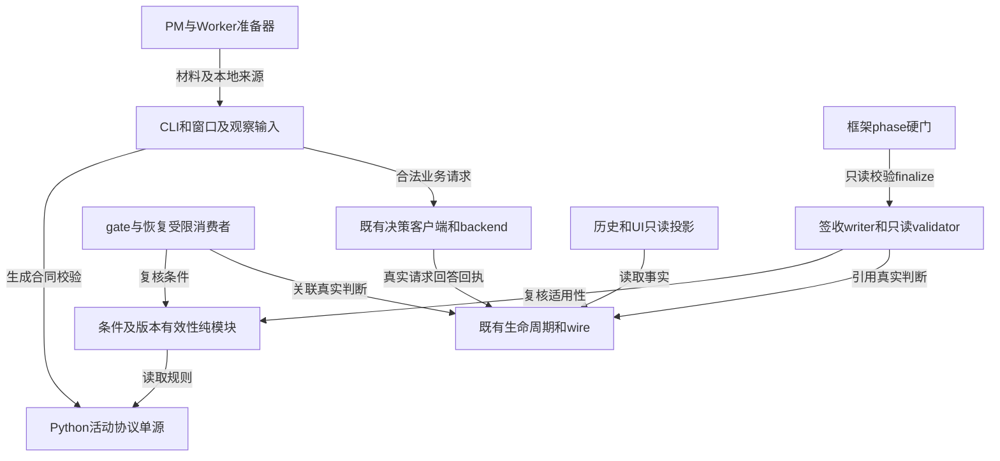

箭头表示使用/读依赖，不是授权。纯模块不import conductor/CLI/TS；backend不调用动作consumer；投影不依赖executor；framework通过只读validator CLI边界读取，不反向import PM。TS通过现有gen_decide_registry_ts生成合同，不成为第二活动权威。

## §3 模块划分与文件结构

精确文件清单、创建/修改/禁写面和单writer边界见`design-write-scope.md`，以下是逻辑责任，不授通配目录写权。

| 模块 | 候选位置 | 单一职责与不负责项 |
|---|---|---|
| M01 活动协议 | decision_points.py、decision_context.py、既有registry生成器/JSON/TS | 八ID、材料/辅助依据/角色/选项及资源描述；退役目录只读，不执行动作 |
| M02 有效性 | 新decision_validity.py | matter、实质版本、授权引用、证据适用性及重放纯校验；不自授权限、不改历史 |
| M03 传输与关联 | decision.py、decision_backends.py、decision_wire.py、decision_lifecycle.py | 同次choice/依据回答、真实本地meta、发送/接收及回执；不以选择代执行 |
| M04 gate效果 | 新autopilot/gate_effects.py，gates/conductor/xkey受限接线 | 事项条件及四分支、锁内执行和恢复对账；不改变原硬门/claim规则 |
| M05 受权恢复 | 新autopilot/decision_recovery.py、decision_policy.py | 只读授权旁载、来源验证、H12隔离handler及限定恢复；普通auto链不可调用自身解锁 |
| M06 PM准备与后继 | decision-tool、pm-orchestrator、task-dispatcher；新pm/decision-followup.ts | 准备材料与basis、送审note、既有文件意图恢复、真实调用；不编造未知用户意图 |
| M07 Worker | worker-mode、既有output-sections/status-model及mw_common | 自主三分支、有界查证、真实不完整结论；不增加同步PM等待或新终态闭集 |
| M08 QG与签收 | decision_signoff_result、decide_archive、CLI与既有validator | 正式QG结论解释，独立同次签收，仅有效finalize写入；不代stage关闭/authority-change |
| M09 观察/历史 | monitor/playground/history/dashboard/ui-bridge | 八合同表单与投影、独立note/理由/后继/执行/结算；历史原字节及缺失事实不补造 |
| M10 框架衔接 | advance_phase.py候选特批写面 | 原适用范围内正确认valid且finalize及对应当前证据；不放宽其他硬门/自动扩大强制面 |

研究过程：RQ13～22已终态吸收并ack，15/16原exit2保留；并行研究各唯一证据，PM单写联合设计。当前串行整合跨模块事项、同一design/state/VC，无新独立RQ，不重复派发研究。少量源码补核不代表独立全仓审计；完整caller和安装身份核验仍列验收工作，不部署。

## §4 接口与集成合同（候选）

### 4.1 角色资格、对象及业务材料

业务请求资格来自真实进程/当前window/task绑定，不能从material.role、CLI --role或一枚page token推导。固定节点直接调用；无合法PM绑定的外部调用不得冒充PM或Worker。既有framework可消费PM已准备的授权意图，但不是新的模型业务主体。

| 入口 | 请求主体 | 必需material（候选字段；原文不降目标） | 唯一业务选择 |
|---|---|---|---|
| dp-w-type | PM派发准备者 | task_goal/task_requirements/task_deliverables；图像要求随真实派发meta | coding/research/review/vision |
| dp-pm-steer | PM | 保留任务目标/要求/交付物原文及pm_decision_background；确有worker才给worker_execution | narrow/split/direct-exec/escalate |
| dp-w-check-task | 当前任务Worker | task_goal、reachability_facts、completed/remaining/blockers、constraints；补证给unknown/source/budget/stop_condition | continue/terminate/investigate（技术ID待审） |
| dp-QG | PM提交正式审核；证据可来自只读reviewer | requirements、verification_evidence、findings、uncovered_scope、basis_issue；每个结论须可复核 | pass/fix/reopen |
| dp-gate-approve | PM；autopilot只消费合法准备的PM意图 | gate_background、current_state、pm_note、condition_evidence；pm_note含事项/受限动作/目标证据预算授权依据/结束判据 | approve/steer/need_fix/reject |
| dp-sign-key | PM，沿原签收规则 | delivery_goal、actual_completion、verification_evidence{verified[],unverified[]}、unfinished_impact[]，四部不改 | finalize/continue/user-confirm |
| dp-auto | PM | question、background{task_goal,current_state,tried,unknowns,constraints}、handling_options[{id,label,description,consequence,risk,conditions}] | 只选实际集合ID；无固定业务菜单 |
| dp-route | PM | decision_actor、decision_object、question；复合事项先拆，不能仅事件名 | 其余七个目标ID；无业务效果 |

D012A采用时，每入口另有preparation.basis_catalog及prepared_at；独立于上表material、本地meta和可选context。schema_version/questions_version绑定当前合同。准备不完整时零模型调用，不能继承动态dp3全局2..5/cN校验。辅助材料不改变签收三数组或快照null语义。

### 4.2 本地身份与可核接口

- `validate_request(active_dp, material, preparation, bound_actor)`：先活动ID→真实角色→完整材料/依据→发送白名单与预算；输出合法PreparedDecision或明确字段错误。旧ID在replay前拒绝，安全失败审计与成功判断不同。
- `matter_for(subject, object, proposed_action, substantive_dependencies)`：产生本地MatterRef；同一对象动作不因gate kind/文件名变成新事项。role/key/task/logical_id不进入模型material；业务对象可为stage或验收项，但本地关联ID不混投影。
- `assess_validity(decision_ref, matter_ref, current_inputs, authority_source)`：valid/stale/blocked及具体原因；只读，不能写新的grant。有效决定须当前角色/事项/合同/实质证据与授权适用。
- `request_decision(prepared)`：同次原backend；输出transport可用性、合法业务choice、basis选择和原始证据引用。分开available/decision/actual_action，不把mode/acted/succeeded猜成执行。
- `consume_gate(decision_ref, prepared_note, current_context)`：锁内条件复核→限定效果或真实后继意图；记录真实效果/阻塞，不返回自动完成。
- `resume_followup(intent_ref, bound_pm)`：核父决定、当前实质版本、合法主体、真实pending/running和结果记录，未发起/在途/失败/有回答/已执行分别投影。
- `validate_key_signoff(key_root, expected_matter, current_evidence)`：只读typed JSON结果，原适用规则、真实finalize、对应签收和当前证据；framework用argv子进程或已有校验接口，不以字符串标签/文件存在代通过。

每项最终名称为设计候选，不是已有API。既有工具/CLI解析入口迁移完整后才能调用目标名；book、stdin、观察submit、validate/scaffold/cases、config on/set/apply均同一个active gate。所有产物型CLI先验type，不把key-signoff交authority-change消费者。

### 4.3 事项与实质版本

MatterRef含真实subject/object/action、依赖项清单、每项语义版本、请求合同版本及授权依据引用。全文件sha用于字节完整性/可追溯，不单独决定实质失效。

语义版本基于明确结构：目标/范围/承诺、AC/VC逐项条件、依赖边、受限文件动作、硬预算单位与上限、相关证据结果/来源、停止及撤权原因。纯空白/排版且语义值等价不变；无关证据不加入本事项依赖。自然语言无法可靠判等时记录unknown及具体差异，由已获授权主体澄清，不用“哈希不同”制造自动重复审批，也不把未知当等价启动。实质变更只使受影响决定/证据失效；保留原批准和失败，不用当前配置重写历史。

质量通过、签收、stage验收对象不同，可复用同份有效证据而非重复同一审批。重复request可复用已适用有效判断，重复action必须对账实际效果；撤销或revoke决定不自动回滚已发生效果。

### 4.4 gate状态、后继及原子性

新记录明确三个轴：transport=pending/answered/failed；business=四项或null；effect=not-started/in-progress/applied/blocked/failed/unknown。answered不是released；业务reject不是技术failed。旧approved/rejected记录保持只读历史，不能在新消费链继续执行；原40字段/三状态不是不动承诺，相关writer/parser/TS/consumer须整批迁移。

approve只有当前条件成立才可把效果记applied。steer/need_fix对应PM prepared后继，原gate.effect保持未放行；reject保持当前方案拒绝，若note另有明确已授权遗留效果须单列closure_kind=legacy，不冒充acceptance关闭。没有遗留授权则零收尾。不能推断reject=halted/rework/closed。

既有gate/task文件内只存协调意图、真实判断/生命周期引用及effect对账信息，判断仍只入原ledger；不造第二决策账本。意图schema含parent_ref、target_dp、material/basis版本、受限executor/action、状态、对应真实request_ref；logical_id由原请求链产生，不手填伪造。PM窗口身份消失时不能仅凭文件续发Worker专属请求。

复用既有O_CREAT|O_EXCL锁：事项/gate锁核版本和effect，队列/索引按既有锁；统一“事项→目标gate/任务→队列/索引”顺序，遇冲突释放后重核，不等待环。跨key多文件锁按规范化路径排序；claim仍须合法接管，模型不能抢占。HTTP/模型不持队列锁，回答后执行前重核。

原文件原子replace与append ledger不是跨文件事务：先记录in-progress意图，再动作，再写真实回执和applied。崩溃窗口必须inspect实际对象/队列/产物与关联记录，unknown时停止并给具体缺口，不盲重试、也不承诺没有事务基础的exactly-once。可幂等的受限写按版本CAS；无法安全重放的动作须真实对账后才续。

### 4.5 授权、预算与受控恢复

候选新增只读 `.agenticdoc/_autopilot/decision-policy.json`，避免改变既有冻结21键；这是单源授权引用/约束载体，不是grant生成器或新账本。没有文件默认不产生权限，非法文件fail-closed。它必须引用已有明确用户授权或受控配置的原始证据、真实actor和scope；任意文件editable/布尔preauthorized/token都不足以证明授权。有效性核授权来源、版本、撤权及目标/文件/动作/能力范围；原config.enabled/paused/auto_gate_mode和原硬门另核，旁载不能覆盖停用。

Policy候选字段：schema_version、authority_ref、scope、hard_limits[{unit,limit,usage_source}]、soft_round_extension{allowed,scope,authority_ref}、recovery{allowed_origins,scope,authority_ref,observation_conditions,stop_conditions}。真实limit/额外轮次/观察时长不由设计设置；没有明确单位/使用来源或无法核当前消耗时阻塞投入，轮数不等于token/成本/墙钟。软追加使用note明确的delta与结束判据，不重置累计使用，不提升硬预算；steer/need_fix查证也计入原适用预算/watchdog。

H12隔离不是新kind：恢复handler不注册给普通auto-pass/conductor tick自身调用；其入口只能由已绑定合法PM/操作方创建的受控请求触发，普通被熔断actor、Worker自报、伪造origin、预授权失效均拒绝在模型前。生产入口访问控制须采用既有actor/受控writer绑定，而非只认页面token；如果实际部署不能证明该隔离，恢复保持blocked，不能用“代码在tick前”替代。handler只可读取原因/检查、写本次授权范围的刹车恢复状态，不能修改policy、扩大预算或改历史；同次用原transport的gate判断，服务不可用保持刹车，无备用通道。

恢复成功后仅启用获授权的观察范围，使用policy已有观察/停止条件；条件缺失不试运行。再次原因出现/检查失败/撤权立即原刹车，关联本次恢复与新熔断。H11人工停止必须有新的明确恢复授权；H09/H10保持历史尝试计量，不清零绕限制。

### 4.6 历史、上下文与外部入口

新八入口复用旧独立key已确认的真实链节点，不改旧十节点合同。节点事实按“准备→本地meta→业务投影→请求→HTTP尝试→回答→采纳→真实执行→本轮结算→任务后快照”映射；若某节点没发生/没记录则null/未记录，不合成时间或身份。路由只有入口选择和关联，无业务executed；观察只能显示隔离request/response，后几节点不得编造；sign同次finalize另关联实际签收writer；Worker continue不生成终态节点。这里是新入口映射，不宣称已完成旧十节点验收。

task快照保留status/observed_at/source/completed/remaining/blockers及真实key/task/logical_id生命周期关联；null与[]独立。context可选摘录才允许明确裁剪，真实任务原文、业务候选/note/依据合同不能因fit_context把核心证据丢掉而仍有效；秘密过滤发送、落盘和DOM三边核验。新增上下文只用于新schema，不回填历史。

`mw decide ask`源码:1585～1598明确是人输入自由问题并用dp-human-ask直连模型，并非仅人工授权UI。它与decide run legacy questions均须纳入本次功能影响审核：候选保留显式human-only隔离查询功能，但不能产出可用于八入口业务的decision_id/签收/权限或被agent调用来替代退役DP；隔离查询标签不是活动DP，生产active集合仍八。若无法证明human-only边界，该路径不获迁移验收，不能简单重命名藏第九入口。**不擅自删除该有意功能；用户须确认保留隔离还是另行移除。** 原dry-run/allow-empty与死helper保留实现，不接回任务计数签收；仅修正当前help与typed拒绝，删除另需明确批准。

## §5 Function Flow候选

所有图为目标态候选，不描述已部署运行。F01～11覆盖外部输入、业务判断和H01～H13，模块依赖图不是业务运行证据。

### F-01 请求、路由与合法业务入口

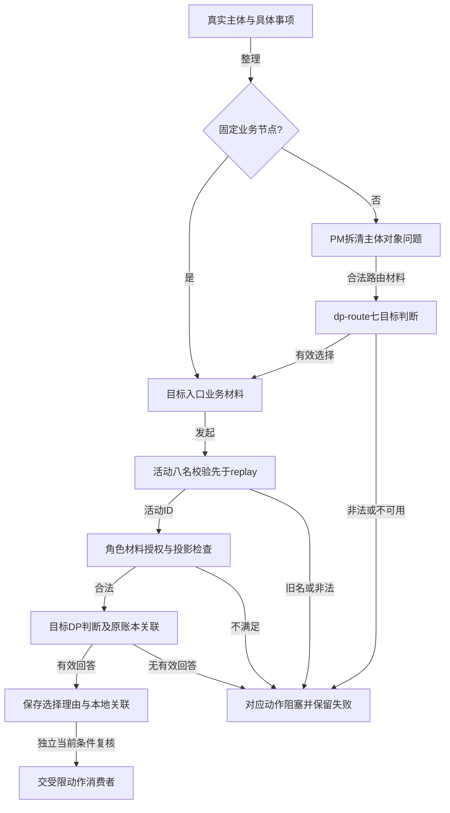

路由不授权目标角色，不直接执行；direct业务节点无额外route。replay亦先核请求身份/合同，不能返回旧ID成功；已有真实记录保留，只读历史可正常读取。

### F-02 gate与真实后继/效果

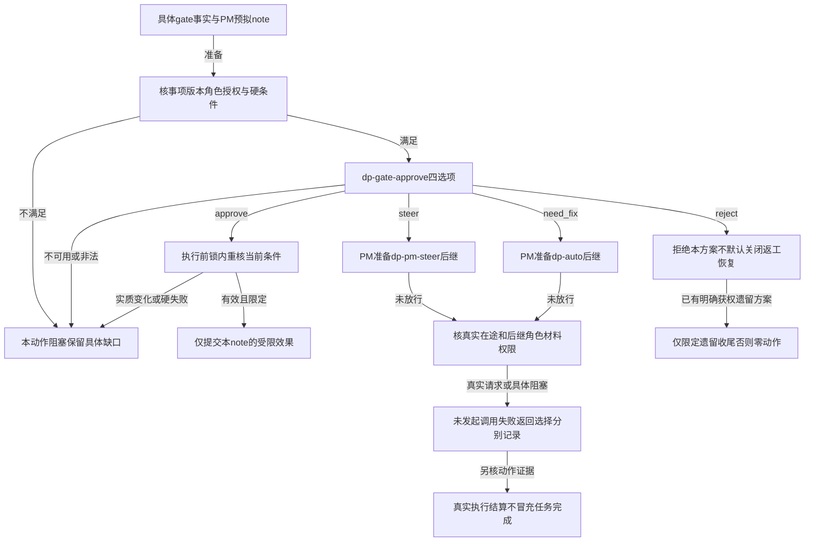

steer/need_fix不使原gate放行，后继判断不等于整改。approve自身也不是有效放行充分条件。H03/H04如同一次投入共一个owner；H09/H10仅确有独立审批对象再gate，不强制双批。

### F-03 Worker自主判断与有界补证

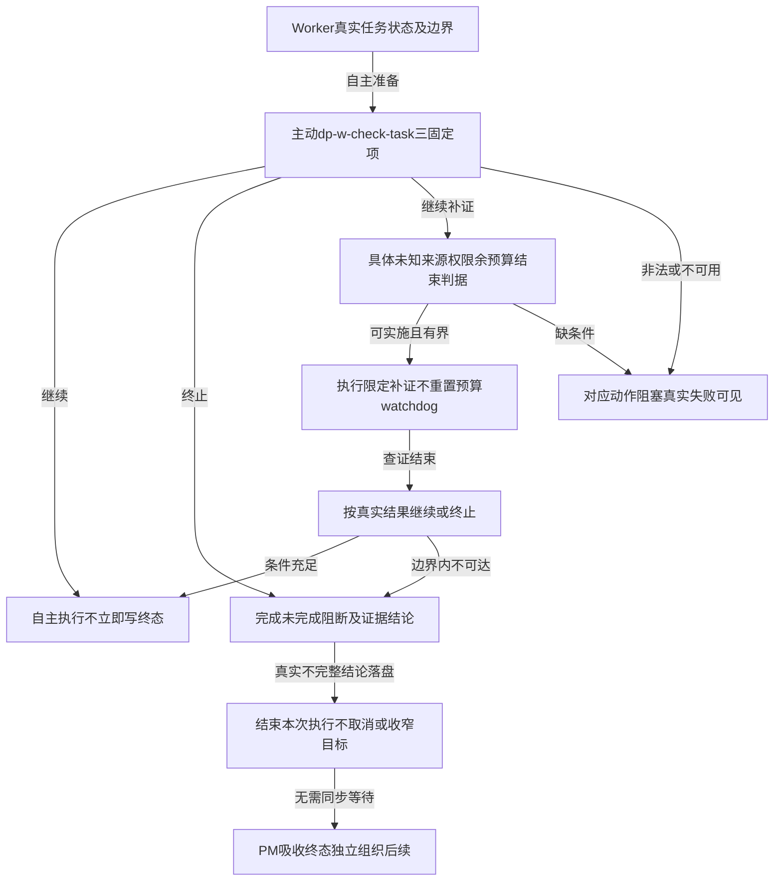

自动settle hook无agent准备材料只能提示/真实失败，不代造业务决定；不新增同步等PM链。选择继续也仍受原生命周期/硬门/授权约束。

### F-04 H01启动、H02关闭及H13签收条件

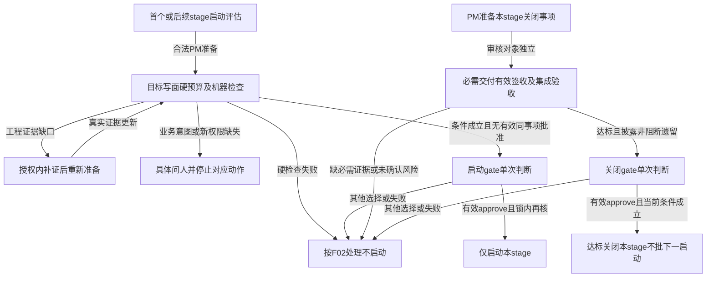

H01工程补证不凭空产生授权；H02不是done计数门，签收只是其中适用的一个前置。stage关闭与下一启动不同事项，不增加原stage-close第二次批准。

### F-05 H03停滞、H04软轮次、H05复核

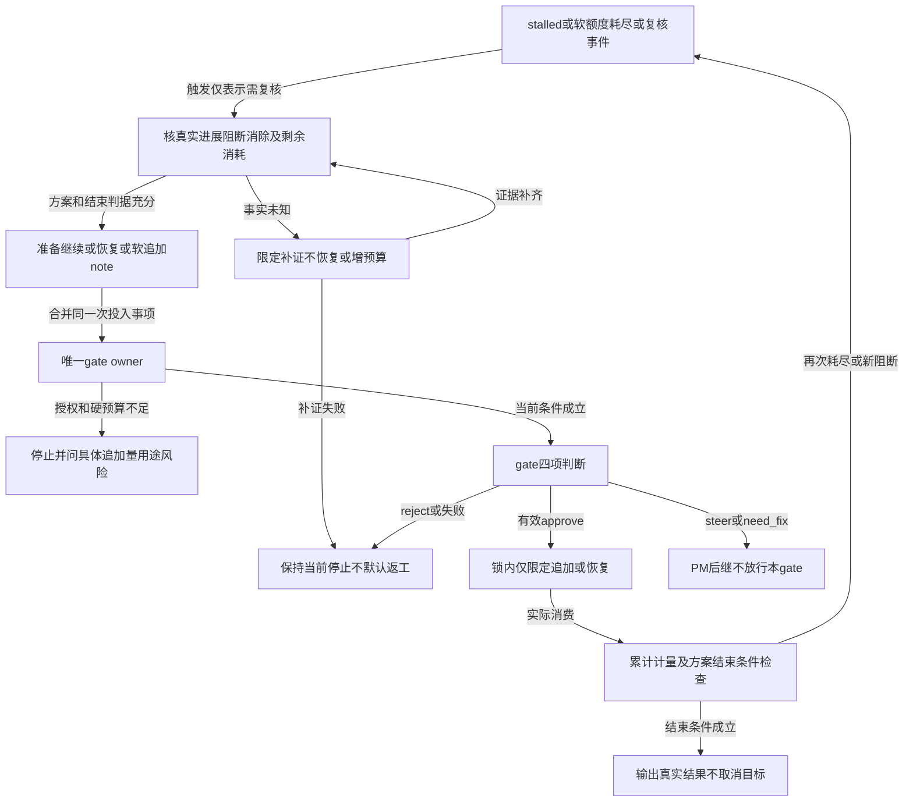

H03/H04同一步投入共一审批；到期不等于恢复/必需人工。工程查证/后继同样受硬预算；不能因硬余额尚余自动追加软轮数。

### F-06 H06目标、H07跨key、H08冻结契约

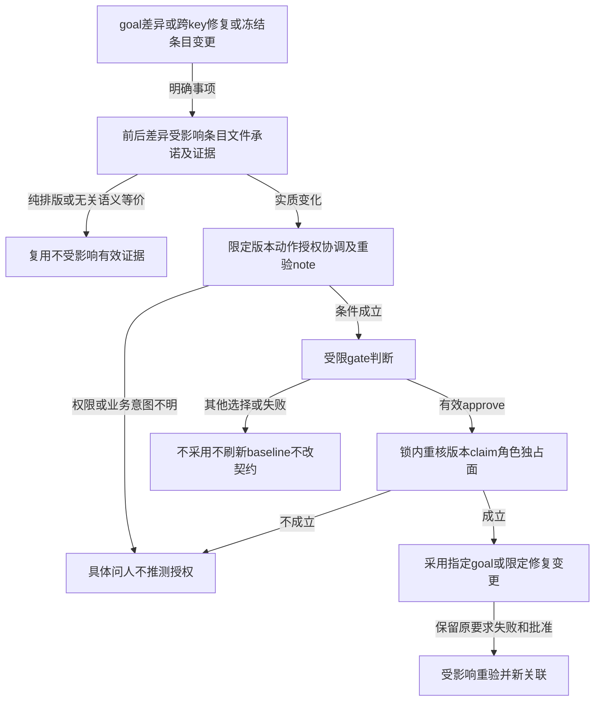

goal只是文件变更不自动授权；跨key包含在项目目录不是充分权限；reopen不是修改AC授权。语义等价核验unknown时不能走复用放行。

### F-07 H09重派与H10重规划

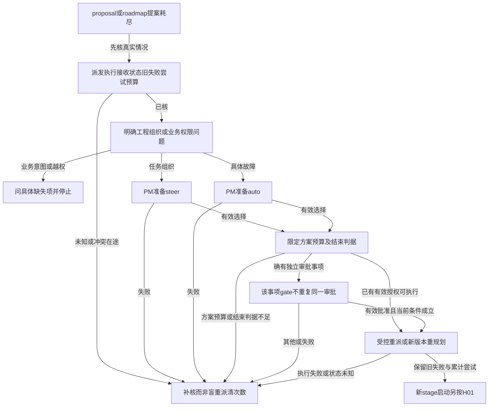

没有新方案/结束判据不得循环相似提案；标记清理是受限恢复结果，不能直接手改state冒充成功。未知result接收状态不等于执行没发生。

### F-08 H11 halted恢复

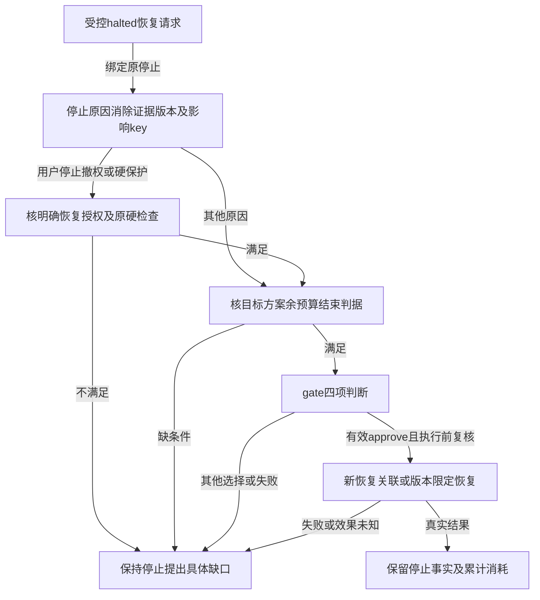

技术修复不能替代人工恢复授权；恢复关联不洗白原halted，也不reset预算/验收。

### F-09 H12隔离恢复与观察再熔断

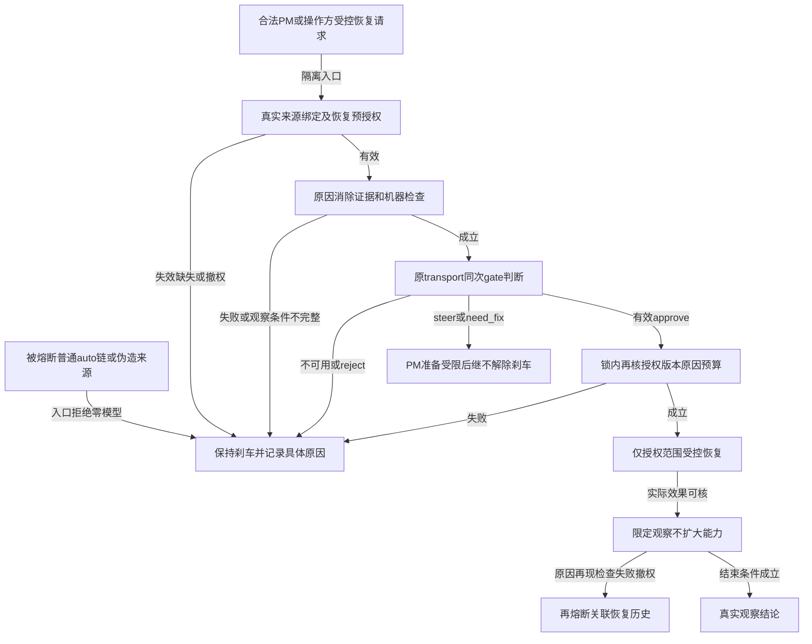

handler资格和写入边界必须由生产路径负例证明。该图不是已有恢复能力/预授权证据；模型不可用时不换通道或绕刹车。

### F-10 正式QG、同次签收及硬门

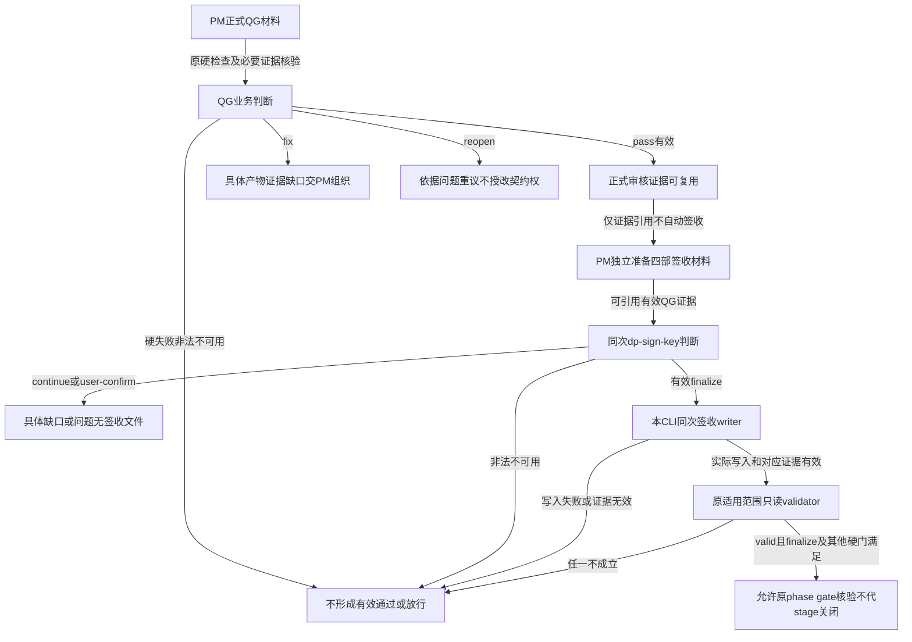

同次finalize不增加第二模型/PM批准。签收与authority-change严格分开；有效文件不是key done/stage关闭证明。

### F-11 外部运行、观察和历史读取

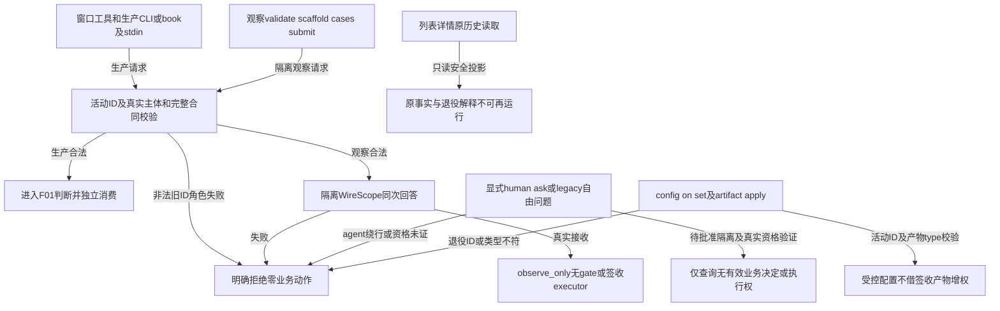

保留human功能的隔离方案必须用户确认并真正证明，不能凭CLI自报human绕过八入口；观察token不是业务授权。

## §6 Coverage Matrix

P=明确正向分支，B=预算/版本/空值/在途边界，N=非法/不可用/硬失败。L0静态只作辅助，所有有实际业务效果的AC必须L2隔离生产路径证据。

| ID | 功能点/Flow | 正常路径P | 边界B | 异常N | 验证层级与VC |
|---|---|---|---|---|---|
| C01 | 八入口/F01,F11 | 精确八名及各合法提交 | 六迁移/19退出/七路由 | 25旧ID及replay拒绝 | L0+L2，001～004/013/040～044 |
| C02 | QG/F10 | pass/fix/reopen | 证据复用与未覆盖 | 硬失败/缺证/无选择 | L2，005/006/053 |
| C03 | gate/F02 | 四选择及真实后继 | 同事项去重/遗留授权 | 非法/失效/硬失败 | L2，007/008/011/012/049 |
| C04 | H01/F04 | 首个/后续各一次启动 | 版本等价/旧批准 | 缺意图权限/硬失败 | L2，015～019 |
| C05 | H02/F04 | 达标带非阻断遗留关闭 | key签收非阶段验收 | 缺必需交付/风险未接受 | L2，010/038/039 |
| C06 | H03～05/F05 | 限定继续追加恢复 | 软额度和累计硬量 | 无计划/越界/事件即恢复 | L2，020～023/048 |
| C07 | H06～08/F06 | 指定版本/限定文件条目 | 无关证据及纯排版 | 假授权/claim冲突/旧批准 | L2，024～029/052 |
| C08 | H09～10/F07 | 有依据受控重派重规划 | 在途/未知/新stage | 清失败次数/无限相似提案 | L2，030～033 |
| C09 | H11/F08 | 限定恢复关联 | 原停止及累计预算 | 人工停止未获恢复权 | L2，034/035 |
| C10 | H12/F09 | 隔离恢复/观察/再熔断 | 预授权范围及撤权 | 普通链自批/假origin/换通道 | L2，036/037 |
| C11 | Worker/F03 | 继续/终止/补证 | null进展/查证结束 | 无结束判据/伪done/PM等待 | L2，046/047/050/051 |
| C12 | PM编排/F01,F02 | 四组织选择/动态现场候选 | 当前上下文/在途协调 | 降目标/未备选项/角色越权 | L2，009/041/042/045 |
| C13 | 签收/F10 | 同次finalize并真实写入 | 原适用范围/新证据 | 旧词表/disable/类型混用 | L2，004/038/039/051 |
| C14 | 来源与历史/F11 | 真实链和只读展示 | 未记录null与明确[] | 秘密/脚本/历史回填 | L2，013/014/050/051 |
| C15 | 并发与故障/全Flow | 有效复用/实际效果对账 | 崩溃窗口/撤权/语义未知 | 重复动作/绕锁/双writer | L2，011/019/030/031/049/052 |
| C16 | 所有八入口失败/F01 | 合法答案对照 | 缺项/错ID/错依据引用 | unavailable/错误type/无选择 | L2，012/043 |

## §7 Verification Contract

以下是拟定断言，不是运行结果。每个VC必须输出测量值和fixture/input/生产入口/真实记录定位；不能由手填PASS或fixture直接写gate/ledger证明。计数在对应隔离场景内，faux provider无retry场景下计算业务判断次数；运输attempt与业务审批另计。`violations=0`必须有逐项预期和观测对照，不能从自评获得。具体证据文件与充分性见evidence-requirement.md。

VC-001: 迁移后的注册、生成TS、CLI及观察提交集合都精确为§0八名；aliases=0，migrated_roles=6，retired_roles=19，added_entries=2。
       Layer: L2（L0生成锁辅助）
       Output: [VERIFY] VC-001: active=8 aliases=0 migrated=6 retired=19 added=2
       Source: AC-001
VC-002: 对每个25旧ID分别从所有运行入口及已有logical_id replay提交，明确retired拒绝；模型/业务动作/新增有效决定各0，安全审计不计成功。
       Layer: L2
       Output: [VERIFY] VC-002: rejected_old_ids=25 model_calls=0 business_actions=0 valid_decisions=0
       Source: AC-002
VC-003: 受限生产caller/config/prompt/case/UI清单逐项分类后，旧ID活跃注册/调用/可提交数=0；六迁移与19退出逐项对应，硬检查和非菜单框架类型丢失=0。
       Layer: L2（L0清单辅助）
       Output: [VERIFY] VC-003: active_old_refs=0 unclassified_refs=0 lost_guards=0 lost_framework_types=0
       Source: AC-003
VC-004: w-type/pm-steer/w-check/sign-key基线合法场景分别走其全部选择，原签收四部及三数组成立；增权/降目标/假执行完成/新增同步等待均0。
       Layer: L2
       Output: [VERIFY] VC-004: baseline_contract_violations=0
       Source: AC-004
VC-005: QG三结论各附真实依据、具体缺口或依据问题及未覆盖面，正式意见与实际整改分开；自动改承诺/验收=0。
       Layer: L2
       Output: [VERIFY] VC-005: reviewed_choices=3 missing_required_evidence=0 unauthorized_contract_edits=0
       Source: AC-005
VC-006: 缺必要质量证据及每项硬门失败时，QG有效pass=0、业务放行=0，失败项逐项可见。
       Layer: L2
       Output: [VERIFY] VC-006: usable_pass=0 releases=0 hidden_failures=0
       Source: AC-006
VC-007: gate四选择分别观测PM note与模型依据独立来源；steer/need_fix不放行不声明整改，reject无具体遗留授权时收尾=0。
       Layer: L2
       Output: [VERIFY] VC-007: gate_choices=4 mixed_note_basis=0 false_release_or_repair=0 unauthorized_closure=0
       Source: AC-007
VC-008: 对启用、授权、预算、claim和机器条件逐项缺失/失败负例，任何gate选择的有效放行/越权副作用=0，并保留各具体原因。
       Layer: L2
       Output: [VERIFY] VC-008: unauthorized_releases=0 unauthorized_effects=0 missing_failure_reasons=0
       Source: AC-008
VC-009: phase硬门失败后，PM用专门背景和候选提交auto并实际受限处理，原硬门未复验通过前phase推进=0，原失败未丢失。
       Layer: L2
       Output: [VERIFY] VC-009: unchecked_phase_advances=0 erased_failures=0
       Source: AC-009
VC-010: stage正例达标且非阻断遗留披露可关闭=1；缺必需交付/验证、仅done或签收、未接受风险负例关闭=0；下一stage自动批准=0，遗留关闭不计达标。
       Layer: L2
       Output: [VERIFY] VC-010: valid_closures=1 invalid_closures=0 next_stage_approvals=0 false_acceptance_closures=0
       Source: AC-010
VC-011: 同主体对象动作实质版本在不同标签/文件重放及并发，只一个业务审批owner，额外同事项审批=0、重复动作=0；路由放行=0。
       Layer: L2
       Output: [VERIFY] VC-011: duplicate_approvals=0 duplicate_actions=0 route_releases=0
       Source: AC-011
VC-012: 八入口材料非法/不可用/无有效选择，各受门控动作=0且原因可见；伪造decision_id/执行回执、默认选择及换入口绕失败=0。
       Layer: L2
       Output: [VERIFY] VC-012: default_actions=0 fabricated_results=0 failure_bypasses=0
       Source: AC-012
VC-013: 退役历史列表详情读取后历史原文件逐字节相同，展示retired/readonly且新运行不可用，不新增当前配置/状态补造事实。
       Layer: L2
       Output: [VERIFY] VC-013: historical_byte_changes=0 historical_fact_fabrications=0 retired_reruns=0
       Source: AC-013
VC-014: Python/TS真实producer→writer→consumer→projection链可关联，选择/执行/完成不混同；请求、记录、DOM秘密明文及注入执行=0。
       Layer: L2
       Output: [VERIFY] VC-014: broken_links=0 false_execution_or_completion=0 secret_leaks=0 script_executions=0
       Source: AC-014
VC-015: 授权条件齐备的首stage及后stage各首次评估只有1次启动gate判断；没有有效同事项决定才发起，逐stage人工要求=0。
       Layer: L2
       Output: [VERIFY] VC-015: first_stage_decisions=1 later_stage_decisions=1 per_stage_human_requirements=0
       Source: AC-015
VC-016: 仅缺授权内工程证据先实际补证，补齐前stage启动=0、把工程缺口升级为新权限请求=0；补齐后可重新判断。
       Layer: L2
       Output: [VERIFY] VC-016: premature_starts=0 fabricated_permission_needs=0
       Source: AC-016
VC-017: 缺真实用户业务意图或越目标/写面/硬预算的启动场景，具体缺失项/所需权限可见，越权启动及执行=0。
       Layer: L2
       Output: [VERIFY] VC-017: unauthorized_starts=0 unauthorized_actions=0 vague_escalations=0
       Source: AC-017
VC-018: 启动各硬检查失败时停止对应动作，DP选approve也不得豁免，具体阻断无遗漏。
       Layer: L2
       Output: [VERIFY] VC-018: waived_hard_checks=0 hidden_start_blockers=0
       Source: AC-018
VC-019: 启动依赖实质变化使受影响旧批准复用=0；同版本及语义等价重复额外审批/动作=0；需要重新判断的新实质版本有真实关联。
       Layer: L2
       Output: [VERIFY] VC-019: stale_starts=0 duplicate_approvals=0 duplicate_actions=0
       Source: AC-019
VC-020: 有软追加授权且note具真实进展/预算/方案/结束判据正例仅限定delta追加；无授权/无计划或只凭硬余额负例追加=0。
       Layer: L2
       Output: [VERIFY] VC-020: unbounded_extensions=0 unsupported_extensions=0
       Source: AC-020
VC-021: 软追加、steer或need_fix将越硬预算时越界执行=0、自行提高硬上限=0；必须具体追加量/用途/风险授权问题，累计消耗不重置。
       Layer: L2
       Output: [VERIFY] VC-021: hard_budget_overruns=0 self_granted_limits=0 reset_usage=0
       Source: AC-021
VC-022: pending复核事件/到期只触发评估，不自动恢复/默认要求人工；正例目标有效且阻断消除及证据授权预算充分才approve恢复，无依据恢复=0。
       Layer: L2
       Output: [VERIFY] VC-022: event_only_resumes=0 unsupported_resumes=0 mandatory_human_waits=0
       Source: AC-022
VC-023: pending三非approve项真实交PM或拒绝方案，reject默认返工=0、假恢复整改=0、越权目标预算写面/遗留关闭=0，同证据重复QG=0。
       Layer: L2
       Output: [VERIFY] VC-023: default_reworks=0 false_resumes=0 unauthorized_changes=0 redundant_qg=0
       Source: AC-023
VC-024: goal文件变化先核实质差异，仅有效approve采用note指定语义版本；其他三选择及失败不刷新baseline/自动恢复，错误采用=0。
       Layer: L2
       Output: [VERIFY] VC-024: unapproved_goal_adoptions=0 unapproved_baseline_refreshes=0
       Source: AC-024
VC-025: 实质goal变更只失效受影响key/验收/依赖/写面批准，缺意图权限具体问人；越权执行=0、无关/纯排版重复审批=0。
       Layer: L2
       Output: [VERIFY] VC-025: stale_affected_releases=0 unauthorized_actions=0 irrelevant_reapprovals=0
       Source: AC-025
VC-026: 跨key note具体必要性/key/文件/动作/影响/授权/协调/验证，正例只在限定面实施；开放式/新增未授权写面修改=0。
       Layer: L2
       Output: [VERIFY] VC-026: open_ended_repairs=0 unauthorized_write_surfaces=0
       Source: AC-026
VC-027: 实际跨key执行者/claim/角色/独占面检查成立；抢他窗claim、双Worker同文件并写、越权及reject自动关闭=0，选择不得冒充派发/修改。
       Layer: L2
       Output: [VERIFY] VC-027: claim_thefts=0 concurrent_file_writers=0 unauthorized_actions=0 fake_dispatches=0
       Source: AC-027
VC-028: 冻结变更仅指定key/条目/前后差异/承诺影响/权限/重验安排获准，旧批准套新变更、未授权降验收和伪完成=0。
       Layer: L2
       Output: [VERIFY] VC-028: reused_unrelated_change_approvals=0 unauthorized_acceptance_reductions=0 fabricated_completion=0
       Source: AC-028
VC-029: 冻结变更后受影响旧证据通过=0，需真实重验；历史原要求/失败/批准字节不改；QG reopen或gate reject自动改契约/签收关闭=0。
       Layer: L2
       Output: [VERIFY] VC-029: stale_acceptance_passes=0 rewritten_history=0 automatic_contract_or_closure_changes=0
       Source: AC-029
VC-030: proposal恢复核派发/执行/接收和pending/running、尝试产物预算，未知/冲突在途重派=0；正例只有限定动作预算结束判据的受控恢复。
       Layer: L2
       Output: [VERIFY] VC-030: unknown_state_redispatches=0 conflicting_redispatches=0 unbounded_recoveries=0
       Source: AC-030
VC-031: proposal失败保留且标记清理有前置检查/原恢复关联，改状态造成功=0、未经验证清标记=0、同事项额外gate=0。
       Layer: L2
       Output: [VERIFY] VC-031: erased_failures=0 unsafe_marker_clears=0 fake_successes=0 redundant_gates=0
       Source: AC-031
VC-032: roadmap耗尽授权内有实质修订/余预算/结束判据才重规划，旧原因可见；无限相似提案/越权硬预算投入=0，缺业务事项具体问人。
       Layer: L2
       Output: [VERIFY] VC-032: unsupported_replans=0 unbounded_proposals=0 unauthorized_planning_actions=0
       Source: AC-032
VC-033: 重规划保留旧提案拒绝失败并以新版本关联，重置尝试/改历史绕限=0，规划直接授新权/启动=0，新stage另按H01。
       Layer: L2
       Output: [VERIFY] VC-033: reset_attempts=0 rewritten_proposals=0 planning_grants_or_starts=0
       Source: AC-033
VC-034: halted正例note具停止消除证据/版本影响/目标权限余预算结束判据且approve有效才限定恢复；抹停止历史/重置消耗/无依据恢复=0。
       Layer: L2
       Output: [VERIFY] VC-034: erased_stop_facts=0 reset_usage=0 unsupported_resumes=0
       Source: AC-034
VC-035: 人工停止撤权或硬保护负例，技术修复/DP选择不能替代恢复授权，未授权解除人工停止/绕硬保护=0，非approve项假恢复/增权=0。
       Layer: L2
       Output: [VERIFY] VC-035: unauthorized_user_stop_unlocks=0 hard_guard_bypasses=0 false_resumes=0
       Source: AC-035
VC-036: 隔离H12来源/预授权/消除证据/硬检查正例才限定恢复；普通熔断链、伪origin、无权、不可用负例自批/换通道/默认恢复=0。
       Layer: L2
       Output: [VERIFY] VC-036: breaker_self_approvals=0 unauthorized_recoveries=0 transport_bypasses=0
       Source: AC-036
VC-037: H12缺授权证据或用户撤权保持刹车且具体问题可见；原熔断及恢复保留，reject项目关闭=0；观察原因再现正例再熔断=1。
       Layer: L2
       Output: [VERIFY] VC-037: unauthorized_unlocks=0 erased_breaker_history=0 reject_project_closures=0 observed_retrip=1
       Source: AC-037
VC-038: 原适用必需签收场景，仅当前有效finalize及对应证据可满足该项；同次判断写入且第二批准=0，continue/user-confirm/QG/文件存在代done或stage关闭=0。
       Layer: L2
       Output: [VERIFY] VC-038: second_sign_approvals=0 false_signed_conditions=0 automatic_done_or_stage_closes=0
       Source: AC-038
VC-039: finalize正确词表与当前matter/实质证据校验成立；旧词表或disable绕原强制规则、强制范围扩大、受影响旧签收复用/历史补造=0。
       Layer: L2
       Output: [VERIFY] VC-039: legacy_word_bypasses=0 signoff_scope_expansions=0 stale_signoff_reuses=0 historical_fabrications=0
       Source: AC-039
VC-040: route分别选择七目标并显示依据，入口选择不能推出目标业务结论，路由业务放行/执行=0，目标材料另准备。
       Layer: L2
       Output: [VERIFY] VC-040: routed_targets=7 route_releases=0 route_actions=0
       Source: AC-040
VC-041: 固定节点强制route=0；复合事项有独立owner，PM代Worker自身判断及Worker调PM入口成功=0，同事项额外审批=0。
       Layer: L2
       Output: [VERIFY] VC-041: mandatory_routes=0 role_impersonations=0 duplicate_approvals=0
       Source: AC-041
VC-042: auto覆盖不同现场候选数目/非cN ID，实际choice只在提交集合且依据匹配真实引用；未备方案/伪理由/增权或代固定审批签收=0。
       Layer: L2
       Output: [VERIFY] VC-042: invented_candidates=0 invalid_basis_refs=0 unauthorized_or_substituted_actions=0
       Source: AC-042
VC-043: 八入口分别构造缺项、错type、不可用、缺选择、错选择或依据不匹配，具体失败逐例可见，受门控动作=0、默认首项/approve/换通道/造授权=0。
       Layer: L2
       Output: [VERIFY] VC-043: failed_entries=8 failure_actions=0 fabricated_approvals=0 hidden_failure_cases=0
       Source: AC-043
VC-044: w-type精确四候选，需图且已证能力的vision正例启动=1；无图能力负例启动=0，unknown无证亦不启动，coding降级=0，其他框架类型未删除。
       Layer: L2
       Output: [VERIFY] VC-044: offered_types=4 capable_vision_starts=1 incapable_or_unproven_starts=0 coding_downgrades=0
       Source: AC-044
VC-045: pm-steer四项逐支有不降目标主线/独立并行/当前上下文依赖/具体人工问题证据，真实编排可区分，未协调在途冲突执行=0。
       Layer: L2
       Output: [VERIFY] VC-045: steering_choices=4 goal_reductions=0 uncoordinated_conflicting_actions=0 vague_human_questions=0
       Source: AC-045
VC-046: Worker充足/不可达/有界未知三场景对应三选择；continue即刻伪终态=0，terminate真实结论并结束本次=1，新增同步等待/目标取消收窄=0。
       Layer: L2
       Output: [VERIFY] VC-046: worker_choices=3 fake_immediate_terminals=0 truthful_terminations=1 added_pm_waits=0 goal_cancellations=0
       Source: AC-046
VC-047: 补证真实未知/来源/权限预算/结束判据成立后实施并真实继续或终止；无结束判据或边界不可查证放行=0、无限补证/凭空意图=0。
       Layer: L2
       Output: [VERIFY] VC-047: unsupported_investigations=0 unbounded_investigations=0 invented_intents=0
       Source: AC-047
VC-048: stalled note具原因状态/尝试产物/额度预算/方案结束判据或获权遗留影响，正例仅限定动作；缺项或只硬余额放行=0、抹历史消耗/降验收取消目标=0。
       Layer: L2
       Output: [VERIFY] VC-048: unsupported_stall_releases=0 erased_usage_or_failures=0 reduced_acceptance_or_goals=0
       Source: AC-048
VC-049: 已备合法后继且无在途时，steer和need_fix各有一次真实PM目标请求；未备/在途/调用失败/有回答/已执行分别可见，重复后继和原gate放行=0。
       Layer: L2
       Output: [VERIFY] VC-049: steer_successor_requests=1 fix_successor_requests=1 duplicate_successors=0 parent_releases=0
       Source: AC-049
VC-050: 真实执行与本轮结算关联同key/task/logical_id及非递减观察时间，before不由当前回填；未执行/失败伪成功executed=0、settled代done=0。
       Layer: L2
       Output: [VERIFY] VC-050: broken_action_links=0 backfilled_before=0 fabricated_executed=0 settlement_done_inferences=0
       Source: AC-050
VC-051: task进展null和[]序列化及投影可区分，sign三数组缺项/null拒绝而合法[]保留；agent-report增权、秘密泄漏或历史回写=0。
       Layer: L2
       Output: [VERIFY] VC-051: null_empty_conflations=0 invalid_sign_arrays_accepted=0 agent_report_grants=0 secret_or_history_violations=0
       Source: AC-051
VC-052: 同事项并发/重放无额外审批动作、双writer或绕锁；实质依赖变化使受影响旧批准无效且真实重验，不受影响/纯排版重复实质审批=0；崩溃未知不盲重试。
       Layer: L2
       Output: [VERIFY] VC-052: duplicate_effects=0 duplicate_approvals=0 concurrent_writers=0 lock_bypasses=0 stale_releases=0 irrelevant_reapprovals=0
       Source: AC-052
VC-053: QG充分无阻断/明确产物缺口/实质依据问题三场景准确对应pass/fix/reopen，证据/缺口/未覆盖明确，自动改契约/派返工/代签收或审批=0。
       Layer: L2
       Output: [VERIFY] VC-053: qg_choices=3 wrong_business_conclusions=0 automatic_contract_dispatch_or_sign_actions=0
       Source: AC-053

## §8 AC → VC 映射表

每条AC由同号VC完整证明；跨项可额外复用但不得用部分VC/计数替代对应全部路径。

| AC ID | AC摘要 | 对应VC | 路径分类/Flow |
|---|---|---|---|
| AC-001 | 八活动入口组成 | VC-001 | P/B，F01/F11 |
| AC-002 | 25旧ID明确拒绝 | VC-002 | N/replay，F11 |
| AC-003 | 生产面无旧活跃调用 | VC-003 | P/N/inventory，F11 |
| AC-004 | 四职责业务基线 | VC-004 | P/B/N，F01/F03/F10 |
| AC-005 | 正式QG证据结论 | VC-005 | P/B，F10 |
| AC-006 | QG缺证硬失败不放行 | VC-006 | N，F10 |
| AC-007 | gate四项与note分离 | VC-007 | P/N，F02 |
| AC-008 | gate授权硬条件 | VC-008 | B/N，F02 |
| AC-009 | phase失败auto处置 | VC-009 | P/N，F01/F02 |
| AC-010 | stage整体验收关闭 | VC-010 | P/B/N，F04 |
| AC-011 | 唯一事项owner与复用 | VC-011 | B/concurrent，F01/F02 |
| AC-012 | 全入口失败阻塞 | VC-012 | N，F01/F11 |
| AC-013 | 退役历史只读原字节 | VC-013 | P/B/N，F11 |
| AC-014 | 真链来源安全 | VC-014 | P/N，F11 |
| AC-015 | 首后stage一次启动判断 | VC-015 | P，F04 |
| AC-016 | 工程证据缺口先补 | VC-016 | P/N，F04 |
| AC-017 | 缺业务权限具体问人 | VC-017 | N，F04 |
| AC-018 | 启动硬门不豁免 | VC-018 | N，F04 |
| AC-019 | 启动实质版本与重放 | VC-019 | B/replay，F04 |
| AC-020 | 有依据限定软追加 | VC-020 | P/B/N，F05 |
| AC-021 | 硬预算不可自提 | VC-021 | B/N，F05 |
| AC-022 | pending事件复核非恢复 | VC-022 | P/B/N，F05 |
| AC-023 | pending三项真实后继 | VC-023 | P/N，F02/F05 |
| AC-024 | goal有效批准指定采用 | VC-024 | P/N，F06 |
| AC-025 | goal影响失效与无关复用 | VC-025 | B/N，F06 |
| AC-026 | 跨key限定方案 | VC-026 | P/N，F06 |
| AC-027 | 跨keyclaim角色独占面 | VC-027 | B/N/concurrent，F06 |
| AC-028 | 冻结条目限定差异 | VC-028 | P/N，F06 |
| AC-029 | 契约受影响重验历史 | VC-029 | B/N，F06 |
| AC-030 | proposal真实在途有界恢复 | VC-030 | P/B/N，F07 |
| AC-031 | 恢复标记失败保留 | VC-031 | B/N/crash，F07 |
| AC-032 | roadmap有依据重规划 | VC-032 | P/B/N，F07 |
| AC-033 | 新规划版本不授启动 | VC-033 | B/N，F07/F04 |
| AC-034 | halted限定恢复关联 | VC-034 | P/B/N，F08 |
| AC-035 | 人工停止恢复权 | VC-035 | N，F08 |
| AC-036 | 熔断隔离来源受控恢复 | VC-036 | P/N，F09 |
| AC-037 | 保持刹车与观察再熔断 | VC-037 | P/B/N，F09 |
| AC-038 | 同次有效finalize硬门 | VC-038 | P/N，F10/F04 |
| AC-039 | 签收词表范围版本 | VC-039 | B/N，F10 |
| AC-040 | 七路由非业务动作 | VC-040 | P/N，F01 |
| AC-041 | 固定直调复合角色 | VC-041 | P/B/N，F01 |
| AC-042 | auto真实候选理由 | VC-042 | P/B/N，F01 |
| AC-043 | 八入口逐例异常 | VC-043 | N，F01/F11 |
| AC-044 | 四类型与vision硬能力 | VC-044 | P/B/N，F01 |
| AC-045 | 四PM编排真实组织 | VC-045 | P/N，F01/F02 |
| AC-046 | Worker三分支真实终止 | VC-046 | P/N，F03 |
| AC-047 | 补证来源预算结束 | VC-047 | P/B/N，F03 |
| AC-048 | stalled专门证据限定 | VC-048 | P/N，F05 |
| AC-049 | PM真实后继与失败 | VC-049 | P/B/N，F02 |
| AC-050 | 真执行结算及前后来源 | VC-050 | P/B/N，F02/F03 |
| AC-051 | null与[]及签收数组 | VC-051 | B/N，F03/F10/F11 |
| AC-052 | 并发实质变化和崩溃对账 | VC-052 | B/N/concurrent/crash，所有Flow |
| AC-053 | QG三项正向与不自动改权 | VC-053 | P/N，F10 |

## §9 非功能方案与验收边界

- 性能：沿用现有timeout/retries/并发/读取资源预算，不新设SLA、上限或实际预算。回答与后继恢复不长持队列锁；扫描只读既有意图/真实记录且遵守原读取上限。材料和basis超界明确拒绝，不能静默截断影响业务依据。
- 安全：真实角色绑定；生产/观察WireScope隔离；路径规范化、symlink/跨根拒绝及已有受限写面；argv无shell；秘密在发送/日志/HTML文本边界过滤；未知能力/授权不能positive。H12 handler不可写policy/权限/预算，不接受被熔断链自调用。
- 历史/并发：原历史byte manifest对照，已有锁/claim独占面负例，失败/撤权/崩溃窗口真对账；readonly解释不是兼容执行。未记录null不补造，安全失败审计不计有效裁决。
- 可观察性：transport/choice/basis/note/request/action/settled/terminal独立来源；父后继链接取真实id与时间，未知显式未记录。report区分活动/退役历史，生成字节锁不等于/API投影相同或运行身份。
- 验证：faux/hermetic生产路径，隔离项目/home/env/临时文件，不真实凭证或付费provider；DOM注入/秘密、历史字节、模型次数及动作次数都有可核负例。L0/Mermaid/audit不替产品L2或正式QG。
- check：批准实施后每个改测试文件跑具体suite；全npm run check用保护副本保留全部输出，不能formatter写他人文件；不跑build/npm test/全vitest，现Windows89环境基线与已知旧失败单独登记。任何新失败先按debug工作流，不偷偷降代码或依赖。

## §10 已批准决策记录

本次联合审核采用D001A活动Python单源；D002A material/meta/生命周期分层；D003A固定/动态独立；D004A纯有效性+事项effect；D005B持久PM已备意图；D006A沿用终态加真实原因；D007A共用只读签收validator；D008B持久恢复请求+A隔离handler；D009A物理八活动/独立退役目录；D010B生成合同+专门投影；D011A签收/authority-change隔离；D012A模型选择预备可溯源理由。备选比较保留，未选方案不作为实施权限；key-decision.md A章追加定案与技术理由。确认出处：`evidence/design-approval-20261026.md`；记录时刻2026-10-26T03:29:23.7502927+08:00，不伪填用户消息时间。

## §11 精确写面与批准边界

`design-write-scope.md`列出的逐文件修改/创建、单writer边界及框架advance_phase.py/test_advance_phase.py限定特批面已获本次审核批准；四旧case只读与全部禁止面不变。进入实施仍须PLAN/任务/执行门禁。未列文件须先报告影响并批准补面，不能以“整目录迁移”放权。

本次三项定案：
1. D012A“模型选择有出处理由/关键依据、文字由PM预备”已接受；无完整依据或回答不匹配仍阻塞。不实施B或猜上游字段，不换provider/model/通道，不新增第二审批。
2. human ask保留真实human-only隔离查询，不产生可用于八入口业务的决定/权限；生产资格隔离无法证明则不验收，不删除功能或凭标签免责。
3. 新gate三轴、只读policy旁载、持久PM意图+隔离恢复及共同validator按联合设计落计划；框架脚本及配套测试限定面批准。此审批不产生实际权限grant、预算数值或恢复许可，不批准mirror/安装部署/commit/push。

evidence-requirement.md与53AC→53VC按本次设计审核固化；断言、Source、流程及SPEC正文不改。实现测试未运行，源码caller全清单/部署身份未验收，独立26AC/monitor8AC/formatter/dropdown/dp3等旧债不完成也不减免。仅允许通过框架进入PLAN及据此组织获批范围任务；本确认不是QG/签收/完成或活业务执行。

