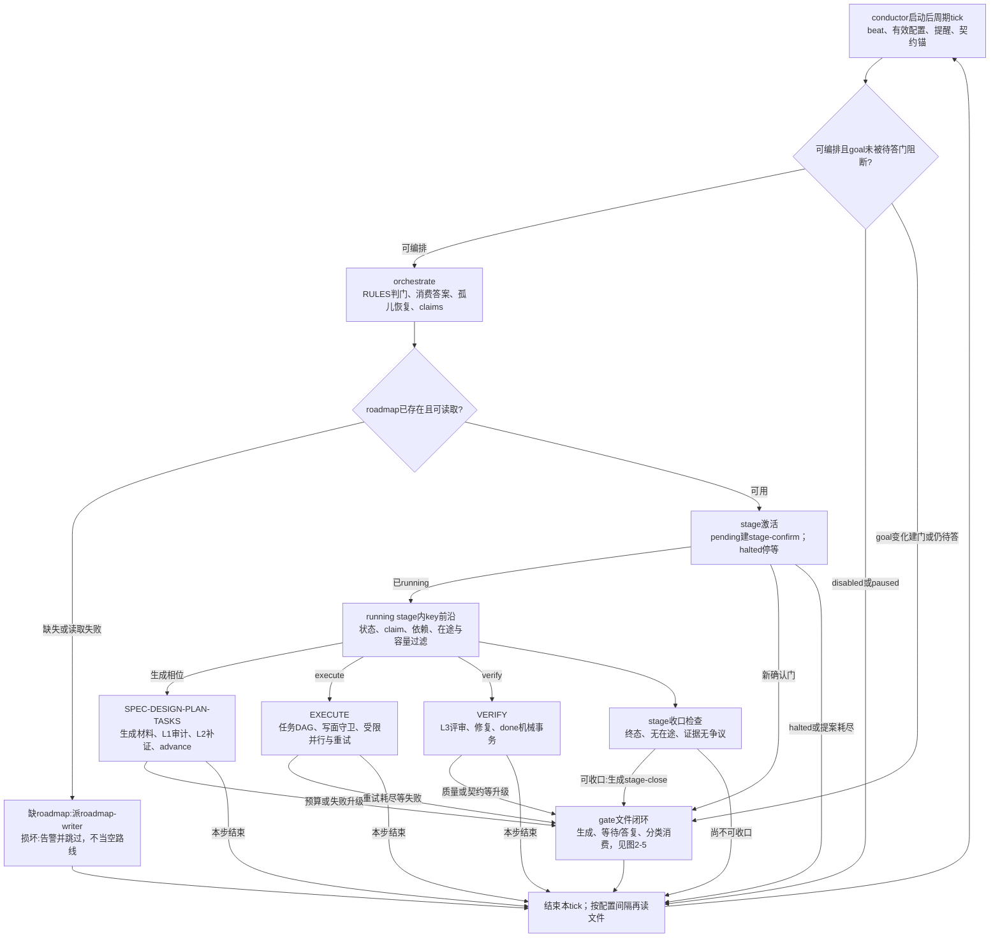
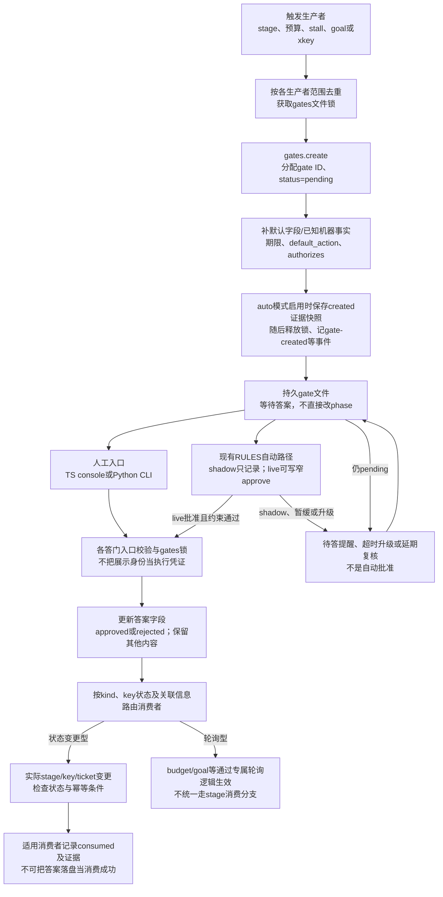
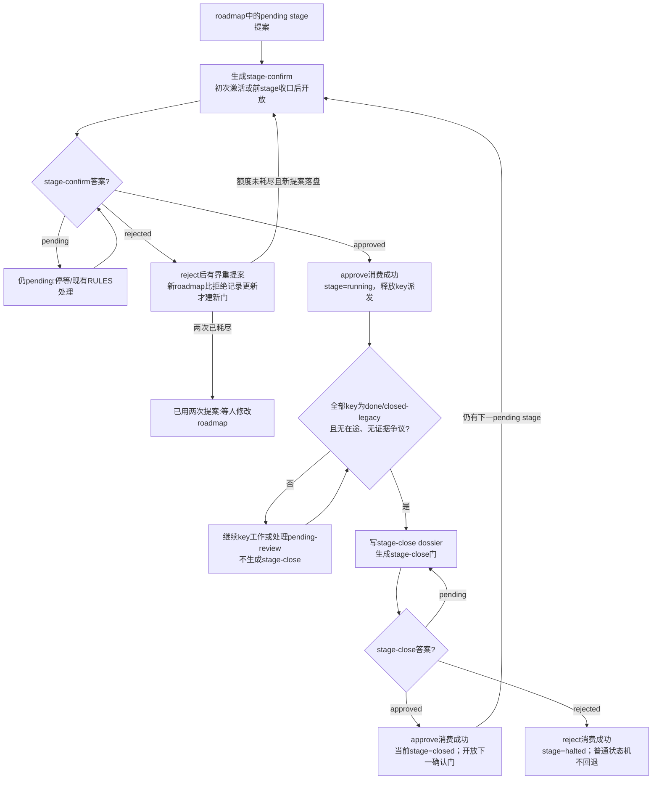
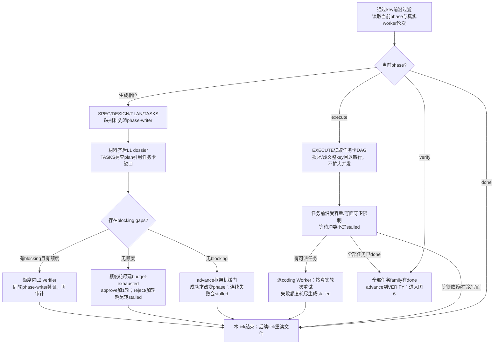
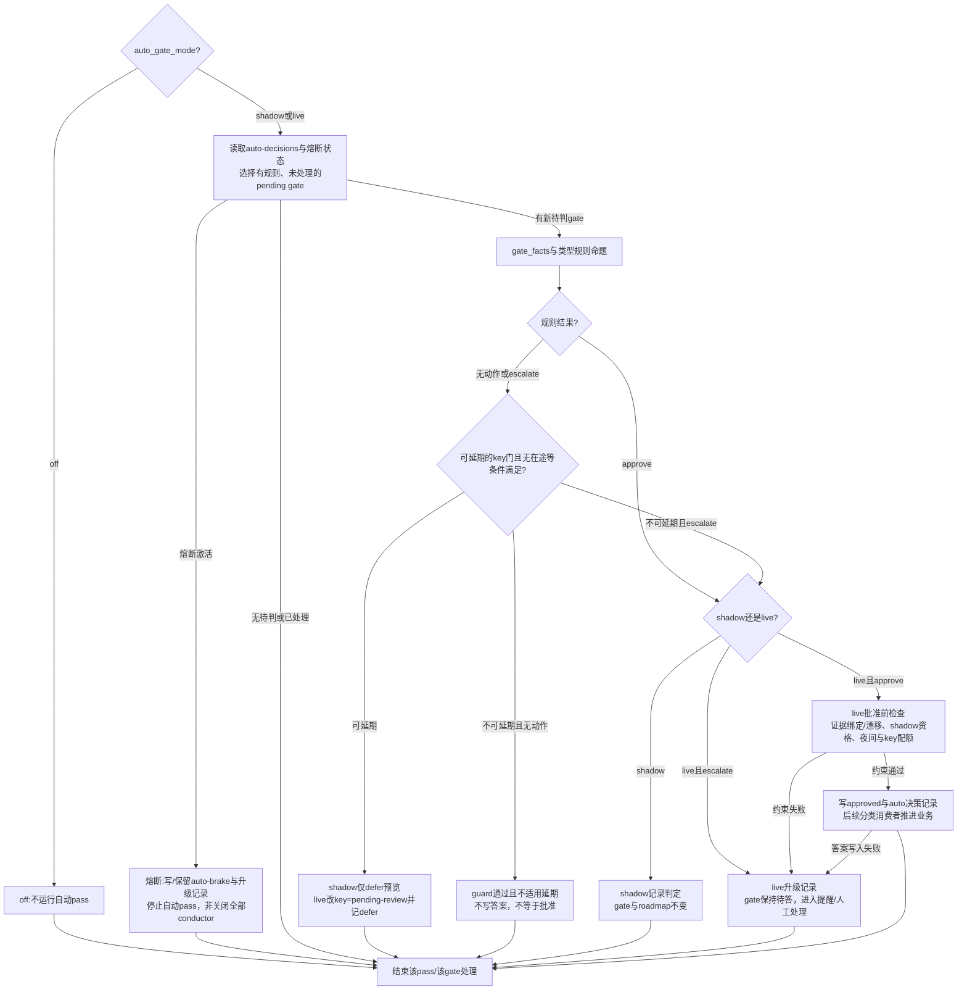
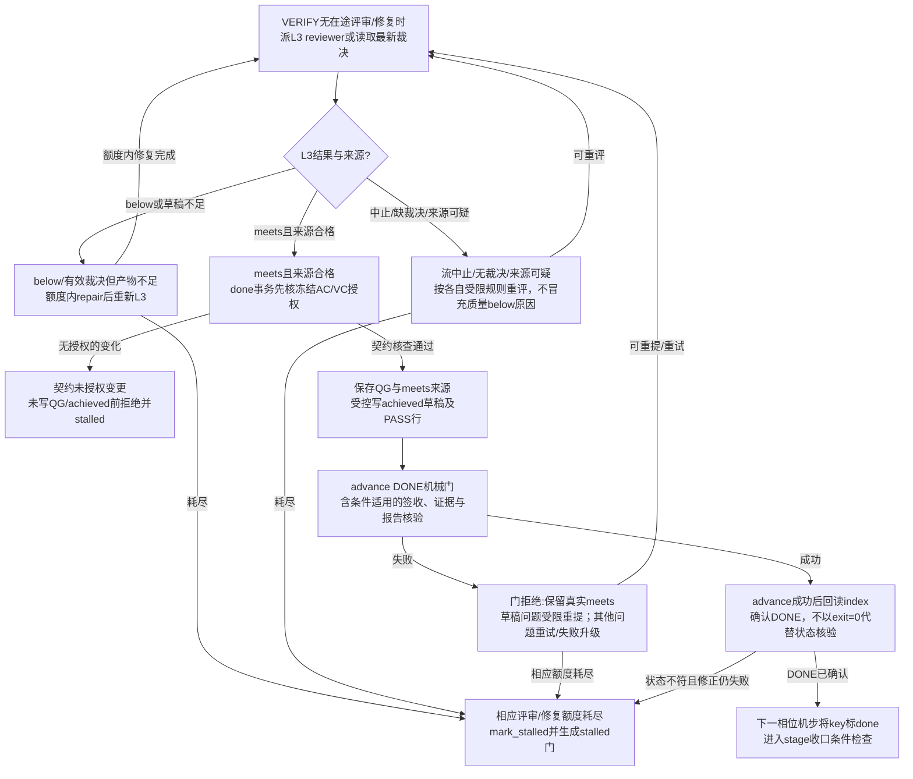
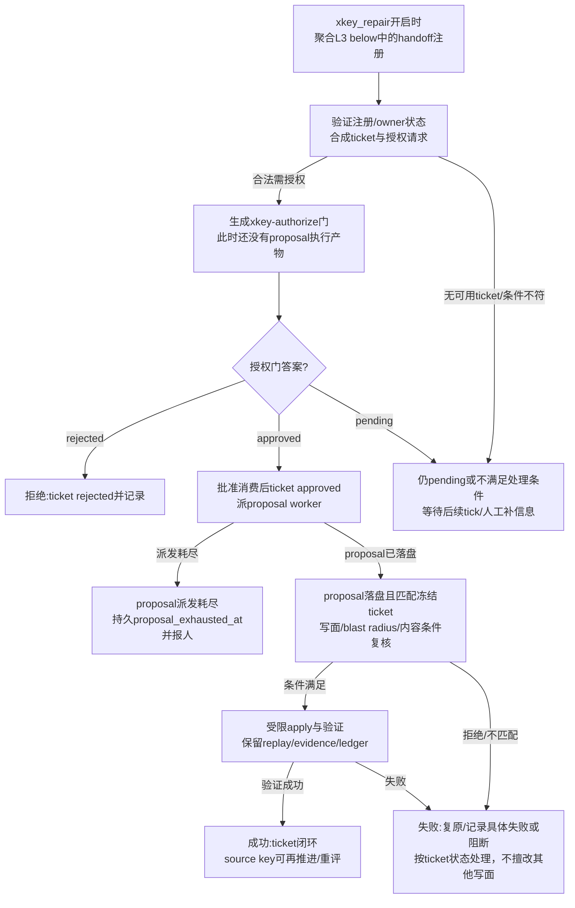
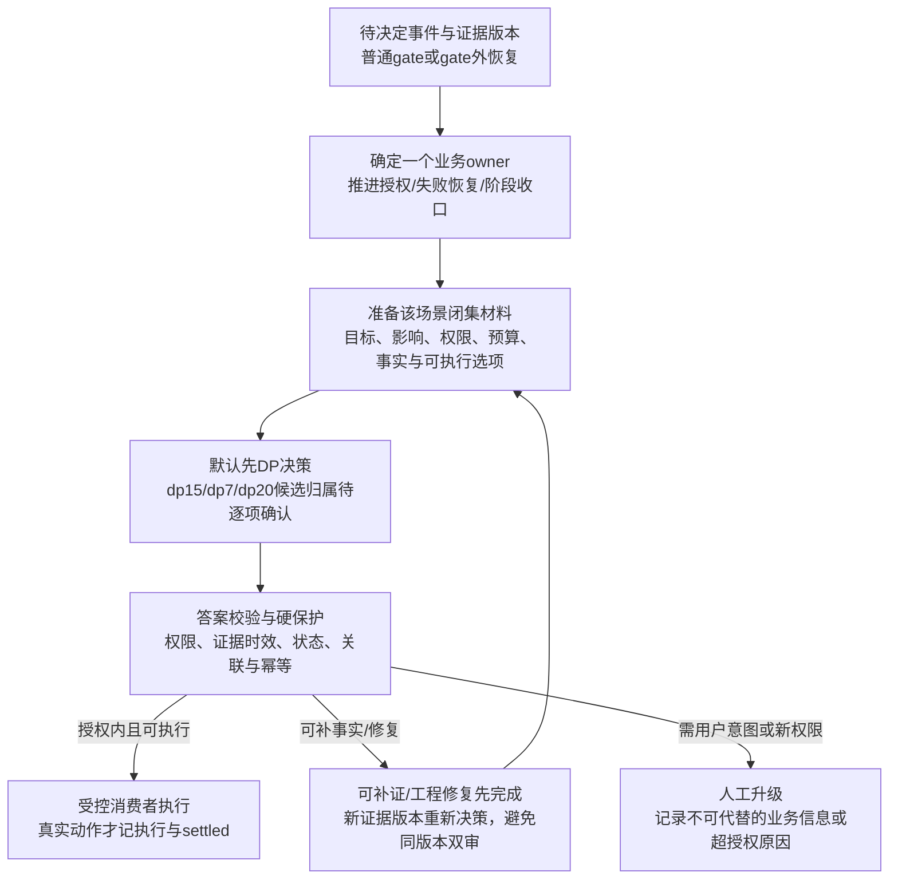

# Autopilot运行全景流程图

> 状态：当前源码静态运行模型，非部署验收；最后一图为未批准目标态。
> 用途：为H01-H13逐项需求澄清提供共同上下文。不是新的design.md，不批准实施或实际自动授权。
> 对齐goal.md：文件驱动协调、并行Worker、Extension API边界；不引入新中心服务、不改pi核心。

## 阅读约定

- 图1是总览，图2-7展开真实子流程；图8单独画拟议DP接线，禁止把它看成当前实现。
- 实线为当前函数控制/数据路径；标注“人工/停等”的节点不表示天然必须人工。
- 新生成gate通常在后续tick判答与消费；orchestrate先自动判已有gate，再消费答案，因此已有gate的live自动答案可在同tick生效。
- “答复已写”不等于“业务已推进”。消费者、条件与幂等记录仍须执行；stage/key/phase/ticket是不同状态维度。
- 以下含并列分支的图是结构总览，不表示各模块按图上布局并发执行。真实orchestrate顺序见§9。

## 1. 全景总览：周期循环、stage与key

图中key状态与收口是同一tick的两个视角；实际stage收口检查在逐key派发之前。goal-change门在tick层优先拦截，不经过后面的RULES pass，见§9已知缺口。

## 2. Gate的生成、答复与消费

- 标准生成口`_create_gate`为默认字段盖章；goal-change在tick中直接create，但同样先盖章再created快照。
- `authorizes: []`是新门默认；TS答门省略/空authorizes保留旧行，并不撤销授权。
- Python CLI reject有`--confirm-destructive`前置；TS console当前无同等二次确认，不能画成一致。
- `_mark_gate_consumed`等适用消费者记录消费；budget与goal消费方式不相同，不保证每类都有相同字段或步骤。

## 3. Stage生命周期与两个阶段门

`pending-review`不是终态，既不释放依赖，也不允许stage收口。stage-close批准不自动批准下一stage；reject不是可逆hold/rework。gate生产者负责pending去重，图中的回环不表示每tick重复生成dossier或新门。

## 4. Key相位与EXECUTE任务推进

相位路径是SPEC→DESIGN→PLAN→TASKS→EXECUTE→VERIFY→DONE。这个顺序是当前机械advance框架路径，不代表每相位都新建人工gate。已有跨key/写面硬拒绝不能被模型建议跳过。

## 5. 现有RULES自动答门与延期复核

这是现有机器RULES机制，不是dp7/dp15/dp20。pending-review在48h期限/stage闭环压力下升级复核；人答原门approve=resume、reject=rework，均回running。不是“暂缓即收口”，也不是“shadow实际执行”。

## 6. VERIFY：L3、修复与DONE事务

key决策签收由已有dp25业务承担，但当前done事务不自动触发dp25；不要在当前图虚构该调用。框架签收旧结论词表与dp25新词表不一致，是已知接线/适配债。L3 meets不保证DONE，也不允许伪造below覆盖机械门失败。

## 7. 跨key修复分支与gate外升级

图里approve是授权后续受限proposal/apply，不是对已完成proposal的追认。contract-change是批准gate的附加授权，与xkey-authorize不是同一业务许可。roadmap提案耗尽、halted stage恢复、auto-brake恢复也存在gate外停等，不统一塞进普通reject。

## 8. 拟议DP接线位置（未批准，当前不存在）

模型服务不可用等真实阻塞须停止并报告；本图不授权绕过UNAVAILABLE或现有硬检查。dp25仍为key签收，dp6仍为正式质量，dp2/dp3业务合同不变。

## 9. 源码坐标与当前缺口

核心源码：`packages/multi-workers/autopilot/conductor.py`。

| 图/步骤 | 主要完整函数坐标 |
|---|---|
| 启动与周期 | main:8673；tick:3769；配置停机、提醒、契约锚、goal检测在orchestrate之前 |
| 编排顺序 | orchestrate:595；依次auto_decide_gates→_consume_answered_gates→reconcile_orphans→claims→roadmap读取/激活→key恢复→xkey聚合/proposal/apply→每stage延期复核/收口→逐key派发 |
| gate生成 | _create_gate:3903、_stamp_gate_defaults:3952、_gate_default_fields:4013；goal直建:3812附近 |
| stage门 | _consume_answered_gates:910、_ensure_next_stage_gate:1065、_stage_activation:1090、_activate_pending_stage:1110、_dispatch_roadmap_writer:1176、_stage_closure:1272 |
| key相位/执行 | _advance_key:1619、execute_loop:1953；失败连续计数:_record_advance_result:1565 |
| 自动机制 | _auto_decide_one:8348、auto_decide_gates:8467、gate_facts:7381、_defer_declined_gate:8277 |
| pending-review | _process_deferred_reviews:4451、apply_review_decision:4494、_apply_review_decisions:4540；key恢复:4146/4215 |
| VERIFY/DONE | _verify_loop:2626、_done_transaction:2932；advance.py封装框架门 |
| xkey | _xkey_aggregate:4967、_xkey_ensure_gate:5127、_consume_xkey_gate:5201、_xkey_proposal_stage:5279、_xkey_proposal_exhaust:5363、_xkey_apply_one:6190 |
| 答门 | answer_gate_auto:7913、answer_gate_confirmed:7981；TS gate-writer.ts:169、console.ts:457；CLI mw.py:_ap_answer:9438 |
| 签收硬门 | .agents/skills/agentic-task/scripts/advance_phase.py:_decision_signoff_problems:309 |

当前实现必须显式保留的缺口：

1. goal-change pending导致tick提前返回，后面的RULES不会处理该门；任何已答状态随后都刷新baseline并恢复，与reject保持halted文案不一致。
2. 标准stage-confirm/budget等生产者未填RULES读取的部分机器事实，不能把“有规则”画成“通常自动放行”；外部/手填字段路径仍未全审。
3. dp7/dp15/dp20登记未接线，没有当前自动DP消费链；图8只是讨论入口。
4. stage-close reject为halted终态，不能拿来表达hold/rework；halted阻断后续激活。
5. 人工TS/Python reject确认不一致；空authorizes不等于撤销。重评与负记录撤销函数未找到生产创建入口。
6. diagram基于静态读回，不读取当前live配置/gates/ledger，不验证服务启动、实际触发频率或真实多tick执行。完整外围模块与调用者审计仍有未覆盖。

## 10. 验证边界

本轮已运行`python .agents/skills/agentic-task/scripts/check_mermaid.py .agenticdoc/mw-dp-consolidation/evidence/autopilot-runtime-panorama.md`，结果`MERMAID GATE PASS: 0 error(s), 0 warning(s)`。它只检查常见语法风险，不等于浏览器渲染、源代码测试或运行路径验收。没有PNG/SVG生成或线上操作。

本轮复用RQ4/RQ5/RQ6并行研究，PM定点全文补读上述核心函数并串行综合；不声称自己通读整个conductor或全仓零遗漏。
