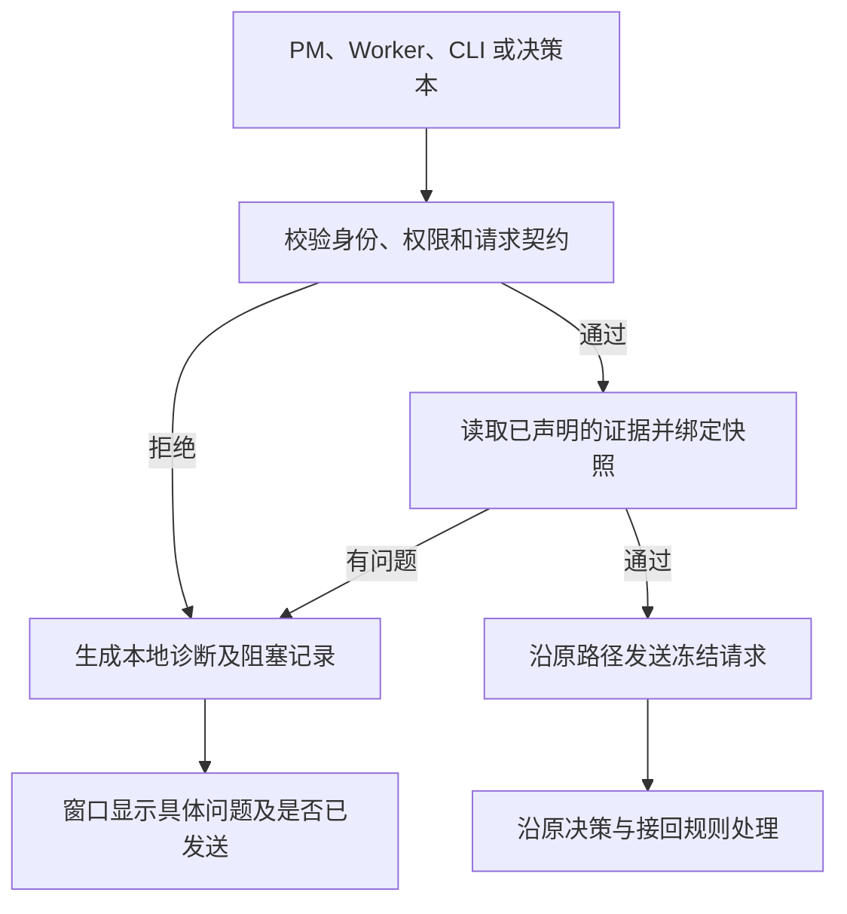

# DP 输入诊断与文件引用设计草案

供评审。本文补充 [DP 材料流水线设计](design.md) 的 [T02 来源](tasks/T02-sources.md) 与 [T06 发送及接回](tasks/T06-transport-continuity.md)。现有任务仍处于 SPEC，本草案不变更既有设计基线、验收标准或任务卡。

## 目标与范围

- 窗口收到 `input-incomplete` 时，可以确定失败阶段、具体字段、修正方式以及请求是否已发出。
- PM、Worker 和决策本可以明确声明实际要读取的文件及行范围。任务正文继续允许中英文、文件名、代码片段及待生成产物描述。
- 运行中的 Pi 窗口可以确认它加载的 MW 扩展和它实际选用的 Python 入口，避免将仓库构建产物或后端启动记录当成前端加载证据。
- 本设计沿用八个 DP 的事项、候选、角色、授权和预算。人工 SPEC 审核沿用框架门控，RenderPerformance 的路由修复、Dual Engine 源码写保护和受限 UBT 写入规则纳入发布回归。

## 已复现的失败

| 项目 | 本地拒绝原因 | 新协议下的验收结果 |
| --- | --- | --- |
| Bearing | `material.task_requirements` 中带反引号的待生成文件被当成证据，搜索了项目根目录下不存在的 `canonical59-refusals.json` | 待生成文件可留在正文，读取列表里没有它。显式引用真正缺失的源文件时仍拒绝。 [阻塞记录](../../../Bearing/.agenticdoc/_autopilot/dp-blocked/17c2c45f-84c9-4a6e-9ca1-3ea5087afd95.json) |
| Gaze | `material.pm_decision_background` 引用了 8–24 行，源文档共 21 行 | 对显式引用返回越界、请求范围及实际行数。改为 9–21 后，同一事项的来源准备通过。 [阻塞记录](E:/MWWS/Gaze/.agenticdoc/_autopilot/dp-blocked/ba02c930-3939-423f-b599-76ef9d56942d.json) |
| UEPerformanceFlow | `material.worker_execution` 中的中文正文和多个文件名被拼成一个路径 | 正文不触发读取。分别提交三项显式引用，按各自路径和行范围读取。 [阻塞记录](E:/MWWS/UEPerformanceFlow/.agenticdoc/_autopilot/dp-blocked/7ac36aba-b5f9-4aa4-a1fd-e61a9144ea16.json) |
| RenderPerformance | PM 用 key 充当 trigger，旧扩展将普通 SPEC 人工审核提交给 `dp-gate-approve` | 无匹配待审 gate 时返回 `not-applicable`。存在真实待审 gate 且 Autopilot 关闭时保留待审状态。两条路径均无 DP 传输。 [门控路由](../../packages/coding-agent/src/extensions/agent-team-loop/pm/gate-route.ts) |

## 设计决策

| 决策 | 备选方案 | 提案及理由 |
| --- | --- | --- |
| D-001 失败接口 | 让窗口按 ID 自行读取日志，或直接转发 CLI 原始结果 | 在现有工具失败响应中提供经过白名单校验的诊断。同一份结构化事实供工具显示及本地审计使用，防止遗漏具体失败或泄露原始材料。 |
| D-002 文件引用 | 继续加中文和标点特判，或添加显式协议 | 新请求走显式引用。旧请求继续走当前解析，迁移前复用既有回放契约。这样待生成文件与真实证据的差别由请求声明。 |
| D-003 诊断时机 | 在 TS 和 Python 各做一次文件扫描，或复用 Python 准备阶段 | Python 是文件范围、行号与运输事实的权威。TS 只校验诊断结构并呈现，避免多读一次文件和两个版本得出不同结论。 |
| D-004 发布验收 | 按磁盘上最新的 bundle 判断，或从运行窗口核对 | 从实际运行窗口验证其加载身份，并同时核对选用的 Python 入口。对现有合并发布包做增量升级，固定发布清单和回滚地址。 |

## 1. 诊断契约

保留现有 `available`、`unavailable`、`escalated_reason`、`blocked_event_id` 和 continuity 字段。对 CLI 本地产生的拒绝增加可选 `input_diagnostics`。Pi 将其返回到工具正文与结构化 details，展示层使用固定模板渲染。

```json
{
  "available": false,
  "unavailable": "input-incomplete",
  "escalated_reason": "input-incomplete",
  "blocked_event_id": "<event-id>",
  "input_diagnostics": {
    "stage": "evidence-preparation",
    "transport": "not-sent",
    "issues": [
      {
        "field": "material.pm_decision_background",
        "code": "evidence-range-out-of-bounds",
        "path": ".agenticdoc/gaze-context-capture/evidence/t003-trim-acceptance-20261120.md",
        "requested_lines": {"start": 8, "end": 24},
        "file_line_count": 21
      }
    ],
    "truncated": false
  }
}
```

- 字段校验使用现有 schema 路径。证据问题使用有限错误码，区分无法解析、行范围格式、行越界、范围拒绝、不可读和预算不足。用可审计的白名单和有界字符串序列化。对未获读权、带凭证形态或无法安全显示的引用，省略路径，保留字段或列表索引和错误码。文件正文、请求正文、绝对路径、凭证及异常堆栈留在工具响应之外。
- `not-sent` 由本地 CLI 在进入传输前标注。远端拒绝、超时及发送后结果未知沿既有状态表达。旧入口缺少诊断时保留原错误及事件 ID，窗口不推定是否发送。
- 安全可定位的错误按引用顺序汇总，沿用现有审计最多 8 项的上限并记录截断。身份或读取范围无法建立时停止证据准备。任一问题使本次请求不发送，已解析的部分不提交给模型。
- 同一拒绝从缓存重放时保留原具体诊断及原因关联。原已发但结果未知的事项继续按既有续接规则处置。更改证据引用或已跟踪的证据依赖后，按现有事项、预算和权限规则重新准备。单独改时间戳或 trigger 不获得重试资格。诊断本身不授权应用计划、签收或派工。

## 2. 显式证据引用

在现有 prepared request 与 `ask_decision` 顶层增加可选 `evidence_refs`。该字段在新工具生成的请求中始终存在，空数组表示仅使用内联材料。

```json
{
  "evidence_refs": [
    {
      "field": "material.worker_execution",
      "path": ".agenticdoc/ueperf-t43/evidence/pm-readback/t061-lexical-shadow-fixture-20261120.py",
      "lines": {"start": 4, "end": 11}
    }
  ]
}
```

- `field` 指向本次请求已有的材料叶字段或 `preparation.basis_catalog[n].text`。它描述证据用途。`basis_catalog[*].material_refs` 仍用于将候选依据绑定到业务字段，两者各自校验。未来产物写入任务正文或既有交付字段。
- `path` 由现有来源读取器从控制工作区或已授权目标根解析。保留现有精确单文件授权及 Worker 读面限制。`lines` 可省略以读取全文。提供时使用从 1 开始的闭区间，单行使用相同起止值。由读取器完成规范化、去重和哈希。
- 顶层引用列表仅参与本地准备。模型继续接收由框架生成的 `evidence_sources`。显式引用的字段绑定、选择器和顺序进入语义指纹。现有文件依赖快照继续约束录入、缓存重放及签收时的版本复查。
- 缺少 `evidence_refs` 的请求走既有引用模式。含该字段时只读取列表声明的证据，即使列表为空。字段存在但不合法时拒绝。决策本的 `notes.evidence` 在迁移时由入口转换成同一显式结构。混用时要求调用方明确选用一套声明，避免双重读取或漏证据。
- 初次启用显式引用模式前，由运行时核验所选 Python CLI 支持该协议。新 TS 对不支持的 CLI 给出版本诊断，保留未发送事实。迁移 PM、Worker、CLI 和决策本入口后，再评估关闭旧正文解析的时机。已有账本和冻结请求保留其原语义。

## 3. 职责与流程

| 环节 | 职责 |
| --- | --- |
| `decision_material_sources.py` 与现有读取器 | 解析引用，检查授权及行范围，生成 `evidence_sources`、文件依赖和具体失败事实。 |
| `decision.py`、`mw.py`、`decision_blocked.py` | 维护 prepared 入口，标注阶段与真实传输状态，投影安全的 CLI 诊断和阻塞记录。 |
| `decision-tool.ts` 与现有 continuity | 校验和呈现诊断，保留背景分类、原事项边界和缓存重放。实施前与活跃的 [continuity 任务](../mw-pm-dp-continuity/pm-state.md) 协调共享文件。 |
| 现有 MW 状态入口及发布清单 | 暴露当前 Pi 进程启动时加载的扩展身份、哈希与实际选用的 Python 入口及协议能力。加载身份取自加载时事实，磁盘文件更新后旧窗口仍显示旧身份。 |



## 4. 分批交付与验收

| 批次 | 可观察的验收条件 |
| --- | --- |
| 1 诊断回传 | 用三条脱敏的历史结构复现原拒绝。进入真实 CLI 准备分支，替身传输调用数为 0，Pi 工具正文、details 与阻塞记录关联到同一字段及错误码。首次和缓存重放都能定位。恶意错误属性、路径或带秘密的字段不会回显。旧 bundle 或旧 CLI 的兼容输出仍能识别通用拒绝。 |
| 2 显式引用 | Bearing 待生成文件和 UEPerformanceFlow 中文并列场景不触发正文读盘，Gaze 越界保留具体诊断。修正后核对模型实际收到的有效证据和快照。覆盖空列表、格式错误、越权路径、文件变化、重解析点和混合版本。使用 faux 或本地替身，不重发历史请求。 |
| 每批发布 | 以当前 [合并发布清单](../../.mw/releases/dual-independent-20261120-gate-route/release-manifest.json) 为基线做差异核对。候选包验证 no-gate、Autopilot 关闭时的真实 pending gate、Dual UBT、Python bearer 和新增诊断。完成仓库检查及定向回归后安装，使用新进程核验加载身份和本地拒绝。旧窗口在安全点 reload，核对其身份后再确认生效。 |

需要评审的决策是显式引用迁移方式、诊断公开字段及发布验收范围。设计证据来自四个项目的阻塞记录、已完成的本地重现和当前 [文件证据协议](../../packages/multi-workers/docs/prepared-decisions.md)。本轮未实施或发布。
