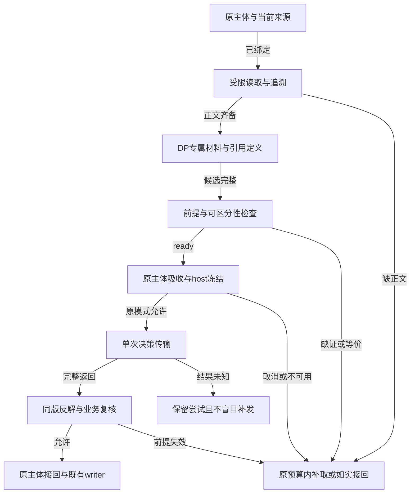
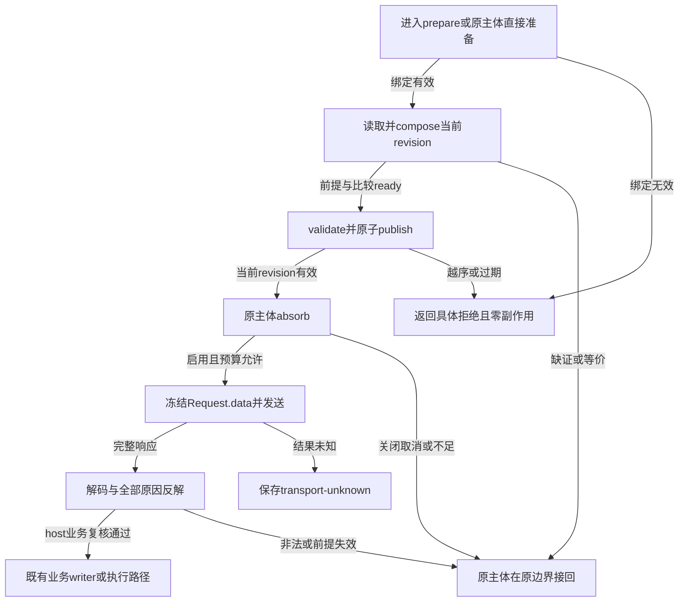

# Design: DP材料准备与决策链路

## §0 设计前提锚定

- Key: mw-dp-material-pipeline
- spec_path: [spec.md](spec.md)
- spec_status: draft，未由用户锁定；本文不伪造锁定时间
- spec_sha256: 8b3e042d27ea553c40b9aea596d71eb3099f8f2bd170adf39c232c0fef58dcbb（当前草稿指纹，不代表用户锁定）
- ac_count: 18
- ac_ids: AC-001, AC-002, AC-003, AC-004, AC-005, AC-006, AC-007, AC-008, AC-009, AC-010, AC-011, AC-012, AC-013, AC-014, AC-015, AC-016, AC-017, AC-018
- 设计来源：[docs详细设计](docs/DP材料准备与决策链路详细设计.md)，逐字节副本见planning清单。
- 状态：规划v3；以v0.5已有四段记录作范本，保持SPEC，不要求先新采8次真实派发。

## §1 架构选型

| 决策 | 采用 | 不采用及原因 |
| --- | --- | --- |
| D-001 数据分层 | 本地决策本、模型投影、原始返回/反解、PM接回四段 | 整段task/准备日志透传会泄漏噪音且不可证明入模内容 |
| D-002 决策协议 | 一个choice及同版合法pair-map | 结论/依据两道题不能保证配对，jev不保证自由文本原因 |
| D-003 来源 | host受限handles、正文/摘要、逐字段追溯 | 只给路径模型无正文；全量灌入不可控且可能丢关键项 |
| D-004 准备执行 | 简单输入原主体直接准备，复杂输入委托受限prepare Worker | 每次都派助手增加成本；普通research权限加提示不能替代工具守卫 |
| D-005 生命周期 | 阶段与结果分离，revision绑定发布/吸收，沿用原matter/预算 | 新prepare任务不能成为新授权/预算；prepared_at不能制造新请求 |
| D-006 权限与存储 | 复用文件锁、原host身份/读写面/唯一writer | 不新增中央调度器/授权库，不改pi核心 |
| D-007 开发范本（用户澄清修订） | 已有v0.5决策本/实际输入/真实回包，加当前PM参考接回及校验向量 | 不以未来采集计划代范本，不伪造缺失的历史生产PM采纳/派发 |

依据：[design-baseline研究留底](evidence/research/design-baseline-20261119.md)。实际源码接口与本地预算由正常入口取证。

## §2 核心结构与依赖

内层纯合同/投影/配对不依赖网络和UI；host适配层负责真实身份、读取、预算、状态；传输层复用现有timi；monitor只消费已保存捕获，不能反过来改变决策事实。

## §3 模块划分与写者/读者

以下为未来写面候选，现时仅建文档；实施者须先读完整文件和当前schema。

| 模块 | 唯一职责 | 写者/读者 | 建议入口 |
| --- | --- | --- | --- |
| 合同/注册表 | 八DP闭集、专属字段、配对及版本 | 注册源生成，两语言适配只读 | decide_registry.json、生成脚本、shared/decide-policy.ts |
| 来源与压缩 | 限定正文/变换/来源版本、未读限制 | host读取器写manifest，投影/复核读 | decision_material_sources.py、decision_source_scope.py、decision_file_evidence.py |
| 投影与定义 | desc/material/references/术语/字段映射 | 原主体/prepare起草，可信投影器写body | decision_book.py、decision_points.py、PM材料producer |
| prepare profile | 模型/权限/阶段/revision/发布吸收 | host推进，Worker仅受限读写 | PM工具、launcher、worker-mode、read-scope |
| 业务前提 | QG AC/VC+独审、sign当前QG、auto比较/路径 | 原主体语义确认，host核机械前提 | decision_points及其适配器 |
| 发送与接回 | 去重、原预算、精确冻结、反解/原writer | 既有host发送和业务消费者 | decision.py、decision_backends.py、decision_wire.py、decision-tool.ts |
| 回放 | 四段显示、原始响应及PM接回入口和历史对照 | 原捕获写，monitor只读 | decision_monitor.py、decision_history.py、现有dashboard |

不手改生成TS注册表产物；不增加隐藏兼容分支以默默接受旧噪音字段。原始历史输入继续只读，协议迁移须在T01给出显式版本处理方案。

## §4 接口与集成

### 4.1 数据合同

模型外层仍为model/state/questions，唯一题为decision_selection，type=choice，criteria是wire到可读字符串。state只投影desc、当前DP专属material、必要references、terminology、enum_meanings及场景说明。原owner/账本/preparation/actionplan/expected留本地。

本地PrepareEnvelope绑定prepare_id/revision、真实owner/matter/task/run、scope/registry版本、原budget_ref、指定/实际prepare模型、source_manifest、field_trace、basis_catalog/pair_map、比较报告、冻结摘要和产物清单。具体子属性以docs第4—8节和字段附录为准，实施schema必须闭合，不能用任意Record对象直接过门。

### 4.2 工具与状态

拟议工具顺序：prepare.begin → prepare.read → prepare.check_inputs → prepare.compose → prepare.check_discriminability → prepare.validate → prepare.publish → absorb_dp_preparation → 原host既有发送/接回。

正常阶段：bound、collecting、prerequisites、drafted、discriminability、validated、published、absorbed。结果：ready、needs-evidence、needs-review、equivalent、invalid、stale、stopped；准备rejected不等于业务gate reject。

prepare.read只接受原授权source handle和选择器；publish仅写本run产物并原子发布。absorb通过真实任务通道取产物，核当前绑定/版本/模型/预算，由原主体核语义；返回preparation_status及真实dp_result或null。助手不拿决策凭证，不执行网络/产品操作，不写claim/QG/sign。

### 4.3 文件材料与压缩

路径解析/读范围 → 取正文 → 必要选择器提取 → 逐字段关联 → 计量 → 去重/去噪 → 有来源摘要 → 重验覆盖/否定/未知 → 冻结。仍超限则给具体overflow，不截尾、不只给路径、不削候选。新属性必须明确写者/读者与缺失行为。

`desc` 起草时绑定逐句来源，宿主在共同投影入口对原文最多 10 句和本地预算一起校验。每项内以中文句末标点或后接空白、行尾的英文句末标点分句，连续句末标点视作同一边界，未加句号的尾句也计入。计量规则 `desc-local-v1` 用 LF 拼接各项，计数为非 ASCII Unicode 码点数加 ASCII 码点数除以 4 后向上取整。计量在发送前本地完成，`desc_measurement.local_budget` 记录规则、计数、上限和是否达标。超限诊断包含字段与实际计数，由原主体接回。模型用量属于独立的传输回执。

### 4.4 专属语义

- QG：同对象/版本独审完成后逐适用AC/VC核对，AC正文与状态、VC方法/实际观测、失败/未测和发现保留。历史缺reopen例为负例，新合同补pass/fix/reopen。
- sign：完整交付、目标/偏差和当前同对象/范围/产物及标准版本QG；过期/缺失不补pass，正式finalize仍受原writer门禁。
- auto：同一决策单位的2..5路径，明确来源目标优先级、区分证据、未知、信息价值、条件后继、上限/停止。n个候选检查n×(n−1)/2对，不靠删项或造偏好提高confidence。
- w-check：只能实际Worker确认自身可达性；route只选入口，不代目标DP完成前提或执行。

### 4.5 去重、时间与返回

matter identity负责原责任/累计额度，semantic fingerprint负责实质材料变化，wire hash负责线上字节；三者不互相替代。prepared_at更新不发新请求；并发只允许一个同语义尝试，已发未得返回记transport-unknown，不在无幂等承诺下盲目补发。

目标/来源/候选/scope/预算分配变化使旧revision失效；墙钟扣减要重核可行性，不以每毫秒变化无限重备。auto每步当时余量必须覆盖该步硬上限+报告预留。原取消/期限/次数到界保持原停止语义。

先保存响应原字节，再官方协议解码，再按同版pair-map恢复choice/basis与全部原因/剩余项；原样记录confidence/probabilities/id/usage。decode_valid、business_accepted、executed分别记录，未知wire/错版/前提漂移不能被业务采纳。

## §5 Function Flow与恢复

关键错误类为身份/范围、来源缺失/漂移、独审/当前QG缺失、候选/定义不完整、不可区分、overflow、顺序/revision、stop/budget、transport unknown、响应非法、业务复核失败。只处理当前准备或请求，不新建全局停机/审批。

| 编号 | 路径 | 验证 |
| --- | --- | --- |
| FLOW-001 | 绑定原主体及来源，校验并发布，原主体吸收同一 revision；越权、材料不足和过期由原主体接回。 | VC-001、VC-002、VC-003、VC-004、VC-005、VC-007、VC-008、VC-009、VC-013 |
| FLOW-002 | 按原预算冻结并发送，返回后反解全部原因，通过宿主复核后接回；传输结果未知时保留原尝试。 | VC-010、VC-011、VC-012、VC-013 |
| FLOW-003 | 生效合同与当前独审进入 QG，sign 复核同对象、同范围和版本，再由正式 writer 判定是否签收。 | VC-006、VC-014 |

## §6 Coverage Matrix

| 功能 | 正常 | 边界 | 异常 | 验证层 |
| --- | --- | --- | --- | --- |
| 候选/配对 | 八DP完整集合及多个fix原因 | auto为2和5，比较1和10对 | 缺reopen、单项、未知wire | L1/L2 |
| 来源/投影 | 生产写入字段→正文→body | UTF-8/大小临界、完整AC矩阵 | 只路径、摘要删失败、错对象同ID | L1/L2 |
| desc/定义 | 本地预算/词典闭包 | 10 句、1000 本地单位可发送 | 11 句、1001 本地单位都零发送 | L1/L2 |
| prepare | 合法模型/范围/顺序/revision | 发布等待期间变化 | 越序、越权、冒充角色、半发布 | L1/L2 |
| QG/sign/auto | 前提/路径完整 | 未测和决策前不可取未知保留 | 假独审、旧QG、循环/超预算 | L1/L2 |
| 发送/continuity | 原预算/同语义去重/接回 | 等待/取消/并发竞态 | 超时补发、时间戳刷额度 | L2 |
| 回放/验收 | 四段/原始返回与PM接回可见 | 历史与当前并列 | 旧回包套新输入、隐藏未执行 | L1/L2/独立复核 |
| 八DP四段范本 | 原决策本/实际请求/真实返回/当前PM参考 | 原版八例及优化auto共九例、两组合 | 旧回包套新输入、伪造历史PM或执行 | L0/L1参考原件核验 |
| 开发对比 | 九份反解与PM事实/动作/禁止声明校验向量 | QG缺候选与旧auto缺材料保留负例 | 只按confidence或自然语言逐字相等验收 | L0/L2/独立复核 |

## §7 Verification Contract

产品实现VC当前状态not-run；下列Output是未来实现验证须实际发射的合同，本轮参考资产检查另存证据。L0=静态/文件，L1=局部隔离，L2-offline=离线生产链。现有v0.5真实API捕获可作范本，不证明当前产品接入或生产PM执行；没有新增真实采集前置。须核实际值，不得只打印固定字符串。

VC-001: 当八DP候选校验运行时，fixed_missing=0且auto_count位于2..5；缺项/单候选反例network_attempts=0。
       Layer: L1
       Output: [VERIFY] VC-001: fixed_missing=0 negative_network_attempts=0
       Source: AC-001

VC-002: 当引用文件和超限正文准备时，required_content_present=true、critical_omissions=0，路径-only反例被拒绝。
       Layer: L1/L2
       Output: [VERIFY] VC-002: required_content_present=true critical_omissions=0
       Source: AC-002

VC-003: 通过 PM 和 Worker 正常入口按 desc-local-v1 本地预计算。10 句和本地计数 1000 的合法样例各发送一次，11 句和本地计数 1001 的样例发送零次，保留字段诊断和本地预算读数。计量不调用 Timi。
       Layer: L1/L2
       Output: [VERIFY] VC-003: local_budget_rule=desc-local-v1 pm_1000_posts=1 pm_1001_posts=0 worker_1000_posts=1 worker_1001_posts=0 sentence_overflow_rejected=true
       Source: AC-003

VC-004: 当真实producer投影八DP材料时，untraced_model_fields=0且local_metadata_leaks=0。
       Layer: L1/L2
       Output: [VERIFY] VC-004: untraced_model_fields=0 local_metadata_leaks=0
       Source: AC-004

VC-005: 当请求解析所有编号/缩写/代码时，unresolved_refs=0；错对象/冲突定义反例发送0次。
       Layer: L1
       Output: [VERIFY] VC-005: unresolved_refs=0 conflicting_ref_network_attempts=0
       Source: AC-005

VC-006: 当QG/sign前提反例运行时，fake_review_accepted=0、stale_qg_finalizes=0、missing_ac=0且未测未被写为pass。
       Layer: L1/L2
       Output: [VERIFY] VC-006: fake_review_accepted=0 stale_qg_finalizes=0 missing_ac=0
       Source: AC-006

VC-007: 当prepare越序/越权/旧版/模型换绑反例运行时，invalid_publish_count=0且out_of_scope_effects=0；合法同版可absorbed。
       Layer: L1/L2
       Output: [VERIFY] VC-007: invalid_publish_count=0 out_of_scope_effects=0 valid_absorbed=true
       Source: AC-007

VC-008: 当n=2和n=5路径输入比较时，pair_counts分别=1/10；缺偏好/等价状态精确为needs-evidence/equivalent。
       Layer: L1
       Output: [VERIFY] VC-008: pair_counts=1,10 missing=needs-evidence same=equivalent
       Source: AC-008

VC-009: 当循环/重复额度/超预算路径运行时，invalid_path_accepted=0且retry_budget_growth=0，合法路径停止出口齐全。
       Layer: L1/L2
       Output: [VERIFY] VC-009: invalid_path_accepted=0 retry_budget_growth=0
       Source: AC-009

VC-010: 当合法fixB和未知/错版wire接回时，原因集合与pair-map逐项一致、wrong_wire_business_accepts=0。
       Layer: L1/L2
       Output: [VERIFY] VC-010: exact_cause_set=true wrong_wire_business_accepts=0
       Source: AC-010

VC-011: 当重复/并发/时间戳变化/transport-unknown接回时，same_semantics_attempts=1、budget_resets=0、unknown_blind_retries=0。
       Layer: L2
       Output: [VERIFY] VC-011: same_semantics_attempts=1 budget_resets=0 unknown_blind_retries=0
       Source: AC-011

VC-012: 当真实离线传输和monitor回放时，wire_bytes_equal=true、raw_response_visible=true，未执行状态不被标为executed。
       Layer: L1/L2
       Output: [VERIFY] VC-012: wire_bytes_equal=true raw_response_visible=true fake_executed=0
       Source: AC-012

VC-013: 当关闭/不可用/prepare失败和取消场景接回时，new_user_approvals=0、new_global_waits=0、role_impersonations=0。
       Layer: L2
       Output: [VERIFY] VC-013: new_user_approvals=0 new_global_waits=0 role_impersonations=0
       Source: AC-013

VC-014: 当准备最终验收时，全部AC有当前源码证据并经另一执行者复核，缺/失败项不可声明完成。
       Layer: L0/L2/independent-review
       Output: [VERIFY] VC-014: missing_current_ac_evidence=0 independent_review=pass
       Source: AC-014

VC-015: 当v0.5范本提交/消费时，八DP四段范本齐全，原版与优化auto共9个唯一案例，原始请求/响应与来源字节一致。
       Layer: L0/L1/reference-evidence
       Output: [VERIFY] VC-015: reference_DP_coverage=8/8 distinct_cases=9 original_wire_bytes_equal=true
       Source: AC-015

VC-016: 当v0.5范本提交/消费时，两个八DP组合不串版，9份PM参考说明理由/保留原因/后续及禁止声明，优化auto事实变化明确。
       Layer: L0/L1/reference-evidence
       Output: [VERIFY] VC-016: cohorts=2 PM_reference_decisions=9 cross_version_mixups=0
       Source: AC-016

VC-017: 依四段逐项对比合同核9例×4段36行原件/实现对比，字段差异有当前观测及AC依据、全部原因一致、PM语义经复核；缺行/重复/串版/假执行/未验证不得通过。 旧 dp-auto 保留历史回执为 null。用当前 PM 正常入口同案例的拒绝事件和身份绑定校验第四段，核对拒绝理由、接回主体、下一步、零发送和原授权余额。
       Layer: L0/L1/reference-evidence
       Output: [VERIFY] VC-017: check_vectors=9 comparison_rows=36 missing_stage_rows=0 unjustified_differences=0 known_negative_cases=2 fake_executed=0
       Source: AC-017

VC-018: 当v0.5范本提交/消费时，前三段历史记录与第四段当前PM参考明确分开，缺历史生产PM/执行回执仍为空，不新调用或伪造。
       Layer: L0/L1/reference-evidence
       Output: [VERIFY] VC-018: fabricated_historical_PM_records=0 new_API_calls=0 new_dispatches=0
       Source: AC-018

## §8 AC → VC → 任务映射

| AC | VC | 主责任任务 | 补充/独立复核 |
| --- | --- | --- | --- |
| AC-001 | VC-001 | T01 | T05、T08、T09 |
| AC-002 | VC-002 | T02 | T03、T08、T09 |
| AC-003 | VC-003 | T03 | T08、T09 |
| AC-004 | VC-004 | T03 | T02、T08、T09 |
| AC-005 | VC-005 | T03 | T08、T09 |
| AC-006 | VC-006 | T05 | T08、T09 |
| AC-007 | VC-007 | T04 | T08、T09 |
| AC-008 | VC-008 | T05 | T08、T09 |
| AC-009 | VC-009 | T05 | T06、T08、T09 |
| AC-010 | VC-010 | T06 | T01、T08、T09 |
| AC-011 | VC-011 | T06 | T04、T08、T09 |
| AC-012 | VC-012 | T07 | T06、T08、T09 |
| AC-013 | VC-013 | T06 | T04、T08、T09 |
| AC-014 | VC-014 | T09 | T08提供集成证据 |
| AC-015 | VC-015 | T10 | 现成参考资产、T08消费校验、T09复核 |
| AC-016 | VC-016 | T10 | 现成参考资产、T08消费校验、T09复核 |
| AC-017 | VC-017 | T10 | 现成参考资产、T08消费校验、T09复核 |
| AC-018 | VC-018 | T10 | 现成参考资产、T08消费校验、T09复核 |

## §9 非功能与验证约束

所有改动沿现有host读取/原预算，无新增固定性能SLA或默默放宽限额。计量分开记录源读取字节、state/body字节、desc 本地预算和总 API usage。目录/hash/内部标签不挤占模型背景。Atomic publish、单matter去重及既有锁覆盖等待/取消竞态。

新测试必须用真实producer/handler加隔离目录和faux provider，不只手写最终fixture。Python证据使用pytest -q -s并保存实际stdout；TS suite用harness/faux和process.stdout.write。历史样例可以作回归输入，不能把历史HTTP200称本key生产门禁通过。

本轮只运行文档结构/副本/AC→VC→任务覆盖检查，不运行任务卡的未来验收命令。源码实现后的必要测试和npm run check由T08组织；不运行未授权build/npm test/全量vitest/真实模型API。

## §10 实施前决定与版本边界

1. T01核当前注册源/生成链并统一本地schema版本；固定候选不可裁剪，显式处理旧协议，不默认保留长期兼容层。
2. T02/T03核现有读取/状态/整份body限额以及 `desc-local-v1` 本地预算。用两角色的实际发送次数验证边界，原主体按原continuity接回拒绝。
3. T04指定准备模型仅使用真实注册模型，记录requested/effective，不在计划中虚构模型名/授权。
4. T06在实施前逐文件核对mw-pm-dp-continuity和当前热改动；不改其它key认领，必要时协调写面再继续。
5. 未来新增/修正QG候选的请求必须保留新版本验证，原缺reopen样例始终只读。
6. 本key当前是draft规划，不以文档自查、复制校验或历史API记录宣称实现AC通过；任务卡的not-run状态必须保留到实际执行。

## §11 v0.5四段范本与开发校验

入口为[四段记录](docs/reference-records/index.md)和[结构化索引](acceptance-samples.json)。用户澄清要已有v0.5样例用于开发，不是新增八次真实运行采集。原版八DP和整合版八DP仅auto不同，共9个唯一案例，保留真实schema/原件和两个cohort。

前三段是发送前冻结决策本、实际完整Request.data、真实jev回包/同版反解。原实验没有生产PM采纳/执行回执；第四段由当前会话补写PM参考裁定，含采纳或退回、理由、全部原因/剩余项、后续安排、真实host待核条件和禁止错误声明。它是现在撰写的参考意见，不冒充历史执行。

每例有reference-chain.json与expected-checks.json；回放严格核原字节/wire/原因，PM文本核必要语义而非逐字相同。QG缺reopen和旧auto缺目标取舍/完整路径是负例，不能照抄旧缺陷来让范本全部通过。优化后的新body不套旧回包。

T10将现有参考资产接入离线回归，T08验证当前实现，T09复核。上轮误加的T11强制新采集已撤回且保留历史，不再阻塞验收。本轮没有产品实施、派发或新模型调用。

### 11.1 四段逐项对比的强制合同

直接采用[reference-comparison-contract.md](reference-comparison-contract.md)及[唯一范本索引](docs/reference-records/index.json)。原件回放与当前实现对照分开，T08交36行JSON及Markdown报告，T09从evidence-index逐行复核。四段的文件/字段、差异规则、负例拒绝时的空响应、PM语义审查、证据绑定及不可通过状态均以该合同为准。T01—T07交职责内字段观测；T10先交只读校验器/schema，T08再集成，不增实施依赖环。

## §12 当前源码接入基线（2026-11-22）

以[源码核对及回归观测](evidence/research/current-code-review-20261122.md)更新实现起点。沿用八 DP 注册表、prepared 请求和文件来源读取、原窗口接回与签收写者、wire/lifecycle 捕获。用户可看到的字段仍按 §4.1 达意投影。现有只读选项预览展示注册表词汇，发送前以 Python 最终合法配对及业务结论覆盖为准。

QG 当前 `basis_issue` 使 `pass` 和 `reopen` 互斥。T01/T05 要给出候选和执行前提的明确合同，检验「分支适用性」「配对依据覆盖」「模型所见候选」三者。按当前 AC-001，最终只剩一个可选业务结论或缺固定项时，返回具体材料诊断，交原主体接回。不得编造 `basis_issue`，也不得把不可执行分支当模型已授权的动作。若需要调整固定候选要求，先在 spec 明确适用规则。

项目当前捕获可能有脱敏、截断或缺失。T07/T08 在干净离线向量校验完整原字节，在真实运行记录校验与捕获副本、hash 和完整度标记一致，并关联实际 PM handoff/执行证据。历史参考裁定维持独立来源标记。

## §13 跨项目阻塞分类与验收入口

以[193 条回执的分类和典型四段对照](evidence/dp-blocked/20261122/v05-blocked-comparison.md)为输入，现有 `evidence_refs`、`allowed_fields`、窗口控制和 claim 检查继续承担各自的校验。准备端按来源用途生成显式引用，后端按真实投影校验目标字段。分别记录原字段限额与整请求限额，保护最小项仍超限时保留 `compression-required`。预览返回注册表允许值，实际发送校验针对 Python renderer 的最终业务选项集合。

阻塞回放至少能追到事件 ID、阶段、来源类别、原原因和附带字段问题。确定未发送时回包为空，连接错误保存原传输原因。PM 接回按真实绑定与执行证据记录，历史人工审计和没有关联证据的阶段单独标记。诊断改进通过相应入口复测，历史事件只有关联到修复后的真实运行才能标为该项目已恢复。
