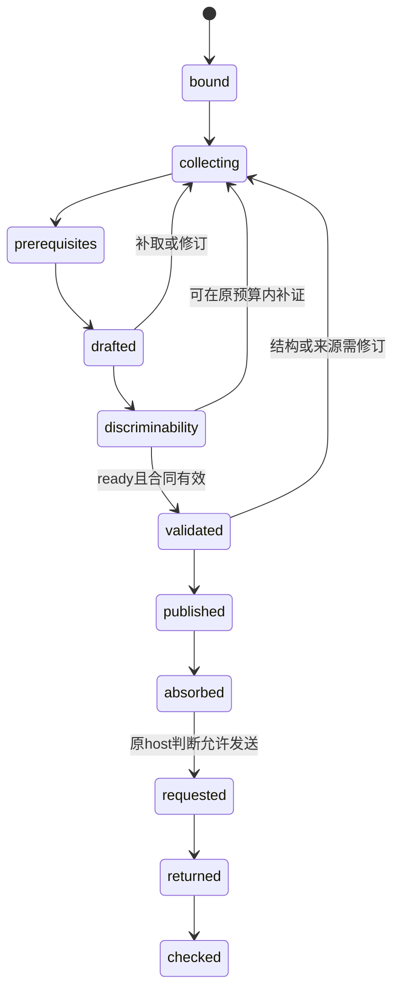

# DP材料准备与决策链路详细设计

| 项目 | 说明 |
| --- | --- |
| 文档版本 | 1.0，基于v0.5整合设计验证包及dp-auto路径修订 |
| 日期 | 2026-11-18 |
| 状态 | 开发设计；专用prepare Worker与新增生产守卫待实现 |
| 覆盖 | 八个DP、材料准备、单选配对、请求投影、返回反解、业务检查和回放 |
| 主证据 | 本目录cases/、captures/、integration-manifest.json；全部为明确标注的合成材料API实验 |
| 编制/复核 | Codex编制并自验；未取得独立设计复核 |

本设计规定后续开发应实现的行为。示例或真实API接受输入，只证明该输入产生了所记录的响应。原始请求保留其发送时schema；本设计中的新本地接口均为拟议接口，不表示已安装到值守窗口。

配套材料：[逐字段字典与来源](DP字段字典与来源明细.md)、[八DP完整请求与真实返回](DP完整请求与真实返回附录.md)、[图表回放](DP引用与术语_动态演示.html)、[prepare机器合同](prepare-worker-contract.json)。后续开发以本设计的规范要求为准，历史捕获中的缺口不得当成验收豁免。

## 1. 问题、目标与范围

### 1.1 需要解决的问题

1. 候选被裁剪成一个选项，模型调用不再承担实际比较。
2. 把task_goal、task_requirements、task_deliverables和pm_decision_background中的目录、内部标签、准备日志直接拼入请求，掩盖当前目标、偏差与证据。
3. 文件材料只给路径，模型没有正文；或为控制大小直接截断，丢失反证、未知及验收项。
4. 结论与原因分成两个题，单次单选协议无法可靠表达合法组合；一个fix也不能自行恢复多个原因。
5. AC等缩写有解释，但具体AC编号正文未入模，模型仍不知道验收标准是什么。
6. dp-auto比较两个可先后执行的首步，缺目标取舍、后继与停止条件，合理候选难区分。
7. 本地准备报告、实际入模body、模型原始返回和host业务检查混在一起，无法证明模型到底看见什么。

### 1.2 目标

让每个DP只回答一个明确问题。由当前合法PM或实际Worker提供有来源、可理解、能比较的材料；可信host冻结并发送一个单选题；按同版映射恢复结论与原因；原主体在原权限与预算下接回处理。全过程可回放，材料缺口具体可修复。

“达意”优先于字段堆砌。每个发送字段必须影响理解、候选比较或引用解释。准备过程和内部身份不是业务背景；需要保留的信息放在本地决策本，不因此丢弃审计证据。

### 1.3 范围与不变约束

本设计不改变项目目标、既有验收标准、认领、DP启用模式、独立review要求和业务唯一writer。prepare不是新调度中心，也不新建授权库。原主体可直接准备简单材料，无需每次先启动助手。

本轮仅形成文档和验证资产，没有修改生产源码，没有新调用API、派工或写正式质量/签收结果。生产接入时应与mw-pm-dp-continuity当前实现共同复核，不能凭文档将原不可用分支改为强制等待或审批。

## 2. 术语与责任边界

| 术语 | 定义 |
| --- | --- |
| DP，Decision Point | 职责明确的决策入口；route只选入口 |
| PM | 当前事项的项目管理Agent，负责组织、回收及接回决策 |
| 实际Worker | 当前task/run的真实执行者；自身可达性判断不能由PM或助手冒充 |
| prepare Worker | 受委托整理来源和材料的助手；不是业务决策者、实际执行者或独立reviewer |
| host | 持有真实工具上下文、核身份/范围/预算、执行可信读写与请求的宿主 |
| AC，Acceptance Criterion | 已确认的验收标准；AC-001等编号还必须有本次完整正文 |
| VC，Verification Contract | 本项目验证合同/验证项，规定如何检验关联AC及预期观测 |
| QG，Quality Gate | 当前对象的正式质量审查，业务结论为pass/fix/reopen |
| matter / run / key | 原事项、具体执行、项目工作项；三者不互相替代，不因准备重新建立预算 |
| wire ID | 单选题传输候选标识，例如fixB；只在本次冻结候选集内有意义 |
| basis / pair-map | 本地依据条目及“wire→业务结论+原因/剩余项”的映射 |
| confidence / probabilities | API原样返回的置信值和候选概率；不同指标，不是业务正确率 |
| receipt | 既有决策/业务接回记录；材料发布、模型选择和业务执行不能混为一件事 |

上述词典说明设计。实际请求只发送该请求用到的术语；还要附具体编号的定义，不灌入整份项目词典。

| 角色 | 可以做 | 不可以做 |
| --- | --- | --- |
| 原PM/实际Worker | 确认目标、准备或委托材料、核语义、吸收结果、按原授权继续 | 用材料字符串伪造owner、扩大权限、冒充另一角色 |
| prepare Worker | 读限定来源、起草desc/material/候选依据、报告缺口 | 任意shell/网络/改产品、改claim、拿决策密钥、代写QG/签收 |
| 独立review来源 | 核当前对象/版本、标准、断言和覆盖缺口 | 用作者自评或prepare报告冒充独立性 |
| 可信host | 绑定真实上下文、受限读写、校验冻结、发送、解码、核接回 | 用HTTP200或模型选择代替真实权限、质量或执行检查 |
| jev | 在完整候选中返回一个wire及API指标 | 新授予权限、改标准、运行工具或生成执行证明 |

## 3. 总体结构与数据流


三份对象必须分别保存：

1. **本地决策本**：真实绑定、完整来源及变换、准备流程、候选配对、原预算、执行计划。不能整体作为state。
2. **实际模型请求**：最终序列化的model/state/questions及精确字节；这是模型可见内容的唯一依据。
3. **返回与检查**：响应原字节、官方解码、配对反解、语义/业务检查、真实执行结果。没有执行则明确未执行。

组装器按允许字段显式构造新对象，不对本地决策本做“删除几个敏感字段后透传”。派发身份、准备元数据、命令计划与作者预期没有默认入模路径。

## 4. 数据对象与本地记录

### 4.1 设计版本与绑定

拟议本地准备合同使用显式schema_version和revision，不能与已发送请求的schema混用。具体版本号在实施时统一登记；未注册的新版本不得默默按旧结构解读。

| 本地对象/字段 | 产生方与内容 | 是否入模 |
| --- | --- | --- |
| preparation_id / revision / stage | host分配准备标识、单调修订和阶段 | 否 |
| dp_id / registry_revision | 当前入口和对应候选/字段合同版本 | 仅题面需要的职责投影入模 |
| owner_binding / matter_ref / task_ref / run_ref | 从真实当前工具/任务通道解析，禁止调用方自填字符串授权 | 否 |
| scope_binding | 目标对象、产物/要求版本、允许读写范围 | 必要业务对象/范围发送；授权账本不发送 |
| budget_ref / usage | 既有原事项累计账本及已用量 | 影响比较的余量/约束发送；账本留本地 |
| prepare_model_requested / effective | 指定和实际准备模型、允许回退记录 | 否 |
| source_manifest | 来源、选择器、版本/hash、时间/范围、读/未读状态、事实性质 | 必要正文/限制发送；路径/hash不替正文 |
| desc_sentences / sentence_sources | 最多10条单句与逐句来源，连接后形成desc | 只发连接后的desc |
| material_draft | 当前DP业务结构化材料 | 校验后按允许字段发送 |
| basis_catalog / pair_map | 依据条目、原因/剩余项集合和传输别名 | 含义在criteria发送；映射表本身不发送 |
| discriminability_report | 全部候选对的比较、反转条件和缺口 | 否；相关事实进入material |
| field_trace | 每个字段来源、变换、是否发送及模型落点 | 否 |
| execution_plan | 工具命令、具体执行参数及安排 | 否 |
| request_freeze / transport_capture | 最终body字节、摘要、时间及响应 | body是实际发送物；捕获元数据留本地 |

### 4.2 来源条目

每条source至少记录：source_id、可信source_handle、对象/版本绑定、选择器、读取状态、已读正文或原件位置、读入字节数、观测时间/采样时间、范围与局限、内容摘要、事实性质、变换记录。host核允许范围和文件真实指向；source_handle不是任意文件路径能力。

事实性质区分observed（实际观测）、reported（来源陈述）、inferred（准备者推论）、estimated（估计）、unknown（未知）。合成样例另标sample_kind；不能把synthetic-observation写成生产实测。推论必须列前提和局限，估计不能改写成硬上限或保证。

source_id只标识本地来源；若模型需要依它解读，则state.references必须提供必要正文、对象范围及关系。相同AC编号在不同产物中不能合并为一个定义。

### 4.3 逐字段追溯

field_trace每条包含local_path、source_refs、source_selectors、transform、fact_kind、send、model_path、limitations。send=true必须有实际模型落点且落点存在；send=false不得借任意context字段绕过投影。数组每项保留关联关系，不把AC状态和VC观测压成两列无关联列表。

当前冻结样例的所有material叶子字段在[字段附录](DP字段字典与来源明细.md)逐项列出。该附录枚举示例实际形状，不是允许任意同名字段直接过生产schema。

## 5. 模型请求合同

### 5.1 完整外层

真实timi/jev请求外层继续使用以下形状。这个结构说明协议；八份实际完整body在[请求与返回附录](DP完整请求与真实返回附录.md)，不以省略示意冒充真实请求。

```typescript
type DecisionRequest = {
  model: string;
  state: {
    scenario?: string;
    desc: string;
    material: Record<string, unknown>;
    references: Record<string, ReferenceDefinition>;
    terminology: Record<string, TermDefinition>;
    enum_meanings?: Record<string, string>;
  };
  questions: {
    decision_selection: {
      type: "choice";
      instructions: string;
      criteria: Record<string, string>;
    };
  };
};
type ReferenceDefinition = {
  kind: string;
  content: string;
  scope?: string;
  ac_ids?: string[];
  expected_result?: string;
};
type TermDefinition = { full_name: string; meaning: string };
```

类型中的Record用于说明外层容器，实施仍须为八DP的material建立独立闭合schema，禁止把任意对象视为有效业务材料。现有auto样例的references还含显式合成来源kind，适配时按注册定义验证，不靠示意类型删除捕获字段。

### 5.2 字段投影规则

| 模型字段 | 产生方式 | 必要性与检查 |
| --- | --- | --- |
| model | 既有决策配置解析 | 模型角色为决策模型；准备模型不能替换它 |
| state.scenario | 真实场景描述；实验必须声明合成 | 不放准备日志、目录列表或隐含授权 |
| state.desc | 原主体准备/吸收的短描述 | 目标、偏差、刚发生什么、证据与未知；最多10句/1000 tokens |
| state.material | 当前DP专属投影器 | 只留精确比较必要信息；字段必须有来源 |
| state.references | 本次引用定义闭包 | 每个编号完整正文、含义与适用对象可在body内解读 |
| state.terminology | 扫描desc/material/题干/选项及业务字段后投影 | 缩写全称/语义；中文简称同样处理 |
| state.enum_meanings | 本次使用的状态/代码/资源单位 | unknown、not-run、worker_minutes等不能让模型猜 |
| questions...instructions | 当前DP固定职责与本次问题 | 一个问题，不能顺便要求再选独立理由 |
| questions...criteria | 合法配对的完整可读判据 | wire→字符串，完整候选覆盖；选项说明不等于事实已成立 |

### 5.3 desc编制与计量

先形成单句数组，再连接为自然语言段落。一般4—6句即可：目标、当前偏差、事件、关键证据、会改变选择的未知。禁止把推荐答案写成事实，也不强凑十句。

每句关联来源。没有观察到偏差时写尚未执行/尚未发现，而不发明异常。结构化材料承担逐AC/VC、资源与分支的精确比较，desc不重复整份正文。

10句与1000 tokens是desc限制，不是整个请求限制。精确目标模型计量器必须在生产接入时确定；现有估计只能预检，记录token_count=null和计量方式。API总input_tokens不能当desc计数。没有精确计量不得宣称硬限制已实现，超限交原准备者重写而非截尾。

### 5.4 引用与术语闭包

扫描模型可见字段及其业务键→收集编号/术语→从当前对象原件取得正文/解释→递归检查定义中引入的引用→消除冲突→只投影本次需要项→验证没有悬空引用。

AC只解释为“验收标准”不够；AC-001还必须解释本次具体要求。引用表不是验收证据，unknown/not-run仍保持原状态。未知新缩写返回具体缺口；正则和词典只能辅助检查，原主体仍需核语义忠实。

## 6. 文件正文读取、提取与超限压缩

### 6.1 正常流程

1. host从原任务范围签发source handles；以当前真实对象/版本解析路径，核允许范围和拒绝规则。
2. 准备者按明确选择器读取正文，保留来源版本、已读/未读范围和事实性质；不能以存在路径代替已读。
3. 先按问题提取必要内容，例如适用AC完整条文、VC方法与实际观测、关键失败日志、授权能力说明。
4. 对所需内容建立field_trace，再组装desc/material/references；命令原件和准备过程留本地。
5. 计量desc及整份请求，核既有状态/材料字节限制和原预算；超限进入压缩，不在最后一层切字符串。

### 6.2 压缩顺序

| 阶段 | 可以压缩 | 必须保留 |
| --- | --- | --- |
| 去噪 | 重复背景、内部标签、无关目录、相同定义的重复副本 | 当前目标/偏差及影响候选的约束 |
| 选择性提取 | 大文件中与本问题无关的章节、重复成功日志 | 必要原文、反例、失败/未知、对象与范围 |
| 有来源摘要 | 冗长过程改为观测/结论/限制的短句 | 逐AC覆盖及关联VC状态、全部原因集合、后继/停止判据 |
| 重组定义 | 统一引用一次，正文中使用已解释编号 | 编号关系和不同对象同ID的区分 |
| 仍超限 | 返回具体overflow及占用报告，原预算内重备 | 不删合法候选、不把未读写成通过、不只给路径 |

compression_record记录原来源摘要、选择器、转换方法、保留项、明确省略项、压缩前后大小及语义复核。不能静默截尾。相互依赖的一个决策不能拆成几次模型选择再拼成结果；是否拆分事项由原主体按原工作流确定。

### 6.3 大小与资源参数

desc上限10句/1000 tokens已明确。单次/累计源读取、整份state/material/body大小、准备步骤与墙钟上限复用既有host/DP配置，实施时在同一配置源登记，本文不另造第二套授权值。不同计量对象分别记录：源读取字节、state字节、body字节、desc tokens、总输入usage。

准备模型、决策模型、读取与返工都计入原事项资源。未知目标模型精确计量和现有字节限制适配属于接入验收项；不能为容纳新字段静默放宽原限制。

## 7. 单选合法配对与反解

### 7.1 配对定义

```typescript
type CandidatePair = {
  wire_id: string;
  choice: string;
  basis_id: string;
  criterion: string;
  material_refs: string[];
  finding_ids: string[];
  remaining_ids: string[];
};
```

一个wire对应一个确定组合，不能在接回后凭模型confidence猜原因。不同wire可有相同业务choice，例如fixA/fixB，但原因集合或修复范围必须不同且可解释。完全等价的重复配对由原主体确认处理，助手不私删意图明确的候选。

### 7.2 fix对应多个原因

QG当前真实示例中，fixA表示处理F1并保留F2重评，fixB表示处理F1和F2后独立复核。选择fixB后恢复：choice=fix、basis_id为该条目、finding_ids=[F1,F2]及其remaining_ids；PM据此建工作项，仍按AC/VC复核，不能把fix当已修好。

criterion的自然语言必须明确范围和遗留，不能只写“fixB比较好”。依据内容只在本次题目criteria中表达一份；本地映射和完整执行actionplan不再重复入模。作者expected值不发送，也不用于提高confidence。

### 7.3 固定候选与示例缺口

| DP | 固定业务候选 / 动态规则 |
| --- | --- |
| dp-w-type | coding / research / review / vision |
| dp-pm-steer | narrow / split / direct-exec / escalate |
| dp-w-check-task | continue / terminate / investigate |
| dp-QG | pass / fix / reopen |
| dp-gate-approve | approve / steer / need_fix / reject |
| dp-sign-key | finalize / continue / user-confirm |
| dp-auto | 当前问题准备的2..5个真实不同路径 |
| dp-route | 上表除route外的七个目标入口 |

固定业务候选不能因当前没有推荐依据而删除；使用条件式判据表达“仅在某条件下成立”。确由host既有能力/权限合同排除的候选须显式记录规则来源和排除原因；不能把模型材料缺证当作权限排除，更不能排除到只剩一个再调用模型。

**已识别缺口：现存QG真实捕获只有passA/fixA/fixB，缺少reopen业务候选。** 原记录保留不改，它证明接口传输与fix原因配对，不证明固定候选覆盖验收已通过。生产实现须补齐reopen条件判据并做新输入验证；不得修改旧请求后套用旧响应。

## 8. 八个DP的材料详细设计

以下路径相对于state.material；“发送”指校验后进入实际请求。所有缺失关键事实都返回明确缺口，不能用未定义标签填充。每条数组项的来源关系和完整实际叶子字段见字段附录。

### 8.1 dp-w-type

触发：当前合法派发者准备选择Worker类型。问题是该项工作需要什么操作能力，而不是让模型重新决定项目目标。

| 属性 | 来源 | 组装与检查 | 发送 |
| --- | --- | --- | --- |
| work_items[].action/object_kind/expected_change | 当前已确认可执行任务及所需操作 | 写清动作、作用对象和预期变化，不能只有任务名/目录 | 是 |
| output_expectations[].kind/content | 任务卡交付与对应AC | 区分改代码、取证、审查、像素解释；不复制整份task.md | 是 |
| image_requirement.needed及必要说明 | 任务是否依赖图像像素、真实host能力 | 不能仅因提及截图就判vision；能力授权留本地核 | 是 |
| constraints[].rule/status | 当前任务范围与原约束 | 只发影响类型选择的限制，未知不写known | 是 |

保留四类候选；coding并不免除后续独立review。当前样例真实返回codingA，说明该例有代码和测试交付。

### 8.2 dp-pm-steer

触发：PM判断剩余工作的组织方向。narrow收窄本轮安排，不减少原验收承诺；escalate只针对真实不可自取的外部条件。

| 属性 | 来源 | 组装与检查 | 发送 |
| --- | --- | --- | --- |
| decision_problem | 当前偏差与需要PM作出的组织选择 | 一个明确问题，不把全部历史塞入背景 | 是 |
| remaining_work[].id/outcome/depends_on/estimate | 当前任务差额、已交付证据及未完成项 | 按结果拆分，已完成不重列；估计标单位/不确定性 | 是 |
| dependencies[].text/kind | 实际读过的接口、写面与任务依赖 | “无依赖”也需来源；不以文件名不同直接推断可并行 | 是 |
| resources[].remaining/unit/scope | 原事项资源和真实可用执行者观测 | 工时与墙钟区分；不把候选Worker数当授权预算 | 是 |
| constraints[].rule/status | 原目标/范围和复核规则 | 保留独审、回收和不能删减标准的限制 | 是 |

模型只选组织方向。派工任务卡、命令、具体文件分配、actionplan留本地，由PM接回后制定；未测和普通服务失败不自动意味着用户缺授权。

### 8.3 dp-w-check-task

触发主体必须是当前实际Worker。prepare助手可整理其提供的材料，但不能据此伪造其工具可达性。

| 属性 | 来源 | 组装与检查 | 发送 |
| --- | --- | --- | --- |
| completed[].text/kind | 当前run实际动作和结果 | 成功样本只证明已测范围 | 是 |
| remaining_work[].id/outcome | 当前卡AC与交付差额 | 保留未完成事实，不结束整体项目目标 | 是 |
| reachability[].text/kind | 实际Worker权限、工具、已读说明和阻塞 | 事实与推论区分，不把未知当可达 | 是 |
| resources[].remaining/unit/scope | 当前原run账本 | 时间/次数/字节分别核 | 是 |
| probe.unknown/resource/expected/limit/stop_when | 已明确未知及原授权取证手段 | 一次有界补取应得到什么、失败保留什么、何时停止 | 是 |

continue要求下一步条件充分；investigate针对具体可消解未知；terminate如实交付当前未完成并结束本run，不取消整个事项。probe描述业务取证边界，实际路径/命令参数仍由host掌控。

### 8.4 dp-QG

顺序：冻结受审对象和完整适用AC/VC→取得当前版本独立review→逐项核对实际断言/观测→准备材料。review完成表示核对过程完整，不表示AC全部满足。

| 属性 | 来源 | 组装与检查 | 发送 |
| --- | --- | --- | --- |
| review_scope.subject/ac_ids | 当前产物与已确认适用标准 | 完整覆盖，编号在references中有全文；对象/版本绑定另留本地 | 是 |
| review_summary.status/coverage/independence | 独立review原件 | 保留核对状态与覆盖局限；真实独立身份由host核，不信一句自称独审 | 是 |
| ac_completion[].ac_id/requirement/status | 已确认AC和逐项review核对 | requirement为具体正文；status使用下表，不能漏未验证AC | 是 |
| ac_completion[].vc_results[].vc_id/verification/status/observation/evidence | 设计VC、实际验证/日志和review | 保存方法、状态、实际观测与必要证据语义；exit0不能替代断言核对 | 是 |
| ac_completion[].deviation/finding_ids | AC要求与实际结果的差额 | 指向具体发现，因果关系可追溯 | 是 |
| findings[].id/ac_id/status/observation | 当前review发现 | 原因逐项保留，不以摘要删除失败/未测面 | 是 |
| criteria_dispute（存在时） | 标准实质争议的原来源 | 区分产物缺陷与标准错误；无争议不编造 | 按需 |

AC状态：met、not-met、unverified、not-applicable；不适用需已确认范围依据。VC状态：pass、fail、not-run、unknown；未运行不能写pass。定义在enum_meanings解释。

pass需要全部适用标准满足且证据充分；fix处理产物缺陷/证据缺口；reopen针对验收/设计依据的实质问题。fix配对恢复多个原因及剩余项，但正式QG仍由既有合法writer完成。缺独审输出needs-review，不由prepare自审补齐。

### 8.5 dp-gate-approve

问题仅限既有gate对当前具体动作的准入。模型不得创造新授权或附带清理动作。

| 属性 | 来源 | 组装与检查 | 发送 |
| --- | --- | --- | --- |
| proposed_action[].action/expected_result | PM当前拟进行的限定动作 | 描述动作和预期业务影响，不泄露完整执行命令 | 是 |
| conditions[].id/rule | 既有准入条件原文 | 不是准备者为了推进临时改条件 | 是 |
| condition_results[].criterion_id/status/observation | 当前动作与条件对应的观测 | 逐条件关联，缺证标unknown | 是 |
| effects[].outcome/resource_cost/risks | 当前方案影响及原预算观测 | 预期/估计标明性质，局部样本限制保留 | 是 |
| authority_constraints[].rule/status | 原合法范围与host确认的约束 | 仅发送影响比较的含义，host接回再核真实授权 | 是 |

approve只适用于该限定动作；steer指组织重排；need_fix指明确技术/材料缺口；reject不隐含执行额外清理的权限。

### 8.6 dp-sign-key

签收以整个已承诺交付范围为对象，不能把一个run结束当事项完成，也不能引用另一产物的QG。

| 属性 | 来源 | 组装与检查 | 发送 |
| --- | --- | --- | --- |
| goal | 当前已确认交付承诺 | 简述要达成的业务结果，不能只有key目录名 | 是 |
| delivery_scope.subject/criteria[].id/text | 当前交付对象、完整AC | 编号与references正文一致 | 是 |
| requirement_results[].criterion_id/status/observation | 实际交付与AC逐项对照 | 未验证、失败和不适用分别保留 | 是 |
| verification[].criterion_id/check/review_status | 真实验证与独立review原件 | 作者自验不冒充独审；引用范围同当前交付 | 是 |
| remaining_impact[].unfinished/impact/resolution_scope | 剩余交付差额 | 写清影响及是否原授权内可继续 | 是 |
| deviation.unmet_or_unverified/impact/external_condition | 目标与实际差额 | 不用百分比遮盖未完成；没有外部条件如实写无 | 是 |
| qg_summary.verdict/review_scope/open_items/freshness | 当前同对象/范围/产物及标准版本QG | 业务结论pass/fix/reopen及未关闭项；原件绑定由host核 | 是 |

finalize要求承诺和必要证据齐备；continue承认剩余项并在原范围继续；user-confirm仅针对真实无法自取、需要用户回答的具体条件。QG缺失/过期如实unknown，允许说明continue/补证，formal finalize仍不得越过原签收门禁。

### 8.7 dp-auto

dp-auto只处理当前明确问题的真实方案比较，不作为其它DP职责不清时的兜底大杂烩。先明确是选择下一条有界路径，还是某个更窄的互斥动作；所有候选必须在同一决策单位上比较。

| 属性 | 来源 | 组装与检查 | 发送 |
| --- | --- | --- | --- |
| question | 当前事件与需要决定的问题 | 单一问题，避免“恢复一切” | 是 |
| decision_scope.unit/source | 原事项当前决策范围 | 定义首步/路径/范围，引用有正文 | 是 |
| objective.status/source/success/priorities | 原主体已确认目标与取舍 | 来源明确、有序目标；缺偏好写未知，不能自行造权重 | 是 |
| evidence[].source/kind及事件属性 | 当前实际观测和来源能力合同 | 超时阶段/次数、快照范围/采样/新鲜度等逐项区分，保留局限 | 是 |
| unknowns[].unknown/affects/evidence_needed/available_before_choice | 会改变排序的未知 | 指向受影响候选，说明现在是否能取得，不假定成功率 | 是 |
| constraints.source/remaining.../各步deadline/次数/report_reserve/stop_conditions/clock_rule | 原预算/权限与步骤硬边界 | 预算采样值不替代接回时真实余额；停止条件闭合 | 是 |
| 每个criteria候选 | 当前合法方案与来源事实 | 首步、信息价值、条件后继、成本边界、风险/适用条件只表达一份 | 是 |

当前正例：原300秒余量、报告预留30秒、重试硬上限60秒且一次、健康读取硬上限120秒且一次。retryA先重试，成功即止，失败按余量再读健康；diagnoseA先读健康，适用当前离线证据则结束，否则按余量重试。两条路径动作上限均180秒；不是实际耗时或成功概率估计。

每步执行前核当时余量≥步骤硬上限+报告预留；取消、授权失效、原期限到达、取得有效响应、明确阻塞、路径用完或余量不足均有停止出口。不得循环、重新授予重试次数或以新turn刷新原预算。

旧例没有响应/诊断优先级、超时阶段及健康来源范围，准备结果应是needs-evidence。新例的明确目标是新增合成前提，不是从旧事实推导出来的偏好。

### 8.8 dp-route

| 属性 | 来源 | 组装与检查 | 发送 |
| --- | --- | --- | --- |
| actor_role | 真实当前角色的必要语义投影 | 角色标签不等于认证，真实绑定仍由host核 | 是 |
| question | 当前事件要回答的业务问题 | 问质量、签收、组织还是实际Worker可达性，不能只写“请选择DP” | 是 |
| 必要事件描述 | 原主体当前观察 | 用desc传达，不能复制完整旧对话 | 是 |

七个候选各解释职责。路由到dp-w-check-task不让PM代Worker提报；路由到QG不等于已review。接回目标入口时重新核该入口前提并重新准备材料，不直接重用route的简述当目标DP材料。

## 9. 可区分性检查

### 9.1 输入与输出

输入为同一草稿/来源/候选/预算绑定下的目标、全部候选与证据。2..5个auto候选检查全部无序对，最多10对；其它DP核固定候选或配对间的职责/原因差异，不以业务choice相同误删fix配对。

每对输出：left/right、支持来源、A优于B的条件、B优于A的条件、当前证据支持什么、可能反转排序的新证据、仍未知什么。不能只比较作者推荐项和刻意削弱的对手。

### 9.2 准备结果

| 结果 | 含义 | 原主体接回 |
| --- | --- | --- |
| ready | 有依据的权衡，必要比较信息完整 | 继续结构校验/吸收；不表示唯一答案 |
| needs-evidence | 缺少会影响排序的目标/事实 | 给具体字段、来源和取证方向，原预算内补取 |
| equivalent | 按当前目标，候选后果和成本不可区分 | 原主体确认是否无需DP或按既有本地规则处理；不私删候选 |
| invalid | 重复/越权/超限/错绑定等合同错误 | 修正当前准备；不是业务reject |

已知某些未知只能通过被比较动作获得，不一律要求先消解，否则会把选择动作的目的提前完成。能ready的前提是已可按真实目标和已知差异权衡，并诚实保留该未知；不能以“还有未知”为由强制永远补证。

报告留本地，模型只接收有来源的目标、证据、未知和完整候选。没有confidence通过阈值；高confidence不证明材料完整，低confidence不自动重发或删选项。

## 10. prepare Worker接口与状态机

### 10.1 拟议工具接口

所有接口从真实host通道绑定调用主体。下列输入描述业务意图；不是允许调用方自填owner/matter后获得权限。

| 接口 | 主要输入 | 主要输出/前提 |
| --- | --- | --- |
| prepare_dp | dp_id、当前task/run引用、source handles、scope引用、原budget_ref、prepare_model | 启动或复用当前准备，返回prepare引用/状态；不等于发DP |
| prepare.begin | host绑定及登记合同版本 | bound；核真实主体/停止/原额度/模型 |
| prepare.read | prepare引用、已签发handle、明确选择器 | 受限正文、来源版本/用量/未读限制 |
| prepare.check_inputs | 当前来源快照与DP | 缺字段/角色/独审/当前QG检查 |
| prepare.compose | 已核输入、desc单句与DP材料/依据草稿 | 新draft revision，旧报告失效 |
| prepare.check_discriminability | 当前revision | 与草稿/来源/候选绑定的比较报告 |
| prepare.validate | 当前草稿及ready报告 | 结构、覆盖、定义、大小、范围/预算结果 |
| prepare.publish | 已validated的相同revision | 原子发布限定产物及manifest，不能原地改冻结版 |
| absorb_dp_preparation | 原主体已有task/run结果通道的产物引用 | accepted/needs-evidence/needs-review/equivalent/stale/rejected及具体意见 |

吸收返回preparation_status、material_ref、semantic_check、mechanical_checks、real_dp_result_or_null。没有真实dp_result就明确null；accepted不是模型结果。可信host在吸收后沿既有发送入口决定是否请求，不把Worker任意JSON透传网络。

### 10.2 正常阶段与异常结果分离



阶段是动作顺序，needs-evidence/needs-review/equivalent/invalid/stale/stopped是结果，不是可直接越过工具顺序的“成功阶段”。现有机器提案里的invalid/rejected分别指比较结果/准备拒绝，不能与业务gate的reject混用；实施schema须以此语义分离明确编码。

失败可在同一原预算内回到收集/草稿，不能跳过check_discriminability直接validate/publish。每个工具校验当前revision及前驱阶段；只在prompt中写顺序不构成守卫。

### 10.3 模型、权限与产物

prepare_model通过已有任务卡model选择注册provider/model，记录请求和实际模型。若允许回退，沿已有显式允许规则并记录，不静默换模型。原PM直接准备与专用Worker准备使用同一产物合同，不能强制每个简单DP起一个Worker。

助手只读限定来源，只能经受限host writer写本次prepare run产物目录。输出preparation、desc、material、pair-map、source-manifest、field-trace、quality-report、discriminability-report和output。它无任意bash/网络/产品写权限，不持决策凭证，也不能写正式receipt/QG/sign。

### 10.4 发布与失效

host先写当前限定run的临时产物，核manifest和摘要，再以项目已有锁/原子文件机制发布revision。失败留下明确未发布状态；不得让半套文件被吸收。已发布revision不可原地修改，后续修订产生新revision并使旧吸收结果失效。

目标/正文/候选/对象范围/授权合同/预算分配变化使旧报告失效；仅prepared_at或观测时间更新不能制造一个新事项或新DP额度。墙钟持续扣减必须发送前重核；若当前余量不再支持候选，则准备stale，不能拿历史300秒授权执行。不能因时间每毫秒变化无限重备，失效判据应是合同/适用性/可行性变化，具体接既有账本revision和停止策略。

## 11. 发送、去重与返回接回

### 11.1 冻结与发送

原主体完成语义吸收后，host重核真实绑定、DP启用/mode、来源/候选版本、停止和剩余预算。显式投影state/questions；使用既有后端的payload builder与headers/config处理。决策凭证不落盘、不进入模型body，也不交prepare助手。

先序列化一次，再保存与Request.data完全相同的字节及摘要。格式化JSON仅供展示，不能用重排版后的字节宣称线上字节一致。除请求/响应原件外记录模型、端点标识、开始/结束时间、HTTP/传输状态、响应id/usage；不记录认证值。

### 11.2 去重与预算连续性

区分三个标识：原matter identity决定责任/累计预算；semantic fingerprint表示有实质变化的目标/材料/来源/候选；wire hash表示本次实际发送字节。它们不互相替代。

同事项、同语义请求若已发送/已有可用结果则复用记录；使用原host已有去重通道与锁。并发调用只能有一个原请求，不能靠两个窗口各写一份材料绕过。prepared_at等无业务变化不产生新调用。实质新证据可产生新revision，但仍扣同一原预算。

请求已发但超时/进程退出未拿到完整返回时，记transport-unknown；没有后端明确幂等承诺不能认定“未执行”再自动补发。按既有恢复机制查捕获/返回并由原主体在原边界内处理。低confidence不是重试理由；不能额外创建一次“理由DP”弥补单选。

### 11.3 反解顺序

1. 保存响应原字节；解析失败、模型不符、回答结构不符都保留原件并返回不可用原因。
2. 官方后端按本次questions解码；应只有decision_selection这一个choice回答。
3. 校验wire属于本次冻结criteria，并查同一revision的pair-map；未知wire不可猜测或用全局同名映射。
4. 恢复choice、basis_id、全部finding_ids和remaining_ids；每个引用仍属于当前对象。
5. 原样保留confidence和probabilities及usage/id，不把多个概率相加后称新的confidence。
6. host核当前身份/权限/来源适用性、取消/停止和余量，核所选分支前提；通过后才交既有业务writer/执行路径。

解析/材料/业务检查分别给状态。decode_valid不等于business_accepted，business_accepted不等于executed。业务检查失败不伪造模型另选了一个更方便的候选；由原主体如实接回。

## 12. 错误与恢复合同

下表为拟议错误分类，接入时映射既有available/reason等字段，不能另建不兼容的全局运行闸。每个错误附prepare revision、字段路径、来源引用、影响和原预算内的下一步。

| 分类 | 典型情形 | 处理 |
| --- | --- | --- |
| IDENTITY_SCOPE | 主体/run/读写面不成立 | 原host拒绝本次准备/发送，不让模型补身份 |
| SOURCE_MISSING / STALE | 缺正文、只给路径、错对象/过期来源 | needs-evidence或stale，限定补取，不假装已读 |
| REVIEW_REQUIRED | QG缺当前独审 | needs-review，回原review流程 |
| QG_BINDING | sign缺失/过期/错对象QG | 明确缺口；禁止据此formal finalize，按原流程继续 |
| CANDIDATE_COVERAGE | 固定闭集缺项、单业务选项、auto不足2项 | 修正准备，不发无意义选择 |
| REFERENCE_UNDEFINED | 缩写/编号无正文或冲突 | 补当前定义，不按编号猜 |
| NOT_DISTINGUISHABLE | 关键偏好/事实缺失或方案等价 | needs-evidence/equivalent，交原主体合法本地处置 |
| MATERIAL_OVERFLOW | 读取/desc/state/body超既有界限 | 有来源压缩或重备，不截尾/放宽预算 |
| ORDER_REVISION | 越序、旧报告发布或吸收 | 拒绝该动作，回当前revision合法阶段 |
| STOP_BUDGET | 取消、原期限/资源到界 | 如实收尾；新卡/turn不刷新额度 |
| TRANSPORT_UNKNOWN | 已发未得完整返回 | 保留尝试记录，不盲目重发 |
| RESPONSE_INVALID | 非JSON/模型错/未知wire | 保留原始响应、不可用结果，不伪造业务选择 |
| BUSINESS_RECHECK | 返回后真实分支前提已失效 | 不执行，原主体按原目标和权限接回 |

材料不可用不是整个PM/Worker运行的强制停止理由。原主体可在既有权限和余额内补取、直接准备或采用既有合法本地处置；只有真实停止/取消/到界等原条件具有原停止语义。不为prepare吸收新增用户审批。

## 13. 回放与monitor展示

固定显示三栏或三页签：本地决策本、实际模型输入、返回与接回检查。默认先显示结果摘要与原始返回入口，不能让完整返回只埋在几百行payload下面。

| 区域 | 必需显示 |
| --- | --- |
| 本地 | 目标/范围、来源正文/未读限制、逐字段是否发送、比较报告、候选配对、预算与准备状态 |
| 入模 | 冻结完整body、完整单选判据、引用/术语定义、请求字节摘要及原件入口 |
| 返回 | 完整原始响应、时间/模型/id/usage、wire及全部原因反解、原confidence/概率、业务检查/执行状态 |
| 对照 | 当前与历史版本、变更的目标/证据/候选、是否重发、旧记录不能用于证明的新结论 |

历史记录不可覆盖。图表当前第2页直接展示最新auto完整响应，第9页八DP实际回放；原缺证auto另在历史对照。日志和UI都不得暴露认证值。

## 14. 实现接入与工作拆分

下列为建议改造位置，按职责定位，不是对当前未提交源码的完整审计或已实现声明。实施前读取对应完整文件和当前活key，协调并发改动；不按本文固定行号盲改。

| 工作项 | 交付及建议接入点 | 依赖 |
| --- | --- | --- |
| T01 合同与注册表 | 八DP专属schema、固定候选/配对、字段发送声明和版本；核decide_registry及生成链，不手改生成TS产物 | 本设计复核 |
| T02 来源与追溯 | host受限source handles、正文读取/版本/范围、选择性提取/压缩、field_trace；复用既有读写范围与预算 | T01 |
| T03 投影与校验 | desc、各DP material、引用/术语闭包、候选覆盖和大小计量；在decision_book/decision_points等职责处接入 | T01、T02 |
| T04 prepare执行面 | 专用profile、指定模型记录、状态/revision守卫、限定发布与原主体吸收；复用任务派发/结果通道 | T01、T02 |
| T05 语义与前提 | QG逐AC/VC+独审、sign当前QG、auto全候选对/路径/停止，原主体语义复核通道 | T03、T04 |
| T06 冻结发送与接回 | decision后端/PM工具通道的精确字节捕获、同事项去重、原预算、官方解码及配对/业务复核 | T03、T05 |
| T07 可见性 | monitor三部分、原始返回首屏入口、版本/未执行/缺口区分，保持原有身份边界 | T06 |
| T08 集成验收 | 下节正反例、当前源码复核、框架必要检查、正式业务路径与独立复核 | T01—T07 |

已有DecisionConfig/Timi后端、任务卡model头、材料准备/发送及原运行身份/预算通道应复用；专用prepare工具、通用来源/可区分性守卫、统一投影与精确desc计量需要实际实现并验证。原版本输入不用旧响应冒充新验证；运行时版本迁移策略在T01明确，不默认要求长期兼容多套协议。

## 15. 验收标准与验证计划

### 15.1 必须满足的验收

- DPA-001：八DP固定职责/候选完整，auto为2..5真实路径；QG必须覆盖reopen，缺项在发送前检出。
- DPA-002：必要文件正文实际入模；超限有来源压缩，反证/未知/逐AC覆盖/候选判据不丢；仅路径不能通过。
- DPA-003：desc最多10句且目标模型精确计量不超过1000 tokens；没有精确计量不能报告已满足生产硬限制。
- DPA-004：每个实际模型字段可追溯；本地元数据/准备过程/执行actionplan/作者预期无默认入模路径。
- DPA-005：缩写、业务代码及编号正文在请求内可解；错对象、同ID冲突、未知新术语给具体错误。
- DPA-006：QG核同版本独审和完整AC/VC，sign带当前同范围QG/目标/偏差；失败/未测保留，不能伪装pass。
- DPA-007：prepare工具顺序、范围、模型、revision与发布/吸收由host守卫；越序/越权/旧报告不可发布。
- DPA-008：可区分性检查覆盖全部必要候选对；缺关键偏好/等价有明确结果，不制造推荐事实或私删选项。
- DPA-009：auto路径有条件后继/信息价值/停止/上限，循环、超预算、重复额度在发送或执行前拒绝。
- DPA-010：一次选择能恢复全部fix原因与剩余项；未知wire、错revision或遗漏原因不能被业务采纳。
- DPA-011：同事项原预算跨准备/模型/等待/返工连续，时间戳变化不触发重复发送，已发未知结果不盲目补发。
- DPA-012：独立保存本地材料、完整Request.data、响应原字节/usage/id和真实业务检查/执行状态，monitor可直接找到原始返回。
- DPA-013：准备失败/DP关闭或不可用时沿原continuity接回，无新全局等待/审批，无PM冒充Worker或prepare冒充独审。
- DPA-014：当前源码所需检查和独立复核完成后才宣称生产接入通过；API实验不代替真实业务验收。

### 15.2 分层验证

先验证纯数据合同和投影，再验证工具状态/权限和预算连续性，最后走既有PM/Worker发送/接回与正式writer集成。必要真实模型验证使用新冻结输入并保存完整证据，不以confidence达到阈值作为通过条件，也不循环采样。

反例至少覆盖：单候选/缺固定项、无引用正文/同ID错对象、摘要删失败、desc超限、未读来源当观测、QG漏AC/VC未测写pass、sign借其它QG、缺偏好/漏比较/无反转条件、路径循环/时间不足、助手越序/越权/换绑、发布旧revision、重复发送、超时未知、PM代Worker、作者代独审、接回时取消/源漂移/余量不足。

本包已有auto正例与21个反例的作者自验记录，但只验证示例合同，不是生产进程/工具隔离测试。后续代码验证遵守仓库AGENTS：必要定向测试、修改测试须实际运行、代码变更运行npm run check，不随意运行全量测试/构建或真实付费调用。

## 16. 已有真实验证及结论边界

当前八份记录如下，完整请求、原始响应、映射和传输指标见附录。它们是不同合成业务情景，不是同一事项的八个执行步骤。

| DP | 实际wire→反解 | confidence | 所选wire概率 | input/output tokens |
| --- | --- | --- | --- | --- |
| dp-w-type | codingA→coding | 1.0 | 1.0 | 1308/56 |
| dp-pm-steer | splitA→split | 0.92 | 0.94 | 1692/57 |
| dp-w-check-task | investigateA→investigate | 0.98 | 0.99 | 1674/52 |
| dp-QG | fixB→fix，原因F1/F2 | 0.64 | 0.76 | 2433/43 |
| dp-gate-approve | approveA→approve | 1.0 | 1.0 | 1519/56 |
| dp-sign-key | continueA→continue | 1.0 | 1.0 | 2003/48 |
| dp-auto当前路径版 | retryA→retry | 1.0 | 1.0 | 2847/39 |
| dp-route | route4→dp-QG | 0.99 | 0.99 | 1889/75 |

当前八份usage合计15365/426；历史原v0.5共13次调用，再加新auto一次，历史总14次、25635/740 tokens。文档整合和本详细设计均新增0次调用。旧auto返回confidence=0.16、retry概率0.58，仍保留原件。

最新auto在2026-11-18 16:22:47北京时间开始，HTTP200，1250毫秒，请求7081字节、响应318字节。原始响应原文：

```json
{"model": "jev-latest", "answers": {"decision_selection": {"type": "choice", "choice": "retryA", "confidence": 1.0, "probabilities": {"diagnoseA": 0.0, "retryA": 1.0}}}, "usage": {"input_tokens": 2847, "output_tokens": 39, "cached_tokens": 0, "cache_write_tokens": 0}, "id": "gen-Q01BLmpj5sYEL9TL2tPSAqefaoYuCkv3bdyw"}
```

新auto补了明确的合成目标和来源能力，不能把confidence变化归因于单一格式改动，也不证明方案普遍更准确。当前QG样例缺reopen是已识别设计覆盖缺口；其它样例通过接口和映射也不等于所有标准已生产验收。

13页/34页签图表的覆盖、导航、窄屏与原字节一致性已自验；无独立复核。最近全仓npm run check因其它任务9个证据快照嵌套Biome根配置退出1，后续阶段未运行；不能把文档校验替代全仓通过。

## 17. 待实施决定与风险

| 项目 | 已确定原则 | 实施时必须完成 |
| --- | --- | --- |
| 精确token计量 | desc硬上限需要目标模型计量，估计不冒充精确 | 确认可用计量器/计量合同，并覆盖边界反例 |
| 字节与读取限额 | 沿用既有统一配置/原预算，不静默放宽 | 核实际material/state/body各层计量，确定prepare累计读取配置 |
| schema与错误码 | 专属闭合schema、阶段/结果分离、错误不混业务选择 | 注册版本/生成链、现有工具返回的映射与迁移方式 |
| QG候选 | pass/fix/reopen完整，原因配对可复核 | 修复当前例缺reopen的覆盖并为新输入留新验证 |
| 可区分性语义 | 机械覆盖不等于理解自然语言 | 原主体复核机制、有效反例、缺证/等价合法接回 |
| 来源压缩忠实性 | 必要正文、否定/未知/范围不可丢 | 选择器/摘要校验、过期/冲突与超限行为的真实工具测试 |
| 并发与预算 | 单一原matter与唯一writer，去重不创建新额度 | 对照continuity活实现复核锁、生命周期、恢复和停止时序 |
| 状态展示 | 本地/发送/返回分开，原始响应直接可见 | 生产monitor接入及可用性/未执行标识验证 |

这些是后续开发中的具体实施项；不能用提高confidence、堆更多背景或重发同一题替代完成。
