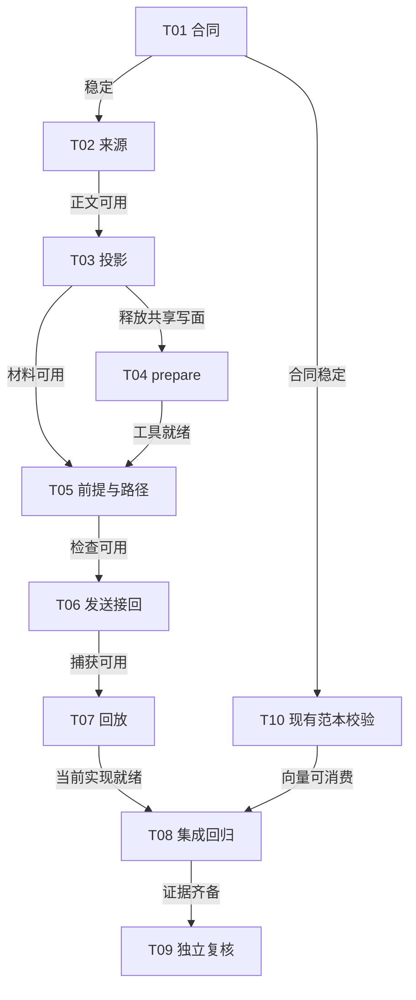

# Plan v3: 以v0.5四段范本指导开发

2026-11-19用户澄清：需要已有v0.5的决策本→实际模型输入→真实模型返回→PM参考决策全部记录作范本，不是先新增八次真实派发采集。当前保持SPEC，仅整理文档/参考资产，不改产品源码、不派工/调用模型。

## 1. 输入和交付

[spec](spec.md)、[design](design.md)、[四段范本](docs/reference-records/index.md)、[证据要求](evidence-requirement.md)。原v05冻结150文件不改，新增reference-records作为补充资产。原版八DP及优化auto对照共9例，前三段来自已保存实录，第四段明确是当前PM参考裁定，历史生产采纳/执行缺失仍为空。

## 2. 待执行任务

2026-11-22 已复核[当前源码与各卡差额](evidence/research/current-code-review-20261122.md)。先补 T01 的最终候选校验、T03 的八 DP 材料投影和 T05 的业务前提/auto 比较。T02/T06/T07 按现有来源读取、接回签收及回放入口补缺口。T04 复用共用接口处理复杂材料。现有依赖和验收范围继续适用。

[跨项目 DP 阻塞回执](evidence/dp-blocked/20261122/report.md)补充 193 条实际输入和状态样例。T02/T03 优先处理路径解析、引用字段和范围问题，T06/T07 观察未发送、配置与传输状态，T08 选代表性回执回归。四段范本仍是实现比对的基线。

| 卡 | 结果 | 依赖 | 对应AC |
| --- | --- | --- | --- |
| T01 | 合同/固定候选/版本处理 | 无 | AC-001、010 |
| T02 | 来源正文/追溯/压缩 | T01 | AC-002、004 |
| T03 | 八DP投影/desc/引用术语 | T01、T02 | AC-003、004、005 |
| T04 | prepare隔离/顺序/模型/发布吸收 | T01、T02、T03（写面串行） | AC-007、011、013 |
| T05 | QG/sign前提、auto比较/路径 | T03、T04 | AC-001、006、008、009 |
| T06 | 发送/去重/原预算/配对/continuity | T03、T04、T05 | AC-009、010、011、013 |
| T07 | 四段捕获及PM参考/实际执行区分的回放 | T06 | AC-012 |
| T10 | 现有v0.5四段范本消费/语义校验 | T01；参考资产已整理 | AC-015—018 |
| T08 | 离线生产链与范本对比、必要回归/证据 | T01—T07、T10 | AC-001—013、015—018 |
| T09 | 另一执行者独立复核 | T08 | 全部18 AC |
| T11 | 已撤回：强制新采八个真实闭环 | 无，不派发 | 不再是验收前置 |

## 3. 执行与写面规则

10个待执行任务，T11仅保留撤回记录。T03/T04共享decision-tool默认串行，T05/T06共享热文件同样串行；不照DAG盲目并行。每卡实施前读完整源码、核其它窗口改动和真实写面，必要扩面由PM修订，不顺手改其它key/凭证/依赖/核心。

每卡保留依赖/AC/VC/已有证据/写面/精确argv/输出。新测试是未来交付，当前不创建/不运行；Python从仓库根，TS从coding-agent包根跑harness/faux指定suite，不跑全量vitest/npm test/build。T08按当前源码跑必要检查并留完整输出，旧环境故障不是当前基线。

### 调用策略（2026-11-22）

用户确认按下列顺序减少常规模型调用。调整点在 PM 调用入口和现有本地处理路径。

| DP | 常规入口 | 需要继续判断时 |
| --- | --- | --- |
| dp-route | 根据调用来源、当前阶段和实际待处理 gate 本地选择下一入口，直接进入对应 DP 的既有流程。 | 路由不明确时由原 PM 核对现场。保留 dp-route 入口供显式使用及原范本回放。路由结果只定位入口，动作权限仍由目标流程核验。 |
| dp-w-type | 任务卡已声明角色，且任务要求与能力、写面、模型等现有检查相符时，取本地类型并走原派发入口。 | 多个类型确实合理时使用既有 dp-w-type。任务卡冲突、缺证或硬检查失败时，原 PM 先处理该缺口。 |
| dp-sign-key | 优先使用当前同范围 QG、独审和交付证据，走现有独审证据签收入口 `mw decide sign --for-done`。签收写入和 Done 阶段仍由既有入口核验。 | 缺证或版本漂移则补证、复核。具备可信材料且确有交付语义取舍时，可用现有 dp-sign-key 流程。 |

本地结果继续按现有记录规则标明来源及证据。八个 DP 的定义、材料、候选、回包反解和业务检查按各自原合同执行。[v0.5 四段验收](reference-comparison-contract.md)仍保留九例、36 项，模型路径用原范本独立覆盖。此处记录调用策略，实施继续留在 SPEC 等待后续指令。

这三项常规调用行为交由 [mw-dp-call-policy](../mw-dp-call-policy/codex_doc.md) 独立交付。上表保留用户决定，具体实施和验收由新 key 统一负责。原 key 继续负责材料、可区分性、单选协议、反解和四段取证；本地路径证据可供集成对照，不能替代实际模型路径。

### 最小集成顺序

两个 key 共写入口时先交调用策略，再交接材料链路。原 key 内保留 T01–T10 的职责与依赖。同一集成负责人从现有 QG 参考和替身建立一条短链，先核来源、实际投影、合法配对、反解和原主体接回。旧 QG 缺 reopen 的捕获作负例，合法正例使用独立请求与匹配的离线响应。最早一个未达节点确定后先补接线，再拓展其余 DP。T08 汇总当前源码证据，T09 复核。准备和接回各阶段在同一证据链中，避免跨 key 重复冻结、复制范本和重复签收。

### dp-auto 补充范本

新增[卡点后的下一步选择设计](dp-auto-stalled-path-design.md)，使用 Gaze 和 continuity 两个复盘时点重建四段，保留真实门禁判断，并独立给出有合成授权和额度的离线选择例。T05 可用于可区分性和路径检查，T06/T08/T09 可用于接回和端到端取证参考。范本在现有 v0.5 九例之外单列。

## 4. 范本验收

[八 DP 同次对账](decision-chain-reconciliation.md)用于 T07/T08/T09。原主体接回和回执作为第四段内的独立证据，按 DP 实际 writer 核验。报告 8/8 前须取得八条当前合法模型路径的同次证据。

跨项目回执按 13 类归并。从[典型四段对照和代码覆盖表](evidence/dp-blocked/20261122/v05-blocked-comparison.md)定位 T01–T09 的验收差额，复用已修的诊断与保护回归。补充回执用例与 36 行范本对照分别留证。

参考原件回放核字节/ID/usage/同版映射；当前投影按规范字段/候选/定义/原因与PM语义比较，明确版本变化，不能要求复制已知缺陷。当前PM参考裁定不等于历史生产PM执行，任何正式writer/派发/签收未发生不得伪造。

T10消费9个existing参考，不以重新调用模型取同一答案；T08离线生产链按原AC验证实际实现，T09另一执行者读证据/差异/真实前提。QG缺reopen和旧auto缺材料的负例必须可检出。若未来另需真实运行，独立按原授权和预算处理，不作为本范本交付前置。

## 5. 规划状态

范本资产覆盖 8 个 DP、9 例四段参考。用户已要求按拆分推进，调用策略 key 已结案，原材料链 key 在 EXECUTE。首个 [QG 离线回放](evidence/implementation/qg-short-chain-20261122/report.md) 贯通请求、原始响应、反解与 PM 接回。18 项 AC/VC 继续逐项验收，实际业务产物与独立复核按原门禁取证。v1/v2 规划备份和 docs 原件保留。

## 逐项复核补充（2026-11-19）

直接采用[v0.5范本索引](docs/reference-records/index.json)及[四段逐项对比合同](reference-comparison-contract.md)。T01—T10全部直接引用同一套资产；T01—T07交职责内字段证据，T10定义原件回放及报告校验，T08交9例×4段共36行JSON/Markdown对照与原始观测，T09逐行复核。原件回放、当前实现差异、负例拒绝和PM语义分别核实；缺段/串版/无依据差异/未验证不通过。T11继续撤回，产品测试/实施仍not-run。
