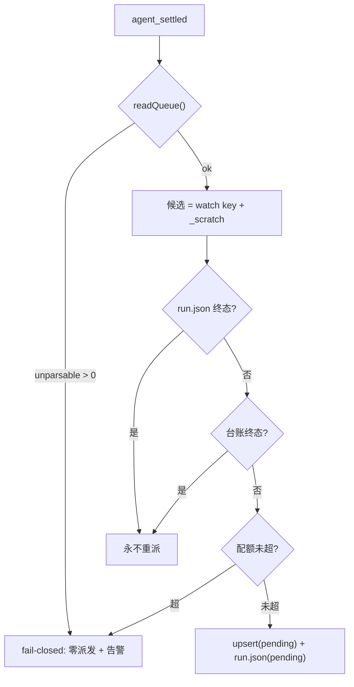

# Design: mw-gate-verdict-hardening（L3 中止指纹 / 闸门主动提醒 / 授权范围机械判定）

## §0 设计前提锚定

| 字段 | 值 |
|---|---|
| spec_path | `.agenticdoc/mw-gate-verdict-hardening/spec.md` |
| spec_locked_at | 2026-10-09（`AC Locked at 2026-10-09T08:45:14Z`） |
| ac_count | 25 |
| ac_ids | AC-001 … AC-025（全列见 §8 映射表；G5/G6 见 §11.8、跨 key 只读见 §11.10、G3 锚点见 §11.11） |
| 设计输入 | `evidence/research/spec-*.md` × 5（RQ-1/2/3/4 + PM 基线）＋ `evidence/research/design-*.md` × 3（DRQ-1 G1 / DRQ-2 G2 / DRQ-3 G3）＋ **PM 直执事故复盘 2 份**（`evidence/incident-in3-queue-reenqueue-20261010.md`、`evidence/in3-impact-assessment-20261010.md`；RQ-5 被 IN-3 杀灭，无产出，其取证需求已被复盘取代） |
| 代码基线 | `H:\git\Multi-Workers` HEAD `10446aefb`（`mw-autopilot-slot-capacity` 已提交；`autopilot/**` 与 `agent-team-loop/**` 无本 key 脏改动） |
| 定位 | **补口**，不是重做：在 `mw-autopilot-slot-capacity` 的 24 张卡之上收口**六条**其未覆盖的根因（G1/G2/G3/G4 ≈ reflect；G5/G6 ≈ **IN-3 事故**；G4/G5 于 2026-10-09、G6 于 2026-10-10 追加） |
| 设计确认 | **2026-10-09 用户确认**（4 项判断全部按 design 原推荐落定）：① `authorizes` 闭集 = `{retry, contract-change}`（`install` 排除，无机器消费者）；② `gate_reminder_max` 为配置键但**取值域封在 1..2**（只能调低，不能破坏 AC-005 的上限）；③ G2 多窗口推送按 `gate.key` 作用域去重；④ G3 接受残余风险：裸 bash 直跑 `advance_phase.py <key> done` 绕开守卫（AgenticTask 是外部仓，字面全覆盖需上游变更） |
| 范围追加 G5 | **2026-10-09 用户确认**，**2026-10-10 被 IN-3 重定界**：原命题“launcher 重启重排已 acked 任务”只是表象 ⇒ 真命题 = **队列完整性**（行缺失不得导致全量重派）；RQ-5 被事故杀灭（无产出）⇒ 设计转以 PM 直执复盘为据（§11） |
| 范围追加 G6 | **2026-10-10 用户确认 3 项硬要求**：① 本 key 执行不得影响历史 worker（隔离）；② 产物必须自带状态；③ worker 自声明 done 不得重启，补充则新起 worker；G6 留本 key。**同日追加第 4 项（AC-024）**：PM 对其它 key **可读不可写**——看得见全部 key 的 workers 与状态，但不得改 / 重派（写面拒绝码 `[cross-key-read-only]`），见 §11.10 |

**本设计的性质**：六条缺口都不是"缺功能"，而是**判据缺位**——L3 中止没有机器指纹所以与"写错文件/真 FAIL"混判（G1）；闸门"等人"没有时间驱动所以静默数小时到数天（G2）；授权只有自由文本 note 所以散文被当授权（G3）；面板帧没有采集时刻所以"观测面撒谎"**不可见也不可自证**（G4，RQ-4）。因此本设计的原则是**给每条缺口补一个可机械复算、fail-closed 的判据**，并且尽量复用既有载体（timeline / gate 允许集 / ledger / 已应答 gate / 面板 staleness 先例），不新造机制。

**贯穿各缺口的硬约束**：
- **P-018 零扰动**：历史 gate 文件、健康项目的 `mw doctor` 文本、无 abort / 无 freeze 的项目、**无 `run.json` 的历史任务**，渲染与行为逐字节不变（AC-013）。
- **不并行写同一热点**：G1 动 `conductor.py` 的 L3 回路、G2 动同一文件的 `tick` 顶部、G3 动 `_done_transaction` + `gates.py` ⇒ plan 串行并对每次改动跑全量 `test_autopilot_*`。**G2 与 G4 都改 `monitor.ts`** ⇒ G2 → G4（D-020）。**G5/G6 新开三条串行链**：`pm-orchestrator.ts`（T-09→T-17→T-19）、`worker-store.ts`（T-15→T-20）、`launcher.py`（T-18→T-20）；`mw_common.py`/`mw.py` 与 T-11 同文件 ⇒ T-11 → T-18/T-19（与 D-009 写面冲突叠加）。
- **G5/G6 不得改变既有派发正向行为**：只把“不可读/无信息”从 fail-open 改为 **fail-closed**，把“行”升格为“行 + 产物身份”；在健康队列上派发结果与今日逐行相同。
- **不并行写同一热点**：G1 动 `conductor.py` 的 L3 回路、G2 动同一文件的 `tick` 顶部、G3 动 `_done_transaction` + `gates.py` —— 三者都在 `conductor.py` 与 `gates.py` 内，plan 必须串行排布并对每次改动跑全量 `test_autopilot_*`。**G2 与 G4 都改 `monitor.ts` 的类型区（`:156-176`）与 `readMonitorState` 的 `return` 对象（`:386`）⇒ 两者也必须串行（G2 → G4，见 D-020）。**

---

## §1 架构选型

### D-001 G1 指纹模型：marker ∧ 无合格源，落在状态门之前

- **选择**：新增纯谓词 `_l3_stream_aborted(worker_log_path, readable_sources) -> bool` =
  **`worker.log` 尾 64 KiB 含子串 `stream closed before response.completed`** ∧ **没有任何可读 L3 源（`output.md` / `report.md`）两节齐备**。
  调用点在 `conductor._l3_round_verdict`（`conductor.py:1556`）**内、状态门 `:1585-1586` 之前**。
- **否决**：
  - 只匹配 marker、不查合格源 —— marker 与"两节齐备"在语料上有 0 重叠，但"写错文件"与"流中止"在 `output.md` 缺两节上**完全重叠**（RQ-1 F4）；不查源会让 A 类误判为 aborted。
  - 要求 `output.md` 必须存在（贴 AC-001 字面）—— 语料 6/6 都存在，但要求它会引入"文件缺失"这条额外假阴性；AC-004 的假阳性判据只列"无 marker ∨ 两节齐备"，故取**最小门**（不要求存在）。
  - 用 `done exit=0` 作为门 —— RQ-1 实测 6/6 中止轮队列 `status=failed`，且 D 类 provider 403 轮**也有** `done exit=0`（不可判别）；`done_exit_zero` 只记进事件 `data`。
  - 复用 `_parse_l3_output`（`conductor.py:1411`）—— 它是旧单源判定，主路径已不依赖，且不含 marker。
- **调研**：`spec-l3-abort-taxonomy-20261009.md`（RQ-1 F1/F2/F4）、`design-g1-l3-aborted-wiring-20261009.md`（DRQ-1 F1）。

### D-002 G1 持久面：timeline 事件 + `data` 载荷（+ stall 时 gate `reason_code`）

- **选择**：aborted 轮发 `st.timeline.append("l3-aborted", key=key, detail=..., data={...})`，
  `data` 键集固定 `{round, task_key, worker_status, output_bytes, done_exit_zero, retry_used, retry_limit, recorded_at}`。
  timeline 的事件载荷机制已存在（`timeline.py:293-339`，`payload["data"] = dict(data)`），TS 侧已放开
  （`status-model.ts:1010 TimelineEvent.data?`，parity 测试明文允许）。预算耗尽时 gate 落 `reason_code="l3-aborted"`。
- **否决**：写进 `l3-verdict-provenance.json` —— 该 sidecar 的消费者（`conductor.py:3290-3322` 按 `raw_verdict=="below"`、
  `:5303 _last_provenance_record`、`:6474 evidence.resolve`）全部假设"有裁决源"，而 aborted 轮 `l3_source is None`；
  且写点 `:1915` 本就有 `if l3_source is not None` 前置（aborted 轮零痕迹）。
- **调研**：DRQ-1 F1.5。

### D-003 G1 专用有界计数：`l3abort:{key}` 标签 + 共享 stem 序号（机制 A）

- **选择**：
  - 新 loop 标签 `l3abort:{key}`，与既有 `repair:{key}` 同族；`state.used_rounds`（`state.py:224-249`）天然派生独立计数。
  - 轮次 stem 共享同一序号空间：`round_no = used + abort_used`，普通轮与 abort 轮都派 `l3-a{round_no+1}`
    （`dispatch.render_task_md` 写 `loop:`/`attempt:` 标签，`dispatch.py:359-360`）。
  - `l3_limit = round_budget + _resume_credits`（`conductor.py:1858`）**语义不变**，只约束普通轮；
    新键 `l3_abort_retry_limit`（int，默认 1，域 0..10）只约束 abort 轮。
  - `if verdict == "aborted":` 分支插在 `verdict == "no-verdict"` 与其内 `used >= l3_limit` **之前**——
    否则共享预算已耗尽时 abort 无法重掷（AC-003 要求专用计数未耗尽即重掷）。
  - `_l3_round_verdict` 第一槽 value 域扩展 `"aborted"`（4 元组长度不变，`test_autopilot_verdict_provenance_guard.py:637-657` 的 `tuple_len==4` 锁不破）。
- **否决**：
  - 机制 B（abort 轮仍用 `loop="l3:{key}"`、另存计数）—— 与 spec §2.4「不占共享轮预算」冲突，且计数要从 timeline 尾部重派生（有界布尔去重，不能表达次数，RQ-2 已证）。
  - 机制 C（独立 stem 前缀 `l3abort-a{N}`）—— `_l3_round_verdict` 硬编码 `l3-a{attempt}`（`conductor.py:1580`），跨命名空间需第二套轮指针。
  - 加 `abort_out` sink 而非新 verdict 值 —— 调用方三处都要多读一个变量，不如显式 verdict 清楚。
- **边界（必须写进实现注释）**：有 abort 轮时 `round_no != used`；任何仍把 `used` 当"轮号"的消费者必须一起审，
  已定位 `_recompute_l3_stall_code`（`conductor.py:5348`）与 `recompute_false_negative_class`（`:5398`）。
  无 abort 轮时 `round_no == used` ⇒ **与今天逐字节同一路径**（语料 57 轮回归零漂移；快照 `2026-10-09T12:30Z`）。
- **调研**：DRQ-1 F2/F3。

### D-004 G1 终态：abort 预算耗尽 ⇒ `mark_stalled` + `reason_code="l3-aborted"`

- **选择**：`mark_stalled(..., reason_code="l3-aborted", loop="l3abort:{key}", used_rounds=abort_used, round_limit=abort_limit, credits_used=0)`；
  `STALL_REASON_CODES`（`conductor.py:4891-4904`）12→14（含 G3 的 `contract-unauthorized`）；
  `_recompute_l3_stall_code` 在 `verdict == "no-verdict"` 之前加 `if verdict == "aborted": return "l3-aborted"`；
  `_stall_family`（`:5288-5301`）把 `l3abort:` 归入 family `"l3"`。
- **否决**：只发事件、stall 时仍用 `l3-no-verdict` —— 会让 `proposition_stalled` 的
  `reason_code == cause_class` 复算失败（`:5036-5041` 判 `stalled-reason-drift`）。
- **反向保证**：aborted 轮的 `recompute_false_negative_class`（`:5376-5414`）落 `undecidable` ⇒ 该门不会被自动 approve（fail-closed）。
- **调研**：DRQ-1 F3.4/F5。

### D-005 G2 判定在 conductor、投递在 extension（路 B）

- **选择**：**判定与计数只在 Python**（conductor `tick`）；**投递只在 TS**（PM poll 循环读到提醒后 `deliverPmAlert`）。
  conductor 写 `gate-reminder` timeline 事件 + ledger 行；extension 只做"读到 → 推送"的搬运，**不做任何阈值判断**。
- **否决**：
  - 路 A（extension 每 tick 读 gate 文件自判阈值）—— 会产生两个独立阈值判官；AC-007 的"无在飞行"在 Py/TS 两侧本就是不同口径，
    叠加时钟漂移与 tick 相位必然出现"一侧提醒、另一侧不提醒/重复"（P-021 家族）。
  - 只发 timeline 事件、不加 extension 消费者 —— 只有人下次跑命令才可见，**达不到 AC-005 的"无人提问也收到"**。
- **调研**：DRQ-2 F1.3/F1.5。

### D-006 G2 计数载体：复用 `auto-decisions.jsonl` 的 `phase:"remind"` 行

- **选择**：行形状 `{"phase":"remind","gate_id","gate_kind","gate_key","reminder_n","reminded_at","detail"}`，
  经 `_append_auto_decision_row`（`conductor.py:5729`）单写者 append；**不带** `executed`/`decision`/`mode`
  （那三个是 decide 行的语义位）。读侧新增 `_reminder_count` / `_reminder_recorded`（只数 `phase=="remind"`）。
- **否决**：
  - detail 序号 + `_timeline_has_event`（`conductor.py:1817`）—— 实测尾 200 条窗口仅 ~20 min（纯 4s 节奏 ~13.3 min），
    小于第 2 次提醒的 60 min 间隔 ⇒ 计数器**结构性复活**（会重复发 1/2）。
  - 把计数写进 gate 文件 —— `_stamp_gate_defaults`（`:2499`）必须在 `snapshot_gate_created`（`:5581`）之前，
    改门文件会破 T-06 的 `gate_file.sha256` replay 绑定。
  - 只靠 pi session entry 存计数 —— 新会话重置 ⇒ 可能 >2 次。
  - 兄弟文件 `gate-reminders.jsonl` —— 语义更干净但要多一对读写函数 + 一个文件名常量；本设计以"不新造机制"优先，取复用路。
- **审计依据（既有 6 个消费者全部不可见）**：`_effective_auto_decision:6033`、`_escalate_recorded:6055`、
  `_shadow_decision_recorded:6065`、`_defer_recorded:6076`、`_night_rows:5813`、`_auto_breaker_signal:5853`、
  `auto_consumption_set:5741`、`shadow_prerequisites:5934` 全部以 `row.get("phase") == "decide"` 为入口（实测 8 处：5748/5820/5860/5938/6043/6057/6069/6082）。
  唯一影响是 `seq = len(rows)+1` 被抬高（无害）与总数型诊断（`test_autopilot_auto_decision.py:412`）。
- **调研**：DRQ-2 F3.1/F3.2。

### D-007 G2 挂点：`tick`（enabled 检查后、goal 检测前）

- **选择**：`_remind_pending_gates(project_root, st, cfg)` 插在 `conductor.tick`（`:2330`）的
  `cfg` 加载（`:2339`）与 `enabled/paused` 早退（`:2340-2341`）**之后**、goal 检测（`:2344`）**之前**。
- **否决**：只挂 `orchestrate`（`:204`）—— `goal-change` 门在 `tick` 的 `:2392-2395` 就早退（`return "halted-goal-change"`），
  永远到不了 `orchestrate`；而 goal-change 正是"全项目 halt"最危险的一类。
  也不挂 `_process_deferred_reviews`（`:2973`）——那是 48h 升级（`review-escalated`）语义，且只在 running stage 内跑。
- **触发规则**：第 n 次提醒在 `age ≥ n × gate_reminder_after_min` 时发（n ≤ `gate_reminder_max`）；
  两次提醒天然相隔一个阈值周期，不会因"每 tick 都满足阈值"而 4s 连发两个 PM turn。
- **配置键**：`gate_reminder_after_min`（int，默认 30，域 1..1440）+ `gate_reminder_max`（int，默认 2，域 1..2）。
  上界 1440 保证主动通道不晚于 `mw doctor` 的被动文本（24h）。`max` 域闭在 1..2 ⇒ 配置只能**降低**不能抬高上限，
  不破坏 AC-005 的"最多 2 次"。
- **时间锚**：`gate.created_at`（base required 字段，历史 v1 门也有，`gates.py:210`）；
  **不得用 `expires_at`**（E2 实测 21 门全 v1、该字段全缺 ⇒ 以其为键对历史门永不触发）。
- **调研**：DRQ-2 F2。

### D-008 G2 AC-007 判据：三轴（第三轴只在 TS 面）

- **选择**：`BLOCKED_ON_HUMAN` = `pending_gates > 0` ∧ `非终态行数 == 0` ∧ `conductor 仍在 tick`。
  - 前两轴两侧都算：门用 `gates.pending_gates`（`gates.py:728`）/ `listGates().filter(pending)`；
    行**两侧统一取"非终态"**（`status ∉ {done, failed, needs-clarification}`，`mw_common._TERMINAL_STATUSES:162`），
    **不是** `status=="running"`（`pending` 行意味着下个 tick 就会启动，提醒人属误报）。
  - 第三轴 `tickStale` **只在 TS 面有意义**（`monitor.ts:596-609/635`）；Python 侧判定发生在 conductor 自己的 tick 内，
    "conductor 正在 tick"是构造事实，**不造** Python 侧 `tickStale` 自评（全仓 `.py` 侧 0 命中）。
- **一致性口径**：两侧要一致的是**布尔判据的真值表**，不是"逐字实现全部三轴"；由共享夹具 + 对拍测试锁住（P-021）。
- **EXECUTE 稀疏的排除**：`非终态行数 > 0`（有在飞/待派 worker）⇒ 不提醒。
- **answered 即停**：每 tick 从 `pending_gates` 重算（零私有状态，D-102 式），门一答即自然零残留（AC-006）。
- **调研**：DRQ-2 F2.3/F3.3/F6。

### D-009 G2 可见面

- **选择**：
  - `/autopilot status`：`GateView`（`status-model.ts:1238-1242`）加 `ageMs: number | null`；映射 `:1349` 从 `GateRecord.createdAt` 计算；文本 `:1396-1398` 追加 ` age=<coarse>`。**不**把 `BLOCKED_ON_HUMAN` 做成 per-gate 字段（它不是门的属性）。
  - monitor 面板：`MonitorSnapshot`（`monitor.ts:170-176`，5 字段）与 `MonitorAutopilot`（`:156-168`，10 字段）加 snapshot 级 `blockedOnHuman: boolean`（采集区 `:355-386`、`return` `:386`），渲染插入点在 `:707-727`（`if (s.autopilot.enabled)` 起）的 autopilot enabled 分支内、attention 之前，`trunc` 到 `MONITOR_LINE_MAX`。**【锚点修正】** RQ-4 实测这两个类型的行号为 `:156-168` / `:170-176`，非更早文档写的 `:155-166` / `:488-495`。
  - `mw doctor`：**保持 24h/72h 文本阈值零扰动**；`_doctor_gates` 段新增 `blocked_on_human`（三轴；需一次 `parse_workers_file`），
    `_gates_text_alerted`（`mw_common.py:2764`）加一条触发条件，`format_doctor_text`（`:3103-3115`）只在非零时追加 `BLOCKED_ON_HUMAN` 后缀。
- **否决**：把 doctor 的 24h/72h 拉低到 30min —— E2 历史语料 30min–24h 区间有 12+ 个门，拉低会把"挂了 40 分钟"从静默变成 issue/suggestion，
  破坏 I7 零扰动契约并制造噪音；30min 级别的正确表达是主动提醒通道，不是 doctor 文本。
- **会红需同步的既有测试**：`autopilot-console.test.ts:374-378`（`GateView` 精确 `toEqual`）、`autopilot-monitor.test.ts:151/911/995`。
- **调研**：DRQ-2 F5。

### D-010 G2 多 PM 窗口的推送作用域

- **选择**：提醒按 `gate.key` 作用域——`gate.key` 非空时只推给 `watch.key == gate.key` 的窗口；
  stage 级/`key` 为空的通用门由消费侧 session entry（`console.ts:75` 的 `agent-team-loop:autopilot-seen` 先例）去重，
  同一提醒只被一个窗口投递。
- **否决**：所有窗口各推一次 —— 同一事件会花掉 N 个 PM turn（`deliverPmAlert` 的 `triggerTurn` 不做去重）。
- **调研**：DRQ-2 F1.4/F1.5（该作用域无现成先例，属本设计要求补充的语义）。

### D-011 G3 字段：`authorizes` 走 `_JSON_LIST_FIELDS` 闭集数组，不升 v3

- **选择**：~~`authorizes` 加入 `FRONTMATTER_FIELDS`（**追加到末尾，索引 40**，绝不插中间）~~ **[REVISED @ 2026-10-10 20:35（T-04 报备 R1）]** 落点改为 `_JSON_LIST_FIELDS`（单行 JSON 数组）+ `Gate` dataclass + 新闭集常量 `AUTHORIZES_ACTIONS = {"retry", "contract-change"}`，**不**进 40 名单：
  解析期成员校验 fail-closed（仿 `gate_schema` 枚举，`gates.py:628-635`）+ 写侧护栏（仿 `REASON_CODES` 越界丢弃，`conductor.py:2523-2527`）。
  - **40 名单保持冻结（已落地事实）**：解析面成员校验 `gates.py:507` 现为“`FRONTMATTER_FIELDS` **或** `_JSON_LIST_FIELDS`” ⇒ `authorizes` 是冻结 40 名之外的**已识别扩展字段**（值解析走 `gates.py:577`）。T-04 在代码内留注释（`gates.py:40/:168-169/:503-504`）并以 `test_autopilot_contract_guard.py:187-188` 锁住“40 名不变 + `authorizes` 不在其中”。
  - **为何不追加第 41 项（接受偏离的判据）**：`FRONTMATTER_FIELDS` 是**跨语言冻结顺序**（TS 镜像 `GATE_FRONTMATTER_FIELDS`），加一项会连带打红两个锁（`test_autopilot_gates.py:224` == 40；`autopilot-gate-presentation.test.ts:206-235` 跨语言 parity）而**无功能收益**：回读路径已由 `_JSON_LIST_FIELDS` 接住；渲染路径 `_gate_file_content`（`gates.py:283`）是手写字面量、**不遍历**该名单 ⇒ **不存在“重渲染丢字段”路径**。
  - **对 T-12 的硬要求**：TS 侧必须镜像同一形状（`status-model.ts` 的 `GATE_JSON_LIST_FIELDS` 加 `authorizes` + 未知字段检查放宽（约 `:811-812`）+ 闭集校验），否则会出现“`authorizes: []` 的门 Python 可解析、TS 面板跳过”的新双语言分叉（AC-015 家族）。
  - **附带收益**：40 名顺序一行不改 ⇒ T-14 **无需**为本次偏离刷新那两处计数锁。
- **否决**：
  - 升 `gate_schema: 3` —— v2 是纯加性可选扩展、`_REQUIRED_FIELDS` 冻结 6 格（import 期 assert）；
    `gate_schema` 是"文件形态版本标记"不是"字段集哈希"；只有把字段做成**必填**才需要新版本标记。
  - 标量枚举 —— 授权天然是"动作类型集合"，与同族的 `write_scope`/`out_of_band_actions`（已是 JSON list）形状一致。
  - 把 `install` 也放进闭集 —— 它**当前无任何机器消费者**；无消费者的成员会让"列了也不生效"变成新的语义空洞（P-014 家族）。
    按 `timeline.EVENT_TYPES` 的"先接词汇、后接生产者"先例可预登记，但本设计选择**只放有消费者的成员**（AC-009 的示例是 "如"，非穷举）。
- **调研**：`spec-gate-authorization-scope-20261009.md`（RQ-3 F1）、DRQ-3 F1.1。

### D-012 G3 写者：conductor 建门物化空行 + 人在应答时填值

- **选择**：
  - conductor 侧 `_stamp_gate_defaults`（`conductor.py:2499-2530`）/ `_gate_default_fields`（`:2553-2573`）多盖一行 `authorizes: []`；
    **`gates.create()` 本身不渲染该字段**（否则破 `test_autopilot_gates.py:216-227` 的"`create()` 恰 13 键"锁）。
  - 人应答时填值：`gate-writer.ts` 扩 `AnswerGateOptions`（`:24-48`）+ `ANSWER_FIELDS`（`:50`）+
    `answerGate()` 闭集校验（`:139-176`）+ `console.ts cmdGate` 的 `--authorizes`（`:455-495`）。
  - `rewriteAnswerFields`（`gate-writer.ts:101-133`）**只重写已存在的行**，所以必须有 conductor 先物化空行，人才能填进去。
  - 手工编辑 gate 文件（`gates.py:11-13` 明写"manual file edits are equally legal answers"）两条路都留，审计路径优先。
- **否决**：只让人写（字段行不存在 ⇒ 写不进去）；conductor 按 kind 自动盖章具体值（无法预知人要授权什么，`contract-change` 永不可被授权）。
- **安全属性**：worker 无法伪造该字段——`xkey-gate-guard.ts`（规则 `:7-77`、注册 `:209-242`）封锁 agent 工具对
  `.agenticdoc/_autopilot/**`（除 `_autopilot/xkey/**`）的 write/edit/bash；残余风险是同 uid 带外进程（守卫自述 `:31-36`）。
- **调研**：DRQ-3 F1.2。

### D-013 G3 worker 提示词硬约束（单一常量，三处拼接）

- **选择**：新增模块常量 `_CONTRACT_CONSTRAINT`，拼进 `_repair_prompt`（`conductor.py:1453-1468`）、
  `_phase_writer_prompt`（`:2291-2297`）、`_fix_writer_prompt`（`:2312-2327`）三处**末尾行**（纯追加，便于逐字锁测试）。
  措辞对齐 `_xkey_proposal_prompt` 的"不得修改…"先例（`:3887`、`:3910-3911`）。
  AC-010 的变更清单产物落 `<key>/evidence/contract-change-<YYYYMMDDTHHMMSS>.md`（与 `_done_transaction` 的 QG 报告命名同风格，`conductor.py:2131-2136`）；
  该文件是**人的手工产物**，机器判据只认 `authorizes:` 字段 + freeze —— 分开可避免"写了个 md 就当授权了"的新空洞（正是 E2 事故的形态）。
- **理由**：`_phase_writer_prompt` 是 autopilot 模式下**唯一会生成 spec/design 的提示词**（`_advance_key:1179-1185`），最危险。
- **调研**：DRQ-3 F2。

### D-014 G3 done 前检查机制：mw 侧纯模块 + conductor 挂点 + CLI 钩子

- **选择**：
  1. 新纯逻辑模块 `packages/multi-workers/autopilot/contract_guard.py`：
     `extract_contract(text_spec, text_design) -> {id: sha}`、`freeze(key_dir, spec, design) -> path`、
     `evaluate(key_dir, gates_dir) -> (ok, changed_ids, carrier_gate, reasons)`。只读、无新常驻组件（满足 GC-1），
     依赖方向沿用 `conductor → closure` 的单向先例。
  2. conductor 挂点：`_done_transaction` 顶部（`conductor.py:2089`，在任何写盘之前，符合其"check-before-write"契约）调用 `evaluate`；
     不通过则不进入 QG/achieved 写入，直接 append 机读 timeline 事件 + `mark_stalled`。
  3. PM 工具路：新增 `mw autopilot contract-guard --project <dir> --key <k>`（复用同一模块，退出码 0/1 + JSON），
     `ui-bridge.ts` 的 advance 工具在 `runAgenticScript` 之前调用它。这样 sanctioned 工具路也被机械覆盖。
- **否决**：
  - (a) 直接改 `.agents/skills/agentic-task/scripts/advance_phase.py` —— 该框架是**外部仓库**
    （`.agentic-framework` 写 `repo=H:\git\Multi-Workers\.agents\skills\agentic-task / commit=d7004d0`，上游 `github.com/wenbocode/AgenticTask`）；
    `.agents/`、`.claude/`、`packages/multi-workers/.tmp/agentic-task/` **全部 gitignored**，本 key 无法提交、无法用本仓 pytest 覆盖（P-023/AC-014 无证据）；
    且有 4 份安装副本（sha 全等）+ 3 份源码缓存（其中 1 份已分叉）。
  - (b) "改 conductor 侧 `advance.py`" —— **前提不成立**：`mw autopilot` 只有 `{gates, verify}` 两个子命令，
    `mw autopilot advance` 命中 0；`advance.py` 是纯 spawn 包装器（docstring 自述 "no business semantics"），无门禁语义。
- **已知残余（必须写进 §5 风险）**：PM/人**裸 bash** 直接跑 `advance_phase.py <key> done` 的路径不被本机制拦截，
  与既有 `pm-state.md` hand-edit 的 bash 兜底属同级已知残余；字面全覆盖需上游 AgenticTask 变更，且应作为**独立上游改动**，
  不在本 key 的写面内。本 key 负责把"判据语义 + freeze 格式 + 批准记录格式"定死，使其可被上游复用。
- **调研**：DRQ-3 F3。

### D-015 G3 文本身份锚：`<key>/evidence/contract-freeze.json`（内容寻址）

- **选择**：new sidecar
  `{"schema":1,"key":...,"frozen_at":...,"spec":{"AC-001":"<sha256>"},"design":{"VC-001":"<sha256>"},"generator":"mw autopilot contract-freeze"}`。
  canonical 化：`splitlines()` 分词、剥 `\r`、单元格 strip，以 `id + "\x1f" + 文本` 求 sha256；
  **不做**全量空白折叠（避免正文换行改写被漏判），也不把行尾空白算进身份（避免编辑器噪声）。
  冻结时机：AC 块在 `spec→design` 接受时冻结；VC 块在 `design→plan` 接受时冻结；
  freeze 之后的任何 AC/VC 文本变化 ⇒ 命中 G3。缺失时 **fail-closed 拒绝**并给可执行提示（`mw autopilot contract-freeze --key ...`）。
- **否决**：
  - 复用 gate `subject_sha256`/`observed_at` —— **死路**：全仓无生产写者，仅声明解析 + 测试。
  - `git diff` —— 长跑 key 常在**交付才提交**，而 `advance done` 发生在提交之前 ⇒ `git diff` 常为空 ⇒ **fail-open**。
  - TOFU 缓释（缺失时以当前文本冻结）—— 是 fail-open，等于给"先改后冻结"开口子。
- **切分口径**：
  - AC 行：`^\|\s*(AC-\d{3})\s*\|\s*(.*?)\s*\|\s*$`（spec §3 表）。
  - VC 块：复用既有生成器正则（`.tmp/msc-gen-evidence-req.py:parse_vcs`），身份 hash 覆盖 `VC-nnn/assert/Layer/Output/Source` 五元组。
  - **不改** `audit_evidence.extract_ac_list`（保持只取 id，避免影响 L1 审计与既有测试）；新增的是 contract_guard 内的独立抽取函数。
  - design §8 的 AC→VC 映射表**不**纳入冻结（扩大误伤面，且映射改了不等于条文改了）。
- **调研**：DRQ-3 F4。

### D-016 G3 批准记录查找 + 留痕

- **选择**：
  - 批准记录 = 任何 `status == "approved"` ∧ `authorizes ∋ "contract-change"` ∧ `gate.key == key` 的门；**不绑定 kind**
    （E2 事故的真实载体是 `kind: stalled`，`gate-0014.md:3`）；`pending` / `rejected` / 散文 note 一律不认。
  - 判定函数**不访问** `gate.note` / `answered_by`，也不解析 design.md 里的"授权链"散文 ⇒ AC-012 构造性成立。
  - 留痕：新增 timeline 事件 `contract-refused`（`data` 带 `changed_ids`/`freeze_rel`/`carrier`）+ `reason_code="contract-unauthorized"`（本 key 第 2 个新原因码）。
  - 医生面：`_doctor_issues` 新增一条 fail-closed issue（插 `mw_common.py:2887` 前，对齐 I9 的"report but keep fail-closed"口径）；
    新增 `gates["contract_guard"]` 段，**仅在存在 freeze sidecar 的 key 上产出** ⇒ 历史 key/门 `--json` 与文本逐字节不变（P-018）。
- **否决**：
  - 复用 `xkey-authorize` 的 carrier 语义 —— 那是"request_id ↔ gate"维度；G3 的是"动作类型 ↔ gate"维度，合并会把两套去重维度混在一起。
  - 复用 I9/VC-048 的 issue 文案 —— 它点名 `cross-key repair request` 与 `xkey-authorize gate`，套在 G3 上会说错对象。
  - 复用既有 `stalled`/`config` 事件以免 event parity 同步 —— AC-011 要求"分类机读"（P-009），
    通用事件名 + detail 散文不构成机器分类；新增两个事件名（`l3-aborted`/`contract-refused`）两侧同步的成本是
    `status-model.ts:962-988` 各一行 + Python 计数测试，风险可接受且已在 §4 列全。
  - stage 级门（`gate.key is None`）授权 —— fail-closed，避免跨 key 越权授权。
- **调研**：DRQ-3 F5/F6/F7.4。

### D-017 G4 冻结判据：帧必须自证新鲜（不围绕 `/mw restart` 设计）

- **选择**：面板每一帧携带**绝对采集墙面时刻** `collectedAtMs`（`Date.now()`，非帧内相对年龄）+ 单调 tick 计数；
  渲染进 `renderMonitorLines` 首行（`:672-673`）。超过阈值未前进（复用 `staleAfterMs = max(30s, pollMs*5)` 机制，定义 `:609`、`tickStale` `:635`）
  ⇒ 帧内显式 `STALE PANEL (no refresh since <ts>)` 告警（粗粒度用 `formatDuration:651-658`）。
  RQ-4 已证明：**可见的陈旧帧 ⇒ 循环仍在跑**（停表会清 widget：`stopMonitor:847-853` → `console.ts:668-674` →
  `interactive-mode.ts:2101-2108` → `tui-main-screen.ts:331-364`），且每帧在改动 widget 之前就失败/被吞。
- **否决**：
  - 帧内算"快照年龄"（渲染瞬间即采集瞬间 ⇒ 活 tick 恒为 0，不能证明上一帧到现在没断）。
  - 用 serve/conductor PID 做活性证据 —— RQ-4 D3：PID 段**每 tick 重读**（`monitor.ts:287` `readMonitorState` → `getMwStatus`，conductor.pid `:316-330`），
    "写一次即固定"只对文件成立；新 PID 只能证明"≥1 次成功 tick 发生在重启后"。
  - 按 `launcher-beat.<pid>` 做目录扫描 —— RQ-4 D2 实测**证伪**（TS 侧 src/dist/全局 bundle 三处 grep 合计 0 命中；
    该文件只有 Python 读写，`mw_common.py:2065-2111`）。
  - 围绕"/mw restart 后重挂"设计 —— RQ-4 D1：`/mw restart` 只杀/起 serve 及其子进程（`mw-runner.ts:324-338`），
    **不触碰 pi 进程**（`.mw/window-model` mtime = 2026-09-23；10-09 无 `session_start`/`/reload` 痕迹）⇒ 重启与冻结无直接因果。
- **调研**：`spec-monitor-freeze-20261009.md`（RQ-4 §1.1/§3.1/§3.3/§3.4/§3.5，D1–D3/D5）。

### D-018 G4 失败不得静默丢帧（唯一能造成"不可见冻结"的代码点）

- **选择**：
  1. `monitor.ts:828-833` 的裸 catch 改为：捕获后仍**产出降级帧**（沿用上一帧数据 + `lastErrorAtMs` + 错误摘要），
     不丢帧；帧含降级标记。
  2. tick 内两处未受保护的读加保护并降级：`worker-store.ts:119` `fs.readFileSync(this.filePath)`、
     `mw-runner.ts:85` `fs.readFileSync(pidPath)`；`monitor.ts:439` 的 `fs.closeSync(fd)` 抛出会穿出
     `readTimelineTail`，同样改为降级而非跳帧。
  3. 失败证据落在**帧内**（不新增写路径，保持 monitor 只读性 —— 已被 `autopilot-monitor.test.ts:412`
     "三 tick 文件字节不变"用例印证）。
- **否决**：
  - 只吞不报（现状）—— 正是 P-009 的"失败只丢一帧、无痕"形态。
  - 给 tick 加日志文件/诊断落盘 —— `monitor.ts` 全文无写路径，新增写面会破只读性且引入新的清理/轮转责任。
  - 在 TUI 渲染层兜底 —— RQ-4 S6 已排除（`Text` 每 tick 新建、主屏 diff 会清多余行）。
- **边界（必须写进实现注释）**：降级帧的 "上一帧数据" 在首次 tick 即失败时为空，此时只能出 `collectedAtMs` + 错误摘要。
- **调研**：RQ-4 §3.1（S1/S3/S4/S6）、D4。

### D-019 G4 重臂：会话替换后面板必须回来

- **选择**：
  1. `autoStartMonitor`（`console.ts:709-725`）的 `:713` 幂等早退（`if (isMonitorActive()) return true;`）改为"已有活动但 ctx 不同 ⇒ 先 `stopMonitor` 再 `startMonitor`"。
  2. 新增 `session_shutdown` 停表（既有惯例先例：`pm-orchestrator.ts:726-732`、`index.ts:28-35`；
     `console.ts:690-693` 注释已留"a future session_shutdown hook can call this too"）。
  3. 在 `autopilot-monitor.test.ts:761-765` 补反向用例（现状把"幂等不重启"当正确行为）。
- **否决**：
  - 不改 —— RQ-4 D6：`monitor.ts:825` 幂等早退 + 扩展工厂跨会话复用（`loader.ts:412-441`）+ 重激活清 widget
    （`interactive-mode.ts:518-520/2160`）+ `runner.invalidate`（`runner.ts:552-556`）⇒ 面板在 `/new`、`/resume`、`/fork`、`/import` 后**永久消失**。
  - 只修渲染层 —— 层次不对（问题在生命周期与 widget 归属）。
- **调研**：RQ-4 §3.6、D6。

### D-020 G4 与 G2 的行面划分与串行

- **选择**：G2 独占 `:156-176` 的 `blockedOnHuman` 字段与 `:707-727` 的渲染插入点；G4 独占 `:672-673` 首行 + `:820-853` 生命周期段（`startMonitor:820`/`stopMonitor:847`）+ 失败处理；
  `monitor.ts:386`（`readMonitorState` 的 `return`）的改动由**先落地的一方**完成，后落地一方 rebase。plan 排 **G2 → G4**，`monitor.ts` 禁并行编辑。
  测试面同文件不同用例（`autopilot-monitor.test.ts`），冲突成本低。
- **否决**：并行改 `monitor.ts`（同一类型区 + 同一返回对象，必 rebase 踩踏）。
- **调研**：RQ-4 §3.9。

---

## §2 数据模型

### 2.1 gate frontmatter 新增字段（schema v2 加性）

```
authorizes: ["contract-change"]     # 单行 JSON 数组；闭集 AUTHORIZES_ACTIONS = {retry, contract-change}
```

- 位置：`FRONTMATTER_FIELDS` 末尾（索引 40）；`FRONTMATTER_FIELDS` 顺序冻结（`gates.py:86` "never reordered, never repurposed"）。
- 缺省：`None` / `[]` ⇒ **未授权**（fail-closed）。
- `_REQUIRED_FIELDS` 保持 6 格不变（AC-013）。

### 2.2 新 sidecar：`<key>/evidence/contract-freeze.json`

见 D-015。与 `closure.py` 的"内容寻址 marker"同族（`closure.py:27-31,110-137`）。

### 2.3 ledger 行（G2 计数）

`<project>/.agenticdoc/_autopilot/auto-decisions.jsonl` 追加：
```
{"phase":"remind","gate_id":"gate-0007","gate_kind":"stalled","gate_key":"<key>","reminder_n":1,"reminded_at":"<ISO>","detail":"pending 31m >= 30m"}
```
读侧过滤 `phase == "remind"`；既有消费者全部以 `phase == "decide"` 为入口 ⇒ 不可见（D-006）。

### 2.4 timeline 事件（本 key 新增 2 个）

| 事件 | 触发 | `data` |
|---|---|---|
| `l3-aborted` | G1 指纹命中 | `{round, task_key, worker_status, output_bytes, done_exit_zero, retry_used, retry_limit, recorded_at}` |
| `contract-refused` | G3 done 前检查拒绝 | `{changed_ids, freeze_rel, carrier}` |
| `gate-reminder` | G2 超阈提醒 | `{gate_id, gate_kind, gate_key, reminder_n, waited_s, after_min}` |

两侧词汇表必须集合相等：`timeline.py:67-96` ↔ `status-model.ts:962-988`（parity 测试 `autopilot-event-parity.test.ts:76-99`）。

### 2.5 新增配置键（project 层 autopilot config，不入 `EFFECTIVE_KEYS`）

| 键 | 类型 | 默认 | 域 | 用途 |
|---|---|---|---|---|
| `l3_abort_retry_limit` | int | 1 | 0..10 | G1 专用重掷上限（0 = 关闭） |
| `gate_reminder_after_min` | int | 30 | 1..1440 | G2 提醒阈值（分钟） |
| `gate_reminder_max` | int | 2 | 1..2 | G2 同门提醒次数上限（只能降不能升） |

`DEFAULT_CONFIG` 14 → 17 键。

### 2.6 面板帧新增字段（G4）

| 字段 | 位置 | 语义 |
|---|---|---|
| `collectedAtMs` | `MonitorSnapshot`（`monitor.ts:170-176`） | 该帧的**绝对采集墙面时刻**（`Date.now()`）；冻结时不再前进 |
| `tickCount` | 同上（可选） | 模块级单调递增计数；重启/重臂后不回退 |
| `stale`/`staleDetail` | 渲染层首行（`:672-673`） | 超过 `staleAfterMs`（`max(30s, pollMs*5)`）未前进 ⇒ `STALE PANEL` 告警 |
| `degraded` / `lastErrorAtMs` / `lastError` | `MonitorSnapshot` | 本帧是降级帧时置位（见 D-018） |

这些字段均为**帧内内存计算**，不新增 IO、不新增写路径。

---

## §3 模块划分

| 模块 | 归属 | 变更类型 | 内容 |
|---|---|---|---|
| `autopilot/gates.py` | Python | 改 | `authorizes` 字段（4 处）+ `AUTHORIZES_ACTIONS` 闭集 |
| `autopilot/conductor.py` | Python | 改 | G1 指纹/分支/计数；G2 提醒壳 + `tick` 挂点；G3 `_done_transaction` 挂点 + 提示词常量；2 个 reason_code |
| `autopilot/contract_guard.py` | Python | **新** | G3 抽取/freeze/evaluate 纯函数 |
| `autopilot/config.py` | Python | 改 | 3 个新键 + 域 + docstring |
| `autopilot/timeline.py` | Python | 改 | 3 个新事件名 |
| `autopilot/dispatch.py` | Python | **T-18 加性**（D-027/F37）| 队列行写入改为 `mw_common.upsert_worker_row`（槽位保留）；`loop:`/`attempt:` 标签机制既有 |
| `autopilot/state.py` | Python | 不改 | `used_rounds` 天然派生 `l3abort:` |
| `mw_common.py` | Python | 改 | G2 `blocked_on_human` 字段 + `_gates_text_alerted`/`format_doctor_text`；G3 issue + `contract_guard` 段 |
| `mw.py` | Python | 改 | `mw autopilot contract-guard` / `contract-freeze` 两个子命令 |
| `autopilot/status-model.ts` | TS | 改 | `authorizes` 镜像 + `GateView.ageMs` + `EVENT_TYPES` + config 镜像 |
| `autopilot/gate-writer.ts` | TS | 改 | `ANSWER_FIELDS` + `--authorizes` 闭集校验 |
| `autopilot/console.ts` | TS | 改 | `cmdGate --authorizes` 参数面；G4: `autoStartMonitor` ctx 变化后 stop+start |
| `autopilot/monitor.ts` | TS | 改 | G2: snapshot 级 `blockedOnHuman`；G4: 帧内采集时刻 + 失败降级帧 + 重臂（**G2→G4 串行**，D-020） |
| `pm/pm-orchestrator.ts` | TS | 改 | G2: poll 循环新增提醒消费者（读 ledger → `deliverPmAlert`）；G4: `session_shutdown` 停表 |
| `shared/xkey-gate-guard.ts` | TS | 不改 | 既有封堵面已覆盖 `authorizes` 伪造 |

---

## §4 接口与集成

### 4.1 gate 字段双侧同步清单（7 + 5 + 3）

Python（`gates.py`）：① `FRONTMATTER_FIELDS` 末尾 ② `_JSON_LIST_FIELDS` ③ `Gate` dataclass ④ `_to_gate()` 解析 + 成员校验
⑤ `AUTHORIZES_ACTIONS` 常量 ⑥ `mw_common._gate_pending_entry` 投影（**仅在字段存在时输出该键**）
⑦ `mw.py` 卡片投影（追加到既有 `answer:` 行尾，仅在非空时；**不加新行**以保 13 行/门锁）。

TypeScript：① `GATE_FRONTMATTER_FIELDS` → 41 项 ② `GateRecord.authorizes: string[]` ③ `GATE_JSON_LIST_FIELDS`
④ `parseGateFile()` 构造 + 成员校验 ⑤ `gate-writer.ts` 四处。

锁测试：① `test_autopilot_gate_schema_v2.py:138-148` ② `test_autopilot_gates.py:216-227` ③ `autopilot-gate-presentation.test.ts:205-241`。

### 4.2 timeline 事件双侧同步

`timeline.py:67-96`（`EVENT_TYPES`，23→26）↔ `status-model.ts:962-988`；Python 计数锁 `test_autopilot_timeline.py:48/53/54`。

### 4.3 配置键双侧同步（3 键 × 每键 7 步）

`config.py:55 DEFAULT_CONFIG` → `config.py:79 _INT_RANGES` → `status-model.ts` 六处（interface / `DEFAULT_CONFIG` / `INT_RANGES` / `intOf` 联合 / `readConfig.merged` / `saveConfig.ordered`）
→ 冻结语料 `test/fixtures/autopilot-config-corpus.json`（每键 **1 个单键 accept 例**，否则 `test_p6_partial_single_key` 的 `covered == expected_keys` 红 + 1 个越界 reject 例）
→ 重冻 `FROZEN_CORPUS_SHA256`/`FROZEN_CORPUS_COUNT`（`test_autopilot_config_parity.py:60-61` + `autopilot-config-sync.test.ts:39`）
→ 计数锁 14→17（`test_autopilot_config.py:114/138/139`、`test_autopilot_effective_config.py:73/207`、`test_autopilot_config_parity.py:423/426`、
`test_autopilot_gate_schema_v2.py:349` 末键、`autopilot-config-parity.test.ts`、`autopilot-console.test.ts:869-885/1194-1213`）
→ 文档（`README.md` 配置表 + 两包 `CHANGELOG.md [Unreleased]`）。

### 4.4 reason_code 闭集（12 → 14）

新增 `l3-aborted`、`contract-unauthorized`；同步 `STALL_REASON_CODES:4891-4904`、`_recompute_l3_stall_code:5348`、
`_stall_family:5288-5301`、测试 `test_autopilot_auto_decision.py:301/333/338`（**本 key 最易引爆的 P-021 面，plan 必须显式认领**）。

### 4.5 CLI / 观测面

`mw autopilot contract-guard --project <dir> --key <k>`（退出码 0/1 + JSON）、
`mw autopilot contract-freeze --project <dir> --key <k>`（写 sidecar）；
`/autopilot status` 的门行带 `age=`；monitor 的 `BLOCKED_ON_HUMAN` 置顶行；`mw doctor` 的条件后缀；面板帧内的**采集时刻 / 降级状态**（G4）。

---

## §5 Function Flow

```
G1（每个 L3 轮）
  _verify_loop
    rounds = state.used_rounds(...)          # 已读
    used, abort_used, round_no := ...
    _l3_round_verdict(key, round_no)
      ├─ _l3_stream_aborted(key_dir, task_key)?     # 新增：尾 64KiB 读 + 合格源检查
      │    marker ∧ ¬qualifies(any source) → "aborted"
      ├─ status ∈ {failed, needs-clarification} → "no-verdict"     # 既有，未命中 marker 才到这里
      ├─ no readable source → "no-verdict"
      └─ _l3_resolve_source → "meets" | "below"
    verdict == "aborted" → 事件 l3-aborted → 计数未耗尽 ? 派 l3-a{round_no+1} (loop=l3abort) : mark_stalled(l3-aborted)
    verdict == "no-verdict" → …既有…（预算判据仍只数普通轮）
    verdict == "meets"/"below" → …既有…

G2（每 tick）
  tick
    cfg 加载 → enabled/paused 早退
    _remind_pending_gates(project_root, st, cfg)      # 新增，在 goal 检测之前
      pending := gates.pending_gates(dir)             # 坏文件 → skip
      rows := parse_workers_file(...)
      non_terminal := count(status ∉ _TERMINAL_STATUSES)
      counts := _reminder_count(ledger rows, phase=="remind")
      for gate in pending:
        n := counts.get(gate.id, 0) + 1
        continue if n > cfg.gate_reminder_max
        continue if non_terminal > 0
        continue if age(gate.created_at) < n * cfg.gate_reminder_after_min * 60
        append ledger {phase:"remind", reminder_n: n, ...}
        timeline.append("gate-reminder", data={...})
    → goal 检测 → orchestrate（既有）

  extension startWorkerPollLoop（每 4s）
    读 ledger 的 phase=="remind" 行（或 timeline gate-reminder）
    按 watch.key 作用域 + 进程内 Set<(gate_id,n)> + session entry 去重
    → deliverPmAlert(text)（triggerTurn）        # 唯一推送原语

G3（每次 done 事务 / PM 工具路）
  evaluate(key_dir, gates_dir)
    freeze := read contract-freeze.json            # 缺失 → 拒绝 + 提示
    changed := {id : sha(id,current_text) != freeze[id]}
    changed == ∅ → ok
    carrier := 找 status=="approved" ∧ "contract-change" ∈ authorizes ∧ gate.key == key
    carrier == None → 拒绝（fail-closed）
    else → ok（carrier_gate 留痕）

  _done_transaction（check-before-write）
    evaluate(...) 不通过 → timeline.append("contract-refused") + mark_stalled(contract-unauthorized) → 不写 QG/achieved
    evaluate(...) 通过 → …既有 done 事务…
  ui-bridge advance 工具：runAgenticScript 之前调 `mw autopilot contract-guard`
```

**异常出口（全部 fail-closed，不静默）**：gate 文件解析失败 ⇒ `GateFormatError` → 跳过并告警（不当作授权）；
未知 `authorizes` 成员 ⇒ 解析期 `GateFormatError`；写侧越界值 ⇒ 丢弃 + `config` 事件（既有 `_log_dropped_gate_fields` 先例）；
freeze 缺失 ⇒ 拒绝并提示；ledger 不可读 ⇒ 视为 0 次计数（保守：可能多发一次，但不会少发）；
timeline 轮转 ⇒ 不影响计数（计数在 ledger）。

---

## §6 Coverage Matrix

| ID | 功能点 | 正常路径 | 边界 | 异常路径 | 层级 |
|---|---|---|---|---|---|
| F1 | G1 中止指纹 | marker ∧ 无合格源 ⇒ aborted | 尾窗正好切断 marker | 尾窗之外 ⇒ 不判 aborted | L1 |
| F2 | G1 三/四类互斥 | A/B/C 各命中一类 | 第四类（散文 report）单列 | 重叠输入 ⇒ 谓词拆开 | L1 |
| F3 | G1 专用重掷 | abort ⇒ 派 `l3abort` 轮 | 共享预算已耗尽仍可重掷 | 预算耗尽 ⇒ stall `l3-aborted` | L1 |
| F4 | G1 零漂移 | 无 abort 轮路径逐字节同今天 | 57 轮语料回归 | 假阳性 ⇒ AC-004 红 | L1 |
| F5 | G2 提醒判定 | 超阈 ⇒ 1 事件 + 1 推送 | 第 2 次在 2×阈值 | `running_rows>0` / `pending` 行 ⇒ 不触发 | L1 |
| F6 | G2 计数 | ledger `phase:"remind"` | timeline 轮转不复活 | ledger 不可读 ⇒ 保守 | L1 |
| F7 | G2 answered 即停 | `pending_gates` 每 tick 重算 | 刚答完的同 tick | 已答门残留 ⇒ 0 提醒 | L1 |
| F8 | G2 goal-change 门 | 挂 `tick` ⇒ halted 也提醒 | stage 级门 | 挂 `orchestrate` ⇒ 漏 | L1 |
| F9 | G2 可见面 | status/monitor/doctor 三面 | doctor 零扰动 | 缺字段 ⇒ 同今天 | L1 |
| F10 | G3 字段 | 闭集 JSON 数组 | 空数组 = 未授权 | 越界成员 ⇒ 解析期拒 | L0 |
| F11 | G3 写侧 | conductor 物化 + 人填值 | 手工编辑 gate 文件 | worker 伪造 ⇒ 守卫拦（L0 既有） | L1 |
| F12 | G3 提示词 | 三处逐字含同一常量 | 三条 prompt 各一 | 措辞分叉 ⇒ 锁测试红 | L0 |
| F13 | G3 freeze | AC/VC canonical sha | 冻结时机两处 | 缺 freeze ⇒ fail-closed | L1 |
| F14 | G3 done 检查 | 无授权且文本变 ⇒ 拒 | 有 `authorizes` 门 ⇒ 放行 | carrier pending/rejected/越 key ⇒ 拒 | L1 |
| F15 | G3 零扰动 | 无 freeze key 文本不变 | 历史 v1 门 | 老代码读新字段 ⇒ 缺省 None | L0 |
| F16 | 配置键 | 3 键双侧注册 | 单键 payload / 越界 reject | 漏一侧 ⇒ parity 红 | L1 |
| F17 | 事件词汇 | 3 新名双侧集合相等 | console 通用渲染 | 只加一侧 ⇒ parity 红 | L1 |
| F18 | reason_code | 12 → 14 + 复算一致 | 无 drift | 漏 `_stall_family` ⇒ drift 判红 | L1 |
| F19 | 非空洞对照 | 摘掉判据 ⇒ 用例转红 | ≥2 组 | 断言函数返回 None ⇒ 空洞 | L0 |
| F20 | 多窗口推送 | 按 `gate.key` 作用域 | stage 级门 session 去重 | 全窗口各推 ⇒ 噪音 | L1 |
| F21 | G4 帧自证 | 帧含绝对采集时刻 | 超 3 周期未前进 | 冻结时时刻不前进 ⇒ 告警 | L1 |
| F22 | G4 跟随 | 数据面变化 ⇒ ≤2 周期（8s）跟随 | `workers: N running` 反向用例 | 不跟随 ⇒ 用例红 | L1 |
| F23 | G4 失败不静默 | tick 异常 ⇒ 降级帧 | 首帧即失败（无上一帧） | 未受保护读失败 ⇒ 降级非跳帧 | L1 |
| F24 | G4 重臂 | ctx 变化 ⇒ stop+start | `session_shutdown` 停表 | `/new`·`/resume` ⇒ 面板永久消失 | L1 |

---

## §7 Verification Contract

> 每条：触发 → 断言 → Layer → `[VERIFY]` 输出 → Source(AC)。L0 静态/契约，L1 局部（单侧实现 + 单测），L2 端到端。

```
VC-001: 当一轮 L3 含 marker 且无合格源时，判 aborted 并发 l3-aborted 事件（非 no-verdict）
       Layer: L1   Output: [VERIFY] VC-001: aborted=1 no_verdict=0   Source: AC-001
VC-002: 当 aborted 轮发事件时，data 键集逐字等于固定八元组
       Layer: L1   Output: [VERIFY] VC-002: keys=8   Source: AC-001
VC-003: 当同一输入分别造 A/B/C 三类时，三者两两不同且各只命中一类
       Layer: L1   Output: [VERIFY] VC-003: exclusive=true classes=3   Source: AC-002
VC-004: 当 aborted 且专用计数未耗尽时，派 l3abort 轮且 used_rounds 派生独立计数
       Layer: L1   Output: [VERIFY] VC-004: reroll=true abort_used=1   Source: AC-003
VC-005: 当 round_budget 已耗尽但发生 abort 时，仍重掷（abort 不消耗共享预算）
       Layer: L1   Output: [VERIFY] VC-005: reroll=true used=1 limit=1   Source: AC-003
VC-006: 当 worker.log 无 marker 或 output.md 两节齐备时，aborted 假阳性 = 0
       Layer: L1   Output: [VERIFY] VC-006: false_positives=0   Source: AC-004
VC-007: 当 pending 门超阈且无在飞行时，产生 1 条 ledger 行 + 1 条 gate-reminder，且 PM 侧收到推送
       Layer: L1   Output: [VERIFY] VC-007: ledger=1 event=1 pushed=true   Source: AC-005
VC-008: 当同一门已提醒 2 次时，第 3 次不产生任何行/事件/推送
       Layer: L1   Output: [VERIFY] VC-008: rows=2 blocked_third=true   Source: AC-005
VC-009: 当门 status ≠ pending 后，该门不再产生提醒（零残留）
       Layer: L1   Output: [VERIFY] VC-009: residual=0   Source: AC-006
VC-010: 当 EXECUTE 期有在飞行（事件稀疏）时，不触发提醒；仅 pending 门 + 0 在飞才触发
       Layer: L1   Output: [VERIFY] VC-010: in_flight_silent=true blocked_only_on_human=true   Source: AC-007
VC-011: 当渲染监视面时，pending 门含 pending 时长且真等人时有 BLOCKED_ON_HUMAN 置顶
       Layer: L1   Output: [VERIFY] VC-011: age_shown=true blocked_marker=true   Source: AC-008
VC-012: 当提交 gate 字段时，authorizes 为闭集数组且未被列出的动作类型不得被引用为授权源
       Layer: L0   Output: [VERIFY] VC-012: closed_set=2 listed_only=true   Source: AC-009
VC-013: 当检查三条 worker 提示词时，逐字包含同一硬约束常量
       Layer: L0   Output: [VERIFY] VC-013: prompts=3 verbatim=true   Source: AC-010
VC-014: 当 AC/VC 文本相对 freeze 变化且无批准记录时，done 被拒且 timeline 留机器分类
       Layer: L1   Output: [VERIFY] VC-014: refused=true changed_ids=1 classified=true   Source: AC-011
VC-015: 当只有 gate 自由文本 note 被引用为授权源时，机械判为未授权（fail-closed）
       Layer: L1   Output: [VERIFY] VC-015: authorized=false   Source: AC-012
VC-016: 当读历史 v1 gate 与无 freeze 工程时，parse 全成功且渲染逐字节同改造前
       Layer: L1   Output: [VERIFY] VC-016: parsed=all required_fields=6 byte_identical=true   Source: AC-013
VC-017: 当摘掉/反转任一判据时，对应用例转红（非空洞对照）
       Layer: L0   Output: [VERIFY] VC-017: counterfactuals>=2 all_red=true   Source: AC-014
VC-018: 当复算验收时，所有 [VERIFY] 数值来自实测且"已机器校验"类声称带文件:行号或测试名
       Layer: L0   Output: [VERIFY] VC-018: verify_lines_measured=true anchors_present=true   Source: AC-014
VC-019: 当注册 3 个配置键时，两侧注册表与冻结语料同步（含单键 accept 例与越界 reject 例）
       Layer: L1   Output: [VERIFY] VC-019: keys=3 single_key_cases=3 corpus_refrozen=true   Source: AC-003, AC-005
VC-020: 当面板逐 tick 渲染时，帧内绝对采集时刻随 tick 前进；连续 >3 个周期未前进时帧内显式告警"快照过期"
       Layer: L1   Output: [VERIFY] VC-020: stamp_advances=true stale_warned=true   Source: AC-015
VC-021: 当数据面变化（`_workers.parallel` 落 N 行 running）时，面板在 ≤2 个刷新周期（8 s）内显示 `workers: N running`
       Layer: L1   Output: [VERIFY] VC-021: followed_within_cycles=2   Source: AC-016
VC-022: 当 tick 内任一读/渲染失败时，仍产出带失败时刻与摘要的降级帧（不丢帧、不静默）
       Layer: L1   Output: [VERIFY] VC-022: degraded_frame=true silent_frames=0   Source: AC-017
VC-023: 当会话被替换/重激活（ctx 变化或 `session_shutdown`）时，面板被重挂且不永久消失
       Layer: L1   Output: [VERIFY] VC-023: rearmed=true panel_present=true   Source: AC-018
```

---

## §8 AC → VC 映射表

| AC ID | AC 摘要 | 对应 VC | 路径分类 |
|---|---|---|---|
| AC-001 | G1 中止指纹：事件 + 持久字段 | VC-001, VC-002 | 正常 |
| AC-002 | 三类无裁决各命中且仅命中一类 | VC-003 | 边界 |
| AC-003 | aborted 轮有界自动重掷 + 独立计数 | VC-004, VC-005, VC-019 | 正常/边界 |
| AC-004 | aborted 假阳性 = 0 | VC-006 | 异常 |
| AC-005 | pending 超阈主动提醒 + ≤2 次 | VC-007, VC-008, VC-019 | 正常/边界 |
| AC-006 | answered 后零残留 | VC-009 | 边界 |
| AC-007 | 只对 pending gate 生效；非 gate 静默不触发 | VC-010 | 异常 |
| AC-008 | 监视面显示时长 + BLOCKED_ON_HUMAN | VC-011 | 正常 |
| AC-009 | 显式授权字段（闭集） | VC-012 | 正常 |
| AC-010 | worker 提示词硬约束 | VC-013 | 正常 |
| AC-011 | done 前 AC/VC 变更机械检查（fail-closed + 留痕） | VC-014 | 异常 |
| AC-012 | 仅凭 note ⇒ 未授权 | VC-015 | 异常 |
| AC-013 | 历史文件 parse + 渲染逐字节不变 | VC-016 | 边界 |
| AC-014 | 非空洞对照 + 实测 [VERIFY] | VC-017, VC-018 | 正常 |
| AC-015 | 面板帧携带绝对采集时刻 + 过期告警 | VC-020 | 异常 |
| AC-016 | 数据面变化 ≤2 周期内跟随 | VC-021 | 正常 |
| AC-017 | tick 失败不静默丢帧（降级帧） | VC-022 | 异常 |
| AC-018 | 会话替换后重挂，不永久消失 | VC-023 | 边界 |
| AC-019 | G6 派发隔离（作用域分层：PM 收窄 / mw 全局） | VC-034, VC-035, VC-046 | 正常/边界 |
| AC-020 | 队列行缺失 fail-closed（零派发 + 告警） | VC-027, VC-028 | 异常 |
| AC-021 | 单轮派发配额（截断至 N）+ launcher 并发有界（含 acked 收敛） | VC-029, VC-030, VC-040, VC-041 | 正常/边界 |
| AC-022 | `run.json` 产物自带终态 + 运行身份不可复用（`supersedes` / `lost`） | VC-032, VC-033, VC-042, VC-043, VC-044, VC-045 | 正常/边界 |
| AC-023 | 读侧不得静默丢行 + 版本头 + 三个 Python 写者槽位保留 + doctor 形状判据 | VC-024, VC-025, VC-026, VC-031, VC-039 | 异常/边界 |
| AC-024 | PM 对他人 key 只读（读全局 / 写限定） | VC-036, VC-037, VC-038 | 异常 |
| AC-025 | G3 锚点必须由框架自身建立（自动 + 显式 CLI） | VC-047 | 正常 |

---

## §9 非功能实现方案

- **性能**：G1 只对 L3 轮多一次尾 64 KiB 读（实测全语料 0 个文件 > 64 KiB，6/6 命中距 EOF 40 B）；
  G2 在既有 4s tick 内完成，多一次 `_workers.parallel` 读取（单文件）+ ledger 读（E2 为 0 行）；
  G3 只在 done 事务与 PM 工具路各跑一次，读 spec/design/sidecar。均不新增常驻组件（GC-1）。
- **安全**：三处判据全部 fail-closed；不新增凭证面；不修改 `~/.pi/agent/`；
  `authorizes` 的伪造面由既有 `xkey-gate-guard.ts` 覆盖。
- **零扰动（P-018）**：历史 gate（无 `authorizes`）缺省 `None`；无 freeze 的 key 不产出 `contract_guard` 段；
  无 abort 轮的项目 `round_no == used`；`mw doctor` 24h/72h 阈值不动 ⇒ 健康项目文本逐字节不变。
- **跨语言（P-021）**：3 个事件名、3 个配置键、`authorizes` 字段、`blocked_on_human` 真值表全部双侧同步，
  由 parity 测试与冻结语料锁住；本 key 已把"最易引爆面"（`test_autopilot_auto_decision.py:301/333/338` 的 reason_code 计数）列入 plan 的回归清单。
- **观测面只读性（G4）**：面板帧新增字段全部为内存计算；**不**为诊断新增写路径（RQ-4 已证 `monitor.ts` 全文无写路径，并有用例 `autopilot-monitor.test.ts:412` 锁住"三 tick 文件字节不变"）。
- **帧开销（G4）**：每 tick 新增成本仅一个 `Date.now()` + 一个整数递增；降级帧不引新 IO。面板周期仍为 `MONITOR_INTERVAL_MS = 4000`（`monitor.ts:58`）不变。

---

## §10 决策记录

| # | 决策 | 依据 |
|---|---|---|
| D-001 | G1 指纹 = marker(尾 64KiB) ∧ 无合格源，落状态门之前；不额外要求 output.md 存在 | RQ-1 F4、DRQ-1 F1.4 |
| D-002 | G1 持久面 = timeline `l3-aborted` + `data`（+ stall 时 reason_code），不动 provenance sidecar | DRQ-1 F1.5 |
| D-003 | G1 专用计数 = `l3abort:{key}` + 共享 stem 序号（机制 A）；新键 `l3_abort_retry_limit` | DRQ-1 F2/F3 |
| D-004 | G1 预算耗尽 = `mark_stalled(l3-aborted)` + `_stall_family` 归 l3 | DRQ-1 F3.4/F5 |
| D-005 | G2 判定在 Python、投递在 TS（路 B） | DRQ-2 F1.3/F1.5 |
| D-006 | G2 计数 = `auto-decisions.jsonl` 的 `phase:"remind"` 行 | DRQ-2 F3.1/F3.2 |
| D-007 | G2 挂点 = `tick`（goal 检测前）；第 n 次在 `n×阈值`；2 个新配置键 | DRQ-2 F2/F4 |
| D-008 | G2 AC-007 三轴（第三轴仅 TS）；两侧统一"非终态"口径 | DRQ-2 F6 |
| D-009 | G2 可见面：status `ageMs`、monitor `blockedOnHuman`、doctor 零扰动 + 机器字段 | DRQ-2 F5 |
| D-010 | G2 多窗口按 `gate.key` 作用域 + session entry 去重 | DRQ-2 F1.4 |
| D-011 | G3 `authorizes` = `_JSON_LIST_FIELDS` 闭集 `{retry, contract-change}`；不升 v3；**冻结 40 名单之外**（`[REVISED @ 20:35]`，见上文 D-011 块）| RQ-3 F1、DRQ-3 F1.1 |
| D-012 | G3 写者 = conductor 物化空行 + 人应答填值；`create()` 不渲染 | DRQ-3 F1.2 |
| D-013 | G3 提示词 = 单一常量三处拼接；产物 `evidence/contract-change-<ts>.md` | DRQ-3 F2 |
| D-014 | G3 done 检查 = mw 纯模块 + `_done_transaction` 挂点 + CLI 钩子；bash 裸路为已知残余 | DRQ-3 F3 |
| D-015 | G3 文本身份锚 = `contract-freeze.json`（内容寻址）；缺失 fail-closed | DRQ-3 F4 | **REVISED @ 2026-10-10 18:55**：（a）“缺失 ⇒ fail-closed 拒绝”改为“**缺失/损坏 ⇒ 无锚 ⇒ 放行**”，只有“**有锚 + 文本变更 + 无批准记录**”才拒绝——原字面会让所有历史 key（含本仓全部现存 key，均无 sidecar）的 done 永久被拒，与 AC-013/P-018 直接冲突；（b）冻结时机按原设计（`spec→design` 冻结 AC 块 / `design→plan` 冻结 VC 块）由 **AC-025/T-23** 落地为“见 design 即冻 AC、见 plan 即冻 VC”的**幂等一次写**，并新增 `contract-frozen` 留痕；（c）历史 key 不自动补锚（不回溯），仅显式 CLI 可补。
| D-016 | G3 批准记录 = 已应答 gate（`authorizes ∋ contract-change` ∧ `gate.key==key`）；新事件 `contract-refused` + reason_code | DRQ-3 F5/F6 |
| D-017 | G4 冻结判据 = 帧自证新鲜（绝对采集时刻）+ 过期告警；不围绕 `/mw restart` 设计 | RQ-4 D1/D2/D3/D5 |
| D-018 | G4 失败不静默：裸 catch → 降级帧；未受保护读与 finally close 失败降级 | RQ-4 §3.1/D4 |
| D-019 | G4 重臂：`autoStartMonitor` ctx 变化后 stop+start + `session_shutdown` 停表 | RQ-4 D6 |
| D-020 | G4 与 G2 行面划分（`:156-176`/`:386` 重叠）⇒ plan 排 G2 → G4，`monitor.ts` 禁并行 | RQ-4 §3.9 |
| D-021 | **G6 隔离 = 作用域分层**：**PM 侧自动派发**（`agent_settled` → `dispatchNewTasks`）收窄为“本窗口 watch 的 key + `_scratch`”；**PM 之外的写面保持全局**（launcher 全量 spawn / `update_status` / 默认 `scope:"cli"` 调用）。两层分开开关，不开成“全局禁止扫描”。**[REVISED @ 2026-10-10（AC-024）]**：原表述里的“`mw` 指令面保持全局扫描（显式 `--key` 必须能跨 key 派发）”主语错误（`mw` 无 dispatch 子命令）⇒ 改为真实写面；并补：**读面对任意 key 全局开放**，而**写面对他人 live 持有的 key 拒绝**（`dispatch_worker` 显式 key / `advance_phase`） | 用户 2026-10-10 确认 + AC-024 |
| D-022 | **G6 产物自带终态**：`workers/<task>/run.json`（`task_key`/`run_id`/`status`/`started_at`/`ended_at`/`exit`/`supersedes`/`artifacts[]`，**worker 自写**；launcher 仅在进程崩死时补 `status=lost` 并保留现场）+ `output.md` 人读标记 `<!-- mw-run: … -->`；派发判据先读此项，终态 `done` **永不重派**。**[REVISED @ 2026-10-10（T-20 落地）]**：①终态集 = `done\|failed\|needs-clarification\|lost`（TS `RUN_TERMINAL_STATUSES` 与 Python 恒等，`needs-clarification` 也是 worker 自宣告的结束态）；②marker 写在 **harness 段首行**（空产物即文件首行；agent 自己写过产物时居 `---` 之下）——不夺占 agent 写的 `VERDICT=`/`TASKS=` 首行（D-117 契约）；③launcher 只允许写 `lost`，PM 不写 `pending` | 用户 2026-10-10 要求②③ |
| D-023 | **G6 运行身份不可复用**：task_key = 一次运行；补充/复审必须新 `task_key`（`<task>-r2`）并在 `task.md` 声明 `supersedes: <旧>`；旧产物**只读**（旧目录已有终态 ⇒ 拒绝覆写） | 用户 2026-10-10 要求③ |
| D-024 | **事故档案不纳入版本控制**：跨 key 归档到 `.agenticdoc/_incidents/in3-queue-reenqueue-20261010/`（`README` 指纹对照 + `01` 归因 + `02` 影响 + `03` 受损清单 + `04` 残留 + `scripts/`） | 用户 2026-10-10 要求③④ |
| D-025 | **G5-A 读侧不得静默丢行**：`parseWorkerLine` 不可解析不再 `return undefined`，而是 `{ok:false, reason}`；`readAll()` 返回 `{rows, unparsable[], version}`；`upsert` 回写时**按行号槽位回插原文**（不丢不删）；队列首行可选版本头 `# mw-queue:v2`（缺 ⇒ v1）。**不新增 timeline 事件**：告警靠 doctor + 面板 + 派发抑制，避免跨语言事件集再扩 | IN-3 根因（`worker-store.ts:81`） |
| D-026 | **G5-B 派发判据改序 + 单轮配额**：`unparsable>0` ⇒ 零派发；队列不可读/空 **且**候选无任何终态证据 ⇒ 零派发 + 告警（AC-020）；单轮新增 ≤ `dispatch_max_per_scan`（默?3），超限拒绝 + 告警；告警复用 `auto-decisions.jsonl` 新增 `phase:"dispatch-alarm"`（对 8 个 `phase=="decide"` 消费者不可见）+ G2 的 `deliverPmAlert` 推送 | IN-3 放大器 F1/F2/F4 |
| D-027 | **G5-C launcher 有界 + acked 参与 + doctor 形状判据**：`launcher.py:837/847/1045` 默认 `max_workers` 从 `None` → `cfg.launcher_max_workers`（默?8）；spawn 前查 `_workers.acked` ∧ `run.json` 终态 ⇒ 跳过并收敛；`mw_common._doctor_issues` 新增**无状态**形状判据：`行数 > queue_alarm_delta（默?50） ∧ 非终态占比 > 90%` ⇒ issue（IN-3 指纹：252 行全非终态） | IN-3 放大器 F1/F3/F5 |
| D-028 | **AC-024 跨 key 只读闸口 = 工具层写面守卫（单一咽喉）**：新增 `ui-bridge.ts foreignLiveClaimRefusal()`（判据 = `_index.parallel` 行的 `claimState(claimId, self) === "held-live"`），挂在**两个写入口**上：`dispatch_worker`（仅当调用方**显式**传了 `key`）与 `advance_phase`；拒绝在**任何副作用之前**（不建目录 / 不写行 / 不跑 gate 脚本），返回固定码 `[cross-key-read-only]` + `switch_key` 指引。**读面零改动**（`list_tasks` all/key、`mw doctor`、面板不动）；可写面 = 自有 claim / 未认领新 key / `_scratch` | 用户 2026-10-10（反馈：“更合理的设计是 PM 可以看其它 key 的 workers 和状态，但不能有改、重新派发等操作”） |
| D-029 | **G6 读取优先级 = `[END]` > `run.json` 终态 > `run.json` 活动(⇒`lost`) > `output.md` > 静默**：`[END]` 是 worker 到达终止写路径的直接证据，**不因陈旧的 `running` 而降级**；`run.json` 无信息 = 与 T-20 之前完全相同的行为（零回填）；未知状态串也归为无信息（未来新增状态不会楔死派发）| T-20（IN-3 放大器 F2）|
| D-030 | **G6 同一 task_key 一律不可重跑**：`evaluateRunIdentity` 对自己目录的 `run.json` 终态 **或活动**都拒派；`supersedes: <旧>` 只作用于**被替换的那个目录**（新 task_key 是新目录，旧目录只读），且要求目标已终态——否则拒（活着的运行不得被静默替换）。**偏离卡片字面**（卡片暗示“终态 + `supersedes` 可重跑同目录”）：事故实证 `msc-t14` 台账 `done` 而重跑进程 11:45:40 覆写了它的 `output.md` ⇒ 允许同目录重跑就是把“产物被改、无人知道哪份是终稿”制度化 | 用户要求③ + `_incidents/.../04-residue-scan-20261010.md` |
| D-031 | **T-19 第 3 项（`out-of-scope` 告警）按 spec R7 实现**：被作用域跳过的 key 每扫描聚合一行 `{phase:"dispatch-alarm", kind:"out-of-scope", count, detail:"<key>,…"}`（接线侧每 session 每 kind 一次）；T-20 同时新增 `kind:"run-ledger-conflict"`（detail 含去重后的原因集合 + 前 3 个 task_key）。两个 kind 都走同一 `flushScanAlarms()`，在**每个 early return 之前**发（不丢告警）。卡片实现记录里的“不单独告警”收窄与冻结需求冲突，以 spec 为准 | spec 风险 R7 / T-19 卡第 3 项 |

---

## §11 G5/G6 追加设计（2026-10-10，IN-3 事故驱动）

### 11.0 证据与定位

- 证据：`evidence/incident-in3-queue-reenqueue-20261010.md`（根因链，PM 直执）、`evidence/in3-impact-assessment-20261010.md`（影响面）；跨 key 归档：`.agenticdoc/_incidents/in3-queue-reenqueue-20261010/`。
- 一句话机制：9 列行 → 旧 7..8 列解析器**静默丢弃** → `upsert` 整表回写**永久删除** → `readAll()` 归零 → 全部任务当成“从未派发”⇒ 252 行整表重建 + 无上限 spawn（峰值 66 并发）。
- 因此 G5/G6 **不是加功能，而是换判据方向**：读不到 ⇒ **不动作**（而不是“当作没做过”）；任务身份 ⇒ **写进产物自身**（而不是只靠台账一行）。

### 11.1 D-025 G5-A：读侧不得静默丢行（TS，`worker-store.ts`）

- 现状：`parseWorkerLine:81-104` 列数不在 7..9 就 `return undefined`；`readAll():117-121` 默默过滤；`upsert():123-140` 读全表 → 改一行 → tmp+rename **整文件回写** ⇒ 丢弃被固化为删除。
- 选择：
  - `parseWorkerLine(line) -> {ok:true, entry} | {ok:false, reason: "cols"|"sep"|"empty"|"encoding"}`；
  - `readQueue() -> {rows, unparsable:[{index, line, reason}], version: 1|2}`（`readAll()` 保留为 `readQueue().rows` 的兼容包装）；
  - `upsert()` 回写 = 版本头（若有）+ 按 index 槽位插入的原始行/新行（**不可解析行原样保留，且保持原相对顺序**）；
  - 版本头：读时首行以 `#` 开头 ⇒ 解为 `# mw-queue:v{N}`；写时若队列非空且无头 ⇒ **不补头**（P-018）；仅当队列由本代码**新建**时写头（历史文件零扰动）。
- **告警面（不新增 timeline 事件）**：① `mw doctor` issue（D-027）；② 面板首行 `queue: N rows (+M unparsable)`（复用 G4 帧字段）；③ 派发抑制（D-026）。理由：事件集已锁 23→26，再扩会拉上跨语言镜像与计数锁；本层告警本质是“状态可见”。
- **非空洞对照**：移除“不可解析行回写保留”⇒ `worker-store.test.ts::preserves-unparsable` 必红；把 `WORKER_COLS_MAX` 改回 8 ⇒ 9 列样本回放用例必红（用 IN-3 真实列数做夹具）。

### 11.2 D-026 G5-B：派发判据改序 + 单轮配额（TS，`pm-orchestrator.ts`）

目标函数（严格顺序，任一前置不满足即**零派发**）：

```
1. q = readQueue()
     q.unparsable.length > 0              -> abort(告警 queue-rows-unparsable)
2. cands = discoverTasks(scope)           // scope: pm|cli（见 D-021）
3. for c in cands:
     if isTerminalRunState(c) or isTerminalLedger(c): continue   // AC-022 / AC-019
4. if q.rows.length == 0 and not anyTerminalEvidence(cands): abort(告警 queue-unreadable)
5. if newRows >= cfg.dispatch_max_per_scan: 告警 dispatch-quota + **return（截断）** —— 配额内已派发的行保留、仅停止本轮继续派发（不是回滚、不是拒绝整轮）；与 spec AC-021①「截断至 N」一致（PM 勘误 2026-10-11，实测实现 = `pm-orchestrator.ts:682-686` 先 `onAlarm` 再 `return`）
6. upsert(pending) + writeRunState(pending)
```

- **为何“空队列”要分两种情况**：真·新项目（无终态证据）应正常派发；**事故形状**（无行但历史任务目录都在）必须告警 + 零派发。判据 = 候选集里有没有任何终态证据（`run.json` 终态 ∨ 台账历史行 ∨ `evidence/` 产物存在）。
- **告警载体**：`auto-decisions.jsonl` 追加 `{phase:"dispatch-alarm", kind, count, at}`（G2 已用同族 `phase:"remind"`；8 个消费者全按 `row.get("phase") == "decide"` 过滤 ⇒ 对它们不可见）+ 复用 `deliverPmAlert` 推送（T-09 已有通道）。
- **非空洞对照**：把第 1 步 abort 改为 `continue` ⇒ `test_worker_queue_integrity.py::test_unparsable_suppresses_all_dispatch` 必红；把配额检查摆到第 6 步之后 ⇒ `test_dispatch_quota` 必红。

### 11.3 D-027 G5-C：launcher 有界 + acked 参与 + doctor 形状判据（Python）

**实现（2026-10-10，T-18，PM 直执；基线 `776b82d7f`）**

| 机制点 | 落点 | 行为 |
|---|---|---|
| launcher 有界 | `launcher.py::_poll_once` 的 `limit = max_workers if max_workers is not None else mw_common.launcher_max_workers(project_dir)`；`run()` 同样解析一次并打印上限 | **`None` 永不等于无界**；优先级 CLI > config > 默认 8 |
| 上限来源 | `mw_common.launcher_max_workers()`（读 effective config；异常/越界 ⇒ 回落默认 8）| 配置坏了也**有界回落**，不是放开 |
| acked 参与 | `_poll_once` 派发前 `read_acked()`：`acked 且行非终态` ⇒ 收敛为 `run.json` 终态（有则用）或 `done`，**不 spawn**；已 acked 的行永不 spawn | ack 文件不可读/格式坏 ⇒ `{}`（无信息），**不得**因此跳过全部 |
| 写侧逐行保留 | `mw_common.parse_workers_queue()`（`rows`/`unparsable`/`version`）+ `_scan_worker_lines()`；`update_status`、`archive_stale_entries`、新 `upsert_worker_row`（`autopilot/dispatch.py` 改用）只重写自己那一行 | 三个「parse 全表 → 整表重写」写者全部消除（IN-3 放大器 F4）|
| 行宽判据 | `WORKER_COLS_MIN=7` / `WORKER_COLS_MAX=9` + `parse_worker_line()`（TS `parseWorkerLine` 的镜像；7/8/9 列全可读）| 8 列行不得被误判（开发中真实踩到 ⇒ 控制 E）|
| doctor 三条**无状态**判据 | `mw_common._doctor_issues`：`queue-rows-unparsable`（`unparsable_count > 0`）、`queue-burst-shape`（`rows_total > queue_alarm_delta`（默认 50）∧ 非终态占比 > 0.9）、`run-ledger-conflict`（行非终态 ∧ `run.json` 终态；T-20 落地后生效）| 只读面**不建文件**；`_doctor_queue` 新增 `rows_total`/`non_terminal_count`/`unparsable`/`unparsable_count`/`version`/`alarm_delta`/`run_ledger_conflict` |
| 文本零扰动 | 队列文本行**仅**在有不可解析行时追加 `, N unparsable` | 健康项目逐字节不变（P-018）|
| 配置键（双侧）| `autopilot/config.py` + `status-model.ts`：`launcher_max_workers`(1..64, 8)、`dispatch_max_per_scan`(1..64, 3)、`queue_alarm_delta`(10..10000, 50) ⇒ `DEFAULT_CONFIG` **14 → 17** | 冻结语料 55 → **64** 例（3 单键 accept + 6 范围 reject），sha256 双侧 deliberate re-freeze |
| TS 侧配额来源 | `pm-orchestrator.readDispatchMaxPerScan()`（`opts.maxPerScan` > 项目 config > 默认 3；`readConfig` 失败/越界 ⇒ 默认）| 配额不可被坏配置关掉 |

**为什么 `dispatch.py` 也在范围内**：它是第三个「parse 全表 → 整表重写」写者（`autopilot/dispatch.py:621-633`），事故形状与 `update_status` 完全相同；只改 `mw_common` 会留下同一缺陷的第三份拷贝。

**为何 doctor 要“无状态”**：快照文件会让只读面自己写盘（违反 P-018 与用户“read-only 不得建文件”的约束），且 IN-3 的形状判据只需当前队列内容——`rows_total` + 非终态比例 + `unparsable` 计数已足够识别。

### 11.4 G6（D-021…D-024 展开）

- **作用域分层（D-021）**：`dispatchNewTasks` 改为 `dispatchNewTasks(scope)`；`agent_settled` 处理器传 `scope="pm"` ⇒ 候选集 = 本窗口 watch 的 key + `_scratch`；`mw dispatch`（Python 侧显式 target）**不受影响**；`scope="cli"` 仅用于测试与显式刷新命令。**副作用面从 O(28 keys) 降到 O(1)**（AC-019）。
**T-19 第 3 项（2026-10-10 补齐，D-031）**：被跳过的 key 聚合为一行 `kind="out-of-scope"` 告警（可见而非静默）。

**产物自带终态 + 身份不可复用（D-022/D-023/D-029/D-030）：实现（2026-10-10，T-20，PM 直执；基线 `776b82d7f`）**

| 机制点 | 落点 | 行为 |
|---|---|---|
| 新模块 | `shared/run-store.ts`（新）| `runPath`/`readRunState`（缺失/坏 JSON/非对象/无 status ⇒ **无信息**）/`runStateKind`/`isTerminalRunStatus`/`newRunId`/`runMarker`/`collectArtifacts`/`writeRunState`（tmp+rename 原子，失败不抛 + `trace.log` 留痕）/`parseSupersedes`/`evaluateRunIdentity` |
| worker 自写 | `worker/worker-mode.ts` | 启动写 `running`（`run_id`=`<task>@<iso>`、`owner_key`、`kind`、`pid`、`supersedes`、`started_at`、`last_heartbeat_at`）；`finishRun()` 在 `recordEnd` / 两条启动拒绝 / `process.on("exit")` 兜底均写终态；心跳同 tick 刷新 `last_heartbeat_at`；`markOutcome()` 先映射结果再写产物 ⇒ marker 与落盘永不分局 |
| marker | `output-writer.ts` + `WriteOutputOpts.runMarker` | 写在 **harness 段首行**（空产物即文件首行；agent 写过时居 `---` 之下）——不夺占 `VERDICT=`/`TASKS=` 首行（D-117）|
| 派发判据 | `pm-orchestrator.ts` 的 `runVerdict` 钩子（`agent_settled` 接真实 `evaluateRunIdentity`）| 自己目录终态/活动 ⇒ 拒；`supersedes: X` 而 X 未知/未终态 ⇒ 拒；无 `run.json` ⇒ 放行（零回填）；`task.md` 懒读（有记录时零读）|
| launcher 只补 `lost` | `launcher.py::_reconcile_orphans` | 判据加序：`[END]` → `run.json` 终态（台账只是滞后）→ `run.json` 活动 ⇒ `lost`（有 `output.md` 即时判定，否则走静默窗口 + 另一活 launcher 让位）→ `output.md`⇒`failed` → 静默⇒`failed`（后两档原样）|
| `lost` 写入 | `mw_common.mark_run_lost()` | 保留 `run_id`/`artifacts`/`supersedes`/`pid`/`last_heartbeat_at`，只加 `status`+`ended_at`，丢陈旧 `exit`；失败安全 |
| `lost` 状态传播 | `worker-store.ts` `WorkerStatus`；`pm-orchestrator.isTerminal`；`ui-bridge` 字形 `!` / ack 可受理 / 进待处理区 / 排序聚合 / 终态详情行；`mw_common._TERMINAL_STATUSES`（两处）| `lost` 在**两侧都是终态**，但在 widget 里属**待处理**（需要人吸收）|

**为何同 task_key 一律拒重跑（D-030，偏离卡字面）**：用户要求③“已 done 的任务不得重启，需补充则新起 worker” + 事故实证（`msc-t14` 台账 `done` 而重跑进程 11:45:40 覆写了它的 `output.md`）⇒ 允许同目录重跑就是把“产物被改、无人知道哪份是终稿”制度化。`supersedes` 保留为新 task_key 指向**已终态旧目录**的声明，旧目录**只读**（字节 + mtime 均不变）。

### 11.5 派发数据流（G5/G6 后）



### 11.6 覆盖矩阵（F25~F46，非空洞对照口径同 §6）

| # | 机制点 | 反向（非空洞）判据 |
|---|---|---|
| F25 | 不可解析行计数 `unparsable[]` | 去掉计数 ⇒ 9 列回放用例读不到 `unparsable` ⇒ 红 |
| F26 | 版本头读/写与 v1 兼容 | 去掉“缺头 = v1” ⇒ 历史 252 行样本解析失败 ⇒ 红 |
| F27 | `upsert` 回写保留原文 + 槽位回插 | 改回“读全表丢弃后重写” ⇒ 行数变少 ⇒ 红 |
| F28 | `unparsable>0` ⇒ 零派发 | 改成 `continue` ⇒ 派发数 > 0 ⇒ 红 |
| F29 | 空队列 + 有终态证据 ⇒ 零派发 + 告警 | 去掉“有终态证据”分支 ⇒ 真·新项目也被阻 ⇒ 反向例红 |
| F30 | 单轮配额 `dispatch_max_per_scan`（T-18 起由项目 config 驱动，默认 3）| 去掉配额 ⇒ 单轮派发 = 候选数 ⇒ 红 |
| F31 | `run.json` 终态优先于台账 | 反转优先级 ⇒ done 任务被重派 ⇒ 红 |
| F32 | `supersedes` 允许新 key，旧目录拒覆写 | 去掉 `supersedes` 例外 ⇒ 合法复审被阻 ⇒ 红；去掉拒覆写 ⇒ 旧目录被改 ⇒ 红 |
| F33 | PM 作用域 = watch key + `_scratch` | 移除收窄 ⇒ 其它 key 行被写 ⇒ 红（AC-019①）|
| F34 | `mw` 全局写面仍全局（程序化 `scope:"cli"` + 未认领新 key 显式派发）| 把收窄也加到这两条路径 ⇒ 跨 key 派发失败 ⇒ 红（AC-019②③）|
| F35 | launcher 默认有界 | 恢复 `None` ⇒ 并发数断言失败 ⇒ 红 |
| F36 | doctor 形状判据（`queue-burst-shape`） | 去掉形状判据 ⇒ IN-3 指纹样本不再产 issue ⇒ 红 |
| F37 | Python 三个写者逐行保留（`update_status` / `archive_stale_entries` / `upsert_worker_row`）| 改回「parse 全表 → 整表重写」⇒ `unparsable` 行丢失 ⇒ 红（控制 D）|
| F38 | 行宽 7..9 是**区间**判据 | 改成 `in (7, 9)` ⇒ 8 列历史行不可读 ⇒ 红（控制 E；开发中真实踩到）|
| F39 | launcher `None` 解析为配置上限 | 恢复 `None = 无界` ⇒ 12 候选 spawn 12 个 ⇒ 红（控制 A）|
| F40 | `_workers.acked` 参与派发且 fail-safe | 把解析失败当 acked ⇒ 该任务被跳过 ⇒ 红（控制 C）；去掉 acked 参与 ⇒ 收敛用例红 |
| F41 | doctor 判据 + 阈值可配（`queue_alarm_delta`）| 去掉 `queue-burst-shape` ⇒ IN-3 样本不产 issue ⇒ 红（控制 B）；去掉 `queue-rows-unparsable` ⇒ 红（控制 F）|
| F42 | `run.json` 终态阻断重派（D-029/D-030）| 把终态分支改成放行 ⇒ 已 done 任务被重入队 ⇒ 红（控制 A）；launcher 忽略终态 ⇒ 滞后台账不收敛 ⇒ 红（控制 F）|
| F43 | `supersedes` 只放行已终态目标 | 目标未终态也放行 ⇒ 活着的运行被双写 ⇒ 红（控制 C）；放行路径整个抽掉 ⇒ 合法替换被阻 ⇒ 红（控制 B）|
| F44 | `run.json` 写 best-effort（R15）+ 不可夺占机器首行 | 写失败改抛 ⇒ `output.md` 被阻断 ⇒ 红（控制 D）；marker 写到文件首行 ⇒ `VERDICT=` 首行断言红（D-117）|
| F45 | 被作用域跳过的 key 可见（D-031）| 去掉 `outOfScope.push` ⇒ `out-of-scope` 告警消失 ⇒ 红（控制 E）|
| F46 | IN-3 行格局回放（9 列可读 / 旧 codec 全丢 / 10 列不丢）| TS 或 Python 读者回到 8 列上限 ⇒ 回放用例红（t21 控制 A/B）；读者只收 9 列 ⇒ 旧 codec 行丢 ⇒ 红（t21 控制 D/E）；写者按解析结果过滤 ⇒ 10 列行被删 ⇒ 红（t21 控制 C）|

### 11.7 VC（G5/G6，追加）

> **VC → 用例名 → 落地卡的逐条映射表在 `evidence/runs/verify-g5g6-tests.md`（T-21 产出，含四组数字与 30 组变异控制矩阵）。** 本节只冻结判据文本。

- **VC-024**：9 列（含 `origin`）行样本读入后 `rows` 含全部行、`unparsable == 0`；7/8 列样本同样全部读入。
- **VC-025**：人为插入 1 行 10 列行 ⇒ `unparsable == 1`、**回写后该行原文仍在**（行数不变）、且驱动 fail-closed。
- **VC-026**：无版本头的历史队列文件经一次 `upsert` 后**逐字节**（除目标行）不变；新建队列才有 `# mw-queue:v2` 头。
- **VC-027**：`unparsable > 0` 时触发一次派发 ⇒ 新增行 = 0，且 `auto-decisions.jsonl` 出现 `phase:"dispatch-alarm"`。
- **VC-028**：队列文件缺失/空 + 候选集含终态证据 ⇒ 新增行 = 0 + 告警；无终态证据（真·新项目）⇒ 正常派发（双向例）。
- **VC-029**：候选 10 个且全部合法 ⇒ 单轮新增 = `dispatch_max_per_scan`（默?3）+ 配额告警。
- **VC-030**：`launcher.py` 未传 `--max-workers` 时并发上限 = `launcher_max_workers`（默?8）。
- **VC-031**：252 行 / 100% 非终态样本 ⇒ `mw doctor --json` 含 `queue-burst-shape`；健康队列 ⇒ **不含**（零扰动）。
- **VC-032**：任务 A 已 done 且无 `supersedes` ⇒ 再次派发被拒（无新增行、无新 `run.json`）。
- **VC-033**：任务 A 已 done、新任务声明 `supersedes: A` ⇒ 派发成功且 A 目录 `mtime`/内容不变。
- **VC-034**：PM 侧自动派发 1 个任务后，其它 key 的 252 行**逐字节不变**（AC-019①）。
- **VC-035**：程序化 `dispatchNewTasks(..., { scope: "cli" })` 与**未认领新 key** 的显式派发在同一状态下**成功**（AC-019②③）。
- **VC-036**：`list_tasks`（`scope:"all"` 与 `scope:"key", key=<foreign>`）在 foreign-live key 上返回其行与状态（**读面全局**）；同一窗口对同一 key 的 `dispatch_worker(key=…)` 返回 `[cross-key-read-only]`（读写分离双向例）。
- **VC-037**：跨 key 写拒绝时**零副作用**：无 `workers/<task>` 目录、无队列行、无 `_workers.parallel` 文件；`advance_phase` 拒绝时 gate 脚本未被执行（stub 标记文件不存在）。
- **VC-038**：可写面反向例：自有 claim key（`claimId == self`）与**未认领**的新 key 显式派发**成功**（新建 key 流程不受 AC-024 影响）。
- **VC-039**：`unparsable` 行在 `update_status` / `archive_stale_entries` / `upsert_worker_row` 三次写入后**原文仍在**且 `unparsable_count` 不变；无匹配行的 `update_status` 不改动文件字节（`test_worker_queue_python_integrity.py`：4 例）。
- **VC-040**：12 个 pending 候选 + `max_workers=None` ⇒ 恰好 `launcher_max_workers`（默认 8）个 spawn；项目 config `launcher_max_workers=2` ⇒ 2 个；显式 `max_workers=3` 覆盖 config；越界 config ⇒ 回落 8（均**永不为无界**）。
- **VC-041**：acked 且行非终态 ⇒ 收敛为终态 + 0 spawn；ack 文件为垃圾内容 ⇒ 仍正常 spawn（fail-safe）；`read_acked` 对无分隔符/空 key/空时间戳行一律跳过。
- **VC-042**：启动后 `run.json` 含 `schema=1`/`task_key`/`run_id=<task>@<iso>`/`owner_key`/`kind`/`status=running`/`started_at`/`pid`/`last_heartbeat_at`；`supersedes` 头被带入记录；`run.json.tmp` 不残留。
- **VC-043**：settle 后 `status=done`+`exit=0`+`ended_at`+`artifacts∋output.md`，且 `output.md` 首行是 `<!-- mw-run: <run_id> status=done -->`；**若 agent 已写 `VERDICT=pass TASKS=2/2`，该行仍是文件首行**、marker 位于 `---` 之后（D-117 不被破坏）。
- **VC-044**：自己目录 `run.json` 终态 ⇒ 派发被拒且零新增行，并产 `kind="run-ledger-conflict"` 告警（detail 含 `run-terminal`）；`running` ⇒ 拒（`run-active`）；新 task_key 声明 `supersedes: A`（A 已 done）⇒ 派发成功且 A 目录**字节 + mtime 不变**；A 未终态/未知 ⇒ 拒（`supersede-not-terminal`/`supersede-unknown`）。
- **VC-045**：滞后台账行 + `run.json` 终态 ⇒ 收敛为**该终态**（含 `needs-clarification`）；`running` + `output.md` ⇒ `lost`（并写回 `run.json`：`run_id`/`artifacts` 不变、陈旧 `exit` 被丢）；`running` + 无 output 且陈旧 ⇒ `lost`；`running` + 新鲜 ⇒ 不动；`[END] exit=0` + 陈旧 `running` ⇒ `done`（不降级）。
- **VC-046**：`scope="pm"` 下另一 key 的候选**不被扫描**（零新增行），但 `auto-decisions.jsonl` 出现一次 `kind="out-of-scope"`（count = 被跳过的 key 数，detail 含 key 名）；`scope="cli"` 下同一状态**不产生**该告警。

### 11.8 AC → 机制映射（G5/G6）

| AC | 机制 | 卡 |
|---|---|---|
| AC-019 | D-021 作用域分层（**写面**）+ D-031 越界可见 | T-19（+ T-22 读面反向用例、T-21 VC-034/035；VC-046 已由 T-20 落地）|
| AC-020 | D-026 空/不可读 ⇒ 零派发 + 告警 | T-17（+ T-21 VC-027/028）|
| AC-021 | D-026 配额 + D-027 launcher 有界（+ acked 收敛）| T-17、T-18（VC-029、VC-030、VC-040、VC-041）|
| AC-022 | D-022 + D-023/D-029/D-030 `run.json` 终态优先 + `supersedes` + `lost` | T-20（VC-032、VC-033、VC-042~VC-045）|
| AC-023 | D-025 读侧不丢行 + 版本头 + 三个 Python 写者槽位保留 + doctor 形状判据 | T-15、T-18（VC-024~026、VC-031、VC-036、VC-039、VC-041）|
| AC-024 | D-028 跨 key 写面守卫（读面零改动）| T-22（+ T-21 VC-036~038）|

### 11.9 G5/G6 非功能

- **只读面不建文件**：doctor 的形状判据是**无状态**的（只看当前队列文件内容），不引入快照文件；`mw doctor` / 面板 / `mw_status` 均不写盘。
- **写入只改自己的行**：Python 三个写者（`update_status` / `archive_stale_entries` / `upsert_worker_row`）逐行重写，未命中行**不触碰**文件（T-18/F37）。
- **写入 best-effort（已落地，T-20）**：`run.json` 写失败不阻断 `output.md`/`report.md` 落盘（R15）：异常吞掉 + `trace.log` 留痕，用例锁该行为（VC-043/控制 D）。
- **`lost` 的可见性（T-20）**：`lost` 在台账/TS 都是终态，但**必须进 widget 待处理区并需要 ack**——否则最需要人判断的状态反而静默。
- **零回填**：无 `run.json` 的历史任务行为与今日一致；本组不批量补写历史目录。
- **性能**：每次 `agent_settled` 从“全项目 28 key 扫描 + 读全表”降为“本 key + 每个候选 1 次小文件 stat/read”；队列读仍为 1 次。T-20 的 run.json 判据在**有记录时零额外读**（懒读 task.md），无记录时多一次几 KB 读（仅用于看 `supersedes` 头）。
- **隔离性（本 key 的执行本身）**：AC-019 收窄后，本 key 的派发不再能影响其它 key 的队列行；另一半是 AC-022（即使队列被重建，done 产物也会阻止重跑）；AC-024 补齐第三半：**写面拒绝跨 key**的同时**读面不得变盲**（隔离不能靠“看不见”实现）。

### 11.10 AC-024（跨 key 只读）：实现点 + 判据 + 非空洞对照

**问题回述（用户 2026-10-10 反馈）**：作用域收窄不能把 PM 变成“瞎子”——PM 需要看全局状态（其它 key 的 workers / 进度 / 终态）才能做计划，但**不得**对别人的 key 做改、重派等写操作。即“**读全局、写限定**”。

**实测定位（代码位置，HEAD `776b82d7f`）**：

| 面 | 位置 | 收窄前行为 | 收窄/守卫后 |
|---|---|---|---|
| 读：整项目任务表 | `ui-bridge.ts registerWorkerTools` 的 `list_tasks`（`scope:"all"` / `scope:"key"`）| 全局 | **不变（全局）** |
| 读：服务/医生 | `mw_status`、`mw doctor` | 全局 | **不变（全局）** |
| 写：PM 自动扫描 | `pm-orchestrator.ts:824` `dispatchNewTasks(..., { scope:"pm", watchedKey })` | 全项目 28 key | 收窄为 watch key + `_scratch`（T-19）|
| 写：显式派发 | `ui-bridge.ts` `dispatch_worker` → `resolveOwnerKeyWithSync(explicit)` → `:67 if (explicitKey) return explicitKey;` | **任意 key 可写** | **他人 live key ⇒ 拒绝**（T-22）|
| 写：阶段推进 | `ui-bridge.ts registerAdvancePhaseTool` → `runAgenticScript(advance_phase.py)` | **任意 key 可写**（改其 pm-state + index 行）| **他人 live key ⇒ 拒绝**（T-22）|
| 写：确认 | `ui-bridge.ts` `ack_worker_result` → `ackTasks(..., {watch, agenticdocRoot})` | 已限本窗口（`ownedByThisWindow`）| **不变（已有的正向先例）** |
| 写：认领 | `ui-bridge.ts` `switch_key` / `takeOverKey` | 需显式调用 + 他人 live claim 需 `force` | **不变（这是“取得写权”的正门）** |

**判据（fail-closed）**：写入口先算 `foreignLiveClaimRefusal(indexStore, key)`，命中 ⇒ 直接返回带固定码的文本，**不进入后续任何分支**。键为
`claimState(entry.claimId, windowClaimId()) === "held-live"`（同主机看 PID 存活；异主机保守判 live），与 `takeOverKey` 的“是否需 force”用**同一**函数，避免两套活性判据漂移。

**可写面边界（避免把新 key 流程锁死）**：`_scratch`、`_`/`.` 前缀、**index 中无行**（未认领新 key：写 spec.md → advance → dispatch 的正常建 key 流程）、`claimId == self`（自有 claim）⇒ 全部放行。

**非空洞对照（摘掉判据 ⇒ 指名用例转红，`evidence/scripts/t22-controls.ps1`）**：

| 控制 | 变异 | 结果 |
|---|---|---|
| A | 删除 `dispatch_worker` 的显式 key 守卫 | 2 failed / 2 passed |
| B | 删除 `advance_phase` 守卫 | 1 failed / 3 passed |
| C | `foreignLiveClaimRefusal` 恒返回 null（活性判据失效）| 3 failed / 1 passed |
| D | 破坏 `list_tasks scope:"all"` 全局读路径 | 1 failed / 3 passed（反向用例抓得住）|

**残余风险（诚实记录）**：① 裸 bash 直跑 `advance_phase.py <他人 key> done` 仍可绕开工具层（同 G3 的已知残余，AgenticTask 是外部仓）；② 另一窗口**同机不同进程**的 `self` 判定依赖 PID 存活（进程已死但未清理的 claim 会判 `held-stale` ⇒ 放行，这是有意的：僵死 claim 不应永久锁住 key）；③ `dispatch_worker` **未显式传 `key`** 时由 `resolveOwnerKeyWithSync` 退化到 `_scratch`（既有行为，非本次新增）。

### 11.11 G3 锚点建立（AC-025，T-23；2026-10-10 追加）

**为何必须有这一节**：T-04 只造了 `contract_guard.py` 的 `freeze_contract`/`write_freeze`，T-10 的 done 前守卫只调 `evaluate`，T-11 只暴露只读 CLI/doctor；**没有任何生产调用者创建 sidecar** ⇒ 全仓零 sidecar（PM 实测：`Get-ChildItem -Recurse -Filter contract-freeze.json .agenticdoc` 为空）⇒ `no_anchor` ⇒ AC-011 永不触发。T-11 拒绝擅自新增第 4 个 CLI 面并把它作为 R1 交回 PM，PM 判定为 G3 完整性缺口，开 **AC-025 + T-23** 收口。

| 机制点 | 落点 | 行为 |
|---|---|---|
| 自动锚（AC 块）| `conductor.py::_freeze_contract_first_sight`（tick 内一步）| `phase == design` 且无 AC 块 ⇒ 读 `spec.md` 摘 AC 文本，构建后与既有块**合并**、**一次** `write_freeze`；留 `contract-frozen`（`block="ac"`, `source="conductor-first-sight"`）|
| 自动锚（VC 块）| 同上 | `phase == plan` 且无 VC 块 ⇒ 同上（`block="vc"`）|
| 永不重写 | 同上 | 既有块非空即跳过（读 `read_freeze`）；同一 key 同一 tick 只写一次；任何异常吞掉并留 `contract-frozen` 失败留痕（不阻断 tick）|
| 不回溯 | 同上 | `phase ∈ {tasks, execute, verify, done}` ⇒ 不自动补锚（P-018：无历史可回填）|
| 显式 CLI | `mw.py::_ap_contract_freeze` | `mw autopilot contract-freeze --project --key [--block ac\|vc\|all] [--force] [--json]`；缺块补齐；已存在且未变更 ⇒ 跳过；已变更 ⇒ 需 `--force`，打印被替换 id；写路径**只在显式人指令下**发生 |
| 事件词汇 | `timeline.py::EVENT_TYPES` += `contract-frozen` | Python 侧 27 项；TS 镜像（`status-model.ts EVENT_TYPES`）由 **T-14** 补齐（跨语言 parity 锁）|
| 无锚语义 | `contract_guard.read_freeze`/`evaluate`（不改）| 缺失/损坏 ⇒ `None` ⇒ `no_anchor=True` ⇒ 放行（D-015 `[REVISED]`）|

- **VC-047**：把临时 key 的 `pm-state` 推进到 `design` 后跑一次 conductor tick ⇒ `<key>/evidence/contract-freeze.json` 出现且 `spec` 块非空、`design` 块为空；推进到 `plan` 再跑一次 ⇒ `design` 块非空且 **`spec` 块逐字节不变**；再跑一次 ⇒ 文件 sha 不变且 timeline 只有 2 条 `contract-frozen`；改写一条 AC 文本 ⇒ `contract_guard.evaluate` 返回 `ok=False` 且 `changed_ids` 含该 id（T-10 的 done 守卫据此拒绝）；`phase == execute` 且无 sidecar 的 key ⇒ tick 后仍无 sidecar（不回溯）。
- **F47** | G3 锚点自动建立（AC-025）| 摘掉 `_freeze_contract_first_sight` 调用 ⇒ sidecar 不出现 ⇒ VC-047 红；把“既有块非空即跳过”改成无条件重写 ⇒ 第二次 tick 的 sha 断言红；删除 `contract-frozen` 事件 ⇒ 留痕断言红 |
- **写面**：`packages/multi-workers/autopilot/conductor.py`（串行链末段 T-01→T-07→T-10→**T-23**）、`packages/multi-workers/mw.py`、`packages/multi-workers/autopilot/timeline.py`（+1 事件名）、新测试文件 `packages/multi-workers/test_autopilot_contract_freeze.py`。**不碰任何计数锁**（归 T-14）。
