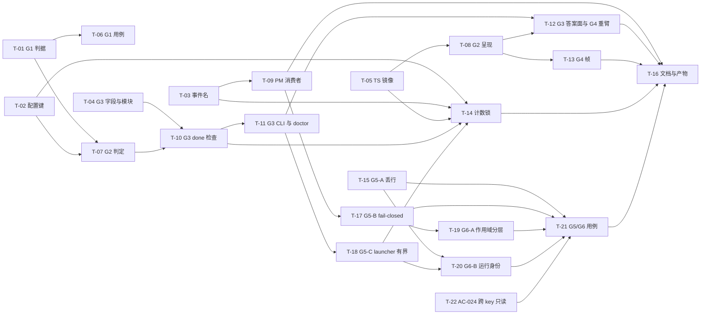

# Plan: mw-gate-verdict-hardening

- key: `mw-gate-verdict-hardening` · design 已定稿并经用户确认（D-001…D-020 + 4 项判断 + G5 追加）
- 规模：**25 AC / 47 VC / 50 功能点**（AC-025 / VC-047 / F47 于 2026-10-10 追加：G3 锚点建立，补齐 AC-011 的可达性，见 T-23）（G1~G6）；G4 于 2026-10-09 追加（AC-015..018），G5/G6 于 2026-10-10 追加（AC-019..023，IN-3 事故驱动；RQ-5 被事故杀灭无产出，其取证需求已由 PM 直执复盘取代），**AC-024 同日追加**（用户要求：PM 可看其它 key 的 workers 与状态，但不得改/重派 —— 读全局 / 写限定）；T-18 落地后增 **VC-039~VC-041 / F37~F41**（Python 写者槽位保留、launcher 有界、acked fail-safe、doctor 判据），T-20 落地后再增 **VC-042~VC-046 / F42~F45**（`run.json` 身份与终态、`supersedes`、`lost`、越界可见）；T-21 不新增 VC（只汇总核销），新增 **IN-3 夹具 + 回放 + 映射表**（`in3-queue-9col-burst.txt` / `test_in3_queue_replay.py` / `verify-g5g6-tests.md`）
- 代码基线：`H:\git\Multi-Workers` HEAD **`10446aefb`**（`mw-autopilot-slot-capacity` 已提交；`autopilot/**` 与 `agent-team-loop/**` 无本 key 脏改动）
- 定位：**补口**，不是重做 —— 在 `mw-autopilot-slot-capacity` 的 24 张卡之上收口五条 reflect 根因：
  G1 L3 流中止指纹 / G2 闸门静默 / G3 授权范围 / G4 面板冻结 / G5 队列完整性（行缺失不得导致全量重派）/ G6 派发隔离与运行身份

---

## 1. 并行度分析（按**文件边界**切写面）

### 1.1 写面清单（一个文件同一时刻只允许一个 worker）

| 文件 | 归属任务（顺序即串行链） | 备注 |
|---|---|---|
| `packages/multi-workers/autopilot/conductor.py` | **T-01 → T-07 → T-10** | **唯一热点**；三段区域互不重叠：L3 回路 `:1556-1940` / `tick` 顶部 `:2330-2410` / done 事务与物化 `:2089`+`:2499-2573`+三 prompt `:1453/:2291/:2312` |
| `packages/multi-workers/autopilot/config.py` | T-02 | `DEFAULT_CONFIG`（17→20；T-18 三键已把 14→17 提前落地）+ `_INT_RANGES`（3 键） |
| `packages/multi-workers/autopilot/timeline.py` | T-03 | `EVENT_TYPES` +3（`l3-aborted` / `gate-reminder` / `contract-refused`） |
| `packages/multi-workers/autopilot/gates.py` | T-04 | `authorizes` 入 `_JSON_LIST_FIELDS`（**不新增 v3、不动 `_REQUIRED_FIELDS`**） |
| `packages/multi-workers/autopilot/contract_guard.py` | T-04 | **新模块**：AC/VC canonical sha + freeze sidecar + 授权查找（纯函数） |
| `.../agent-team-loop/autopilot/status-model.ts` | T-05 | 事件集镜像 + `GateView.ageMs` + 3 键镜像（三段同文件 ⇒ 单卡） |
| `.../agent-team-loop/autopilot/monitor.ts` | **T-08 → T-13** | G2 `blockedOnHuman`/`ageMs` ⇒ G4 帧时刻/降级帧（`:156-176` 与 `readMonitorState` 的 `return` `:386` 重叠，**必串行**） |
| `.../agent-team-loop/autopilot/console.ts` | **T-08 → T-12** | G2 层 B 呈现 ⇒ G3 `--authorizes` + G4 `autoStartMonitor` 重臂 |
| `.../agent-team-loop/autopilot/gate-writer.ts` | T-12 | `AnswerGateOptions` + `ANSWER_FIELDS` + `rewriteAnswerFields` + 闭集校验 |
| `.../agent-team-loop/pm/pm-orchestrator.ts` | T-09 | G2 提醒消费者（读 ledger → `deliverPmAlert`）+ G4 `session_shutdown` 停表 |
| `.../agent-team-loop/pm/ui-bridge.ts` | **T-09 → T-22** | G2 `deliverPmAlert` 幂等包装 ⇒ **AC-024 跨 key 写面守卫**（`foreignLiveClaimRefusal` 挂 `dispatch_worker` 显式 key 与 `advance_phase`；读面零改动） |
| `packages/multi-workers/mw.py` | T-11 | ⚠️ **另一 key 有未提交改动**（D-009）：`mw autopilot contract-guard` CLI |
| `packages/multi-workers/mw_common.py` | T-11 | ⚠️ 同上：`_doctor_issues` 新 fail-closed issue（插 `:2887` 前）+ `contract_guard` 段 |
| 6 个测试文件 + 冻结语料 | T-14 | `test_autopilot_config_parity.py` / `autopilot-config-corpus.json` / `test_autopilot_timeline.py` / `test_autopilot_auto_decision.py` / 2 个 TS parity/console 测试 |
| `packages/multi-workers/launcher.py` | **T-18 → T-20** | G5-C 有界 spawn + `_workers.acked` 参与 + 配额告警 ⇒ G6-B 仅补 `status=lost`（不代写终态）|
| `packages/multi-workers/mw_common.py` | T-18 | ⚠️ 与 T-11 同文件（D-009）：`_doctor_issues` 新增三条队列形状 issue + **队列写者改逐行保留**（`update_status`/`archive_stale_entries`/新 `upsert_worker_row`）⇒ 必排 **T-11 → T-18** |
| `packages/multi-workers/autopilot/dispatch.py` | T-18 | 队列行写入改用 `mw_common.upsert_worker_row`（第三个「parse 全表 → 整表重写」写者，F37）；与 `conductor.py` 无同行冲突（仅此行段）|
| `.../agent-team-loop/shared/worker-store.ts` | **T-15 → T-20** | G5-A 读侧丢行计数/告警/回写不删 + 队列版本头；G6-B 追加 `run.json` 终态优先查询 |
| `.../agent-team-loop/pm/pm-orchestrator.ts` | **T-09 → T-17 → T-19** | G2 消费者 ⇒ G5-B fail-closed + 单轮配额 ⇒ G6-A 作用域分层（同文件，必串行）|
| `.../agent-team-loop/shared/run-store.ts` | T-19 → T-20 | **新模块**：`run.json` 读写 + 终态查询（纯函数 + 注入 fs，无副作用）|
| `.../agent-team-loop/worker/worker-mode.ts` | T-20 | worker **自身**写 `run.json`（启动 running / 结束终态）；失败不得阻断落盘 |
| `.../agent-team-loop/worker/output-writer.ts` | T-20 | **范围变更**：`WriteOutputOpts.runMarker`（写进 harness 段首行，不夺占 agent 写的 `VERDICT=` 首行）|
| `packages/multi-workers/mw.py` | T-11 → T-19 | CLI 侧全局扫描断言 + `mw queue` 只读观测面 |
| 新增测试（G5/G6） | T-21 | `test_in3_queue_replay.py`（新）+ `test/fixtures/in3-queue-9col-burst.txt`（新夹具）+ `worker-store.test.ts` 回放段 + `verify-g5g6-tests.md` 映射表 |

> `packages/coding-agent/src/extensions/agent-team-loop/worker/**`、`shared/**` 本 key **不改**（G1 的 TS 侧只读镜像在 `status-model.ts`）。

### 1.2 波次（波内文件边界互斥 ⇒ 可同时开工）

| 波 | 任务 | 独占写面 | 依赖 |
|---|---|---|---|
| **0** | T-01 G1 conductor 判据 | `conductor.py`（L3 段） | — |
| | T-02 三个配置键 | `config.py` | — |
| | T-03 三个事件名 | `timeline.py` | — |
| | T-04 G3 字段 + 新模块 | `gates.py`、`contract_guard.py`（新） | — |
| | T-05 TS 镜像三件套 | `status-model.ts` | — |
| | T-06 G1 用例（新文件） | `test_autopilot_l3_aborted.py`（新） | T-01 |
| **1** | T-07 G2 提醒判定 | `conductor.py`（`tick` 段） | T-01, T-02 |
| | T-08 G2 呈现 | `monitor.ts`、`console.ts` | T-05 |
| | T-09 G2 PM 侧消费者（含 G4 停表） | `pm-orchestrator.ts`、`ui-bridge.ts` | T-03 |
| **2** | T-10 G3 done 检查 + 物化 + 提示词 | `conductor.py`（done 段 + 三 prompt） | T-04, T-07 |
| | T-11 G3 CLI + doctor | `mw.py`、`mw_common.py` | T-04, T-10 |
| | T-12 G3 答案面 + G4 重臂 | `gate-writer.ts`、`console.ts` | T-08, T-11 |
| | T-13 G4 帧自证与降级 | `monitor.ts` | T-08 |
| **3** | T-15 G5-A 丢行不可静默 | `worker-store.ts` | — |
| | T-17 G5-B fail-closed + 单轮配额 | `pm-orchestrator.ts` | T-09 |
| | T-18 G5-C launcher 有界 + doctor 规模告警 | `launcher.py`、`mw_common.py`、`autopilot/dispatch.py` | T-11 |
| | T-22 AC-024 跨 key 只读（写面守卫） | `ui-bridge.ts` | — |
| **4** | T-19 G6-A 作用域分层（PM 收窄 / CLI 全局） | `pm-orchestrator.ts`、`mw.py` | T-17 |
| | T-20 G6-B 运行身份 + 产物自带终态 | `run-store.ts`（新）、`worker-mode.ts`、`output-writer.ts`、`launcher.py`、`worker-store.ts` | T-15, T-18 |
| | T-14 计数锁与语料重冻 | 6 测试文件 + 语料（T-18 已把配置键锁推到 **17**；T-02/T-03/T-05/T-10 到齐后 **20**） | T-02, T-03, T-05, T-10, T-18 |
| | T-21 G5/G6 用例 + IN-3 样本回放 | 新测试 ×2 + 夹具 + 映射表 | T-15, T-17, T-19, T-20 |
| **5** | T-16 文档 + dist + 全量回归 | `CHANGELOG.md`×2、`dist/**` | 全部 |

最大并行度 = 6（波 0）。**八条串行链**：`conductor.py`（T-01→T-07→T-10→**T-23**）、`monitor.ts`（T-08→T-13）、`console.ts`（T-08→T-12）、`pm-orchestrator.ts`（T-09→T-17→T-19）、`worker-store.ts`（T-15→T-20）、`launcher.py`（T-18→T-20）、`autopilot/dispatch.py`（T-18）、`ui-bridge.ts`（T-09→T-22）。
**文档类 AC 不派卡**：AC-014 的"非空洞对照 + `[VERIFY]` 实测"由每张卡在回执里自带（见 §2.4），verify 期由 PM 核销。

---

## 2. 契约冻结（并行 worker 逐字遵守，不得重定义）

### 2.1 闭集与计数（**权威来源 = design.md D-004/D-007/D-011/D-016**）

- `authorizes`：**JSON 数组（单行）**，闭集 **`{retry, contract-change}`**（**`install` 排除**，无机器消费者，见 D-011）；空数组 = 未授权；越界成员 ⇒ 解析期拒。
- `STALL_REASON_CODES`：**12 → 14**，新增 `l3-aborted`、`contract-unauthorized`；`REASON_CODES` 同步；`_recompute_l3_stall_code` / `_stall_family`（`l3abort:` → `l3`）同步，否则判 `stalled-reason-drift`。
- timeline 事件：**+3**（`l3-aborted` / `gate-reminder` / `contract-refused`），两侧 `EVENT_TYPES` **集合相等**；Python 计数测试 23 → **26**。
- 配置键：`DEFAULT_CONFIG` **17 → 20**（`l3_abort_retry_limit` 0..10 默认 1；`gate_reminder_after_min` 1..1440 默认 30；`gate_reminder_max` **1..2** 默认 2；T-18 的 G5/G6 三键已把基线从 14 推到 17，见 §2.5），`_INT_RANGES` 三键齐备；**不进** `EFFECTIVE_KEYS`；`status-model.ts` 镜像同步。
- 轮次编号：共享 stem `l3-a{used + abort_used}`，专用 loop 标签 `l3abort:{key}`，**不占** `l3_limit` 共享预算（D-003）。

### 2.2 判据口径（不得改写）

- G1 指纹谓词：`worker.log` **尾 64 KiB** 含 `stream closed before response.completed` **且**无两节齐备的合格源 ⇒ `l3-aborted`。挂在 `_l3_round_verdict` **状态门 `:1585-1586` 之前**（否则 failed 直接短路 ⇒ 6/6 真例全漏）。**不得要求队列行 `status=done`**（6/6 实测为 `failed`）。
- G2 挂点：`tick`（`conductor.py:2330`）在 `enabled` 检查 `:2340-2341` 之后、goal 检测 `:2344` 之前；**不得挂 `orchestrate`**（goal-change 门在 `:2392-2395` 早退 ⇒ 漏）。
- G2 谓词：`age ≥ n × threshold`（n = 已提醒次数 + 1）**且** `pending` 门数 > 0 **且** `_workers.parallel` 非终态行数 == 0（**两侧同口径**，不是 `running`）。
- G2 计数：`auto-decisions.jsonl` 追加 `phase: "remind"` 行；**不得**用 `_timeline_has_event`（尾 200 窗口 ≈20 min < 60 min 第二触发间隔 ⇒ 计数会复活）。
- G3 授权来源：任何 `status == "approved"` ∧ `authorizes ∋ "contract-change"` ∧ `gate.key == key` 的门，**不绑定 kind**；`pending` / `rejected` / 散文 note 一律不认；判定函数**不读** `gate.note` / `answered_by`。
- G3 文本身份锚：`<key>/evidence/contract-freeze.json`（AC 行正则 `^\|\s*(AC-\d{3})\s*\|\s*(.*?)\s*\|\s*$`、VC 块复用 `.tmp/msc-gen-evidence-req.py:parse_vcs`）；**不用** `subject_sha256`（无生产写入者）、**不用** `git diff`（fail-open：done 早于 commit）。
- G4 帧：`collectedAtMs`（绝对墙面时刻）+ `tickCount`；超 `staleAfterMs = max(30s, pollMs*5)`（`:609`）未前进 ⇒ 帧内告警。**不围绕 `/mw restart` 设计**（RQ-4 证伪）。

### 2.3 不变量（禁止违反）

- `_REQUIRED_FIELDS`（`gates.py`，6 格）**一格不加**；历史 v1 门文件全部照旧 `parse()` 成功。
- L3 判定的**严格性**不动：`_L3_SOURCE_ORDER`、FAIL 判据、`_l3_provenance_record` 语义零改动；本 key 只**新增分类 + 回退既有路径**。
- `PI_WORKER_IDLE_MS` / `DEFAULT_IDLE_MS` **不动**（GC-4）。
- 只读路径（doctor / 面板 / `show`）**不得创建**任何文件或目录。
- `monitor.ts` **不得新增写路径**（既有用例 `autopilot-monitor.test.ts:412` 锁"三 tick 文件字节不变"）。
- 历史数据**不回填、不改写**；`l3-verdict.txt` / `l3-verdict-provenance.json` 不就地改写。
- 零扰动（P-018）：无 freeze sidecar 的工程，`mw doctor --json` 与文本**逐字节不变**；历史 key 文本不变。

### 2.4 每张卡必须自带的三样东西

1. 卡内 `[VERIFY]` 命令原文 + 实跑输出（不许只写"已通过"）。
2. **非空洞对照**：摘掉/反转本卡判据 ⇒ 命名的用例转红（至少 1 组，G1 卡至少 2 组）。
3. 关键声称带 `文件:行号` 或测试名坐标（P-016 / P-023 / P-025）。

### 2.5 G5/G6 契约（2026-10-10 追加，与 §2.1~§2.3 同等冻结力）

- **队列行格局**：`task_key|status|cli|provider|task_path|dispatched_at|updated_at|model|[origin]`；**可选首行版本头** `# mw-queue:v2`（缺失 ⇒ 视为 v1）。读侧容忍 **7..9** 列，但对无法解析的行必须：① 计入 `unparsable_rows`；② 产告警；③ **回写时保留原文不改不删**（禁止 `upsert` 隐式删除）。
- **派发作用域**：常量 `scope` ∈ `{pm, cli}`。`pm` = 本窗口 watch 的 key + `_scratch`（**自动派发**）；`cli` = 全局（程序化/`mw` 侧）。**PM 之外的写面不得被收窄**。
- **跨 key 只读（AC-024，工具层）**：读面（`list_tasks` `scope:"all"`/`"key"`、`mw_status`、`mw doctor`、面板）对**任意 key** 全局开放，**不得因作用域收窄而变盲**；写面（`dispatch_worker` 的**显式 `key`**、`advance_phase`）对 `claimState(claimId, self) == "held-live"`（他人 live claim）的 key **先拒后动**，返回固定码 `[cross-key-read-only]` + `switch_key` 指引，**零副作用**；可写面 = 自有 claim / **未认领**新 key（建 key 流程）/ `_scratch`。
- **派发 fail-closed**：判据顺序 = ① `run.json` 终态（`done`/`failed`/`lost` ⇒ 不派且不覆盖）；② 台账行终态 ⇒ 不派；③ 二者皆缺且队列**不可读**（文件缺失/空/全行不可解析） ⇒ **本轮不派任何任务 + 告警**；④ 单轮新增行数 ≤ `dispatch_max_per_scan`（默认 3），**截断至 N（配额内正常派发、派满即止）+ 告警**（[PM 勘误 2026-10-11]：原写「超限拒绝」与 AC-021① 的「截断至 N」不一致，实现为 `pm-orchestrator.ts:682-686` 先 `onAlarm` 再 `return`；同族勘误 T-11 漏改本处）。
- **`run.json`（新产品面，schema 1）**：`workers/<task>/run.json` = `{schema:1, task_key, run_id, owner_key, kind, status, started_at, ended_at, exit, supersedes, artifacts[], pid?, last_heartbeat_at?}`；**写者 = worker 自身**（启动 `running`、结束终态）；launcher **只在进程崩死时**补 `status:"lost"` 并保留现场；声明 `supersedes:<旧 task_key>` 的新任务不得覆写旧任务目录（旧目录只读）。
- **身份不可复用**：`task_key` = 一次运行；复审/补充 = 新 key（`<task>-r2`）。
- **新增配置键（3 个）**：`dispatch_max_per_scan`（1..64，默认 3）、`launcher_max_workers`（1..64，默认 8）、`queue_alarm_delta`（10..10000，默认 50）⇒ `DEFAULT_CONFIG` **17 → 20**（T-14 锁数）。
- **不变量**：`mw doctor` / 面板等只读面**不得**因本组改动创建文件；无 `run.json` 的历史任务行为与今日一致（P-018）。

---

## 3. 任务表（落成 `tasks/T-*.md`）

| 任务 | 名称 | 波 | AC | VC | 核心交付 |
|---|---|---|---|---|---|
| T-01 | G1 中止判据 + 专用重掷 | 0 | AC-001…AC-004 | VC-001…VC-006 | `_l3_round_verdict` 前置指纹 + `l3-aborted` 事件/持久字段 + `l3abort:` 专用计数 + 预算耗尽 stall |
| T-02 | 三个配置键注册 | 0 | AC-003, AC-005 | VC-019 | `DEFAULT_CONFIG` 17→20（T-18 三键已占 14→17）+ `_INT_RANGES`（含 `gate_reminder_max` 封 1..2） |
| T-03 | 三个事件名 | 0 | AC-001, AC-005, AC-011 | VC-001, VC-007 | `timeline.py` `EVENT_TYPES` +3（两侧集合相等的 Python 半边） |
| T-04 | G3 字段 + `contract_guard` 模块 | 0 | AC-009, AC-011, AC-013 | VC-012, VC-015 | `authorizes` 入 `_JSON_LIST_FIELDS` + 纯函数 freeze/授权/AC-VC sha（新模块，零 IO 依赖注入） |
| T-05 | TS 镜像三件套 | 0 | AC-001, AC-007, AC-008, AC-015 | VC-011 | `status-model.ts`：事件集 + `GateView.ageMs` + 3 键镜像 + `blocked_on_human` 真值表 |
| T-06 | G1 用例（含非空洞对照） | 0 | AC-001…AC-004, AC-014 | VC-001…VC-006, VC-017 | `test_autopilot_l3_aborted.py`：P1-P7/N1-N6/X1-X2，夹具按真实 160~179 B 形状复刻（**真实语料不可入仓**） |
| T-07 | G2 提醒判定（Python） | 1 | AC-005, AC-006, AC-007 | VC-007…VC-010 | `tick` 顶部判定 + ledger `phase:"remind"` + `notified`/`escalated` 去重 + answered 即停 |
| T-08 | G2 呈现（TS 两层） | 1 | AC-008 | VC-011 | `monitor.ts` `blockedOnHuman` + `console.ts` 门行 `age=` |
| T-09 | G2 PM 侧消费者（含 G4 停表） | 1 | AC-005, AC-018 | VC-007, VC-023 | `pm-orchestrator.ts` poll 循环读 ledger → `deliverPmAlert`（`triggerTurn`）+ 幂等/会话水位 + `session_shutdown` 停表 |
| T-10 | G3 done 前检查 + 物化 + 提示词 | 2 | AC-010, AC-011, AC-012 | VC-013…VC-015 | `_done_transaction` 前 fail-closed 检查 + `_stamp_gate_defaults` 物化 `authorizes: []` + 三条 prompt 同一常量 |
| T-11 | G3 CLI + doctor 面 | 2 | AC-011, AC-013 | VC-016 | `mw autopilot contract-guard` + doctor 新 issue + `gates["contract_guard"]` 段（**仅 freeze 存在时**） |
| T-12 | G3 答案面 + G4 重臂 | 2 | AC-009, AC-012, AC-018 | VC-012, VC-023 | `gate-writer.ts` 闭集校验与重写 + `console.ts --authorizes` + `autoStartMonitor` ctx 变化后 stop+start |
| T-13 | G4 帧自证与降级 | 2 | AC-015, AC-016, AC-017 | VC-020…VC-022 | 帧内 `collectedAtMs` + 过期告警 + 裸 catch→降级帧 + 两处未保护读加护 |
| T-14 | 计数锁与语料重冻 | 4 | AC-014 | VC-019 | 6 文件：12→14 reason_code、23→26 事件、14→**20** 配置键、单键 accept + 越界 reject 例、重冻 sha |
| T-15 | **G5-A 丢行不可静默** | 3 | AC-023 | VC-024…VC-026 | `worker-store.ts`：`unparsable_rows` 计数 + 告警 + 回写保留原文 + 版本头；**旧行为（`return undefined` 静默丢行）用测试钉死为回归** |
| T-17 | **G5-B fail-closed + 单轮配额** | 3 | AC-020, AC-021 | VC-027…VC-029 | `pm-orchestrator.ts`：判据改序（run 终态 > 台账 > 无信息）、队列不可读 ⇒ 零派发 + 告警、单轮 ≤ `dispatch_max_per_scan` |
| T-18 | **G5-C launcher 有界 + acked 参与 + doctor 形状判据** | 3 | AC-021, AC-023 | VC-030, VC-031, VC-039, VC-040, VC-041 | `launcher.py`（`max_workers=None` ⇒ `launcher_max_workers`，默认 8；acked 收敛不 spawn）、`mw_common.py`（三个写者逐行保留 + `parse_workers_queue` + `read_acked` + doctor 三条无状态判据 + 配置键）、`autopilot/dispatch.py`（改用 `upsert_worker_row`）、`autopilot/config.py` + `status-model.ts`（3 键）、新测试 2 个 |
| T-19 | **G6-A 作用域分层** | 4 | AC-019 | VC-034, VC-035, VC-046 | `pm-orchestrator.ts` 收窄为 watch key + `_scratch`；`out-of-scope` 聚合告警（可见而非静默，VC-046 已由 T-20 落地）；程序化 `scope:"cli"` 与未认领新 key 断言**全局扫描仍可用** |
| T-20 | **G6-B 运行身份 + 产物自带终态** | 4 | AC-022 | VC-032, VC-033, VC-042…VC-045 | `run-store.ts`（新）+ `worker-mode.ts` 写 run.json + `output-writer.ts` marker + launcher 仅补 `lost` + dispatch 终态优先 + `supersedes` 拒覆写 |
| T-21 | **G5/G6 用例 + IN-3 样本回放** | 4 | AC-014, AC-019…AC-024 | VC-024…VC-046（VC-039~041 T-18 / VC-042~045 T-20 / VC-046 T-19+T-20 已先落地，本卡汇总核销）| `test_in3_queue_replay.py`（新）+ 9 列夹具（250 行/27 owner）+ 旧 codec 对照（250/250 全丢）+ 10 列行三写者不丢 + 空队列 + 配额（10→3）+ 隔离双向 + run 终态拒派 + **跨 key 读全局/写拒绝双向** + 映射表 |
| T-22 | **AC-024 跨 key 只读（写面守卫）** | 3 | AC-024 | VC-036…VC-038 | `ui-bridge.ts`：`foreignLiveClaimRefusal()` + `dispatch_worker`（显式 key）与 `advance_phase` 的先拒后动 + 工具描述声明只读语义；**读面零改动** |
| T-23 | **AC-025 G3 锚点建立（自动 + 显式）** | 3 | AC-025 | VC-047 | `conductor.py` 见 design 冻 AC / 见 plan 冻 VC（幂等一次写、不回溯）+ `mw autopilot contract-freeze` CLI + `timeline.py` 事件 `contract-frozen`；**不碰计数锁**（T-14 补 TS 镜像与 27 事件数） | + T-04, T-10, T-11 |
| T-16 | **文档收口 + 全量回归 + 切换 runbook** | 5 | 全部 | 全部 | `CHANGELOG.md`×2（两包）+ `verify-closure.md`（基线对照，新增红=0）+ 运行时切换 runbook（**只写不执行**）；**`dist/**` 重建已按 D-059 拆出**（需用户批准后 PM 直执）|

依赖 mermaid（边标签无引号）：

---

## 4. 风险登记

| # | 风险 | 触发条件 | 缓解 |
|---|---|---|---|
| R1 | `conductor.py` 三段串行相互踩踏 | 并行派发 | 波次表锁为单链；每卡只碰其区域；开工前 `git diff --stat 10446aefb.. -- conductor.py` 确认他段未被动 |
| R2 | `monitor.ts` G2/G4 行面重叠 | 并行派发 | T-08 → T-13 串行（D-020）；`:156-176` 与 `:386` 的改动由先落地方完成 |
| R3 | **另一 key 占用 `mw.py` / `mw_common.py` / `effective_config.py`** | T-11 开工 | D-009：开工前确认对方已提交或书面释放；不得单方面覆写 |
| R4 | 跨语言不同步（3 键 / 3 事件 / `authorizes` / `blocked_on_human`） | 只改一侧 | T-05 + T-14 双侧；VC-011/VC-019 集合相等断言；两侧都跑（P-021） |
| R5 | 计数锁漏改（12→14 / 23→26 / 14→17） | 改语义未改锁 | T-14 专卡；`test_autopilot_auto_decision.py:301/333/338` 三处同步 |
| R6 | 零扰动被破坏（历史 v1 门 / 无 freeze 工程） | 新增字段即渲染 | AC-013 / VC-016 逐字节断言；`contract_guard` 段仅 freeze 存在时产出 |
| R7 | **执行期 worker 被 launcher 重启重跑并覆写产物** | `_workers.parallel` 被重建（IN-3 实测两次：10-09 20:01、10-10 10:50，252 行整表重建） | 每卡 `[VERIFY]` 结果先落 `report.md` 并**立即复制到 `evidence/runs/`**；交付文件（新增测试/新模块）开工前先 `git add` 到暂存区；**根因修复 = T-15/T-17/T-18/T-19/T-20（G5+G6）** |
| R8 | 工作树被其它会话大规模操作（本轮实测 3,531 文件瞬时消失又恢复） | 多会话同 cwd | 开工前 `git status --porcelain` 快照；只动本卡写面；不 `git add -A`、不 commit（除用户要求） |
| R9 | 非空洞对照写成"存在即过" | 断言空洞 | §2.4 硬要求；T-06 用 X1/X2 反例（摘掉指纹 ⇒ 用例必须红） |
| R10 | G1 尾窗切断 marker（>64 KiB 日志） | 夹具用了更大日志 | VC-001 边界例：marker 落在尾窗之外 ⇒ 必须**不**判 aborted（fail-closed 方向明确）；实测语料 max 14,120 B |
| R11 | **G5/G6 改动改变派发语义 ⇒ 影响其它 key**（PM 侧收窄后可能漏派本来该派的跨 key 任务） | T-17/T-19/T-22 | 收窄**只加给 PM 侧自动派发**；PM 之外的写面保持全局（AC-019 反向用例②③）；读面对任意 key 全局只读（AC-024，看得见就不会瞎猜）；派发前把被跳过的候选写进告警事件（可见而非静默） |
| R12 | **`run.json` 与台账双源不一致**（旧任务无 run 记录 / 台账说 done 而 run 说 running） | T-20 | 优先级明确：**`run.json` 终态 > 台账 > 无信息**；冲突（台账 done ∧ run running）必须告警并**不派发**；无 run 记录的旧任务**不回填**（P-018），行为与今天一致 |
| R13 | 队列版本头导致历史文件被误判 | T-15 | 缺头一律视为 v1（历史零改动）；版本头只影响**新写**；VC 断言历史 252 行样本解析结果与今日逐行相同 |
| R14 | **写面与另一 key 冲突**（`mw_common.py`/`mw.py`/`worker-store.ts`/`pm-orchestrator.ts`） | T-11/T-18/T-15/T-17/T-19 | 开工前 `git status --porcelain -- <path>` + `git diff -- <path>` 复核（D-009 口径）；同文件一律串行（波次表） |
| R15 | worker 写 `run.json` 失败阻断落盘 | T-20 | 写 `run.json` 必须 **best-effort**：异常吞掉并只在 `trace.log` 留痕，绝不阻断 `output.md` 落盘；用例锁该行为 |
| R16 | **AC-024 守卫误伤正常建 key 流程**（把“未认领新 key”也拒了 ⇒ PM 无法开新 key）| T-22 | 可写面显式包含：index 中**无行**的 key、`claimId == self`、`_scratch`、`_`/`.` 前缀；VC-038 锁“未认领新 key 与自有 claim 均能成功派发” |
| R17 | **T-18 把 `autopilot/dispatch.py` 拉进写面**（原设计该文件“不改”，但它是第三个整表重写写者）| T-18 | 只改队列写入那一段（改用 `mw_common.upsert_worker_row`），不碰 `loop:`/`attempt:` 标签与其余逻辑；`git diff` 限行数复核；向用户报告范围变更（设计 §11.3 + 本表 + T-18 卡已记录）|

---

## 5. 验收与收口顺序

1. **波 0 开工前（第一步，未做不得改码）**：实测并记录 Python 基线
   `cd packages/multi-workers && python -X utf8 -m pytest test_autopilot_*.py test_doctor_gates.py -q`
   把红集合写入 `evidence/runs/verify-baseline.md`；后续每波只与该基线比对（既有红不算回归）。
2. **卡内自检**：`[VERIFY]` 命令原文 + 输出 + 非空洞对照，写入该卡 `report.md`。
3. **波内自检**：TS 侧定向 vitest（`node ../../node_modules/vitest/dist/cli.js --run test/suite/autopilot-*.test.ts`）；Python 侧定向 pytest。
4. **全量检查**：`npm run check`（全量输出，不 tail）；`./test.sh`（非 e2e）。
5. **回归项**：`autopilot-event-parity.test.ts`（集合相等）、`autopilot-config-parity` 冻结语料、`autopilot-console.test.ts:374-378`（`GateView` 精确 `toEqual` ⇒ 加字段必红，需同步更新）、`test_autopilot_auto_decision.py`（12→14 三处）。
6. **dist 与文档**：`27e3c927e` 式重建 `dist/**`；`CHANGELOG.md`（`packages/multi-workers`、`packages/coding-agent`）追加 `[Unreleased]` 条目。
7. **G5/G6 专项验收（新增，2026-10-10）**：
   - **IN-3 样本回放**：把事故当日的 **9 列行样本**（`_incidents/in3-queue-reenqueue-20261010/` 记录的行格局，去敏后入测试夹具）喂给读侧 ⇒ 断言：`unparsable_rows == 0`（新解析器认得）、且**旧 8 列解析器的丢弃行为可被测试复现**（非空洞对照）；
   - **隔离反向用例**：`_scratch` 里派 1 个 smoke 任务 ⇒ 断言其它 250+ 行逐字节不变（AC-019①）；再以 `dispatchNewTasks(..., { scope: "cli" })` 与**未认领新 key** 的显式派发断言 PM 之外的写面仍然可用（AC-019②③）；
   - **跨 key 只读双向用例**：同一窗口对他人 live 持有的 key：`list_tasks scope:"all"/"key"` **读得到**（AC-024①）；`dispatch_worker(key=…)` / `advance_phase` **拒绝且零副作用**（AC-024②，gate 脚本不得被执行）；未认领新 key 与自有 claim **照常可写**（AC-024③）；
   - **fail-closed 反向用例**：临时把 `_workers.parallel` 指向空文件副本 ⇒ 断言新增行 = 0 且告警 = 1（AC-020）；
   - **run 身份反向用例**：给一个 `run.json` 已是 `done` 的任务再派 ⇒ 断言拒绝派发（AC-022）。
9. **队列完整性 / Python 写面验收（T-18 已落地，2026-10-10）**：
   - **三个 Python 写者**：`update_status` / `archive_stale_entries` / `upsert_worker_row` 各写一次后，`unparsable` 行原文仍在且计数不变；无匹配行的 `update_status` 不改动文件字节（VC-039）；
   - **launcher 有界**：12 个 pending + `max_workers=None` ⇒ 恰好 8 个 spawn；config 覆盖与显式参数优先各一例（VC-040）；
   - **acked fail-safe**：acked 且行非终态 ⇒ 收敛 + 0 spawn；ack 文件为垃圾内容 ⇒ 仍 spawn（VC-041）；
   - **doctor 形状判据**：252 行 / 100% 非终态 ⇒ 含 `queue-burst-shape`；健康队列**不含**且文本行逐字节不变（VC-031）；
   - **控制脚本**：`evidence/scripts/t18-controls.ps1`（A~F 六组，均转红 + 还原）；
   - **配置键跨语言**：`DEFAULT_CONFIG` 17 键双侧一致 + 冻结语料 64 例（sha256 双侧已 deliberate re-freeze）。
8. **验证期**：`evidence/runs/verify-*.md` 逐 AC/VC 核销 → `/quality-gate` → `achieved.md`（含「系统行为变化」「遗留」）→ `advance_phase done --summary`。
| R19 | **G3 锚点仍未覆盖“错过边界”的 key**（conductor 未运行时穿过 design/plan 的 key，或 feature 上线前已在 execute 的历史 key）⇒ 无锚 ⇒ 不受 G3 保护 | T-23 | 按设计**不回溯**（P-018）：这类 key 的守卫需由人显式 `mw autopilot contract-freeze` 建立；残余状态在 `mw doctor` / `mw autopilot contract-guard --key K` 上可见（后者明确打印 `no freeze sidecar`）|
| R21 | **`dist`/bundle 未重建 ⇒ 本轮全部 TS/扩展改动尚未生效**（运行时仍是 10-10 10:53 的 `b8bc115ff` 时代 bundle + 常驻 launcher 的进程内旧代码）| T-16 收窄（D-059）| T-16 产出 `runtime-cutover-runbook.md`（命令/前置/验证/回滚）；用户批准后 PM 直执 `mw build --install --allow-dirty` + 重启 launcher/serve + 重启 9 个 pre-10:53 旧窗口；在那之前每次 dispatch 都会把队列翻成 9 列（PM 每次归一回 8 列，脚本 `evidence/scripts/t23-normalize-whole-queue.py`）|
