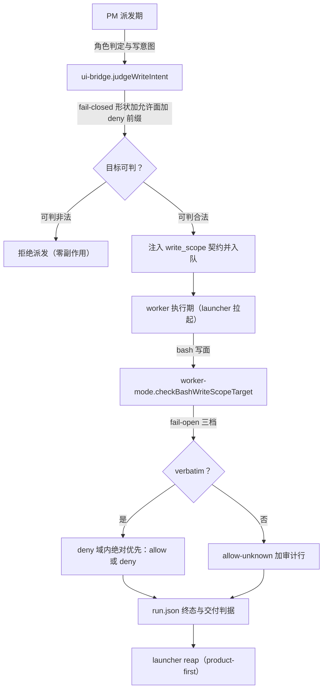

# Design: 守卫形态加固（mw-guard-form-hardening）

- Key: `mw-guard-form-hardening`｜阶段: DESIGN（初稿，DRQ 回收后由 PM 补全 §4 并锁定 VC）
- 上游: `spec.md`（11 AC，19,049 B）+ `evidence/research/spec-*-20261011.md`（5 份）
- 基线 commit: `ab546bb64`｜本文件状态: **骨架**（§4 详细设计待 3 个 DRQ 落地后写入）

## §0 索引

| 项 | 值 |
|---|---|
| ac_count | 11 |
| 落点文件 | `worker/worker-mode.ts`、`pm/ui-bridge.ts`、`shared/index-store.ts`、`shared/deliverable-evidence.ts`（+ 测试） |
| 串行链 | 5 条 / S3 细分 7 段（§5） |
| VC 数 | 46（§6） |
| 设计证据 | `evidence/research/design-*.md` 3 份（65,217 / 78,981 / 78,828 B）+ `design-scope-and-baseline-20261011.md` |
| 方向二分 | 写面守卫 fail-open / 跨 key 守卫 fail-closed（`spec.md` §4 Q1、pm-state D-002） |

## §1 守卫分层（现状 → 目标）

## §2 设计决策（DD 集，已定稿）

| # | 决策 | 依据 |
|---|---|---|
| DD-01 | 写面守卫改为 `verbatim` 三档；deny 是「只在 verbatim 域上有定义」的偏函数 | RQ-2 §1.3 witness（对含变量 token 判 deny 会被合法展开证伪） |
| DD-02 | token 化必须保留「单引号段 / 反斜杠转义」信息（否则新增 2 条漏放） | RQ-2 P-1/P-3（B12/B13） |
| DD-03 | 提取器形态补全：包装器递解开箱 + 重定向算子族 + 操作数白名单 + 词法 `cd` 跟踪 | RQ-1（33 条缺失、5 类完全隐形） |
| DD-04 | PM 侧目标识别改为「路径**形状** + 允许面 realpath + deny 前缀优先」；**禁止裸 token 兜底** | RQ-3（裸 token = 35% 假阳性） |
| DD-05 | basename 白名单仅在解析后仍落在允许面内才生效（先目录、后 basename） | RQ-3 A4 + PM 偏移证实 |
| DD-06 | 角色判定收敛为单源：frontmatter-only（首个 `type:`）+ 裸头/fence 双形态；6 份解析器收敛或桥接 | RQ-4（flip=1、6 解析器语义分歧） |
| DD-07 | key 身份：豁免改**显式清单**（12 个框架保留名）+ 大小写归一 + `_index.md` 回退显式语义 | RQ-5（A5/A6 潜伏、A7 可达） |
| DD-08 | 未知档可观测：审计行 + `risk=deny-basename` + PM 侧告警（F1–F3 的唯一兜底） | RQ-2 §1.4 残余风险归属表 |
| DD-09 | 断言质量：消除自证式断言（占位符自计数、形态覆盖薄断言） | QG-B D-047 + spec AC-009 |
| DD-10 | 契约处置：`WRITE_SURFACE_MARKER` 的落地方案 —— **实现采纳「补齐消费端」分支**（`worker-mode.ts::writeSurfaceMarkerState()` 整行匹配 `absent/ok/malformed`，`malformed` ⇒ 落 1 条 `[WRITE_SURFACE]` trace 审计行，**审计-only、零 verdict 变化**；载体见 T-17 与 `mwds-t03`）| 原设计倾向「删契约 + 设计说明改写」，但删契约必须先改 `pm/ui-bridge.ts:1340/1341/1468/1733/1737` 与 `mwds-t02` 的 import + 5 处断言，二者均在 T-12 卡白名单外 ⇒ 按 `pm-state.md` D-045 裁定改走「补齐消费端」。补齐后 `ui-bridge.ts:1337-1339` 原本 stale 的注释（runtime consumer only greps for these markers）成为事实 |
| DD-11 | 文档计数对齐（占位符 16）；`type:` 解析语义在 doc 中写明 | QG-B C7 + RQ-4 |

## §3 AC → 落点 → VC（映射表，VC 编号见 §6）

| AC | 落点（文件:符号） | VC |
|---|---|---|
| AC-001 | `worker-mode.ts::checkBashWriteScopeTarget` / `verbatim` 判定 / `ShellToken` 引用标记 | VC-001…005 |
| AC-002 | `worker-mode.ts::extractBashWriteCandidates` / `tokenizeShellCommand` / wrapper 集合 | VC-006…010 |
| AC-003 | `ui-bridge.ts::isWhitelistedWriteTarget`（先目录后 basename） | VC-011…014 |
| AC-004 | `ui-bridge.ts::WRITE_INTENT_PATH_RE` 替代（形状判定）/ `collectWriteIntentHits` | VC-015…019 |
| AC-005 | `worker-mode.ts::parseTaskMd`（frontmatter-only）+ 派发侧复用 | VC-020…023 |
| AC-006 | `ui-bridge.ts::foreignLiveClaimRefusal` + `index-store.ts::findByKey` | VC-024…028 |
| AC-007 | `worker-mode.ts::appendBashWriteScopeTraceLine` + PM 告警出口 | VC-029…031 |
| AC-008 | 14 条未覆盖分支的测试 | VC-032…034 |
| AC-009 | 空洞断言替换 | VC-035 |
| AC-010 | `WRITE_SURFACE_MARKER` 处置 + 占位符计数 | VC-036…037 |
| AC-011 | 本文与 `plan.md` 的证据锚定 | VC-038 |

## §4 详细设计

三份设计证据（`design-write-guard-landing`、`design-target-axis`、`design-role-key-identity`）承载**全表级**细节（形态 33 条逐条正/反例、形状判定表、6 解析器矩阵、Windows 9 项等）；本节给出**实现权威**所需的落点、定稿接口、求值顺序、冻结面与 PM 裁定。与证据冲突时以本节 + AC 为准。

### 4.1 落点总表

| # | 文件 | 符号（最终工作树行号，T-17/B-1 重锚） | 目标形态 |
|---|---|---|---|
| L1 | `worker/worker-mode.ts` | `ShellToken` `worker/worker-mode.ts:742`、`tokenizeShellCommand` `worker/worker-mode.ts:756` | 加 required `verbatim: boolean`（越界/引号状态在词法阶段算出） |
| L2 | 同上 | `BashWriteCandidate` `worker/worker-mode.ts:694`、`inlineTargets` `worker/worker-mode.ts:1237`、`extractBashWriteCandidates` `worker/worker-mode.ts:1519` | 加 required `verbatim: boolean`；新增 wrapper 递解开箱 |
| L3 | 同上 | `INLINE_WRITE_PATTERNS` `worker/worker-mode.ts:1014`（用 `worker/worker-mode.ts:1309`） | 删「把实参当写目标」的捕获（`write_text('x')` 类 FP） |
| L4 | 同上 | `BashWriteScopeRule` `worker/worker-mode.ts:709`、`bashWriteDenyReason` `worker/worker-mode.ts:1533` | 加 `allow-unknown`；deny 6 规则逐字节不变 |
| L5 | 同上 | `BashWriteScopeVerdict` / `BashWriteScopeRejection` | 加 `risk?: "deny-basename"` / `blocked: boolean` |
| L6 | 同上 | `normalizeForCompare` `worker/read-scope.ts:100`、`checkBashWriteScopeTarget` `worker/worker-mode.ts:1571` | `verbatim` 门最前；仅 verbatim 域判定 deny |
| L7 | 同上 | `appendBashWriteScopeTraceLine` `worker/worker-mode.ts:1660` | 加 `blocked=`；新增 `[WRITE_SCOPE_SUMMARY]` 三计数 |
| L8 | 同上 | 调用点 `worker/worker-mode.ts:2167-2169`（+ 11 处补第 3 实参） | 传入 verbatim 判定所需的上下文 |
| L9 | `pm/ui-bridge.ts` | `WRITE_INTENT_VERBS` `pm/ui-bridge.ts:1349`、`WRITE_INTENT_TOKEN_RE` `pm/ui-bridge.ts:1432`、`collectWriteIntentHits` `pm/ui-bridge.ts:1548` | 删扩展名枚举与 `pm.index !== 0` 放弃分支；改行首锚定字符类 token 发现 |
| L10 | 同上 | `isWhitelistedWriteTarget` `pm/ui-bridge.ts:1664`（布尔包装）/ `judgeWriteTarget` `pm/ui-bridge.ts:1645` | 改为 `judgeWriteTarget` 的布尔包装；basename 白名单**仅在无目录成分时**生效 |
| L11 | 同上 | `judgeWriteIntent` `pm/ui-bridge.ts:1679` | 复用 `../worker/read-scope.ts::isSameOrUnder`/`normalizeForCompare`（复用导入 `pm/ui-bridge.ts:52`） |
| L12 | 新增 `shared/task-frontmatter.ts` | `extractTaskHeader` `shared/task-frontmatter.ts:109` / `readTaskHeaderScalar` `shared/task-frontmatter.ts:117` / `readTaskType` `shared/task-frontmatter.ts:141` / `scanBodyTypeLines` `shared/task-frontmatter.ts:159` / `findTypeEscalation` `shared/task-frontmatter.ts:169` | 单一事实源模块 |
| L13 | `worker/worker-mode.ts` | `parseTaskMd` `worker/worker-mode.ts:336`；`type:` last-wins 已由 `shared/task-frontmatter.ts:141`（`readTaskType`）取代 | 改用 L12；首个 `type:` 胜出 |
| L14 | `pm/task-dispatcher.ts`、`autopilot/status-model.ts` | 各自 `type:` 解析 | 改用 L12（`status-model` 保留 fenced-only 语义） |
| L15 | `shared/index-store.ts` | `shared/index-store.ts:67`（`keyNameRefusal`）/ `shared/index-store.ts:169`（`upsert` 归一）/ `shared/index-store.ts:285`（`findByKey`） | 读侧 key 归一（保首写大小写，不迁移存量） |
| L16 | `pm/ui-bridge.ts` | `pm/ui-bridge.ts:277`（`foreignLiveClaimRefusal` 显式名门）/ `pm/ui-bridge.ts:97`（`_index.md` 回退）/ `pm/ui-bridge.ts:2256`（`registerAdvancePhaseTool`） | 显式 14 名保留清单；回退补 `claimState`；放行方向与 `claim` 一致 |
| L17 | `packages/multi-workers/mw_common.py` | `read_task_type` | 与 L12 同语义（BOM 剥除 + 首个 `type:`） |
| L18 | 测试 | `test/suite/mwds-t02-*`、`mwds-t03-*`、`mwds-t01-*`、`autopilot-protocol.test.ts`、`test/fixtures/task-md-header-cases.json`、Python 一致性测试 | 见 §4.4.6 |

### 4.2 S1 写面判据（fail-open，`worker-mode.ts`）

**4.2.1 `verbatim` 定稿**（DD-01/DD-02）
逐字符状态机：**单引号段内**与**反斜杠转义后**的字符「失活」（不参与展开语义）；**双引号内 `$` 不失活**。`verbatim = 该字符段内无失活字符且无展开语法（`$`、反引号、行首 `~`、glob、brace）`。

| 形态 | verbatim | 判定 |
|---|---|---|
| `report.md` | true | 进 deny 域 + scope 判定 |
| `$T/x` / `"$T/x"` / `~` / glob / brace | false | `allow-unknown` + 审计 |
| 单引号包裹的 `$T/x` | **true** | **仍 deny**（VC-004） |
| 反斜杠转义 + `$T/x` | **true** | **仍 deny**（VC-004） |
| `$'a\tb'` | false | `allow-unknown` |

**为何在 extractor 算**：`worker/worker-mode.ts:1571` 层四种调用形态（直接路径 / 变量 / 引号 / 展开）到达时逐字节相同 ⇒ verdict 层不可能恢复引用状态。

**4.2.2 形态补全（33 条 + 5 类隐形，全「补提取」）**

| 组 | 内容 | 关键算法 |
|---|---|---|
| A 包装器 19 | `bash|sh|zsh|dash|ksh -c`、`cmd /c`、`powershell|pwsh -Command`、`perl|ruby -e`、`env VAR=x`、`sudo -u`/`doas`、`xargs … sh -c`、`timeout`/`setsid`、`stdbuf -oX`/`nice -n`/`time -p` | 命令位跳过（flag arity 表）+ 载荷重 token 化 + `MAX_UNWRAP_DEPTH=3` |
| B 重定向 2 | `>|`、`>&`（fd-dup） | 三态判定（fd-dup ⇒ 非写目标） |
| C 操作数 7 | `install`/`dd of=`/`ln`/`rsync`/`tar -x`/`perl -i`/`--` 后操作数 | 操作数白名单 + arity |
| D find 2 | `find -exec` / `-delete` | `-exec` 后重进 A 组 |
| E 其他 3 | `os.system`/`execSync` 内联串、`truncate -s`、`--` 终止符 | arity 修正（`truncate -s 0 F` ⇒ `F`） |
| F 隐形 5 | `bash -c`/`sh -c`/`powershell -Command`/`perl -e`/`>|` | 归入 A/B 组后非 0 candidate |

**8 条 FP 消除**：`truncate -s 0 F`（arity）、`Path(F).write_text('x')`（删 L3 捕获）、`> $(...)`/`> $VAR`（非 verbatim ⇒ 未知档）、`rm *.txt`/`> *.txt`（glob ⇒ 初始匹配）、`~/f`（非 verbatim）、`{a,b}.txt`（brace ⇒ 未知档）、`> $null`（`NULL_WRITE_TARGETS` 注册 `$null`）。
**每条新形态必须带 1 正例 + 1「不得误拦」反例**（P-01 前馈）。

**4.2.3 求值顺序（不变式）**：`verbatim` 门 → deny 6 规则 → scope 判定 → write-scope → allow。**逐字节冻结**：deny 6 规则、允许面判定、`matchesWriteScopeEntry`、`GLOB_MAGIC_RE`、`worker/worker-mode.ts:1572` 实参表达式、handler「首个违规即 block」。

**4.2.4 审计行定稿**：`[WRITE_SCOPE] <ts> write-scope blocked=<bool> rule=<r> detail=<d> [risk=<…>] pattern=
 target=<t> cmd=<c>`；新增 `[WRITE_SCOPE_SUMMARY] allow=… deny=… allow-unknown=…`。**兼容性已证**：`WRITE_SCOPE` 写点 `worker/worker-mode.ts:1660`；读者 `test/suite/mwds-t03-bash-write-scope.test.ts:167`（`startsWith`）与 `pm/pm-orchestrator.ts:488`（`countWriteScopeResidualRisks`）均按字段解析，Python 侧零读者 ⇒ 扩展字段向后兼容。

**4.2.5 登记残余**：`cd <taskDir> && > report.md` 仍 deny（未纳入词法 `cd` 跟踪）⇒ 本 key **接受为残余**，写入 achieved 残留账本（VC-045）。

### 4.3 S2 目标集轴（fail-closed，`ui-bridge.ts`）

**4.3.1 判定顺序（定稿）**：`judgeWriteTarget` = ①形状识别 ⇒ ②deny 前缀（D1–D6 镜像 `worker/worker-mode.ts:1533`）⇒ ③允许面 `realpath` + 段边界 ⇒ ④**无目录成分**的 basename 白名单 ⇒ ⑤形状拒判（fail-closed）⇒ ⑥非候选放行。`isWhitelistedWriteTarget` 退化为布尔包装。
**A4 修复前置是 `!hasDirComponent`**（不是 `shape === "bare"`，否则 `output.md`/`report.md` 会被踢出框架通道）。
**token 发现**：verb → gap ≤32 → **行首锚定字符类**；**否决前向扫描**（无界 `violations=12`；保守有界仍 +1 FP `url/`）⇒ 只取「verb 后紧邻 token」。

**4.3.2 形状判定（要点）**：分隔符 / 前导点 / 扩展形状 / `existsSync` / 冒号五轴；`Makefile` 类无扩展名目标走**形状层 deny-name 表（11 名）+ `existsSync`**，不入 deny 表；负例必须覆盖散文词（`your`/`design`/`mcp`/`side`/`surface`/`message_update`/`-pattern`/`/`）与 `1.2.3`/`e.g.`/`foo.bar`/`README`。
**禁止裸 token fail-closed**（35% 假阳性）。

**4.3.3 预期回归**：`hits 2→13`、`violations=1`、`FP=0`、`leak_caught=5/5`。

**4.3.4 PM 裁定（fixture 语义修正，不得盲改断言）**：`test/suite/mwds-t02-write-intent.test.ts:445` 的 `true` 属 A4 实例（该 fixture `PROJECT = <tmpdir>/mwds-t02-project`、`TASK_DIR = <PROJECT>/k/workers/t02`，缺 `.agenticdoc` 段）——**但断言意图是「自身 taskDir 的相对写法」**。修法：**改 fixture 语义**（`TASK_DIR` 补 `.agenticdoc` 段）保留 `true`，并**另加**跨目录负例（`.agenticdoc/<other>/workers/x/report.md`、`../other/workers/x/report.md` ⇒ `false`）（VC-046）。

### 4.4 S3 角色解析单源 + key 身份

**4.4.1 新模块 `shared/task-frontmatter.ts`**：`extractTaskHeader(raw)` → 头部区；边界 = 首行 fence（`---`）→ **首个空行** → 头部键文法截断；`readTaskHeaderScalar(header, key)` 首个键胜出；`readTaskType(raw)` ⇒ `{ type, source, bomStripped }`；`scanBodyTypeLines(raw)` / `findTypeEscalation(headerType, bodyTypes, tools)`。
**BOM 必须先剥**（`bomStripped` 参与审计）。

**4.4.2 6 份解析器矩阵**

| # | 解析器 | 处置 |
|---|---|---|
| P1 | `worker/worker-mode.ts::parseTaskMd` | 物理改用 L12（首个 `type:`） |
| P2 | `pm/ui-bridge.ts::resolveDispatchType` `pm/ui-bridge.ts:1148` / `writeDispatchTaskMd` `pm/ui-bridge.ts:1780` | 物理共享 L12（生成 + 判定同源） |
| P3 | `autopilot/status-model.ts` | 共享边界提取，**保留 fenced-only 语义** |
| P6 | 测试 `corpusType` | 改用 L12 |
| P4 | `launcher.py` | `mw_common.read_task_type` 同语义副本 |
| P5 | `mw.py` | 同上 |
TS 三份**物理共享**；Python 两份**同语义 + 一致性测试**（无法物理共享）。

**4.4.3 一致性测试**：golden `test/fixtures/task-md-header-cases.json`（18 条、base64 内联以规避 `.gitattributes` 行尾改写）；Python 侧用 **node 反向差分**（照抄 `test_autopilot_config_parity.py` 范式，**node 缺失即 fail**，不得静默跳过）。

**4.4.4 fail-closed 范围（PM 裁定，覆盖 DRQ-3 原案）**：**带 origin 标记（派发）任务**：`type:` 缺失/非法 ⇒ 拒绝；**无标记（手工/冒烟）任务**：保持现行为（verbatim fallback）+ 审计行。⇒ `test/suite/autopilot-protocol.test.ts:346-362` **不需要改写**（T-13 零拦截契约不变），只新增 origin 标记用例（VC-041）。
存量影响：缺失/非法 `type:` 1 本（`smoke-ac016b`）。

**4.4.5 key 身份**：豁免 = **14 名显式清单**（RQ-5 的 12 + `_impl_gate.log` + `_incidents`，实现为常量，逐名用例）；新 key 判据 `findByKey === undefined`；`advance_phase` / `claim` / `/pm-key new` / `update_index.py` 共用同一 `keyNameRefusal`（方向一致）；`shared/index-store.ts:67` / `shared/index-store.ts:169` / `shared/index-store.ts:285` 读侧归一（保首写大小写、不迁移存量、`shared/index-store.ts:169` 不得再追加重复行）；`_index.md` 回退**必须补 `claimState`**；`dispatch_worker` 守卫改**无条件**但保留 3 个调用行（否则 `test/suite/mwds-t01-worker-guard.test.ts:269` 变红）。

**4.4.6 测试改造清单**：`mwds-t02`（fixture 语义 + 跨目录负例 + 形状表用例）；`mwds-t03`（形态 33 条分组 + FP 全消 + `[WRITE_SCOPE_SUMMARY]` 等值）；`mwds-t01`（守卫无条件 + 3 调用行）；`autopilot-protocol`（新增 origin 标记用例）；golden fixture + Python 一致性测试（新增）。

### 4.5 代码纪律（本 key 全量适用）

无 `any`；`packages/*/src` 仅可擦除 TS 语法；**无内联 import**（含 `await import()` 与动态类型 import）；单行 helper 内联；**同一文件同一时刻仅一张卡**（§5 串行链）；Rust/Python 侧只改 `mw_common.py` 与一致性测试。

### 4.6 代价与残余（显式登记）

| # | 项 | 处置 |
|---|---|---|
| C-1 | 契约代价：F1–F3（含变量/间接形式的写目标判 `allow-unknown`） | 接受（witness 已证 deny-on-unknown 是错的猜测）；靠审计 + PM 告警兜底 |
| C-2 | 残余：`cd <taskDir> && > report.md` 仍 deny | 接受并登记；**载体已由 T-17 补齐**：`mwds-t03` 的钉子用例 `cd_relative_redirect_deny=1 rule=scope`（原标注的「VC-045」编号与本仓历史套件冲突，属编号问题而非缺载体）|
| C-3 | 残余：BOM 导致 7 本历史任务书在 Python 侧丢 `type:`（其中 1 本实为 `review`） | 新算法剥 BOM 后修复（VC-042）；历史运行期影响不追改 |
| C-4 | `type:` 之外头部键的正文注入 | 后续卡（本 key 仅收敛 `type:`/`phase:`/边界） |
| C-5 | 14 条未覆盖分支中 S1 承担 5 条（BR-01…05），其余分属 S2/S3 | 全部在本 key 消除（AC-008） |
| C-6 | 正文 `type:` 的**提权拒绝**（`role-escalation-blocked`，evidence §1.4 第二层）未实现 | 本 key **不做**：AC-005 只要求「正文行不得改变角色」（已达成：正文被忽略 + 审计观察 `escaped=`）；`findTypeEscalation` 已在模块内可用于后续卡。登记为残余，写入 achieved 遗留账本 |
| C-7 | `dup-type-ignored` 审计未实现 | 本 key **不做**：一致性模块（T-08 定稿）未暴露该信号，且存量语料 **0 例**；登记为残余 |
| C-8 | `ui-bridge.ts::resolveDispatchType` 未改为复用单源（该文件由 T-04/T-09 持有） | PM 侧写入器与读取器已一致（裸头形态双向一致、`fenced=0`）；派发期该函数取自**入参**而非解析 task.md ⇒ 无第二处解析。登记为残余并在 QG 证据链中复核 |
| C-9 |（**T-13 已确认 = 活动漏口**）仓内另有 **6 份** `update_index.py` 副本（`.agents/skills/agentic-task/{core,claude}/scripts/`、`.claude/scripts/`、`packages/multi-workers/.tmp/agentic-task/{,core/}scripts/`）**均无 key gate** | 本 key 写入面只覆盖权威副本 `.agents/skills/agentic-task/scripts/update_index.py`。**由 T-13 核实副本拓扑**（生成物 vs 手工维护、运行时实际调用哪一份、是否随安装/打包分发），结论写入 `achieved.md` 遗留账本；若判定有活动副本未覆盖 ⇒ 作为后续 key 的入口 |
| C-13 | `[WRITE_SURFACE]` 审计行的**端到端 emit 无测试覆盖**（全仓无任何测试引用该标记；T-13 已用 7 组纯函数输入证明 `absent/ok/malformed` 判定正确，emit 锚点 `worker/worker-mode.ts:1967-1972` 仅 `appendTrace`、零 verdict 变化） | **已由 T-17 落地**：1 正（合法 marker ⇒ 0 条审计行）+ 3 反（悬空/重复/倒序 ⇒ 恰 1 条，`toEqual([])` / `toHaveLength(1)` 等值断言），载体 `mwds-t03` |
| C-10 | design §3.9 的 3 个**可选**形态（`awk`、cmd 内建）未实现写入面判定 | 本 key **不做**（design 标为可选）。T-10 已加**钉子用例**把当前行为显式化（拒绝/allow-unknown 有断言），后续若要支持再开卡 |
| C-11 | BR-11 的 doctor 配对（无 timeline 场景）未覆盖 | 面板侧已由 `test/suite/autopilot-monitor.test.ts:1254` 覆盖；doctor 配对在 T-10 写入面外。登记为残余，`achieved.md` 遗留账本列明 |
| C-12 | `packages/coding-agent/dist/**`（被跟踪的构建产物）早于本 key 全部改动 ⇒ 运行时装载的扩展仍是旧守卫 | **收口必办**：由 T-13 核实 `dist` 与 `src` 的漂移范围并写入报告；**重建/安装需 `npm run build`，属用户未授权命令 ⇒ PM 必须在收口前向用户请示**，不得自行构建 |

## §5 串行链（同文件冲突面冻结）

| 链 | 顺序 | 理由 |
|---|---|---|
| S1 | AC-002（提取器/形态）→ AC-001（verbatim 判据）→ AC-007（审计行） | 同一文件 `worker-mode.ts`，且审计行依赖 verdict 字段新增 |
| S2 | AC-003（目录判据）→ AC-004（目标集轴） | 同一函数族（白名单/收集器），形状判定是目录判据的前置 |
| S3 | AC-005（解析单源）→ AC-006（key 身份） | `parseTaskMd` 与 `index-store` 相邻接缝，避免同文件并发 |
| S3 细分 | S3-0 新模块 `task-frontmatter.ts` → S3-1 TS 三解析器切换 → S3-2 golden fixture → S3-3a Python `read_task_type` → S3-3b Python 一致性测试 → S3-4 key 豁免/归一 → S3-5 `_index.md` 回退 → S3-6 守卫无条件 + 调用行 | DRQ-3 §7：新模块先行，Python 侧在 TS 语义冻结后跟随 |
| S4 | AC-008（分支测试）→ AC-009（断言质量） | 测试面先补后收 |
| S5 | AC-010（契约/计数）→ AC-011（证据锚定/收口） | 文档面最后收口 |

## §6 VC 清单（46 条，定稿）

- VC-001 `verbatim` 判定函数存在且被 `checkBashWriteScopeTarget` 前置调用（`worker-mode.ts`）
- VC-002 `ShellToken`/`BashWriteCandidate` 携带引用标记（类型定义 + 唯一构造点）
- VC-003 `BashWriteScopeRule` 含 `allow-unknown`；verdict 含可选 `risk`
- VC-004 `'$T/report.md'` 与反斜杠转义形式**仍被判 deny**（RQ-2 B12/B13）
- VC-005 RQ-2 语料：`false_positives=0` ∧ `must_block_currently_allowed=0`
- VC-006 39 条形态族逐条有判定（RQ-1 §4 表）
- VC-007 5 类「完全隐形」形态不再 0 候选（或显式未知档 + 审计）
- VC-008 8 条 FP 形态全部消除（含 `truncate -s 0 F`、`write_text('x')`、`$null`）
- VC-009 `>|`/`>&`/fd 前缀可被识别
- VC-010 wrapper 递解开箱（`bash -c`/`sh -c`/`powershell -Command`/`perl -e`）
- VC-011 先目录后 basename（顺序断言 + 目录盲判反例）
- VC-012 允许面 realpath + 段边界（`worker/read-scope.ts` 复用点）
- VC-013 自身 taskDir/evidence 正例不退化
- VC-014 语料 `hits=13 / violations=1 / FP=0`（预期值）
- VC-015 5 个漏放样例命中 5/5（含 `config.toml`/`Makefile`/`x.rs`）
- VC-016 `.agenticdoc/_index.parallel`、`.git/config` 被识别
- VC-017 deny 前缀优先于形状判定
- VC-018 裸 token 不引入假阳性（`bare_token_fp=0`）
- VC-019 Windows 9 项边界逐条有裁定
- VC-020 `parseTaskMd` 只取 frontmatter 首个 `type:`（注入反例不被翻转）
- VC-021 存量语料 `flip=0`（前值 1，具名文件）
- VC-022 裸头/fence 双形态均可解析
- VC-023 非法/缺失 `type:` 的 fail-closed 有测试
- VC-024 豁免清单为显式集合（12 名）
- VC-025 `_tmp` 形式活 key 被拒（`exempt_live_key=0`）
- VC-026 大小写归一（`case_mismatch_bypass=0`）
- VC-027 `_index.md` 回退语义有测试（不产生「活窗口判未持有」）
- VC-028 `advance_phase` 与 `claim` 放行方向一致
- VC-029 `allow_unknown_audited == allow_unknown_count`
- VC-030 `risk=deny-basename` 标注存在（F1–F3）
- VC-031 PM 侧告警出口（`auto-decisions.jsonl`）有测试
- VC-032…034 14 条未覆盖分支逐条测试（分组）
- VC-035 2 条空洞断言替换为独立数据源断言
- VC-036 `WRITE_SURFACE_MARKER` 处置结论（删或补消费端）
- VC-037 占位符计数 = 16（文档与实现一致）
- VC-038 证据锚定：`unanchored_refs=0`
- VC-039 `shared/task-frontmatter.ts` 存在，且 worker 与派发侧均从它取 `type:`（单一事实源）
- VC-040 golden fixture 18 条 + node 反向差分测试存在，且 node 缺失时 fail（非 skip）
- VC-041 fail-closed 仅对带 origin 标记任务生效；无标记任务保持 verbatim fallback + 审计（具名用例）
- VC-042 BOM 剥除：7 本历史任务书可读 `type:`；`py_md5 == ts_md5`（308 本全量）
- VC-043 豁免 14 名显式常量 + 逐名用例；`_tmp` 形式活 key 仍被拒
- VC-044 `_index.md` 回退补 `claimState`；`dispatch_worker` 守卫无条件且 3 个调用行保留
- VC-045 `cd <taskDir> && > report.md` 的**已知 deny** 有具名断言（残余显式化）
- VC-046 测试 fixture 语义修正（`TASK_DIR` 含 `.agenticdoc`）保留自身 taskDir 真例 + 新增跨目录负例

## §7 回归面（不得恶化）

`mwds-t01…t12` 全部套件、`autopilot-*` 套件、`agent-team-loop*.test.ts`、Python `test_worker_queue_python_integrity.py` / `test_run_identity.py` / `test_mwds_t07…t10`；
真实语料三项：write-intent 语料（`hits/violations/FP`）、交付判据语料（30/28/2）、read-scope 语料。

## §8 风险

| # | 风险 | 缓解 |
|---|---|---|
| R-01 | 形态补全引入新误拦（RQ-1 已有 8 条 FP 教训） | 每条新形态必须带 1 正例 + 1 不得误拦的反例（AC-002） |
| R-02 | `verbatim` 判定过严 ⇒ 把 must-block 放走 | VC-004 锁定引用/转义形式 |
| R-03 | PM 侧形状判定对散文误报 | 禁裸 token（AC-004）+ 语料 FP=0 硬判据 |
| R-04 | frontmatter-only 放宽既有任务权限（1 例） | VC-021 具名 + 用例显式记录该文件前后角色 |
| R-05 | 6 份解析器收敛触及 Python 侧 | 允许「同语义 + 一致性测试」而非物理共享（DRQ-3 给方案） |
| R-06 | 本 key 改动面跨 TS/Python 双端 | 串行链 + 单文件冻结（§5） |

## §9 QG 复审增量（2026-10-12，PM 落笔）

本节的目的是让 `design.md` 与**实现/复审事实**一致（AC-010）。来源：`workers/mwgf-qgb2-evidence-recheck/report.md`（FAIL，2 条窄口径阻断）、`workers/mwgf-qga2-code-adversarial/report.md`（有 bash 的对抗复审，含原始输出）。

### 9.1 §6 VC 编号口径（AC-011 子判据闭合）

裸 `VC-NNN` 编号在本仓**已被历史套件复用**（如 `test_advance_phase.py` 的 VC-001…036），因此本 key 的 VC 在**测试载体**中以 key 命名空间标签 **`VC-MWGF-0NN`** 唯一标注（`rg -n "VC-MWGF-0NN"` 可唯一解析）；编号与本节 §6 的 VC-001…VC-046 一一对应。载体对照表（含「无载体」条目及其理由）落在 T-18 报告。

### 9.2 新增残余（QG-A2/QG-B2 复审发现，**均为既有、非本 key 引入**）

| 编号 | 内容 | 类 | 严重度 | 处置 |
|---|---|---|---|---|
| C-14 | `.exe` 包装器（`bash.exe -c`/`cmd.exe /c`/`powershell.exe -Command`）与 PowerShell `& "…bash.exe" -c "…"` 形态在当前源码下提取 0 候选；另有「从命令**内容**误提取目标」的误拦 | 漏放 + 误拦 | 中 | **T-18 A/B 段先实测后裁决**：确认则修 + 补「1 正例 + 1 不得误拦反例」；不成立则由 T-18 给反证并否决 |
| C-15 | F-A4-1 单独/内嵌 **CR**：Python `read_text` 通用换行 vs Node 原样 ⇒ 头区解析分歧 | 跨语言分歧 | 中 | **T-19 修**（共享头区提取器内做换行归一） |
| C-16 | F-A4-2 **U+2028**：Python `splitlines()` 与 `\n` 区间索引空间不同 | 跨语言分歧 | 中 | **T-19 修**（统一按 `\n` 索引空间） |
| C-17 | F-A2-2 heredoc 体内的 `>` 被当重定向（误拦，实际不建文件） | 误拦 | 低 | **T-19 修** |
| C-18 | F-A3-1 `tar -c … -C <dir>` 把 chdir 源当写目标（误拦）并漏掉归档目标（漏拦） | 误拦 + 漏放 | 中 | **T-19 修** |
| C-19 | F-A2-1 反引号紧贴 `[[` 仍拦；F-A2-3 未配对 `((` 吞掉后续重定向（非法 bash）；F-A3-2 `tar -czf -` 被拦；F-KEY-1 `nul`/`con`/`aux` 等 Windows 设备名仍放行 | 误拦/漏放 | 低 | **登记为残余**（不修）：非真实 agent 用法或非法 bash；`achieved.md` 须写明 AC-001/AC-002 的「误拦=0」是**语料口径**，未覆盖形态另计 |
| C-20 | PowerShell 裸位置参数写法（`Set-Content o.txt other/report.md`）会把 Value 当写目标（误拦）——T-18 实测的最小复现（**非** QG-B2 引证的内容串形态，后者已被实测否决） | 误拦 | 低 | **登记不修**：正确修法需 PowerShell 取值 flag 表，朴素实现会丢掉真实形态（`New-Item -ItemType Directory newdir`）的目标 ⇒ 由后续 key 处理 |
| C-21 | **U+2028 标签镜像残余**（C-16 的窄剩余）：`autopilot/status-model.ts::parseTaskLabels` 与 `autopilot/state.py::parse_task_labels` 在「整头区以 U+2028 分行」的极端形态上仍分歧（角色判定 `readTaskType` 两侧**已一致**，仅标签镜像不一致） | 跨语言分歧 | 低 | **登记不修**（T-19 卡的冻结面）：文件不在写面；建议后续 key 让 TS 标签读取复用共享提取器归一后的 `lines` |

### 9.3 已确认的复审事实（供 achieved 引用）

- **A1 路由单源**：21 个端到端用例（正文 `type: codex`、多 `type:`、BOM、围栏/未闭合围栏、`type:codex`、`TYPE:`、`# type:`、CRLF、前导空行、`codexfoo`、`types:`）全部路由 `pi`；仅头部 `type: codex` 路由 codex ⇒ 正文永不翻转（AC-005 路由轴闭合）。
- **A2 比较上下文**：10 种攻击形态正确 + 11 条「本应仍拦」对照全对。
- **A3 tar/`-i`**：修得不过头（旧等价档位仍拦、7 条字面目标对照仍 deny）；QG-A 首轮「sed 端到端误拦」被**推翻**（T-17 正确）。
- **度量**：`[ANCHORS] refs_total=74 resolved=74 unresolved=0 out_of_range=0 content_mismatch=0 unanchored_refs=0`、`[FORMS] total=79 covered=79 missing=0`，均由 QG 独立复现。
- **C-12 未解除**：运行期加载 bundle 仍是修复前版本（定位 `~/.pi/agent/extensions/agent-team-loop.js:24543`）；需用户已授权的 cutover（`python packages/multi-workers/mw.py build --install --allow-dirty`）。
- **biome 疑点撤销**：`Fixed 1 file` 系 stdin-echo 假象；`npx biome check --error-on-warnings .` = 1121 文件 / 0 fixes / exit 0 ⇒ 不存在纯格式化修复。

### 9.4 T-18 / T-19 验收事实（PM 依据其报告与门禁输出记录）

- **T-18（`.exe` 包装器 + VC 标签）**：确认漏放并修复（根因：包装器精确名匹配 + tokenizer 在双引号内折 `\X` 吃掉 Windows 分隔符）；反例 `ls -la foo.exe` / `grep x file.exe` ⇒ `[]`。**同时否决 QG-B2 的「内容串误提取」引证**（当前源码只产出真实 `-Path` 目标；该现象属旧 dist 守卫）⇒ 记作 C-20 的来源辨析。VC 唯一性达成：`rg -o "VC-MWGF-[0-9]{3}"` = **46 命中、每标签 ×1**，无载体 0 条。3 文件 268→270。
- **T-19（C-15…C-18）**：`shared/task-frontmatter.ts` 中的 `splitTaskLines` 归一 `\r\n`/`\r`/U+2028/U+2029 ⇒ `\n` 后切分；Python 镜像（`mw_common.py` 的同名函数）；一致性表新增 `EOL_CASES` 6 条 + 具名跨语言测试，证据行 `[VERIFY] eol_cross_language=6/6 py_eq_ts_eq_expected=true`、`corpus_py_md5_eq_ts_md5=330/330`。heredoc 体不再产候选（真重定向仍拦）；`tar -c` 只用 `-f` 归档作写目标、`-C` 不再是 deny 依据（extract 保留 `-C`；字面越面归档仍 `rule=scope`）。计数：`task-frontmatter` 63→69、`mwds-t03` 53→59、TS 9 文件回归 **429 passed**、Python 4 文件 **144 passed**。
- **门禁**：`[FORMS] total=79 covered=79 missing=0`（T-19 后仍绿）。锚点门禁由测试打印 `[ANCHORS]` 行，**其 `refs_total` 会随 PM 编辑相位文档而变化**；PM 曾在此处写入「76/76/0」并新增两条 `:NNN` 引用，导致门禁一度 `unanchored_refs=2`（QG-A3 的 H-1），已由 PM 改为不带行号的符号引用修复。**此后相位文档的引用一律写可解析形式，并在每次编辑后复跑门禁确认 `unanchored_refs=0`（实测值以最新一次门禁输出为准）。**
- **锚点引用纪律（PM 自身教训）**：我在编辑相位文档时新增了裸引用 `ui-bridge.ts:1337-1339`（缺 `pm/` 前缀），把 `refs_total` 74→76 且一度 `unresolved=1`，由 T-18 在测试内补解析根修复。**此后 PM 编辑相位文档一律写可解析全路径，并在编辑后复跑锚点门禁确认 `unanchored_refs=0`。**

### 9.5 QG-A3 发现的登记（2026-10-12，PM 裁定）

来源：`workers/mwgf-qga3-final-adversarial/report.md`（FAIL，7 项发现）。

| 编号 | 内容 | 类 | 处置 |
|---|---|---|---|
| — | H-1 锚点门禁 `unanchored_refs=2`（PM 的 §9.4 新增两条 `:NNN` 引用） | 门禁 | **PM 即时修复**（本节 §9.4 已改引用形式）；编辑后须复跑门禁确认绿 |
| **H-2** | T-18 的两个 `& "D:\...\bash.exe" -c` / `"C:\...\bash.exe" -c` 用例依赖 `path.basename` 的 **win32 语义**，POSIX 下 `commandBasename` 得不到包装器名 ⇒ **Linux CI（ubuntu + `npm test`）必红** | CI 阻断 | **T-20 修**（加平台守卫或改用平台无关的路径构造，保留断言强度） |
| **H-3** | 混合 EOL heredoc（`cat <<EOF\r\nbody\r\nEOF\nprintf y > real4.md\n`）⇒ `targets=[]`（定界符 token 为 `EOF\r` 不匹配闭行）⇒ **真实写入漏放** | 漏放 | **T-20 修** |
| **H-4** | 同行 `;`：`cat <<EOF; printf y > real.md` ⇒ `targets=[]`（真实执行的写入被误当体行） | 漏放 | **T-20 修** |
| C-22 | H-5：U+2028/U+2029 标签镜像比 T-19 自报更宽——TS 会把**正文** `type` 当标签（`coding` vs Python `review`），后果触及 `usedRounds` 的 `loop`/`attempt` | 跨语言分歧 | **登记（并入 C-21 的扩大口径）**：影响面为轮次预算标签而非角色判定；交后续 key |
| C-23 | H-6：`.exe` 残余漏放 3 形态（`bash.exe --command`、反引号命令替换、`bash.exe -c=`） | 漏放 | **登记不修**（非真实 agent 用法） |
| C-24 | H-7：T-19 报告写 `task-frontmatter 63→69`，实测 **65**（基线 59） | 计数误写 | **登记更正**：以实测为准（4 文件合计 341 与其一致） |

### 9.6 最终轮登记（2026-10-12，cutover 后）

- **AC-011 子判据 `[REVISED @ 2026-10-12]`**：见 `spec.md`（由 `VC-MWGF-0NN` 唯一标签承载；裸 `VC-NNN` 与历史命名空间冲突，不可作唯一标识）。
- **C-24 计数更正**：`task-frontmatter` 63→**65**（基线 59）；`corpus_py_md5_eq_ts_md5` 330/330 → **332/332**；T-20 自报 434 而 PM 实测 **433**（以实测为准）。
- **C-25**：锚点门禁正则不覆盖 `.js` / `~` 路径（覆盖缺口，非产品缺陷）。
- **C-26**：审计行 `target=` 删除 `\` 分隔符（`cmd=` 保留原文）⇒ 不可回放；拦截结论不受影响。
- **VC-024 契约的实测印证**：bash 写面守卫注册条件 `isShellRole && isWritelessRole`（`worker/worker-mode.ts:747`；注释 `worker/worker-mode.ts:747`）。冒烟 v3（research）**6/6 拦**并留 `[WRITE_SCOPE]`×6 + `[WRITE_SCOPE_SUMMARY]`；两次 `coding` 角色负向冒烟属**测试设计错误**（写角色按契约不注册守卫）。
- **环境限制**：`bash` 工具后端 = PowerShell 5.1（`~/.pi/agent/settings.json: shellPath`），本机无 Git bash；唯一 `bash.exe` 为 WSL 转发器且无发行版 ⇒ `.exe`/真实 bash 语义**无法本机端到端冒烟**，仅单元测试覆盖。
- **cutover 事实**：全局扩展 1,043,634 B、sha256 `0FE644319ACB25F5B16F1CD29FF2559281C78A71518B27A99E3435DDC4E026E9`；`packages/coding-agent/dist` 与 `packages/multi-workers/dist` 同步重建；运行期装载面经独立读取确认为新代码。
