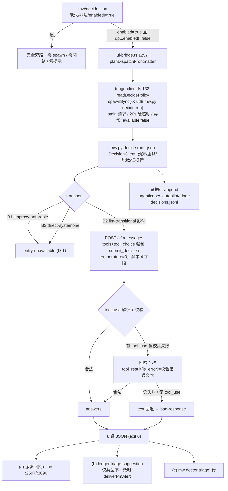

# jev 接入：全链路流程与使用说明

- key: `mw-jev-provider-integration`
- 文档定位：**运维/接入正式文档**。回答三件事——(1) 链路怎么走；(2) 决策结果**怎么被用掉**（输入 → 输出 → 执行 → 结果）；(3) 怎么测。
- 代码基线：`packages/multi-workers/{decision.py,decision_backends.py,mw.py,mw_common.py}` + `packages/coding-agent/src/extensions/agent-team-loop/pm/{triage-client.ts,ui-bridge.ts,pm-orchestrator.ts}`
- 更新日期：2026-10-16

---

## 0. 一句话架构

`jev` 在本框架里**不是聊天模型**，而是**决策服务**：一次调用 = 一段情境（`state`）+ 一组结构化问题（`questions`）→ 一组带置信度的结构化答案（`answers`）。框架只把它当**旁路建议源**用：拿到建议后**不改写**任何派发决策，只做"呈现 + 留痕 + 争议时叫醒 PM"。

---

## 1. 全链路流程图

```text
┌──────────────────────────────────────────────────────────────────────────────────────┐
│ ① 配置门（唯一开/关，默认关闭）                                                       │
│   <project>/.mw/decide.json                                                          │
│     ├─ 缺失 / 非法 JSON / enabled != true ──▶ 完全旁路（零 spawn、零网络、零提示）      │
│     └─ enabled=true 且 points.dp1.enabled != false ──▶ 继续                            │
└───────────────────────────────┬──────────────────────────────────────────────────────┘
                                ▼
┌──────────────────────────────────────────────────────────────────────────────────────┐
│ ② TS 侧（PM 进程内）  pm/ui-bridge.ts                                                │
│   dispatch_worker:2440  /  /worker:2938                                              │
│     └─▶ planDispatchFrontmatter:1257    ← DP-1 挂点 A（本波唯一挂点）                 │
│           └─▶ pm/triage-client.ts                                                    │
│                 ├─ readDecidePolicy:132   每次派发重读配置文件（不吃 PM 内存缓存）     │
│                 ├─ 组装 {state, questions}，state 按 max_state_bytes 截断（16 000B）  │
│                 └─ spawnSync(PYTHON_EXE, [-X utf8, mw.py, decide run …])   :169      │
│                      请求 JSON 只走 stdin（绝不进 argv）                              │
│                      timeout = timeout_s（默认 20s）  windowsHide: true              │
│                      任何异常/超时/非 JSON ──▶ available=false（不抛、不阻断派发）    │
└───────────────────────────────┬──────────────────────────────────────────────────────┘
                                ▼
┌──────────────────────────────────────────────────────────────────────────────────────┐
│ ③ Python CLI  mw.py  decide run --project P --dp dp1 --json                          │
│   _decide_read_request:693   请求 shape 校验 ──非法──▶ exit 2（stderr 说明）          │
│   DecisionConfig.from_project()          fail-soft 读 .mw/decide.json                │
│   DecisionClient.decide()  (decision.py)                                             │
│     ├─ 预算(max_state_bytes/max_questions/max_tokens) / 重试退避(max_retries)         │
│     ├─ 凭据脱敏、异常归一（8 类 reason）                                              │
│     └─ 末尾 append 一行证据（best-effort，写失败不影响返回）                           │
│          .agenticdoc/_autopilot/triage-decisions.jsonl（唯一写者 = Python；TS 只读）  │
└───────────────────────────────┬──────────────────────────────────────────────────────┘
                                ▼
┌──────────────────────────────────────────────────────────────────────────────────────┐
│ ④ 传输后端（decision_backends.py，按 transport 选；默认 B2）                          │
│                                                                                      │
│  B1 llmproxy-anthropic ─▶ entry-unavailable（D-1：timiai 未暴露决策入口）             │
│  B3 direct-systemone   ─▶ entry-unavailable（保留位，无凭据）                         │
│                                                                                      │
│  B2 llm-transitional（默认）  model=glm-5.3-flashx 经内网 llmproxy                    │
│     POST /v1/messages                                                                │
│       { model, temperature: 0,                                                       │
│         tools: [submit_decision],  tool_choice: {type:"tool", …},                     │
│         禁带 response_format / state / questions / store }      :522-581              │
│        ▼                                                                             │
│     取 content 中 type=="tool_use" 的 input（忽略 thinking / text 块）                │
│        ▼                                                                             │
│     校验：逐题必答 / choice ∈ enum / score ∈ [min,max]                                │
│        ├─ 合法 ────────────────────────────────────────────▶ 成功                     │
│        └─ 有 tool_use 但校验失败                                                      │
│              └─▶ 回喂 1 次（design D-002）：                                          │
│                  user → assistant(tool_use) → user(tool_result, is_error=校验错误文本) │
│                    ├─ 合法 ───────────────────────────────▶ 成功                      │
│                    └─ 仍不合法 / 无 tool_use ─▶ text 回退（解析正文 JSON）             │
│                                                  └─ 仍失败 ─▶ bad-response            │
│   （单次 decide 最多 2 次 POST，绝不循环）                                             │
└───────────────────────────────┬──────────────────────────────────────────────────────┘
                                ▼
┌──────────────────────────────────────────────────────────────────────────────────────┐
│ ⑤ 返回（BackendOutcome → DecisionClient → CLI stdout JSON，固定 8 键）                │
│   available / transport / model / confidence_source / attempts / latency_ms /         │
│   answers / reason                                                                    │
│   成功与 available=false 都 exit 0；只有请求参数非法 exit 2                            │
└───────────────────────────────┬──────────────────────────────────────────────────────┘
                                ▼
┌──────────────────────────────────────────────────────────────────────────────────────┐
│ ⑥ 反馈三层（design D-005）                                                            │
│   (a) 派发回执 echo       ui-bridge.ts:2597 / :3096（零额外 turn，PM 直接在工具返回里看到）│
│   (b) ledger notice kind  triage-suggestion / triage-unavailable                      │
│                           仅"建议类型 ≠ 派发类型"且 alert_on_disagreement!=false 时     │
│                           deliverPmAlert（一次 PM turn）；不可用默认全静默             │
│   (c) mw doctor           triage: 信息行 + --json 的 decide section（未配置逐字节不变） │
│   ※ 建议只作旁路：绝不改写派发的 type / 角色 / 模型                                    │
└──────────────────────────────────────────────────────────────────────────────────────┘
```

### mermaid 版（贴文档用）



---

## 2. 输入 → 输出 → 执行 → 结果

这是本文的重点：**决策结果拿到之后，到底谁在读它、读来干什么、最后改变了什么**。

### 2.1 输入：谁给出 `state` 和 `questions`

| 项 | 内容 |
| --- | --- |
| 生成者 | TS 侧 `ui-bridge.ts:1429-1436`（`planDispatchFrontmatter:1257` 内；行号已按 RQ-4 复核纠正） |
| `state` | 该次派发的**情境文本**：任务描述 + 类型/阶段等上下文，按 `MAX_TRIAGE_STATE_BYTES = 16_000`（`triage-client.ts:44`）从尾部截断 |
| `questions` | DP-1 固定两题（`triage-client.ts:55-57`）：<br>`triage_type` : choice `["coding","research","review"]`<br>`triage_risk` : choice `["low","mid","high"]` |
| 语义边界 | `triage_risk` **不是**运行时 `computeRisk` 的 checkpoint 信号，只依据"卡片文本 + 阶段"作建议性分类 |
| 传输 | 整份请求 JSON 走 **stdin**（`triage-client.ts:169` 的 argv 里只有 `--project/--dp/--json`），不落 argv、不进日志 |
| 敏感内容 | `state` 会发给**内网 llmproxy**（与 pi worker 自身模型流量同通道）。派发描述里不要放凭据/敏感原文；敏感场景保持 `enabled=false` |

CLI 侧允许的完整问题类型（比 DP-1 更宽，供后续决策点用）：

| type | 取值/约束 | 传输后端支持 |
| --- | --- | --- |
| `choice` | 必须 ∈ `choices` | B2 支持（`choice→enum`） |
| `score` | 整数且 ∈ `[min,max]` | B2 支持（`score→integer`） |
| `noul` | boolean（收 0/1） | B2 支持（`noul→boolean`） |
| `box` | 自由文本/结构化框 | **B2 不支持**：不发请求，直接 `unsupported-question-type` |

### 2.2 输出：拿到什么

CLI 成功返回（固定 8 键，`decision.py:111-120` 的 `_RESPONSE_FIELDS`）：

```json
{
  "available": true,
  "transport": "llm-transitional",
  "model": "glm-5.3-flashx",
  "confidence_source": "model-self-report",
  "attempts": 1,
  "latency_ms": 5100,
  "answers": {
    "triage_type": { "value": "review", "confidence": 0.9 },
    "triage_risk": { "value": "low",  "confidence": 0.9 }
  },
  "reason": null
}
```

不可用时（同样 **exit 0**）：

```json
{ "available": false, "transport": "llmproxy-anthropic", "model": "jev-latest",
  "confidence_source": "api", "attempts": 0, "latency_ms": 3,
  "answers": null, "reason": "entry-unavailable" }
```

字段语义：

| 字段 | 含义 |
| --- | --- |
| `available` | 唯一成功标志。**false 时 `answers` 必为 null**，不得解读为"空建议" |
| `answers[qid]` | `{value, confidence}`；`value` 的类型由问题 type 决定（string / int / bool） |
| `confidence` | **0..1 自报值**。B2 下整份 payload 只有一个 confidence，故各题拿到的是**同一个数**（形状逐题、数值同源） |
| `confidence_source` | `api`（由后端/API 给出）/ `model-self-report`（模型自报）/ `unknown` |
| `reason` | 8 类失败原因之一（见 §5.2），成功时为 `null` |
| `attempts` / `latency_ms` | 客户端层面的重试次数与耗时；回喂重发**不**增加 `attempts`（同一次 attempt） |

**置信度硬规则（P0 级）**：`confidence_source != "api"` 时，`confidence` **不得进入任何门控/阈值判断**，只能作弱排序参考。实测依据：B2 对平凡事实自报 0.8–1.0，与真实准确率无关。

### 2.3 执行：结果被谁用掉、怎么用

四条消费路径，一条都不改派发决策：

| # | 消费者 | 触发条件 | 具体行为 | 锚点 |
| --- | --- | --- | --- | --- |
| (a) | **PM 的派发回执** | `available=true` | 回执文本末尾追加一行（逐字格式见下）；PM 在 `dispatch_worker` / `/worker` 的工具返回里直接看到，**零额外 turn** | `ui-bridge.ts:279` `appendTriageReceipt`，调用点 `:2597` / `:3096` |
| (b) | **ledger 告警行** | 任意结果 | `recordDispatchAlarm` 写一行 `kind=triage-suggestion`（可用）或 `triage-unavailable`（不可用且 `triage_notify_on_unavailable=true`）；五元组行格式不变 | `ui-bridge.ts:258` `emitDispatchTriage` |
| (c) | **PM 主窗口唤醒** | 仅 `available=true` **且** 建议类型 ≠ 实际派发类型 **且** `alert_on_disagreement != false` | `deliverPmAlert` 发一条消息，文案固定："`N pre-dispatch triage suggestion(s), advisory only — the dispatch type/role/model were NOT changed: <detail>`" | `pm-orchestrator.ts:619` |
| (d) | **结构化证据** | 每次 `decide()` 调用 | append 一行 11 字段 JSON 到 `<project>/.agenticdoc/_autopilot/triage-decisions.jsonl`（`ts/dp/transport/model/attempts/latency_ms/available/reason/answers/confidence/confidence_source`） | `decision.py:945-960` |

回执行逐字格式（`triage-client.ts:327`）：

```text
[triage] 旁路建议，未据此更改派发：triage_type=review（conf=0.9）, triage_risk=low（conf=0.9）（模型自报）confidence_source=model-self-report
```

ledger `detail` 逐字格式（`triage-client.ts:340`）：

```text
dp=dp1 triage_type=review triage_risk=low dispatched_type=coding disagreement=yes confidence_source=model-self-report
```

> 注意 (a)/(b) 的分工：(a) 每次可用都呈现（PM 看得见、不需要额外动作），(b)(c) 只在**争议**时才升级成一次唤醒——这样既不淹没 PM，也不让分歧被静默吞掉。

### 2.4 结果：四个象限，各自的最终状态

| 象限 | `available` | 建议 vs 派发类型 | 可观测输出 | 派发是否改变 | 人怎么应对 |
| --- | --- | --- | --- | --- | --- |
| 一致 | true | 相同 | 回执行 + ledger 行 + 证据行，**无告警** | 否 | 无需动作（建议与判断一致） |
| 争议 | true | 不同 | 回执行 + ledger 行 + **一条 PM 告警消息** + 证据行 | **否**（告警文案明写 "NOT changed"） | PM 自己决定是否改判：与用户确认 / 显式重派 `type:` |
| 不可用 | false | — | 默认**全静默**（可选 `triage_notify_on_unavailable=true` → 一条 ledger 行，仍不唤醒 PM）+ 证据行（带 `reason`） | 否 | 只有想排查时才看：`mw decide show` / `mw doctor` / 证据 JSONL |
| 未启用 | — | — | **零输出**（无 spawn、无网络、回执逐字节不变，TS 侧有真断言） | 否 | 无需动作 |

**明确不会发生的事**（设计级硬约束，均有断言/代码证据）：

1. 不会因为建议而改写 `type` / role / model / 工具白名单——建议是旁路。
2. 不会因为决策服务不可用而阻断或延迟派发的**语义**（最多多一次 20s 上限的同步等待，超时即放弃）。
3. 不会把 `confidence` 当门控阈值用（`model-self-report` 时）。
4. 不会把 `state` 或请求 JSON 写进 argv、日志、证据行。
5. 不会静默降级成"假装成功"：B1 七个 return 点全部 `available=false`（复审已逐点核对）。

### 2.5 新决策点怎么接（给后续接入者）

三种消费形态，从轻到重：

1. **只要建议**：加一个 `questions` 字典，调 `mw decide run --request-file`，读 `answers[qid].value`。
2. **要建议 + 留痕**：同上，并把 `--dp <name>` 设成新决策点名字（证据行的 `dp` 字段随之改变，可按 dp 过滤统计）。
3. **要建议 + PM 可见**：在 TS 侧按 DP-1 的模式实现（`readDecidePolicy` → `triageDispatch` → `appendTriageReceipt` + `emitDispatchTriage`），notice kind 复用 `triage-suggestion`（或新增 kind 并加入 `NOTICE_DISPATCH_ALARM_KINDS`，`pm-orchestrator.ts:562`）。

**当前只有一个挂点**：PM 发起的派发（`planDispatchFrontmatter`），conductor 的 13 个自动派发点未接入 → 覆盖面 **2/15**（后续要挂 Python `dispatch.py` 的校验段，且**不得**进入 `workers.lock` 临界区）。

---

## 3. 凭据：复用 pi 自己的鉴权（无需额外配置）

**结论：不需要单独配 `TIMI_API_KEY`，默认就复用 pi 的 `~/.pi/agent/auth.json` 里 `timi.key`。** 与 `mw_common._DEFAULT_CONFIG` 的 timi 凭据源链完全一致。

解析顺序（`decision_backends.py:137` `resolve_timi_api_key`，调用点 `:638`）：

```text
1) <project>/.mw/decide.json 的 api_key   ← 项目级覆盖（运维显式设置时才用）
2) 环境变量 TIMI_API_KEY                  ← CI/临时覆盖
3) ~/.pi/agent/auth.json 的 timi.key      ← 默认走这条：pi 登录一次即可
```

实测证据（本机，`TIMI_API_KEY` **未**设置在环境里）：

```text
$ python -c "...resolve_timi_api_key(env={})..."     # 强制跳过环境变量
authjson-only: {'timi': True, 'typesafe': False}     # ← 仅靠 pi 的 auth.json 就能解析
$ echo $env:TIMI_API_KEY
(空)
```

而本 key 的真实端到端调用（`available=true, latency_ms≈5100`）就是在 `TIMI_API_KEY` 未设置的情况下跑通的 → **走的就是 pi 的 auth.json**。

安全要点：
- 密钥值**永不**出现在证据行、日志、回执、doctor 输出里（`_redact`/`_sanitize` + `set --json`/`show --json` 的 `<redacted>`）。
- `credential_status()` 只输出布尔值（`{"timi": true, "typesafe": false}`），可安全打印。
- Worker 侧不需要这把 key（GC-4 凭据隔离）：决策是 **PM 进程 → 本地 Python** 发起，与 worker 的模型凭据无关。
- `TYPESAFE_API_KEY` 只在走 B3（direct-systemone）时才需要，当前不交付、不读取。

---

## 4. 怎么测（五层，从便宜到贵）

| 层 | 测什么 | 命令 | 期望 |
| --- | --- | --- | --- |
| L1 | Python 客户端/后端/CLI（真契约、假网络） | `cd packages/multi-workers; python -m pytest -q test_decide.py test_decide_backends.py test_decide_cli.py` | **137 passed**（含回喂 4 例、"两次非法恰好 2 次 POST"防循环、脱敏断言） |
| L2 | TS 接入层（假 spawn） | `cd packages/coding-agent; node ../../node_modules/vitest/dist/cli.js --run test/suite/triage-dispatch.test.ts` | **21 passed**（含"未配置则回执逐字节不变"） |
| L3 | CLI 手工冒烟（零成本） | 见 §4.1 | disabled 路径 + doctor 零扰动 |
| L4 | 真实决策调用（烧 token，~5s/次） | 见 §4.2 | `available=true` + 证据行落盘 |
| L5 | 真 PM 派发路径 | 见 §4.3 | 回执出现 `[triage]` 行 |

### 4.1 L3 手工冒烟（零成本）

```powershell
$P = "H:\tmp\jev-smoke"; New-Item -ItemType Directory -Force $P | Out-Null

# 默认关闭：不进决策服务
python -X utf8 packages/multi-workers/mw.py decide show --project $P
#   -> decide: disabled (.mw/decide.json not present)
python -X utf8 packages/multi-workers/mw.py doctor --project $P | Select-String triage
#   -> 无输出（zero-perturbation）

# 打开（原子写）
python -X utf8 packages/multi-workers/mw.py decide set --project $P enabled=true transport=llm-transitional model=glm-5.3-flashx
python -X utf8 packages/multi-workers/mw.py decide show --project $P      # -> enabled + 生效值
python -X utf8 packages/multi-workers/mw.py decide set --project $P --json api_key=sk-test-123
#   -> config.api_key = "<redacted>"（回显脱敏），落盘值不变
```

### 4.2 L4 真实决策调用

请求**落盘**（P-001：禁 PS 管线喂多字节内容）：

```powershell
@'
{ "state": "PM is about to dispatch a read-only audit of the transport backends, expected to produce an evidence document with anchors.",
  "questions": {
    "triage_type": {"type":"choice","choices":["coding","research","review"],"criteria":"Best-fitting task type."},
    "triage_risk": {"type":"choice","choices":["low","mid","high"],"criteria":"Blast radius of this dispatch."} } }
'@ | Set-Content -Encoding utf8 $P\req.json

python -X utf8 packages/multi-workers/mw.py decide run --project $P --request-file $P\req.json --json
Get-Content -Encoding utf8 $P\.agenticdoc\_autopilot\triage-decisions.jsonl -Tail 1
```

实测参考：`available=true, transport=llm-transitional, model=glm-5.3-flashx, attempts=1, latency_ms≈5100`，`triage_type=review(0.9)`、`triage_risk=low(0.9)`，`confidence_source=model-self-report`。

诊断矩阵（复现 D-1，不烧决策预算）：

```powershell
python -X utf8 packages/multi-workers/mw.py decide probe --project $P --json
#   -> jev @/v1/messages = 429；jev @/responses = 200 upstream-error；B2 = 200 ok
```

**手工触发回喂路径**（唯一办法：正常输出总是合法的）：把 `choices` 设成两个值、在 `criteria` 里诱导同义词，例如 `choices:["coding","research"]` + `criteria:"answer 'implementation' or 'exploration'"` → 模型多半答 `implementation`（越界）→ 回喂 → 第二次落回 enum。验证点：仍 `available=true` 且 `attempts=1`（回喂不增加 attempt）；要确认"确实发了 2 次 POST"，只能看 llmproxy 侧日志或临时给 `_http_post` 打点。

### 4.3 L5 真 PM 派发路径（当前**还测不了**）

```powershell
mw build --install     # 未做则真实会话里加载的还是旧 bundle，TS 那半边等于没上线
# 然后在开了 .mw/decide.json 的项目里发一次派发，看回执是否带 [triage] 行 + doctor 是否出现 triage: 行
```

---

## 5. 契约附录

### 5.1 配置字段（`.mw/decide.json`）

| 键 | 默认 | 作用 |
| --- | --- | --- |
| `enabled` | `false` | 总开关；非 true 一律旁路 |
| `transport` | `llm-transitional` | `llm-transitional`（B2）/ `llmproxy-anthropic`（B1）/ `direct-systemone`（B3） |
| `model` | `glm-5.3-flashx` | B2 模型名 |
| `timeout_s` | `20` | 单次决策硬超时（TS 侧 spawn 超时同步生效） |
| `max_retries` | `2` | 客户端重试次数（仅可重试类别） |
| `max_questions` | `8` | 单次最多问题数 |
| `max_state_bytes` | `16384` | `state` 上限（TS 侧更保守，16 000） |
| `max_tokens` | `1024` | 输出预算 |
| `points.dp1.enabled` | `true` | DP-1 单点开关 |
| `points.dp1.alert_on_disagreement` | `true` | 争议时是否唤醒 PM |
| `triage_notify_on_unavailable` | `false` | 不可用时是否写 ledger 行（永不唤醒 PM） |
| `api_key` | 空 | 项目级凭据覆盖（通常**不设**，走 pi auth.json） |
| `extras.*` | 空 | 传输旋钮：`base_url` / `entry_probe` / `systemone_url` / `jev_model` |

### 5.2 `reason` 8 类（`decision.py:88-99` 的冻结集合，不得发明新值）

| reason | 含义 | 可重试 |
| --- | --- | --- |
| `disabled` | 未启用（客户端短路，**不发请求**） | 否 |
| `entry-unavailable` | 决策入口不存在：HTTP 404、其他 3xx/4xx 路由问题，或 B1/B3 未接线 | 否 |
| `upstream-error` | 401/403/400 等非可重试状态、5xx，或 HTTP 200 但 body 含 `error` / `litellm.*Error`（其中 unmapped provider / model unavailable / bad request 判为永久） | 视来源 |
| `rate-limited` | 429，或 200 响应 body 带限流标记 | 是 |
| `timeout` | 408 / transport 超时 / body 带超时标记 | 是 |
| `bad-response` | 2xx 但不是 JSON；或解析/校验失败且回喂 + text 回退都没救回 | 是 |
| `unsupported-question-type` | 遇到 `box` 等 B2 不支持的类型（**不发请求**） | 否 |
| `budget-exhausted` | 超出 state/questions/tokens 预算（**不发请求**） | 否 |

### 5.3 测试覆盖缺口（诚实声明）

- 回喂的多轮消息形状（`tool_result` + `is_error`）**只**在 fake transport 上验证过，真实 llmproxy 是否接受未证。
- 真实 `runDecideMw`（TS 侧真正 spawn 的函数）无直接测试（测试桩替在 seam 上），spawn 参数错误只能人工核对。
- 失败时无可读诊断（`detail` 在进程内被丢弃），只有 `reason` 枚举。
- conductor 的 13 个自动派发点未接入（覆盖面 2/15）。
