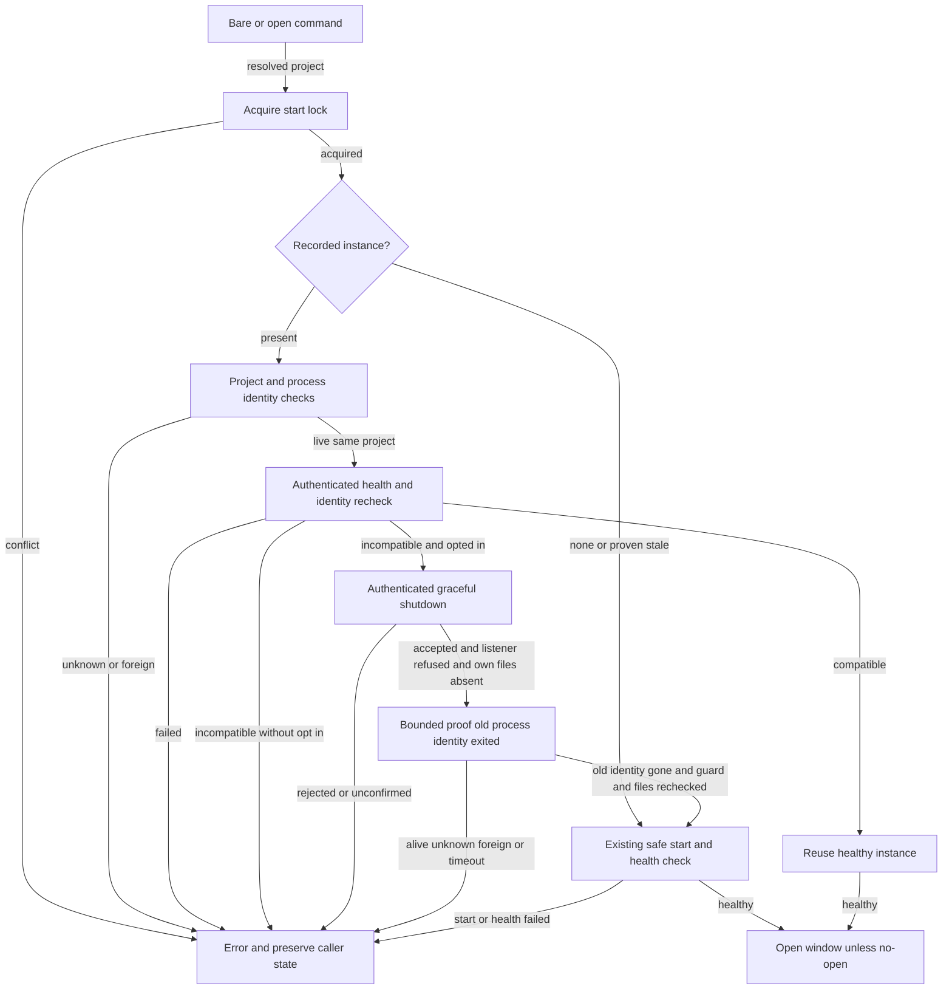

# Design: mw-monitor-auto-restart

## §0 设计前提锚定
- spec_path: `.agenticdoc/mw-monitor-auto-restart/spec.md`
- spec_locked_at: user 推进 confirmed AC scope 2026-10-24; exact user-message UTC unknown, not invented.
- ac_count: 8
- ac_ids: AC-001, AC-002, AC-003, AC-004, AC-005, AC-006, AC-007, AC-008
- Status: user approved D001–005; source implemented and targeted verified, whole-key quality/runtime acceptance pending. See evidence/implementation-report.md.
- Goal: .agenticdoc/goal.md; no core/framework/config/dependency changes.

## §1 架构选型
All decisions cite evidence/research/design-safe-replacement-20261024.md; source findings cite spec-lifecycle-20261024.md and spec-cli-20261024.md.

| D-ID | 方案 A / Pros / Cons | 方案 B / Pros / Cons | 推荐 |
|---|---|---|---|
| D001 | CLI stop→open two independent calls, simple; race outside shared lock | opt-in ensure_instance under existing start_lock, one coordinating boundary; longer lock hold | B, only bare/open opts in, existing default refusal unchanged |
| D002 | refused listener + own files absent, works for in-process owners; no proof of process exit | also prove old PID/start identity gone, literal exit safety; bounded extra wait/self-PID refusal | B for automatic CLI restart, tests use synthetic probes/detached fake process, not lower gate |
| D003 | module-only fingerprint, current logic; asset-only edits invisible | module + ordered HTML/CSS/JS names/bytes, catches stale page; one replacement after adoption | B, same existing fingerprint field/protocol/schema |
| D004 | queue/retry concurrent opens, friendlier; new retry timing/contracts | retain short start-lock-conflict, no extra starts; caller retries manually | B, AC006 needs single publisher not waiting guarantee |
| D005 | refactor public stop result, broad impacts | validate existing stop result strictly for replacement only, optional internal deterministic seams | B, status/stop unchanged |

## §2 核心结构 / dependencies
CLI monitor open → lifecycle ensure_instance → existing identity/auth/lock/stop/start/health primitives. Fingerprint consumes source bytes and assets already served. No circular imports, new coordinator or model requests. General serve/explicit stop/status do not enable automatic replacement.

## §3 模块划分 / proposed write surfaces
- packages/multi-workers/decision_monitor.py: fingerprint, opt-in replacement branch, strict shutdown validator and bounded old-process exit confirmation under start_lock; narrow deterministic seams if needed.
- packages/multi-workers/mw.py: _monitor_open alone opts in and outputs replacement fact; new child/publication/browser path reused, status/stop/serve behavior not changed.
- packages/multi-workers/test_decision_monitor_auto_restart.py (new): lifecycle/fingerprint/failure/race/preservation synthetic regression matrix.
- packages/multi-workers/test_decision_monitor_cli.py or new dedicated CLI restart test file: actual _monitor_open opt-in/--no-open/redacted report and status/stop zero-start probes. Inspect complete target before choosing exact test edit.
- No dashboard source, framework, config, deps, locks/shrinkwrap, other keys or user's lifecycle files may be edited.
- PM serial single writer because dispatch currently triggers forbidden real dp1 API; no further worker dispatch without permission. Research parallel completed (RQ1 worker + PM RQ2). Test files independent questions may be prepared separately, final verification serial after stable code.

## §4 接口与集成
- Proposed ensure_instance keyword `replace_incompatible: bool = False`; only _monitor_open passes True. Default/general serve stays conservative. Automatic replacement requires process-exit gate; self-PID owner fails closed, not force-killed.
- Proposed returned instance replacement metadata: previous identity (non-secret), accepted stop result, old-identity exit confirmed; no token/boot code. CLI JSON `replacement` plus existing `instance/recovery/no_open/window`; text distinguishes reused/started/replaced. Starter metadata remains real new-child facts.
- Error kinds existing instance-unknown/unresponsive, stop-failed, start-lock-conflict, health-failed. Error includes truthful stage and non-secret old identity. If old stopped but new start/health fails, report that partial outcome; never fabricate reuse/rollback.
- Compatibility fingerprint covers exact decision_monitor.py bytes and ordered decision_dashboard.html/css/js path labels+bytes with unambiguous length framing. Deterministic same bytes, any covered byte change produces incompatibility. No history rewrite/schema migration. Missing source/assets fail explicitly, no silently compatible fallback. Full transitively imported Python cache invalidation is not claimed.

## §5 Function Flow

Separate unchanged entries: status → recorded identity/auth health → status/error, never start/window. stop → recorded identity/auth shutdown → existing stop report/error, never start/window. They do not enter replacement branch.

## §6 Coverage Matrix
| Feature | Normal | Boundary | Exception | Layer |
|---|---|---|---|---|
| Start/reuse | empty, compatible, code/assets incompatible | no-open, one replacement | startup/health failure truthful partial outcome | L1/L2 synthetic |
| Identity/auth | old identity matches | changed token/state/PID start | project/port/identity mismatch, missing secret/unknown PID | L1 |
| Shutdown/exit | accepted, refused, absent, old process dead | PID reuse, own PID refusal | request detail despite stopped=true, retained/foreign, alive/unknown timeout | L1/L2 synthetic |
| Coordination | held lock through replacement | second open conflicts then reuses | changed lock/foreign files no destructive caller cleanup | L1 |
| Preservation | history/test data byte-identical | malformed/state schema unknown | zero strong kill/delete/model/browser on refused path | L1 |

## §7 Verification Contract
VC-001: When no instance exists, starter_count=1 and healthy=true; window_count=1 or 0 with no-open.
       Layer: L1/L2 synthetic
       Output: [VERIFY] VC-001: starter_count=1 healthy=true
       Source: AC-001
VC-002: When authenticated compatible instance exists, reused=true and shutdown_count=0 and starter_count=0 and identity/PID unchanged.
       Layer: L1
       Output: [VERIFY] VC-002: reused=true shutdown_count=0 starter_count=0
       Source: AC-002
VC-003: When authenticated same-project covered-code/assets mismatch occurs, exact_order=verify,shutdown,port_refused,files_absent,old_identity_dead,start,health,window and replacement_count=1 (window omitted only no-open).
       Layer: L1/L2 synthetic
       Output: [VERIFY] VC-003: replacement_count=1 exit_before_start=true
       Source: AC-003
VC-004: When identity/auth/project proof fails, shutdown_count=0 starter_count=0 window_count=0 and recorded bytes unchanged by caller.
       Layer: L1
       Output: [VERIFY] VC-004: shutdown_count=0 starter_count=0 preserved=true
       Source: AC-004
VC-005: When shutdown is rejected/unconfirmed or old process remains alive/unknown/timeouts, replacement_count=0 kill_count=0 caller_delete_count=0 and error_nonempty=true; preserve surviving files, do not undo server's own cleanup.
       Layer: L1
       Output: [VERIFY] VC-005: replacement_count=0 kill_count=0 caller_delete_count=0
       Source: AC-005
VC-006: When two opens contend on held restart lock, active_replacement_count<=1 and contender_error=start-lock-conflict; after lock release contender reuses replacement.
       Layer: L1
       Output: [VERIFY] VC-006: active_replacement_count=1 contender_error=start-lock-conflict
       Source: AC-006
VC-007: When successful automatic restart with no-open, browser_spawn_count=0 and history/test-submission raw hashes unchanged; report contains no token/boot secret.
       Layer: L1/L2 synthetic
       Output: [VERIFY] VC-007: browser_spawn_count=0 history_equal=true submissions_equal=true
       Source: AC-007
VC-008: When status/explicit stop execute, starter_count=0 window_count=0 model_request_count=0 and existing targeted contracts pass unchanged.
       Layer: L1
       Output: [VERIFY] VC-008: starter_count=0 window_count=0 model_request_count=0
       Source: AC-008

## §8 AC → VC 映射表
| AC ID | Summary | VC | Paths |
|---|---|---|---|
| AC-001 | ordinary start | VC-001 | normal/no-open |
| AC-002 | compatible reuse | VC-002 | normal/auth |
| AC-003 | safe incompatible replacement | VC-003 | normal/process-exit/assets |
| AC-004 | identity fails closed | VC-004 | error/race |
| AC-005 | stop/exit fails closed | VC-005 | error/timeout/partial |
| AC-006 | single concurrent publisher | VC-006 | contention |
| AC-007 | no-open and history | VC-007 | normal/security |
| AC-008 | status/stop unchanged | VC-008 | entry boundaries |

## §9 非功能实现方案
Strict bounded waits, no auto retries. Existing stop request/probe/file waits retained; process-exit confirmation proposed max10s using monotonic clock + tri-state PID/start probes, sleep only remaining deadline; lock held until returned healthy instance/error. Windows unknown process information blocks instead of guesses. Loopback-only tests with scrubbed secrets/proxy env/private temp roots and fake provider/client; no live monitor/shared serve/browser/model. Freeze baseline bytes/diffs before code; RED then minimal GREEN. Targeted serial regression files with raw logs/UTC argv cwd rc; root check protected copy only, retain outside-scope failures (known older 3warnings2infos not fresh result here). No build/install/commit/deployment.

## §10 决策记录 / implementation readback
User confirmed D001–005, strict old-process exit gate and asset fingerprint; key-decision.md A/evidence-requirement.md/plan/tasks written and phase gates PLAN/TASKS/EXECUTE passed. RQ1 done/acked, PM direct source implementation (no new dispatch/API calls).

Source: _replacement_files_absent uses read_state + secret lstat, FileNotFound only as absence proof; _stop_for_replacement validates identity/token/guard/self-PID/liveness then existing AttachedInstance.stop exact successful result, bounded10s _identity_liveness dead gate, guard/files/port rechecks. Recycled PID/start drift remains conservative unknown rather than treating unrelated live PID as dead. No moves on successful replacement; existing stale recovery unchanged for other starts. Metadata process_exit_confirmed becomes true as soon as death is observed, even if later foreign listener prevents start; starter/health failures carry partial truth.

No new public stop seam/refactor needed: tests inject existing health/stop/OS probes; new replacement-only helpers are internal. Fingerprint length-frames source + sorted asset names/bytes, unreadable input refuses; module/schema unchanged. CLI actual _monitor_open writes opt-in, replacement payload, text replaced mode in exactly three byte-replayed edits; status/stop untouched. Report raw tests and remaining full-check blocker: evidence/implementation-report.md. Real-browser/current monitor operation not performed.
