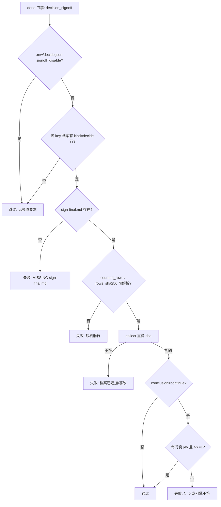

# design — mw-signoff-decide-only

## 1. 设计结论

三层，一个原则：**签收只在决策模型真的参与过时存在；决策由决策模型给，调用方与人都没有结论输入。**

| 层 | 结论 |
| --- | --- |
| 门禁（`advance_phase.py`） | `done` 只保留一条 `decision_signoff` 检查，无条件执行；旧的「必须有 `sign-final.md`」两条规则删除；适用性由「该 key 有 `kind=decide` 行」决定 |
| CLI（`mw.py` + `decide_signoff.py`） | `mw decide sign` 只剩 jev 一条路；`--conclusion`、`--human-confirmed`、`auto-llm`、`cli`/`tui` 全部删除 |
| 窗口（`ui-bridge.ts`） | 不弹框、不要求 `hasUI`、不拼 `--human-confirmed`；preview 用 `--dry-run --json`，write 用 `--auto` |

关键判据取舍：**"有决策行"取 raw `kind=decide` 行数（含 `dp25-signoff-conclusion` 自己的行），不取 `collect().rows`。**

理由（`evidence/research/spec-archive-scan-20261022.md`）：本仓库 5 个有 jev 行的 key 中，`mw-signoff-per-key` 与 `mw-usage-monitor` 的 raw=2 / counted=0，两种口径给出相反结论；counted 口径还会让 `verdict()` 的 `"N=0 + continue"` 分支在门禁上永久不可达。

## 2. 门禁层

### 2.1 `GATES["done"]` 的三改

```python
# 删除：两条无条件旧规则（现 advance_phase.py:107-121）
#   ("evidence/review/sign-final.md", "glob_has_files", 1, ...)
#   ("evidence/review/sign-final.md", "content_match", r"(?m)^conclusion:...", ...)
# 它们让零决策行的 key 也必须交文件（全仓 74/77 key 当前被这条规则拦）。

# 替换：单一规则，哨兵路径，无条件执行
(
    DECISION_SIGNOFF_RULE_TARGET,   # "" —— 规则本身不读任何路径
    "decision_signoff",
    None,
    "签收内容校验（无条件执行；适用性由检查函数判断：signoff=disable 或该 key 无 "
    "kind=decide 行 → 跳过）。counted_rows/rows_sha256 必存且与档案重算一致；"
    "conclusion=continue 还要求 N>=1 且每行都来自真 jev；narrow/revoke 只要求哈希链完整",
),
```

哨兵用空串而不是 `DECISION_SIGNOFF_REL`：`path_pattern` 只有两个消费点（拼 `full_path`、与 `DECISION_SIGNOFF_REL` 比较），空串既不改变任何其它规则，也避免与已删除的循环级 `disable` 短路产生隐式耦合。旧的两条规则删掉后，`check_gate` 里那段 `path_pattern == DECISION_SIGNOFF_REL and disabled: continue` 变成死代码，一并删除。

### 2.2 `_decision_signoff_problems` 新控制流

```
disable?            -> []
_key_has_decide_rows(key_dir)?  -> False 时 []
文件存在?            -> 否: [MISSING]
机器行完整?          -> 否: [SIGNOFF ...]
import decide_signoff -> 失败: [SIGNOFF cannot import]
collect() / sha / counted / verdict -> problems
```

廉价判据必须插在 `disable` 之后、**导入之前**：否则没装 `packages/multi-workers` 的项目会因导入失败把 `done` 变红。

```python
DECISION_ARCHIVE_REL = "_autopilot/decisions.jsonl"

def _matches_key(row, key):
    if row.get("key") == key:            # 原始比较，不做 str()
        return True
    decision_id = row.get("decision_id")
    if not key or not isinstance(decision_id, str):
        return False
    return decision_id.endswith(":" + key)

def _key_has_decide_rows(key_dir):
    archive = key_dir.parent / DECISION_ARCHIVE_REL
    try:
        text = archive.read_text(encoding="utf-8")
    except FileNotFoundError:
        return False
    except (OSError, UnicodeDecodeError):
        return True                      # 读不清 → 交给完整校验 fail-loud
    key = key_dir.name
    for line in text.splitlines():
        if not line.strip():
            continue
        try:
            row = json.loads(line)
        except ValueError:
            continue
        if isinstance(row, dict) and row.get("kind") == "decide" and _matches_key(row, key):
            return True
    return False
```

与权威实现的差异只允许一处：`collect()` 之后会排除 dp25，本判据**不排除**（见 §1）。

### 2.3 状态图



## 3. CLI 层

### 3.1 参数面

| 参数 | 现在 | 之后 |
| --- | --- | --- |
| `--conclusion` | 人类语义，agent 会话内被拒 | **删除** |
| `--human-confirmed` | 绕过 agent-session 拒绝 | **删除** |
| `--auto` | 持久化 `signoff=auto` + 可选结论 | 持久化 `signoff=auto` 后 exit 0（**只改配置，不签收**；实现如此，窗口不使用它） |
| `--disable` | 持久化 `signoff=disable` | 保留（唯一的显式关闭面），持久化后照旧 exit 0 不签收 |
| （无模式标志） | 自动流程，按配置的 `signoff` | 保留：配置为 `disable` → 只预览；否则 jev 签收。窗口用这一条 |
| `--allow-empty` | `continue` + N=0 的放行 | 保留（只影响 `--dry-run` 的 verdict 预览） |
| `--dry-run` / `--json` | `--json` 无 `--dry-run` 时 jev 可用会写文件 | `--dry-run --json` 必出 `verdicts`，永不写 |

### 3.2 `_decide_sign` 收敛为单路径

```python
facts = collect(key_dir_path, key)
if signoff == SIGNOFF_DISABLE:
    return preview(...)                       # 不写，说明无需签收
if dry_run:
    return preview_verdicts(facts, ...)        # 三个结论的 verdict，零模型调用、零写入
conclusion, detail = auto_conclusion(control_dir, key, facts=facts)
if conclusion is None:
    return preview(note=f"decision model unavailable ({detail}); sign-off not required")
facts = collect(key_dir_path, key)             # dp25 行已追加
ok, problems = verdict(facts, conclusion, allow_empty=allow_empty and conclusion == "continue")
... render / write / authority-change row ...
```

`--dry-run` 必须在 `auto_conclusion()` **之前**分支：现在的实现会把预览放到模型调用之后，jev 可用时会白花一次调用、追加一条 dp25 档案行，且 JSON 里只有一个 `conclusion`、没有 `verdicts`。`--dry-run --json` 的形状固定为 `{"ok", "verdicts": {"continue"|"narrow"|"revoke": {ok, problems}}, "facts", "path": null}`。

成功写入路径的 `--json` 额外带 `"signed_via": "auto-decide"`、`"conclusion"`、`"path"`；窗口可读 JSON 的 `signed_via` 键，或文本模式的 `signed_via:` 行。

无 `auto_flow`、无 `signed_via` 分支、无 `human_confirmed`。

### 3.3 写入与词表

- `write_signoff(project_dir, key, text)`：删除 `allow_agent_session`、`signed_via` 参数与 agent-session 拒绝分支；`AGENT_SESSION_ENV_VARS` 常量**保留**（`mw.py:1854` 模块级使用）。
- `mw.py::_decide_sign_signed_via`、`_decide_sign_write` 的 `human_confirmed` 分支删除。
- 写面词表：`SIGNED_VIA_VALUES = ("auto-decide",)`；`AUTO_SIGNED_VIA` 删除。
- **读面不动**：`decision_history.py:713` 仍接受 `auto-decide|auto-llm|cli|tui`，保证历史签收不被判 `unknown signed_via`、`human_basis` 归类不翻转（`human_basis` 分支保留）。

## 4. 窗口层

| 位置 | 现在 | 之后 |
| --- | --- | --- |
| `decidePreviewArgs`（`:4730`） | `["sign","--key",k,"--json"]` | `["sign","--key",k,"--dry-run","--json"]`（+`--allow-empty`） |
| `ctx.hasUI !== true`（`:4823`） | 直接拒 | 删除该守卫 |
| 确认框（`:4871`） | 必弹 | 删除 |
| 写入 argv（`:4884`） | `--conclusion c --human-confirmed` | `["sign","--key",k,"--json"]`（不传 `--auto`，让项目 `signoff: disable` 继续生效） |
| `parseDecideArgs`（`:4558`） | 必须带 conclusion | 允许裸 `sign`；`conclusion` 从解析结果与 `ParsedDecideArgs` 中移除 |
| 回显 | 只报成功 | 解析 stdout 的 `signed_via:` / `conclusion:` 回显真实结论 |

## 5. 失败语义

| 场景 | 行为 |
| --- | --- |
| 零决策行 | 门禁跳过；`mw decide sign` 仍会跑 jev 并写一份 `narrow` 签收（无害，门禁不要求）；通常不会有人对它手动调用 |
| 有决策行、jev 可用 | 写文件 `signed_via: auto-decide` + `authority-change` 行 |
| 有决策行、jev 不可用 | exit 0，不写文件，输出 `decision model unavailable; sign-off not required`（门禁仍会是 MISSING，逼下一次重试——这是唯一残留的环内动作，且不需要人） |
| `signoff: disable` | 门禁跳过；`mw decide sign` 只打印 |
| 档案读不出（IO/编码） | 按「有决策行」fail-loud，不静默放行 |
| 签收后档案被追加 | sha 不符 → 重新 `mw decide sign` |

## 6. 测试矩阵

| 层 | 文件 | 动作 |
| --- | --- | --- |
| 门禁 | `packages/multi-workers/test_decide_signoff.py` | `604` 改名 + 断言"无 SIGNOFF failure"；新增 AC-002b（有 marker 无行 → 通过）；`613/623/649/667` 补 `_append(...)` 让检查真的执行；`633` 只删 marker 夹具 |
| 门禁 | `packages/multi-workers/test_decide_sign_auto.py` | `526` 先造真 jev 行；`494` 删 marker 夹具；`504` 依赖 `install.py` 同步镜像 |
| 框架 | `.agents/skills/agentic-task/scripts/test_advance_phase.py` | 现有 done 夹具只写文件不断言缺失，删规则后仍绿；新增「有 jev 行 + 缺文件 → SIGNOFF MISSING」正面用例 |
| CLI | `packages/multi-workers/test_decide_sign_auto.py` / `test_decide_cli.py` | `--conclusion`/`--human-confirmed` 断言删除；新增 `--dry-run --json` 零写入 + 带 `verdicts` |
| 窗口 | `packages/coding-agent/test/suite/decide-command.test.ts`（真正含 `hasUI`/`--human-confirmed` 断言的 12 例）+ `decision-signoff.test.ts`（写守卫，12 例） | `decide-command`：删 5 / 改 4 / 留 3；`decision-signoff`：0 删 2 改 |
| 历史读面 | `packages/multi-workers/test_decision_history.py` | 不改（读面保留旧值），跑通即可 |

## 7. 落地顺序

1. `decide_signoff.py`：删三张脸、收窄写面词表、去 `write_signoff` 拒绝、`--dry-run --json` 出 `verdicts`。
2. `mw.py`：`_decide_sign` 收敛、argparse 收敛。
3. `advance_phase.py`（canonical = `.agents/skills/agentic-task/scripts/`）：删两条旧规则、加 `_key_has_decide_rows`、哨兵规则、删死代码。
4. `python .agents/skills/agentic-task/install.py .` 刷新 `core|claude` 镜像与 `.claude/`（`test_decide_sign_auto.py:504` 锁字节一致）。
5. `ui-bridge.ts` + `mw-runner.ts` 注释。
6. 文档：`docs/decision-substitution.md`（§5.3 TUI 段、§6.3 两行）、`packages/multi-workers/README.md:854/929-933`。
7. 测试 + `npm run check`。

## 8. 风险

- 两个活跃 key（`claim-driven-review` VERIFY、`mw-decision-dashboard` EXECUTE）各有 1 条 jev 行，改造后必须签收才能 `done`。这是预期行为，需在验收时点名，避免被当成回归。
- `Trigger.key` 默认空串（`decision_points.py:229`）会让「无 key 的 decide 行」对所有 key 不可见（今天 0 实例）。本 key 不修，只在证据里记录。
- 删除旧两条规则后，任何依赖「缺 `sign-final.md` 就红」的外部脚本会失效；仓库内无此依赖（框架测试只创建文件，不断言缺失）。
