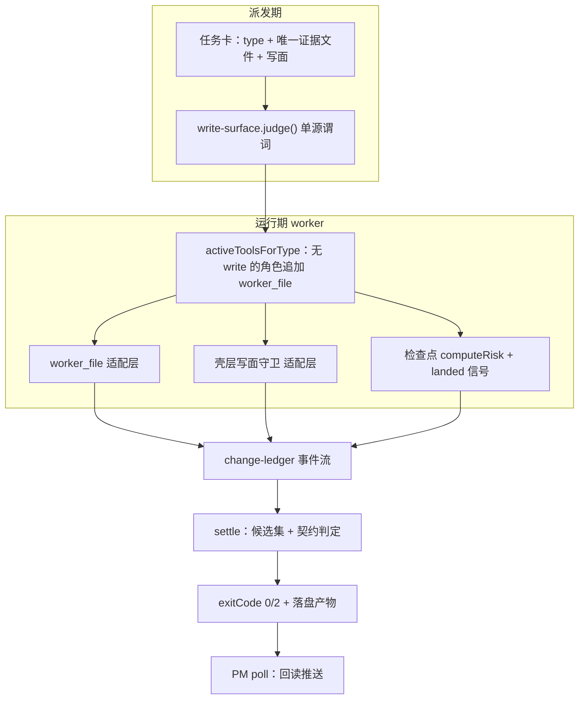

# design — mw-worker-output-contract

- Key: `mw-worker-output-contract`（framework 层修复：worker 输出面）
- Phase: DESIGN（2026-10-14）
- 依据：`spec.md`（AC-001…AC-017，**用户已锁定**）+ spec 阶段 5 份研究与 design 阶段 6 份研究（DR1…DR6，索引见附录 A）

## 1. 目标与不变量

修的是**同一根链上的五个切面**，所以设计必须先立三条不变量，再谈落点：

| 不变量 | 陈述 | 反例（当前就发生） |
|---|---|---|
| **I1 判定与产物一致** | 契约判定读的那份文本，必须与最终落盘的那份文本一致；不允许只对内存文本判定 | 判定读 `report.md`，补齐却写 `output.md` ⇒ 判定与产物分叉 |
| **I2 写面单一真源** | 「这个角色能不能写这条路径」只有一个谓词；派发期与运行期不得各判一套 | `judgeWriteTarget` 拒 `evidence/**`，运行期允许同一路径 |
| **I3 既有语义不回归** | 看门狗（idle 10m / 墙钟 60m / deadline steer）、`writes`/`uniq_targets` 计数语义、`TOOL_ALLOWLISTS` 与 Python REGISTRY 的 parity 锁、快照白名单，全部保持不变 | `writes` 语义一变，既有断言与 parity 测试一起红 |

**明确不做**（DR1 否决项，避免后人再提）：不给 research/review 加 `write`/`edit` 工具（GC-5 禁止）；不把 `worker_file` 塞进 `WRITE_TOOLS`（会连带改计数语义与 parity 锁）；不改 `TOOL_ALLOWLISTS` 表本身（只能加**通道**与**写面**）。

## 2. 架构总览



一条数据流串起五个切面：**写面**（谁能写）→ **账本**（写了什么）→ **检查点**（是否在推进）→ **判定**（产物是否达标）→ **回读**（PM 是否收到）。下面 §3–§7 逐切面给落点与接口。

## 3. W1 · 写面单一真源（AC-006 / AC-007 / AC-016）

### 3.1 新模块与三个适配层

```
新增 packages/coding-agent/src/extensions/agent-team-loop/shared/write-surface.ts
  - pmWriteDenyReason(target)             deny 表 6 条（从 ui-bridge 迁入）
  - isAllowedWorkerFileName(name)         迁址后的 basename 白名单
  - resolveWriteSurfacePaths(ctx)         { taskDir, keyDir, agenticdocRoot, projectRoot }
  - judgeWriteTarget(pathToken, ctx)      唯一谓词：deny -> taskDir -> evidence 面 -> basename -> shape -> fail-closed
```

三个调用点退化为薄适配（**只转换入参类型，不做判定**）：

| 适配层 | 位置 | 现状 |
|---|---|---|
| 运行期通道 | `worker/worker-file-tool.ts` | 自带 basename 白名单 + 目录判定 |
| 壳层守卫 | `worker/worker-mode.ts` 的 `checkBashWriteScopeTarget` 调用点 | 自带 deny 表 + 允许面 |
| 派发期 | `pm/ui-bridge.ts::judgeWriteTarget` | 自带 deny 表 + basename 通道，**无 evidence 面** |

### 3.2 路径域语义（DR1 裁决，原 spec 开放项 A2/A15）

- 基准**双接受**：`project-root 相对`（`.agenticdoc/<key>/evidence/...`）与 `keyDir 相对`（`evidence/...`）都算命中 —— 否则 AC-016 放行的订单在运行期写不成。
- 允许面 = `taskDir`（自有任务目录）+ `<key>/evidence/**`（唯一证据文件面）；`evidence/**` 不限制扩展名（`.md` 与 `.txt` 一视同仁，收掉 DR1 发现的第三个语义缺口）。
- 拒绝面仍然 fail-closed：`../..`、其他 key、仓库源码、`.git`、`node_modules`。
- `WORKER_FILE_NAME_RE` **不放宽**，只迁址 + 再导出 —— 它被 `shared/deliverable-evidence.ts:113`（`readdirSync` basename 判定）与 `pm/ui-bridge.ts:1715`（`!hasDirComponent` 通道）共用，放宽等于重开目录盲区。
- `write_scope:` **同时约束 `worker_file`**（今天零行为变化：`renderDefaultWriteScope` 恰等于默认面）。

### 3.3 AC-007 的层级

模型可见的 `Tool … not found` 由 pi 核心 `packages/agent/src/agent-loop.ts` 的 `kind:"immediate"` 分支生成，扩展的 `tool_call`/`tool_result` 钩子都在其后 ⇒ **扩展到不了那段文本**。验收改走「错误不再产生」：卡面注入正确通道 + `worker_file` 的 description 写明「这是你的唯一写通道」，让 worker 不做无效尝试。

## 4. W2 · 契约判定与机械段补齐（AC-001…AC-005 / AC-010 / AC-014 / AC-015）

### 4.1 判定算法（H2 标题档）

```
haystack = 每行匹配 " {0,3}##(?!#)[ \t]+" 的标题文本（围栏代码块内与引用块内的 # 不计）
归一化   = 去收尾 '#' + trim + 内部空白折叠 + ASCII lower
命中     = 该标题文本 includes 该段任一别名（45 条别名逐字不变）
结论     = fail-closed（缺段即缺段）；词汇保持 fail-open（标题可用别名）
```

要点：**正文彻底不参与**（这是当前 6 次误判的根因）；**不做标点剥离**（语料增益 0）；**不取 `###`**（与读侧口径一致，放宽只多救 4 个 target）。由此堵掉 FW-001 的自证漏洞：框架自己在 `## Recovery Gaps` 里写「缺失段：上下文来源」不再让 `上下文来源` 段被判为「已满足」。

### 4.2 受判候选集（AC-015）

顺序：`report.md` → `report-<slug>.md`（同层多文件按 mtime 降序）→ `output.md`。

**必须同批改第二个入口**：`worker/worker-mode.ts:2734-2738` 的 `reportProduct` 谓词只 `statSync(report.md)` ⇒ 不改则「只写 slug 文件」的 write 角色**根本不被判**。四条硬证据：`findNonEmptyReport`（`deliverable-evidence.ts:105`）、`judgeWriteTarget`（`ui-bridge.ts:1715`）、`writesLabel`（`worker-mode.ts:2695`）、`WORKER_FILE_NAME_RE` 已把 `report-<slug>.md` 当一等产物名。语料影响：33 个 target 带 slug 文件、**13 个受判文件变化**（含 QG / W-12 / W-15）。

### 4.3 机械段补齐（S3）与顺序矛盾（I1）

判定发生在唯一一次写出**之前**（`readTerminalGaps` `worker-mode.ts:2740` → `exitCode` `:2746` → `writeOutputGuarded` `:2761`）。因此：

- **I2 落点** = `worker-mode.ts:2739`（判定前）：先把 `## 上下文来源` 追加到**判定将要读的那个文件**（即 §4.2 选中的候选），再执行判定。
- **拒绝「只补 `output.md`」**：受判文本是 `report.md` 时必然违反 I1。
- 内容规则：由框架已掌握的事实生成（`task.md` 的 `card_path` / `card_sha256`、读工具事件汇总、写事件里的产物路径）；纯 append + 幂等标记（已存在则不重复追加）。
- 三类失败回退（文件不可写、候选文件不存在、追加后仍缺段）**一律 fail-closed**，绝不退化为「判内存文本」。

### 4.4 前置清单（S2）与自检（I1 点）

- 清单 = `recoverySectionsFor(type)` 渲染成 `## 交付段契约（本角色）`，由**生产者**注入：`autopilot/dispatch.py::_envelope_card_body` + `pm/ui-bridge.ts::renderCardSeedSections`（门控 `card is not None`）。
- worker 侧**只审计不改 task.md** —— 改写会推高 mtime 撞 `launcher._envelope_enforced` 分支。
- 自检回合复用既有 `followUp` 模式（`worker-mode.ts:2556`），每进程一次；这是**承载机制**：DR2 量化 116 例翻转里 **32 例与机械段无关**（S3 完全无效），只有 S2 能救；S3 单独只救回 6 例。

### 4.5 实测预期（诚实声明）

6 个历史实例在**新判定**下**全部仍 `exit=2`**（差别只在「判错文件」被 AC-015 修掉、缺失集合变准）—— 本设计不承诺「历史实例全绿」，承诺的是 §10 的验证计划。

## 5. W3 · 变更账本抽取器（AC-008 / AC-017）

三条**数据流**约束（不是再打正则补丁）：

1. **先剥数据区再词法**：PowerShell here-string `@'…'@` 与 heredoc 体在词法分析**之前**剥离 ⇒ 正文里的 `>` / `->` 不再成为算符（这是 `target=--glob`、`` `:1175 `` 这类伪行的根因）。
2. **目标只取自写动词的目标位**，并经 `verbatim` + 「单命令字面量值环境」解析；未解析的目标**不写** `[WRITE_FILE]`。
3. **未解析落新事件** `[WRITE_UNRESOLVED]`；`unjudgeable` 由「**有效**事件数为零」派生（现在是「零事件」派生，一条乱码事件就能把它变成 `false` 甚至全绿）。

配套：41 个 label **全保留**（守卫 miss 面），新增 `net-file-api`（`[System.IO.File]::WriteAllText` / `::AppendAllText` 等四形态，现产 0 候选）；`BashWriteCandidate` 形状与 `ok` 公式**不变**。消费者 6 处全在 TS（`parseWriteFileEvents → diffLedger → readTerminalGaps → writeOutput/settle → PM readTerminalDetail`），Python 不消费 ⇒ 不动 Python。

**危害面已升级（4 个独立 worker 现场踩到）**：抽取失真会**误拦合法只读命令**（heredoc 直写、只读 `node -e` 探针、脚本里的 `> 1`/`->`、`--glob`），不只是记账失真。

## 6. W4 · 检查点与看门狗（AC-009）

- **路线 = 判据为主 + 与账本同源的落盘信号**：`writes` / `uniq_targets` 语义**不变**（保住既有断言），新增 `landed` / `lastLandingAgeMs` / `artifactPresent` / `progressDone`，来源 = `parseWriteFileEvents`（同一 `formatWriteFileEvent` 语法，按归一化路径去重，不叠加 `[TOOL] worker_file` 计数）。
- `computeRisk` 单函数扩展：`s.landed === undefined` 时 write 角色**逐字节不变**；writeless 分支 = 产物在盘 `low`；零落盘且过锚点 `high`；落盘陈旧且无产物按 `repeatTop>=4` / phases 停滞 `mid`，否则 `low`；新鲜窗 `max(60s, anchor/3)`。
- `[CHECKPOINT]` 行**尾部追加**可选字段 `land=/last_land=/artifact=/done=`（仅 writeless），`CHECKPOINT_LINE_RE`（`shared/heartbeat.ts:84`）用可选非捕获组扩展 ⇒ 旧行/新行都能解析，**不新增 trace 行**。
- 不变量 I3 证据：idle（`worker-mode.ts:2589-2646`）、墙钟（`:2650-2654`）、deadline steer（`:2577-2587`）都不吃 `risk`。

## 7. W5 · 终端回读推送（AC-011 / AC-012 / AC-013）

`pm/pm-orchestrator.ts` 的最小改动：

```
notified.has(...) || !isTerminal(...)                 -> 不变（投递水位）
if (!watch.key)      { notified.add(k); continue; }    -> C3：静默但继续记账（既有锁 :2079 要求）
if (owner !== watch.key) { continue; }                 -> C1：不记账（原缺陷在此）
notified.add(k)                                        -> 后移到 owner 门禁之后
recordWriteScopeResidualRisks(...)                     -> 仍受 notified 的「每任务一次」界保护
```

- **去重键 = `taskKey`**；`notified` 仍是投递水位（进程级）；新增 `readbackDelivered` 只作**未读数**依据。
- **`ackStore` 不参与投递抑制**：`done` 行本不需要 ack，「未 ack 即补推」会无界重投；`ackedAt` 会被 re-ack 重写 ⇒ ack 是「处理水位」，不是「投递账本」。
- **AC-012 取方案 B**：不补推开窗即终态的行，机械判据 = widget 尾行 `N unread`（方案 A 被 AC-011(b)「P5/P6 不变」排除）。
- **AC-013**：无 watch key 时只渲染单行 widget（`N>0` 才有，`N=0` 清空），**不发消息** —— `applyWatchWidget` 在 `ui.ctx === undefined` 时 no-op，既有 `messages === []` 锁不破。
- **P4 断言债**：探针 `step4 === 1` 改为 `had("b2")`；`P3` 判据改 `count("b1") === 1` 且必须成对读 `P2`。

## 8. 风险与边界

| 风险 | 处置 |
|---|---|
| 行号漂移（并行 session 改了 `pm/ui-bridge.ts` +2 行；`agent-team-loop.test.ts` 锚表已失配） | 设计与实现**一律符号锚定**；测试用**用例名**而非行号 |
| parity 锁（`TOOL_ALLOWLISTS` ↔ `autopilot/dispatch.py` REGISTRY） | 只加通道/写面，不改表（§1 明确不做） |
| HEAD 既存红 5 个 | 已登记（R8 + 附录 A），实现期不得算作本次引入 |
| settle 层 3 处既有用例需改 | 登记为「**预期内**改动」，与「回归失败」分开计量 |
| 机械段补齐写进 agent 的 `report.md` | 只在文件末尾纯 append + 幂等标记；失败 fail-closed；不改 agent 正文 |
| 抽取器加固只做形状校验 | 明确禁止（正文里 382/1720 行含反斜杠盘符路径会被误判）；必须「正信号 + 形状」组合 |
| 历史语料标题档通过率仅 8.5% | 不作为验收判据（AC-010(b) 用**新产物**） |

## 9. 写面切分（并行实现时的文件边界）

| 工作流 | 独占文件 | 可并行 |
|---|---|---|
| W1 写面 | `shared/write-surface.ts`(新)、`worker/worker-file-tool.ts`、`shared/deliverable-evidence.ts` | 与 W3/W5 并行 |
| W2 判定 | `worker/output-sections.ts`、`worker/output-writer.ts` | 与 W1 的 `worker-mode.ts` 段冲突 ⇒ 串行 |
| W3 账本 | `shared/change-ledger.ts`、`worker/worker-mode.ts`（抽取器段） | 与 W4 同文件 ⇒ 串行 |
| W4 检查点 | `worker/worker-mode.ts`（检查点段）、`shared/heartbeat.ts` | 同上 |
| W5 回读 | `pm/pm-orchestrator.ts`、`pm/ui-bridge.ts` | 与 W1-W4 并行（除 `ui-bridge.ts` 的 `judgeWriteTarget` 属 W1） |
| 测试 | 各工作流各自的测试文件 | 按文件并行 |

**冲突面集中在 `worker/worker-mode.ts`**（W1 注册点 / W2 settle 段 / W3 抽取器 / W4 检查点）⇒ 实现期必须按**段**串行或按「同一文件同一时刻一个 worker」拆分任务。

## 10. 验证计划（AC → 证据）

- **单元/集成**：AC-001…AC-009、AC-014…AC-017 → 各工作流的 vitest 文件（矩阵见 `evidence/research/design-rq6-verification-matrix-20261014.md`）；跑法用单文件命令，**不跑全量 `./test.sh`**（P-032）。
- **语料对照（AC-010 a/c）**：`evidence/scripts/recovery-contract-corpus-stats.py`（已落盘，可复跑）+ `evidence/recovery-contract-flip-disposition-20261014.txt`（111 flip = 8 mechanical-only + 103 substantive，逐条处置）。
- **新产物全通过（AC-010 b）**：本 key 交付后新跑 ≥6 个 worker（覆盖 research/review/coding），取受判产物与 `run.json.exit`，要求全 `exit=0`。
- **AC-005 重放**：取 8 例 `mechanical-only` 中 3 例的**盘上现存文本**（从未被 PM 补录，PM 已逐例复核「无标题承载 `上下文来源`」）作为输入，断言 `exit=2 → 0`。
- **基线区分**：先跑 `baseline-vitest.json` 里的 24 个文件取 5 红，再跑改动后同集合 ⇒ 只认「新增红」。
- **部署与生效**：`mw build --install --allow-dirty` →（**仅当无 running worker**）`mw stop` + `mw start` → `mw doctor` → 每个已打开的 pi 窗口手工 `/reload`；记录 `mw doctor` 的 `serve code:` 与 `bundle stale:` 两行。

## 11. 未覆盖面声明

- 6 个历史实例在本设计下仍 `exit=2`（不承诺历史全绿，见 §4.5）。
- AC-007 的 (b) 支（收到错误后同回合改通道）**不可机械验收**，只验 (a)。
- DR3/DR4 的若干分支（`net-file-api`、`stripDataRegions` 与 POSIX heredoc 交互、`env` 作用域、`Tee-Object`/`Copy-Item`/`StreamWriter`）**设计未实测**，实现期需补用例或显式接受为边界。
- 多窗口回读行为（R6）只做了推演，未做双窗口实测。
- 本次 design 研究全部只读，**未改仓库任何源码**；所有「改后行为」均为静态推演 + 函数级实测（dist）。

## 附录 A · 设计研究证据索引（PM 复核：大小 + sha256 + 与任务目录 `report.md` 字节一致）

| 研究 | 证据文件 | 大小 | sha256（截断） | 覆盖 AC |
|---|---|---|---|---|
| DR1 | `evidence/research/design-rq1-write-face-channel-20261014.md` | 56,226 B | `b8118e74…eb9098` | AC-006 / 007 / 016 |
| DR2 | `evidence/research/design-rq2-contract-judgment-20261014.md` | 53,842 B | `be05e928…7df9174` | AC-001…005 / 010 / 014 / 015 |
| DR3 | `evidence/research/design-rq3-ledger-hardening-20261014.md` | 38,175 B | `e3ac2213…b26bc8` | AC-008 / 017 |
| DR4 | `evidence/research/design-rq4-checkpoint-invariants-20261014.md` | 41,941 B | `141e4145…985b12` | AC-009 |
| DR5 | `evidence/research/design-rq5-readback-delivery-20261014.md` | 40,609 B | `734c47e5…953bb2b` | AC-011 / 012 / 013 |
| DR6 | `evidence/research/design-rq6-verification-matrix-20261014.md` | 45,217 B | `955bebc3…` | 全 AC + 部署 |

spec 阶段研究（RQ1…RQ5）与设计决策 D-001…D-008 见 `pm-state.md`；可复跑脚本 `evidence/scripts/{recovery-contract-corpus-stats.py,new-worker-exit-scan.py}`。
