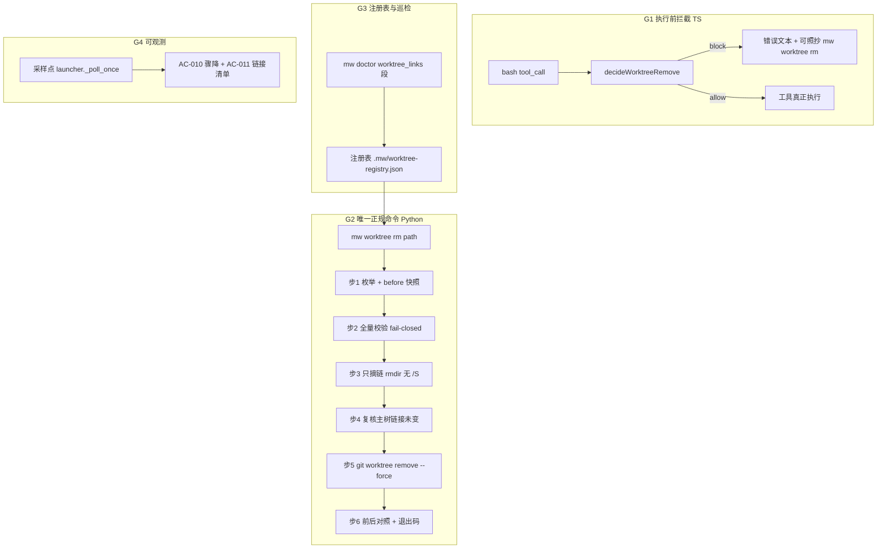
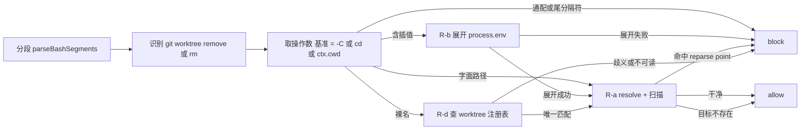

# design — mw-worktree-junction-guard

- key: `mw-worktree-junction-guard` · 阶段: design · 日期: 2026-10-13
- 规格: `spec.md`（AC-001..AC-012，四组 G1..G4）· 目标锚点: `.agenticdoc/goal.md`
- 事实基础（一手，均已独立复核）:
  - `mw-workspace-incident-probe/evidence/incidents-timeline-20261009.md`（**v3**，已吸收独立 QG 的 E1–E13）
  - `mw-workspace-incident-probe/evidence/in1-junction-incident-20261009.md`（穿透机理与最小复现）
  - `mw-workspace-incident-probe/evidence/in2-file-vanish-incident-20261009.md`（受害面与未提交改动）
  - 本阶段三份 RQ 证据：`evidence/research/design-guard-path-resolution-20261013.md`（RQ-D1）、`design-registry-and-worktree-cli-20261013.md`（RQ-D2）、`design-observability-and-verification-20261013.md`（RQ-D3）
  - 必要性复核（三条独立线索）：`evidence/research/design-necessity-rq1-equivalent-guard-20261013.md`（现有 12 道执行前门禁对 `git worktree remove` **全部零命中** ⇒ G1 不冗余）、`design-necessity-rq2-reachability-20261013.md`（今天仍**可端到端得手**，三种模式实测）、`design-necessity-rq3-live-surface-20261013.md`（事故面仍在 + 发现仓库自带触发脚本）
- 环境（全部实测）: Windows `10.0.26100` / PowerShell `5.1.26100.9168` / `git 2.53.0.windows.1` / `node v24.19.0` / `Python 3.14.3`。本仓实测：tracked **4,995**、`*/dist/` **2,239**（全在 `packages/` 下）、non-dist **2,756**、当前 `deleted=0`、`node_modules` reparse point **14** 条（9 条 `@earendil-works/*` + 5 条 `pi-extension-*`）。

## 1. 目标与不变量

**要解决的问题**（一句话）：`git worktree remove --force <path>` 会穿透 path 内的 reparse point，递归删掉**链接目标**（真树）里的文件；2026-10-09 的事故就是这条路径删掉了 8 个包整树 3,300 个已跟踪文件 + `packages/tui` 的 156 个（合计 3,456），并静默丢弃他人未提交改动，约 5.5 分钟内无人报警。

**四条不变量**（AC 的可执行化）：

| # | 不变量 | 对应 AC |
|---|---|---|
| INV-1 | 含 reparse point 的 worktree **没有**任何执行通道能把它连同目标一起删掉：agent 的 `git worktree remove` 在执行前被 block，且 block 文本给出唯一可执行的正规命令 | AC-001/002/003 |
| INV-2 | 唯一正规命令是 `mw worktree rm <path>`，六步固定顺序、不可跳步、任一步失败即中止且保留现场 | AC-004/005/006/007 |
| INV-3 | 对称的 `add` 默认不建链；建链必须登记（目标/时刻/创建者）；`mw doctor` 能报出遗留链且不误报 | AC-008/009 |
| INV-4 | 同类事故可被机器发现：骤降与断链两个判据自动采样、可复算、有反向对照 | AC-010/011/012 |

**必要性复核（2026-10-13，在 spec 之后做的独立复核）**：目标未失效，且比 spec 期更紧急 ——

1. 现有 **12 道执行前门禁**对 `git worktree remove` **全部零命中**（含 worker bash write-scope 的 `git` 子命令词表只有 `checkout|apply|clean|restore`，`worker-mode.ts:1501-1507`）。
2. 端到端实测（faux provider → agent loop → 真 `activate()`）：every-mode / PM / worker **三种模式都能得手**，阳性对照 rc=0。
3. 事故面仍在：仓内 **14 条** Junction + 仓外活雷 `%TEMP%\mwvg-t5\node_modules`，且 `package-lock.json` 恰好 **14 条** `"link": true` —— 结构性对应。
4. 用法仍活跃：会话库记录 worktree 类 bash toolCall 209 次（`remove` 84 次），真仓最近一次在 **2026-10-13**。
5. **新发现**：`scripts/diff-model-catalog.mjs`（`npm run diff:model-catalog`）默认就会 `worktree add` + 建 junction + `worktree remove --force` —— 与事故同构且 **G1 看不见**（见 §3.6）。

**非目标（明确不做）**：不做沙箱。G1 是文本 + fs 启发式（与 `shared/protected-config.ts`、`shared/implementation-gate.ts` 同定位），结构性闭环由 G2 保证；TOCTOU、嵌套 `bash -c`、`commandPrefix`/`spawnHook` 改写等已知绕过面在 §7 逐条列明。

## 2. 架构总览



**落地顺序（硬依赖）**：G2 的 CLI 契约先定（本文件 §4.3），G1 的 block 文本按该契约写死（AC-002 要求"可直接照抄执行"）。G1 与 G2 可并行实现，但必须**同一版本落地**——否则 G1 会把用户导向一条还不存在的命令。G3/G4 依赖 G2 的注册表（AC-009 的登记项）与 G1 的 block trace（分级佐证），排在 G2 之后。

## 3. G1 · 执行前拦截（TS guard）

### 3.1 落点与注册

新文件 `packages/coding-agent/src/extensions/agent-team-loop/shared/worktree-junction-guard.ts`，注册点与三个既有 guard 同位置（`packages/coding-agent/src/extensions/agent-team-loop/index.ts:42/:49/:59`，双加载 flag 之后、PM/Worker 分支之前）——三种模式全覆盖。

可用的 hook 能力（RQ-D1 事实组 1，已复核）：

- `event.input.command` 是模型给出的**原字符串**（`core/tools/bash.ts:41-45` schema 无 transform；`packages/agent/src/agent-loop.ts:617-620` 传的是**校验后**参数）。
- handler 第二参 `ctx.cwd`（`core/extensions/types.ts:307-313`、`core/extensions/runner.ts:309`）。
- handler 可**同步**做 fs：`runner.ts:940-944` 对 handler 只 `await`、**无超时包装** ⇒ 扫描必须自带 entry 预算。
- env 不在 event/ctx 里 ⇒ 读 `process.env`，与 bash 子进程的 `getShellEnv()`（`utils/shell.ts:181-193`）**同源**（差异仅 PATH 与 `PI_*`）。
- `{ block: true, reason }` ⇒ 工具不执行（`agent-loop.ts:619-645` `kind:"immediate"`）；**handler 抛异常同样 = 不执行**（`runner.ts:932-950` 无 try/catch → `core/agent-session.ts:480-498` → `agent-loop.ts:657-661`）⇒ fail-closed 免费获得。
- `ToolCallEventResult` 没有结构化字段（`types.ts:1071-1075`）⇒ 机器可判据只能落在 `reason` 文本 + 自写 trace（照 `shared/protected-config.ts:224-243`）。

### 3.2 接口

```ts
export interface WorktreeGuardVerdict {
  block: boolean;
  reason?: string;   // AC-002：链接路径 + 目标 + 可照抄的 mw worktree rm <path>
  target?: string;   // 解析后的 worktree 绝对路径（审计）
  hits: string[];    // 命中的 reparse point 绝对路径
  basis: string;     // resolved | unresolved:<var> | glob | bare-name-ambiguous
                     // | reparse-point | target-absent | scan-error:<code> | not-remove
                    // | delete-penetration   (D-11: 非 worktree 目标的尾分隔符/通配删除形态)
}
export function decideWorktreeRemove(command: string, cwd: string, env: NodeJS.ProcessEnv): WorktreeGuardVerdict;
export function registerWorktreeJunctionGuard(pi: ExtensionAPI): void;
```

### 3.3 判定流水线



**规则表**（AC-003 的反向对照义务写在同一行）：

| 情形 | 规则 | 反向对照（不得误拦） |
|---|---|---|
| (a) 字面路径 | `path.resolve(base, expandTilde(token))` 后扫描 | 干净 worktree 放行（RQ-D1 probe4 `control-clean-literal` = ALLOW） |
| (b) 含插值 `$env:N`/`${N}`/`$N`/`%N%` | 展开全部拼写（大小写不敏感）+ 命令内前置赋值；**任一变量查不到 ⇒ block** | 可解析的干净 worktree 仍放行（`control-clean-envvar` = ALLOW）；只有"未知变量"小类被拦，该类本身不可判定 |
| (c) 通配 / 尾分隔符 | 含 `* ? [`、**尾分隔符**或命令替换 ⇒ **block**（fail-closed，与流水线图 P3→P6 一致；尾分隔符不按 (a) 剥离） | 依据 RQ-1：`<link>/`、`<link>/*` 正是让"不穿透 API"变穿透的形态，必须拦 |
| (d) 裸名（无分隔符） | 必须查 worktree 注册表（`git worktree list --porcelain`）按 basename/id 唯一匹配；无匹配 ⇒ allow（git 自己 rc=128 拒绝）；歧义/不可读 ⇒ block | 绝对/相对路径不受影响 |

**事故命令的判定链**（形态 b）：`$env:TEMP` 可解析 → `%TEMP%\qg-head` → 扫描命中 `node_modules` junction → **block**（RQ-D1 probe4 `incident-shape-junction` = BLOCK）。

**扫描实现约束（实测）**：

1. `readdirSync(dir, { withFileTypes: true })` + 显式栈；**禁止 `{ recursive: true }`**——实测它会跟进 junction（`probe3`：返回 `linkGood\sub\f.txt`）。
2. reparse point 判定用 `lstatSync(...).isSymbolicLink()`（**断裂链也报 true**，正是 AC-009 语料形态）；`stat`/`existsSync` 对断链不可用。
3. entry 预算（建议 20 万条，推算值）超限即 block，避免同步阻塞 agent 循环（handler 无超时）。
4. 顶层目标不存在 ⇒ **allow**（git 自身 `fatal: ... is not a working tree`、rc=128、零副作用；fixture 实测）；权限/竞态/枚举失败 ⇒ block。
5. **不得复用 worker write-scope 的抽取器**：`extractBashWriteCandidates`（`worker/worker-mode.ts:1044`）只认 `-Path/-LiteralPath/-FilePath/-Destination`，`Remove-Item -Recurse -Force <x>` 与 `cmd /c rmdir /S /Q <x>` 提取 **0 候选**；且对非字面路径（`$env:TEMP\...`）走 `allow-unknown` **fail-open**（`:1602`/`:1616`）—— 即原事故命令即使把 `worktree` 补进它的 git 词表也会漏（RQ-N1 §2.4、RQ-N2 §4-5 实测）。
6. **按命令结构判定，不按词表宽匹配**：`protected-config` 的 `WRITE_VERB_RE`（`shared/protected-config.ts:162`）含 `dd`，PM 的一条只读扫描命令因日期格式字面量 `yyyy-MM-dd` 被误拦 —— G1 的判定必须建立在结构化解析（分段 → 动词 → 操作数）上，而不是单词表命中。

### 3.4 词法器归属（决策 D-3）

`parseBashSegments`（`shared/implementation-gate.ts:361-518`）目前**模块私有**（仓内调用点仅 `:620`），且已实测能原样取出事故 token `$env:TEMP\qg-head`（引号剥离、插值不展开）。

**决策 D-3：下沉为 `shared/bash-segments.ts` 并 `export`**，`implementation-gate.ts` 改为 import。理由：复制一份会留下两套词法漂移（本项目 IN-3 类事故的成因）。代价：`implementation-gate.ts` 被修改 ⇒ 写面冲突风险，必须与其它 key 串行（见 §8）。

### 3.5 边界（决策 D-4）

RQ-D1 暴露：`rm -rf <含 junction 的 worktree>` **不被** `git worktree remove` 规则覆盖（probe4 `plain-rm-junction` = allow）。

**决策 D-4（证据化边界，不做大而全）**：

1. 覆盖 `git worktree remove|rm`（含 `--force`、`-C`、`cd`/`Set-Location` 基准）——事故通道。
2. 覆盖**同一目标树**上的穿透形态 `<path>/`、`<path>/*`（RQ-1 已坐实这些形态会穿透 1 层），无论动词是 `rm -rf` 还是 `Remove-Item -Recurse`。
3. **不**覆盖无尾分隔符/无通配的 `rm -rf <link>`、`rmdir /S`、`robocopy /MIR` 等（RQ-1 已坐实这些默认不穿透）——扩大动词集会引入误拦，收益为零。
4. 现有 `checkBashWriteTarget` 不扩展（它连 `git worktree remove` 都不覆盖，且 `WRITE_VERBS`（`implementation-gate.ts:79`）是写面门禁的语义，不宜复用）。

> **补充（2026-10-13，首轮实现后的更正）**：D-4 第 2 条（`rm`/`Remove-Item` + **尾分隔符/通配**形态）在首轮实现中被 W-05 卡片的"不扩大动词集"一句漏掉——**那是 PM 写卡的错**（把第 3 条的"不扩大"错按到了第 2 条上），worker 按卡实现、无责。更正：
> - 动词集**只**扩到有实测穿透证据的三类：`rm`（含 `-r`/`-rf`）、`Remove-Item`（含 `-Recurse`/`-Force`），**且**操作数带尾分隔符或含 `* ? [`；
> - 命中后走同一扫描与判定流水线；**非 worktree 目标用第二套 block 文本**（列出链 + 处方 `cmd /c rmdir "<link>"`，因为 `mw worktree rm` 只适用于已注册 worktree）；目标是注册 worktree 时仍用 §4.3 模板；
> - 无尾分隔符/无通配仍 **allow**（D-4 第 3 条不变）；`rmdir /S`、`robocopy /MIR` 仍不覆盖。

### 3.6 G1 覆盖不到的触发面：仓库自带脚本（决策 D-9，2026-10-13 用户已确认 ⇒ AC-013）

RQ-N3 实测：`scripts/diff-model-catalog.mjs`（`package.json:28` 的 `npm run diff:model-catalog`）**默认**执行三步与 10-09 事故同构的操作：

- `:148` `git worktree add --detach <临时>/baseline-worktree HEAD`；
- `:155-157` `symlinkSync(repoRoot/node_modules, <wt>/node_modules, "junction")` —— 把 worktree 的 `node_modules` **指回真树**；
- `:233-235` 收尾 `git worktree remove --force <wt>`。

它不经 agent 的 bash 工具（脚本内 `run("git", ...)` 起子进程）⇒ **G1 的 `tool_call` hook 天然看不见**，AC-001..AC-012 **一条都不覆盖**：一次 `npm run diff:model-catalog` 就可能穿透两层到 `packages/**`。（PM 已逐行复核这三处。）

**PM 建议（决策 D-9）**：把"修这条脚本"升为规格级新增项（AC-013），最小修法二选一：

- **(a) 摘链后再 remove**：在 `worktree remove` 之前用 `cmd /c rmdir <wt>\node_modules`（无 `/S`、无尾分隔符）摘链 —— 与 G2 步 3 同一原语；
- **(b) 不建链**：worktree 内改跑 `npm ci --ignore-scripts`（与决策 D-6 的 `add` 默认路径一致），代价是数 GB 下载。

推荐 **(a)**（最小改动、保留脚本原有语义、零下载），并加一条自检：`remove` 前断言 `<wt>` 内无 reparse point（复用 G1 的扫描函数）。

## 4. G2 · 唯一正规命令 `mw worktree rm <path>`

### 4.1 落点

`packages/multi-workers/mw.py`：一级 `sub.add_parser("worktree", ...)` 插在 `:5853`（`ue-toolchain`）之前，二级 `add_subparsers(dest="worktree_action", required=True)`；`cmd_worktree` 走 **if-chain**（照 `cmd_autopilot:3557`），**不用** `_RAG_ACTIONS` dict（`rm` 的错误文本要带"第几步"，if-chain 更易逐级返回）。退出码 0/1，错误一律 `[mw worktree <action>] Error: ...` 到 stderr（约定原文 `mw.py:625-629`）。

> **行号漂移警告（RQ-D2 §0，已被 PM 复核）**：卡与 spec 期证据里的行号是 2026-10-09 的旧修订。当前 HEAD 实测：`_parse_args` 在 `mw.py:5603`（+279）、dispatch dict `:5949-5969`（+310）、`cmd_doctor` 注入段 `:522-532`（0）、`doctor_report` 在 `mw_common.py:3624-3664`（+667）、`_doctor_issues` `:3401`（+621）、`format_doctor_text` `:3666`（+667）。**实现者一律 grep 函数名，不照抄数字。**（PM 独立复核了其中 5 个锚点。）

### 4.2 六步事务（必须同一进程、同一次调用）

| 步 | 动作 | 实现要点 | 为什么必须同进程 |
|---|---|---|---|
| 1 | 枚举 worktree 内 reparse point + 主树 before 快照 | 显式栈、命中不下钻；主树快照 = `node_modules/@earendil-works/*` 的规范化 `(link, target)` 集合 | before 快照必须早于任何变更 |
| 2 | 校验目标（AC-006） | **全量**判定后才能进入步 3；任一不合格 ⇒ 一条链都不摘 | 与步 3 共享同一份冻结列表 |
| 3 | 只摘链 | `os.rmdir(link)`（Windows `RemoveDirectoryW`，实测只摘链不穿透）；**禁 `/S`** | 步 2 与步 3 之间不允许其它进程介入 |
| 4 | 复核主树链接逐条未变 | 与步 1 的 before 快照**逐条比较** | 必须同一份内存快照；落盘再读会引入"死在摘链与复核之间"的窗口 |
| 5 | `git worktree remove --force` | `_git([...], cwd=repo_root)`（`mw.py:4097`），**只认步 4 的判定** | — |
| 6 | 打印前后对照 + 退出码 | before/after 链接表 + 已摘链条目 | 对照的 before 来自步 1 |

**控制流纪律（写进实现约束）**：

1. 中止 = 逐级 `return 1` + `ABORT at step N/6` + 明确打印"未降级继续"；**没有** `try/finally` 补偿写、**没有**"把剩下的链摘完"。
2. `mw worktree rm` **不接受**任何跳过某一步的开关（无 `--force`/`--continue`）；需要手工介入时，输出里给的是可照抄的 `cmd /c rmdir "<link>"`（禁 `/S`）。
3. 步 2 与步 3 之间**零写入**：`links` 是步 1 冻结的列表。
4. 范本：`_toolchain_run`（`mw.py:966-1058`）的"前置快照 → 动作 → 后置快照 → drift 判定 → 打印对照 → `0 if ok else 1`"；`_cmd_rag_init:2205-2216` 的"先全量判定、一条都不写"。
5. 建议加 `--json`（机器出口，供 AC-004..007 断言）。

### 4.3 CLI 契约（G1 的 block 文本与 G2 必须逐字一致）

```
mw worktree add <path> [--project DIR] [--ref REF] [--link-deps] [--dry-run] [--json]
mw worktree rm  <path> [--project DIR] [--json]
mw worktree list [--project DIR] [--json]        # 只读：注册表 + git worktree list 合并视图
```

AC-002 的 block 文本模板（G1 侧写死，`reason` 单行可照抄）：

```
[mw-worktree-guard] blocked: <worktree> 内有 N 个 reparse point（示例 <link> -> <target>）；
直接执行 git worktree remove 会穿透并删除目标真树内容。请改用：
  mw worktree rm "<worktree>"
```

### 4.4 AC-006 的三分类（决策 D-1，2026-10-13 用户已确认）

AC-006 字面「链接目标在仓库外 ⇒ 拒绝」会与 G1 死锁：在**仓库外**创建的 worktree 跑 `npm ci` 后，它自己的 `node_modules/@earendil-works/*` 指向 `<worktree>/packages/*`（目标在仓库外但完全无害）；字面规则会拒掉它，而 G1 又拦裸 `git worktree remove` ⇒ 无路可走。

**PM 建议（决策 D-1）**：把 AC-006 的判据改成三分类，AC 的本意（"不可归类的指针一律 fail-closed"）完整保留：

| 链接目标 | 语义 | 动作 |
|---|---|---|
| 落在 `repo_root` 内 | 危险但有解（事故形态：指回真树） | 摘链 → 步 4 复核 → 才 remove |
| 落在被删 worktree 子树内 | 无害（`npm ci` 自指链） | 摘链即可 |
| 其它（两者之外） | 不可归类 | **fail-closed 拒绝，一条链都不摘**（AC-006 原文） |

三个形态都有实测语料：`@earendil-works/*` 全 9 条 `inside_repo=True`；`%TEMP%\mwvg-t5\node_modules` 的目标 `\\?\H:\git\Multi-Workers\node_modules` 也 `inside_repo=True`；仓库外 worktree 的自指链是 RQ-D2 §4.3 的推断（高置信，未实测——见 §7）。

## 5. G3 · 注册表与 `mw doctor`

### 5.1 注册表（`packages/multi-workers/mw_common.py`）

- 落点 `<project>/.mw/worktree-registry.json` + 锁 `<project>/.mw/worktree-registry.lock`（`.gitignore:53` 整目录忽略 ⇒ 零额外规则；`.mw/` 已放 `dispatch.yml`/`window-model`/`toolchain.json` 等配置型状态）。
- 格式：`{version, entries[{link, target, worktree, repo_root, created_at, created_by}]}`（AC-008 点名的三项：`target`/`created_at`/`created_by`）。
- API：`worktree_registry_path` / `worktree_registry_lock` / `read_worktree_registry`（缺文件 ⇒ `[]`；坏文件 ⇒ 抛错，**绝不静默当空表**）/ `register_worktree_link` / `unregister_worktree_link`。
- 写入 = 锁 + 校验 + upsert + tmp + `os.replace` + 读回验证（照 `_write_workers_file:2063-2075`；`open("w")` 先截断会把文件写空）。
- 锁**直接复用** `mw_common.acquire_lock:2039` / `release_lock:2054`（`O_CREAT|O_EXCL` @ `:2044`）+ `conductor.lock_file:137-139` 的命名规则（新锁名 `worktrees`）；TS 对端已有同协议 `shared/file-lock.ts:12-43`。**不新写锁实现**。
- `mw worktree rm` 步 5 成功后 `unregister_worktree_link`；`add --link-deps` 建链成功后 `register_worktree_link`。

### 5.2 `mw doctor` 新段（AC-009）

**挂载点（RQ-D2 最容易被做错的一点）**：新检查必须写在 `mw_common.doctor_report`（实测 **`mw_common.py:3748`**）**内部**，注册为 `report["worktree_links"]`；issue 进 `_doctor_issues`（实测 **`mw_common.py:3525`**，格式同 `queue-burst-shape`）；文本行进 `format_doctor_text`（实测 **`mw_common.py:3790`**，条件成立才打印）。**不能**走 `mw.py:522-526` 的注入段——那里的 `report` 在 `:522` 就返回了，`_doctor_issues` 已在 `mw_common.py` 里跑完，注入段**注定**只能 informational（这正是 conductor/rag 两段的语义来源；PM 已复核）。

> 行号漂移（2026-10-13 实测，卡/旧证据里的 `:3624-3664`/`:3401`/`:3666` 是旧修订）：`_doctor_gates` 在 `mw_common.py:3407`、`_doctor_issues` 在 `mw_common.py:3525`、`doctor_report` 在 `mw_common.py:3748`、`format_doctor_text` 在 `mw_common.py:3790`。实现前 grep 函数名。

> **循环导入（W-03 的实际障碍）**： `worktree_registry.py:37` 顶层 `import mw_common` ⇒ `mw_common` 顶层不能 import 新模块。做法：在 `doctor_report` 内用**函数内 import**（单一处，带注释说明循环），下游 `_doctor_issues`/`format_doctor_text` 只读 `report["worktree_links"]` 字典，不再 import；并加一条 `python -c "import mw_common"` 的循环回归测试。

若评审决定 AC-009 只要求"可见"、不翻转退出码，则注入段可接受——但 design 必须显式写明这个降级。**PM 建议：挂内部段**，因为 AC-009 的语料锚点是"遗留链"，而遗留链正是事故前夜的状态，静默的 informational 段等于没有护栏。

**域与成本（实测）**：

| 域 | 规模 | 耗时 | 覆盖 |
|---|---|---|---|
| `<root>/node_modules/@earendil-works/*` | 10 条（9 junction） | 0.05 ms / 0.95 ms（含 readlink + 仓库内判定） | 事故的 9 条链；**漏 `pi-extension-*` 5 条** |
| `<root>/node_modules/*` 顶层 | 229 条（14 reparse） | 1.97 ms | **推荐默认域**：全部 14 条 workspace 链 |
| 全仓剪枝遍历 | 43,412 条目 / 4,162 目录 | 0.28 s | 仓库内任意位置（`--deep`） |
| `%TEMP%` 定点 / depth-1 | 72,548 顶层条目 | 1.19 s / 5.39 s | 活雷猎捕域；**不入默认路径** |

### 5.3 AC-009 的判定域（决策 D-2，2026-10-13 用户已确认）

AC-009 说"报出**指向仓库内**的 junction"——而事故的真雷（`%TEMP%\mwvg-t5\node_modules`）**链接在仓库外、目标在仓库内**。所以"域"有两个维度：链接在哪、目标在哪。

**PM 建议（决策 D-2）**：

| 层 | 域 | 默认 |
|---|---|---|
| (a) 注册表域 | `<project>/.mw/worktree-registry.json`（W-02 实测落点）的每条登记项（`link` 可在任意位置，含 `%TEMP%`）：`link` 仍在而 `worktree` 已不在 ⇒ `leftover`；`link` 已不在 ⇒ `stale-entry` | **默认开** |
| (b) 仓库内域 | `<repo>/node_modules/*` 顶层 reparse point，目标规范化（剥 `\\?\` 前缀）后落在 `repo_root` 内 **且不在 `package-lock.json` 的 `"link": true` 期望集内** ⇒ `leftover`；在期望集内 ⇒ 正常 workspace 链，**静默**（1.97 ms） | **默认开** |
| (c) 全域猎捕 | 显式开关（如 `mw doctor --worktree-scan-roots <dirs>`，depth-1 `\<wt>\node_modules` 形态），不入默认路径；**跳过 worktree 仍存活的已登记链**（决策 D-12）—— 只报 worktree 已消失或未登记的链 | 默认关 |

理由：注册表 + 仓库内两域在默认路径上近零成本（合计 ~2 ms）且覆盖**所有经 `--link-deps` 建链的**遗留；未被登记的 `%TEMP%` 孤儿链（正是 mwvg-t5 的形态）只能靠 (c)，但 5.39 s、域无上界，不适合默认。**这同时是 AC-009 的"反向对照"保证**：`count==0` 时不打印任何行、不产生 issue。

**判据修正（决策 D-10，2026-10-13 PM 实测）**：D-2 字面规则“`<repo>/node_modules/*` 顶层链，目标在 `repo_root` 内 ⇒ `leftover`”**在本仓必然误报** —— PM 剥 `\\?\` 前缀后实测：顶层 reparse point 5 条（`pi-extension-*`），**5/5 目标都落在仓内**（指向 `packages/coding-agent/examples/extensions/*`）⇒ `mw doctor` 永远红，与 AC-009 自己的反向对照（干净仓库 `count==0`、零行输出、rc 不变）矛盾。因此 (b) 的判据改为**减期望集**：`package-lock.json` 的 `"link": true` 集合（实测恰好 14 条，与磁盘 14 条逐条同名同目标）为正常态，不报；不在集合内的仓内顶层链才报。

## 6. G4 · 可观测

### 6.1 AC-010「已跟踪文件数骤降」

**数据源（RQ-D3 的头号发现）**：**不能**用 `git ls-files`（只读索引，磁盘文件被删后计数不变：实测 6→6、合成仓 5001→5001）。正确原语 = `git -C <root> --no-optional-locks ls-files -d -z`（索引有、磁盘无）。

```
范围面 : 排除 dist（照 mw.py:4504 的路径面 glob 惯例）；本仓 dist=2,239（占 packages/ 58.5%），
        "npm run clean --workspaces" 会让总 D 飙到 ~2,170 ⇒ 不排除 dist 必然误报
采样点 : launcher._poll_once（launcher.py:1706），每 6 次 poll（poll 5 s ⇒ 窗口 30 s）
        可由 PI_TREE_WATCH_SEC 覆盖，0 = 关闭
状态   : <root>/.mw/tree-watch.json = {ts, tracked, deleted_non_dist, deleted_paths[<=50], link_inventory}
判据   : ΔD = deleted_non_dist(t) - deleted_non_dist(t-1) >= max(20, 1% * tracked_non_dist(t))
         且 deleted_non_dist(t) >= 20；百分比取四舍五入（round-half-up），不用 ceil
本仓   : tracked_non_dist 实测 2,756（design 期）⇒ 28；实现期并发会话已漂到 **2,822** ⇒ 亦为 28
         （均取 round-half-up：1%*2756=27.56→28、1%*2822=28.22→28；若用 ceil 则 2,822 会得 29，
         与 AC-010 的判据文本不一致——实现按公式实时计算，不硬编码基数，见 T-W04 证据）
事故   : 9 包 non-dist ≈ 1,363（今日构成推算）⇒ 约阈值 49 倍；总口径 3,456 ⇒ 123 倍
动作   : (1) stderr 一行 [TREE-WATCH] deleted=… non_dist=… delta=… links=…（照 launcher.py:1277 形状，
             进 .mw/launcher.log）(2) 事件落盘（自清后仍可回溯）(3) 同窗口 link_inventory 也有 delta
             ⇒ 升级为 issue（mw_common.py:3401），mw doctor rc=1
```

**不误报的实测依据**：单文件编辑 ΔD=0；一次 commit ΔD=0；切分支 ΔD=0（tracked 变、`-d` 不变）；`git rm -r <pkg>` ΔD=0（索引同步）；新增 untracked ΔD=0；排除 dist 后 `npm run clean --workspaces` ΔD=0。**任何用"tracked 总数"做判据的方案都会误报切分支**（180↔200）——这是必须用 `-d` 的硬理由。

**事件语义**（不得只看当前状态）：夹具实测 `git checkout -- .` 后 `deleted 5→0` ⇒ 判据会随恢复归零，而恢复**不会**复原已发生的事故（`npm install` reify 重建的 8 条链是新链接，链清单"路径相同、目标相同"从而不可区分）⇒ 必须持久化"采样时刻 + 观测值 + 迁移"。

### 6.2 AC-011「junction 目标丢失」

- **语言选择（决策 D-8）**：权威实现放 **Python**——Node `lstatSync` 对 junction 报 `isSymbolicLink()=true`、`isDirectory()=false`，且 `Stats` 上 `fileAttributes`/`reparseTag` 都是 `undefined`（实测），TS **判不出** junction vs symlink。Python 侧 `os.path.isjunction=True` / `islink=False` / `st_reparse_tag=2684354563`；`os.readlink` 带 `\\?\` 前缀须剥。
- 判据 1（断链）：`link_type == "Junction" and not target_exists` ⇒ 触发（给出 path + target）。
- 判据 2（清单迁移）：上一样本存在的 link 在本样本消失，或 target 变化 ⇒ 触发（覆盖 v2 的漏报面："只剩 1 条链无人报警"）。
- 代价：`@earendil-works/*` 0.5 ms；整根 `node_modules` 185–195 ms ⇒ 可挂在同一个采样点。
- 反例区分：`Test-Path <link>` 对链接本身恒 `True`，**不能**当"目标完好"；真目录（`LinkType` 空）忽略；`SymbolicLink`（tag 0xa000000c）单独标记但默认不触发（git 不穿 symlink，尾分隔符/通配形态才穿一层）。

## 7. 风险、未坐实与已知绕过面

**未坐实（本阶段，逐条来自三份 RQ 证据，按对设计的影响排序）**：

| # | 未坐实项 | 处置 |
|---|---|---|
| 1 | **AC-006 三分类与 AC-009 域是本 RQ 唯一会让规格自相矛盾/失效的点**（RQ-D2 §D-rm、§3.3） | 决策 D-1/D-2 需用户/评审拍板；本文件给出 PM 建议 |
| 2 | `npm ci` 在 worktree 里的实际产物（"自指链"）是推断 | design 已按三分类容纳；实现期用 `%TEMP%` 夹具实跑一次 `npm ci`（可选，数 GB/网络）或按主树形态外推并标注 |
| 3 | G2 命令当前**不存在**（`mw.py` 的 `worktree` 命中只有 `:5335`/`:5360` 两处只读 docstring，无子命令 ⇒ AC-002 的文案此刻指不到可执行命令） | 硬依赖 §2 的落地顺序（G1/G2 同版本） |
| 4 | 扫描性能与 entry 预算（20 万条）是推算；真树损坏态下 `git ls-files -d` 代价是线性外推 | 实现期在 AC-012 夹具顺带计时；阈值参数化 |
| 5 | `os.rmdir` 摘链只在 Python 3.14.3 + 本机 NTFS 实测；`--link-deps` 若用 symlink 需要特权（未测低特权环境） | 优先 junction；`--link-deps` 的目标选择（主树 `node_modules` vs 逐包链）待实现期定 |
| 6 | 多 worktree 并发 `rm` 的注册表竞态未实测；git 采样命令可能刷新 `.git/index`（未观测到，但文档允许） | 采样统一 `--no-optional-locks`；并发按 `.mw/worktree-registry.lock` 串行 |
| 7 | 事故当时的 per-package dist/non-dist 拆分未从一手证据反推（阈值对比用今日构成） | 已标注"推算"；阈值本身不依赖事故数值 |
| 8 | 祖先目录是 junction、嵌套 `bash -c`、`commandPrefix`/`spawnHook`、引号态感知、shell 家族（WSL/PowerShell）未判定 | §7 已知绕过面，逐条列入 AC-006 的边界声明；不做结构性承诺 |

**已知绕过面（明确不承诺闭环）**：TOCTOU 窗口；`bash -c "…"`/heredoc 载荷不被 `parseBashSegments` 展开；`commandPrefix`/`spawnHook` 在 handler **之后**才生效（`core/tools/bash.ts:369-370`）；非 Windows 形态未测。G1 是"提高成本 + 阻断事故形态"，不是沙箱——结构性闭环由 G2 的六步事务承担。

**AC-003 误拦的可接受面**：未知变量、裸名歧义、注册表不可读三类会被 fail-closed 拦下；三类都不可判定，代价可接受，但**必须在测试里各有反向对照用例**（`unknown-var` = BLOCK、`control-clean-literal`/`control-clean-envvar` = ALLOW）。

## 8. 写面切分（同一文件同一时刻只允许一个 worker）

| 写面 | 归属 | 备注 |
|---|---|---|
| `packages/coding-agent/src/extensions/agent-team-loop/shared/worktree-junction-guard.ts`（新） | G1 | 唯一新文件 |
| `packages/coding-agent/src/extensions/agent-team-loop/shared/bash-segments.ts`（新）+ `shared/implementation-gate.ts`（改 import） | G1 | 决策 D-3；改既有文件 ⇒ 与其它 key 串行 |
| `packages/coding-agent/src/extensions/agent-team-loop/index.ts`（注册一行） | G1 | 三 guard 同位置 |
| `packages/multi-workers/mw.py`（`worktree` 子命令 + `_npm_hydrate` 抽出） | G2/G3 | 决策 D-6：抽 `_npm_hydrate(target_root)`（把 `:4966` 那 3 行搬走）供 `cmd_bootstrap` 与 `add` 共用；`add` 默认走 `npm ci --ignore-scripts` |
| `packages/multi-workers/mw_common.py`（注册表 API + doctor 段 + issue + 文本行） | G3 | 决策 D-5：挂 `doctor_report` 内部（可翻转退出码） |
| `packages/multi-workers/launcher.py`（采样钩子 + 告警） | G4 | 决策 D-7：`_poll_once` 每 6 次 poll |
| TS 测试（`packages/coding-agent/test/suite/regressions/<issue>-worktree-junction-guard.test.ts`） | G1/G4 | faux provider + `BashOperations` recorder 证明"命令未执行" |
| Python 测试（`packages/multi-workers/test_worktree_*.py`） | G2/G3/G4 | `%TEMP%` 夹具，禁碰真树 |

## 9. 验证计划（AC → 证据）

| AC | 判据 | 夹具/手段 | 反向对照 |
|---|---|---|---|
| AC-001 | 含链 worktree 的 `git worktree remove` 执行前被 block，命令未运行 | TS suite：faux provider → agent loop → `ExtensionRunner.emitToolCall` → `{block,reason}`；`BashOperations` recorder 证明零执行（范式 `test/suite/xkey-gate-guard-coverage.test.ts:124/:131`） | 无链 worktree 同路径不 block |
| AC-002 | `reason` 含链接路径 + 目标 + 可照抄命令 | 断言文本含 `mw worktree rm "<path>"`（与 §4.3 契约逐字比对） | — |
| AC-003 | 干净 worktree 不被误拦 | `decideWorktreeRemove` 纯函数 17 例矩阵（RQ-D1 probe4 的 `control-clean-literal`/`control-clean-envvar`） | `unknown-var`/`glob`/`bare-name-ambiguous` = BLOCK |
| AC-004 | 六步顺序固定、不可跳步 | Python 夹具驱动 `mw worktree rm --json`，断言步序与步号 | 步 2 失败 ⇒ 无任何链被摘 |
| AC-005 | 只摘链、主树零损伤 | manifest（`git ls-files -z` + sha256 + size + mtime）before/after | 阳性对照（unsafe remove）必须非零变化 |
| AC-006 | 仓库外目标 fail-closed、不摘任何链 | `%TEMP%` 夹具造"worktree 外目标"链 | 三分类各自一个用例（决策 D-1） |
| AC-007 | 任一步失败中止 + 打印"未降级继续" | 注入失败（步 3 rmdir 失败、步 4 快照不等） | 断言 `git worktree remove` 未被调用 |
| AC-008 | 默认不建链；`--link-deps` 登记三项 | 断言 `add` 默认无 junction；登记项含 `target`/`created_at`/`created_by` | 不建链时不写注册表 |
| AC-009 | 报出遗留链 + 不误报 | (a) 注册表域夹具 + (b) 仓库内域夹具（`node_modules/*` 顶层）；正向语料 = mwvg-t5 形态 | 干净仓库 `count==0`、零行输出、rc=0 |
| AC-010 | 骤降触发 / 正常波动不触发 | 合成仓 5,000 tracked 删 3,000 ⇒ `-d` = 3,000 行；阈值 28 | 单文件编辑/commit/切分支/`git rm -r`/`npm run clean` ΔD 全 0 |
| AC-011 | 断链触发 / 完好链不触发 | `%TEMP%` 内 `goodlink`/`brokenlink`/`realdir` 三类（RQ-D3 F4 语料） | 完好链与真目录均不触发 |
| AC-012 | 端到端：新流程清理后主树内容与 mtime 零变化 | 夹具 `%TEMP%\wjg-<key>-<n>\{A,B}`：A = 假真树（git init + packages + `node_modules/@scope/*` 链），B = `git worktree add` + `B\node_modules -> A\node_modules` 双层链；阳性对照 = 直接 `git worktree remove --force`（应看到 A 侧 5/6 tracked 消失、3 条链清零）；阴性对照 = 六步前 5 步（manifest 的 `removed/added/content_changed/mtime_changed/missing_after` **全 0**） | 两向都必须跑；清理用"先逐条 `cmd /c rmdir`（无 `/S`、无尾分隔符）再 `rmdir /S /Q <root>`" |

| AC-013（决策 D-9，用户已确认） | 修 `scripts/diff-model-catalog.mjs`：`git worktree remove` 前摘链（或改为不建链） | 夹具内跑该脚本的等价流程，断言真树 manifest 的 `removed/added/content_changed/missing_after` 全 0（复用 AC-012 的 manifest 原语） | 阳性对照：**现行**脚本在夹具内必须能复刻事故（否则夹具不成立） |

**夹具硬约束**：所有链接目标必须在夹具目录内（**绝不指回真树**）；清理走不穿透形态；真树只读（`scandir`/`lstat`/`readlink`/`git ls-files`），禁 `checkout`/`reset`/`clean`/`worktree remove`/`rm`。

## 10. 未覆盖面声明

- 本 design 未实现任何代码；三份 RQ 证据里的原型（TS 原型、Python 探测脚本）都只在 `%TEMP%` 存在过并已随夹具删除，实现需按本文接口重写。
- 未测非 Windows 平台、WSL bash 语境、`commandPrefix`/`spawnHook` 的真实配置使用、云占位符等非 junction 的 reparse tag、多 worktree 并发。
- 未在真树跑任何 before/after 清单（AC-012 只保证夹具内零变化；真树是多会话共享树，端到端零变化需要静默窗口）。
- 行号以本文件与三份 RQ 证据的实测值为准，实现前再 grep 一次函数名。

## 附：2026-10-14 对抗性审计派生补充（D-17/D-18/D-19/D-20）

来源 `evidence/delta-adversarial-audit-20261013.md`（方法 = 对抗性证伪，43 条攻击向量）。本节只补**坐标与判据**，不改前文结构：

- **D-17（AC-015 裂缝）**：`worktree_registry.read_registry` 的存在性门从 `path.exists()` 改为 `os.path.lexists()`；悬空符号链接 ⇒ `lexists` 真 ⇒ `read_text` 抛 `FileNotFoundError` ⇒ 折入 `WorktreeRegistryError` ⇒ `worktree_doctor._registry_domain` 的 `registry_error` ⇒ `mw_common._doctor_issues` + `format_doctor_text` 的 `REGISTRY-ERROR` 行 + rc。判据仍是 §5.1「坏文件 ⇒ 抛错，绝不静默当空表」。
- **D-18（AC-016 多标记）**：`ACTIVATION_MARKER` 升级为标记集合 `("reparse-point", "user_bash")`；`_activation_scan` 逐标记记录存在性，`has_marker` = 全部存在；issue/文本行须指明**缺失的是哪一个**标记，修复提示仍为 `mw build --install`；照旧 fail-open-to-verdict（`None` ≠ 已激活）。理由：单标记只覆盖判定面，删掉 `pi.on("user_bash")` 挂钩时仍会假绿。
- **D-19（D-11 动词/基准面补全）**：§3.5 的删除穿透形态判定，头词白名单扩为 `rm|remove-item|ri|del|erase|rd|rmdir`；§3.2/§3.3 的基准跟踪（`readLocationTarget`）扩为 `cd|set-location|pushd|sl|chdir` 且跳过 cmd 风格 `/d`、`/D` 与 PS `-Path`/`-LiteralPath` 的值位。**不动**「非 worktree 目标的删除穿透」谓词（递归 + 尾分隔符/通配 + 非 `notRemove`）与处方文本形态。
- **D-20（边界确认，不变更设计）**：`\<LF>` 续行拼接、头部/子命令位插值、`bash -c`/`cmd /c`/`env` 前缀包装、PS 反引号转义 —— 归入 §3.3 已声明的「静态不可判定 / 嵌套解释器 / 刻意混淆」边界；由 `achieved.md` 遗留 1 承接（本轮把 W-15 新枚举的 4 条并入该清单）。
