# 当一个 Agent 不够用：Multi-Workers 里的三层循环（Agent Loop / Autopilot / Decide）

> 面向公开的技术博客 · 讲清楚一套「单进程 Agent → 多 Worker 编排 → 决策入口」的分层机制是怎么咬合的
>
> 决策层按最新收敛设计（`mw-dp-consolidation`，设计已批准、代码迁移进行中）描述；运行细节以仓库当前版本为准。
>
> 配套阅读：[MW + AgenticTask + Autopilot 三层机制图解](./mw-agentictask-autopilot-layered.md) · [决策闭环设计](./decision-loop-design.md)

## 引子：真正的瓶颈不是「不会做」，而是「停下来等人」

单个 LLM Agent 干一件长任务，会撞上两堵墙：

1. **上下文溢出**——对话越长，窗口越挤，早期信息被压缩或丢弃；
2. **无法并行**——一条推理链只能串行推进，遇到需要分头调查的子问题无能为力。

Multi-Workers 的解法是「一个 PM Agent 管多个 Worker Agent 并行做同一个项目」。但当「1 个 PM + N 个 Worker」真的跑起来，瓶颈悄悄发生了位移：

> 实测最高频的失败不是「做不出来」，而是 worker 终态里的 `needs-clarification`（占 17.4%，42/242），加上大量 mid/high 风险的 `[CHECKPOINT]`——**Agent 停下来等人**，一次等人平均十几分钟，累计近百分钟。

于是设计目标从「让 Agent 更能干」变成「让 Agent 少等人，且该判断的地方有明确、可审计的判断入口」。围绕这个目标，代码里长出了三层嵌套的循环。

---

## 全景：三层循环各管一件事

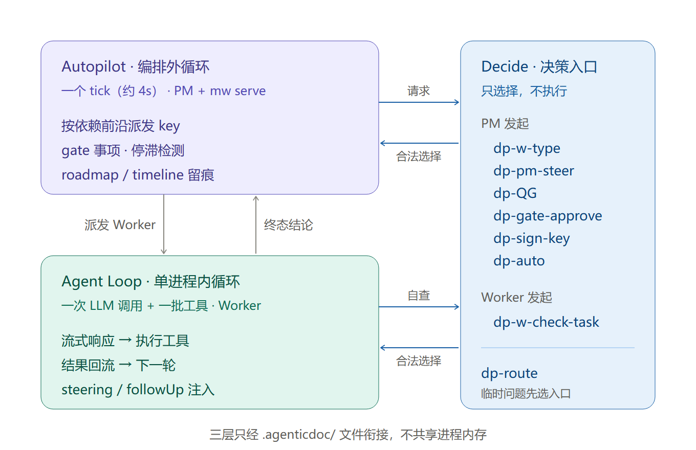

| 层 | 循环单位 | 谁在转 | 解决什么 |
| --- | --- | --- | --- |
| **Agent Loop**（内循环） | 一次 LLM 调用 + 一批工具调用 | 单个 pi 进程 | 「这一步该调哪个工具、结果怎么接回去」 |
| **Autopilot**（外循环） | 一次跨 key 的编排 tick | PM 进程 + `mw serve` 后台 | 「哪些任务并行跑、跑到哪了、卡在哪」 |
| **Decide**（决策层） | 一次决策请求 | 调用方 → decide → decision model | 「这个分支选哪条，凭什么选」 |

关键变化：**决策不再是「等人信号上浮后再看能不能自动答」，而是在固定业务节点上直接调用对应入口**——PM 派发时、Worker 自查时、gate 审批时、key 签收时。三层靠 `.agenticdoc/` 文件衔接，不共享进程内存。

---

## 第一层：Agent Loop —— 一个「LLM ↔ 工具」的纯内循环

最底层是 `packages/agent/src/agent-loop.ts`，它只做一件事：把「模型出工具调用 → 执行 → 结果喂回去 → 再问模型」这个环转到没有工具可调为止。核心是一个双层 `while`：

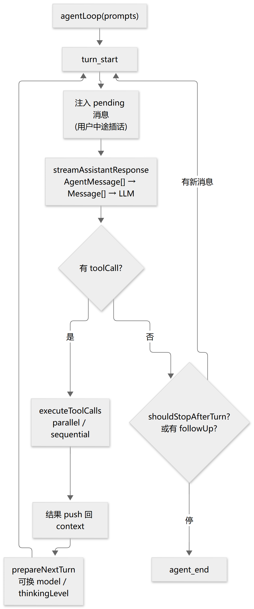

mermaid 源码

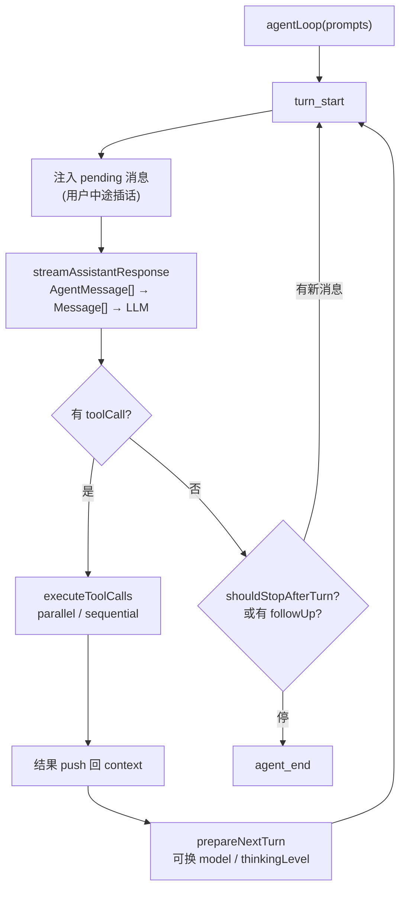

几个值得注意的设计点：

- **`AgentMessage` 与 `Message` 分离**。内部用可扩展的 `AgentMessage`，只在 LLM 调用边界用 `convertToLlm` 转成 `user/assistant/toolResult`，应用私有消息不污染协议。
- **截断保护**。`stopReason === "length"` 时工具参数可能残缺，**一个工具都不执行**，全部判错让模型重发。
- **工具并行 vs 串行**。默认并行；任一工具声明 `sequential` 则整批串行。`beforeToolCall` / `afterToolCall` 是守卫与决策工具挂载的钩子点。
- **steering / followUp 两个注入口**。这是内循环与外循环衔接的缝。

> 内循环不关心「任务对不对」「该不该做」，它只保证「这一轮的工具调用被正确执行并回流」。

---

## 第二层：Autopilot —— 跨 key 的编排外循环

当 PM 要同时推进十几个 AgenticTask key，就需要一个**外循环**：每 4 秒一个 tick，读一遍磁盘上的全部状态，决定这一轮派发谁、收敛谁、卡住谁。它的哲学是**无状态、纯读文件派生**——进程崩了重启，只要文件在，视图就一致。

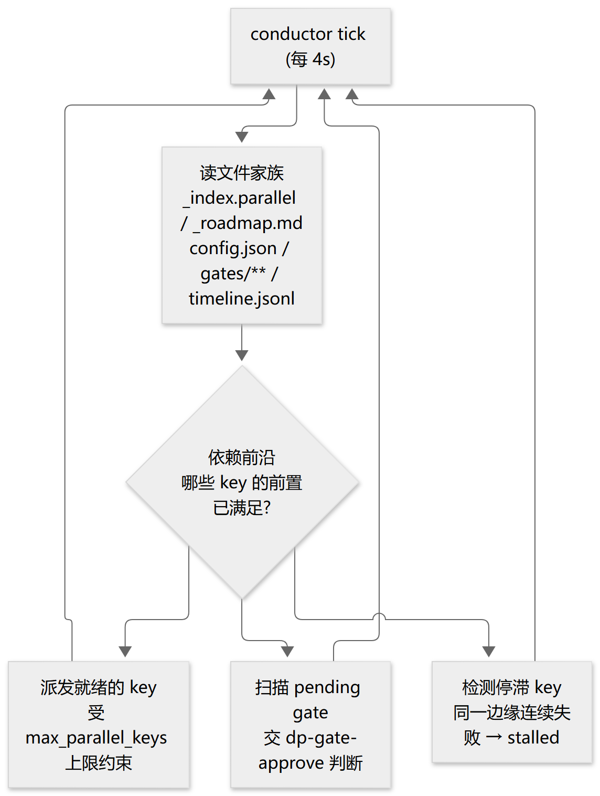

mermaid 源码

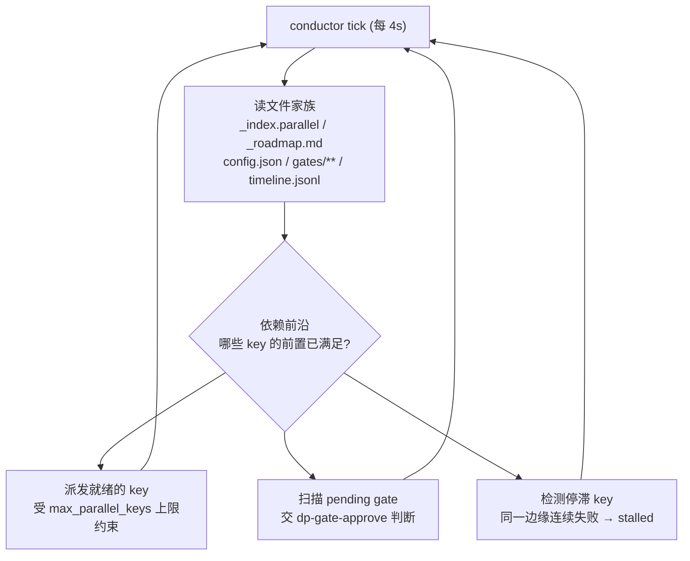

| 机制 | 作用 | 口径 |
| --- | --- | --- |
| **依赖前沿** | 只有前置 key 为 `done`/`closed-legacy` 才释放下游 | `DEP_SATISFIED_STATUSES` |
| **并发上限** | key 层与 per-key 层各一个上界，取 `min` | `max_parallel_keys` × `max_workers_per_key` |
| **轮次预算** | 四种循环族各自计数，取最耗的作约束 | `round_budget` |
| **停滞检测** | 同一边缘连续失败 N 次 → `stalled`，不再派发 | `stallThreshold` |

外循环的状态全部落在 `.agenticdoc/_autopilot/` 下：`_roadmap.md`（路线图）、`gates/`（待审批事项）、`timeline.jsonl`（事件时间线）。monitor 面板是纯只读视图。

> 外循环回答「全局推进得怎么样」，但不回答「这个具体分支该怎么选」——那是第三层的事。

---

## 第三层：Decide —— 把「等人」收敛成 8 个决策入口

### 从 25 个编号到 8 个职责

早期做法是把每一处「会停下来等人」的位置注册成一个编号决策点（dp1..dp25），但真正接进流程的只有少数几个，其余只注册、不触发。问题很快暴露：编号多、职责交叠，调用方不知道该问谁；接没接线全靠记忆。

最新设计把它收敛成 **8 个按职责命名的入口**：6 个固定业务节点 + 2 个通用能力。旧编号只作只读历史，**不保留可调用别名**。

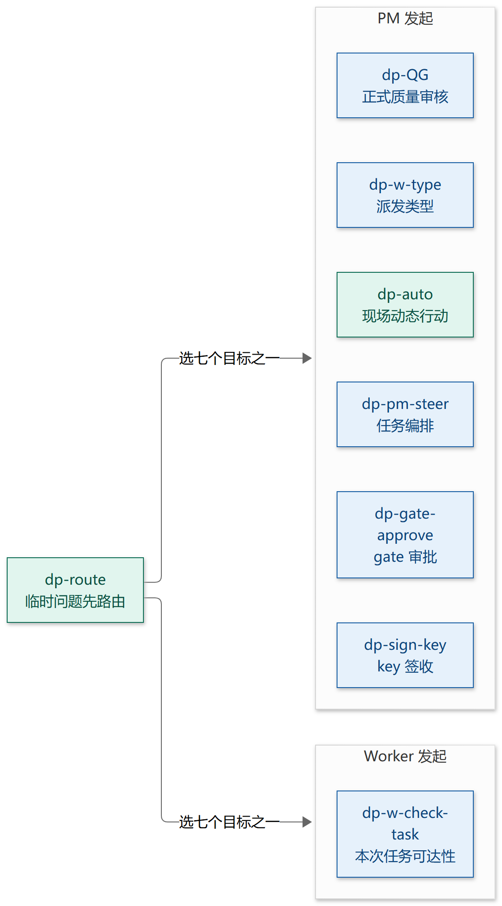

mermaid 源码

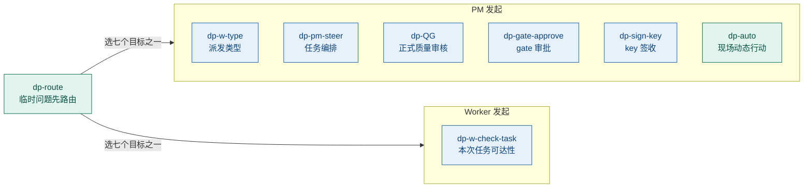

| 入口 | 谁发起 | 判断什么 | 选项 |
| --- | --- | --- | --- |
| **dp-w-type** | PM 派发前 | 任务交给哪类 Worker | coding / research / review / vision |
| **dp-pm-steer** | PM | 任务如何收敛或编排 | narrow / split / direct-exec / escalate |
| **dp-w-check-task** | Worker 自己 | 本次任务还能不能做下去 | 继续 / 终止并出结论 / 有界补证 |
| **dp-QG** | PM | 产物是否达到质量要求 | pass / fix / reopen |
| **dp-gate-approve** | PM（autopilot 消费） | 具体 gate 事项是否放行 | approve / steer / need_fix / reject |
| **dp-sign-key** | PM | key 交付能否签收 | finalize / continue / user-confirm |
| **dp-auto** | PM | 现场问题选哪个已准备方案 | PM 现场准备的候选 |
| **dp-route** | PM | 临时问题该交给哪个入口 | 其余七个入口 |

两条调用规则：**固定节点直接调用对应入口**，不强制多一次路由；**临时问题先经 dp-route 选入口**，再按该入口的合同判断。路由只选入口，不授予角色，也不代表业务结论。

### Worker 不再「等 PM」

旧流程里 Worker 遇到问题就以 `needs-clarification` 退出，等上层答复。新设计里 Worker 用 **dp-w-check-task 主动判断**，并且 fire-and-forget：

- **继续**：条件充足，接着做，不写终态；
- **终止并出结论**：输出已完成 / 未完成 / 阻断及证据，结束本次执行，但不等于目标完成或取消；
- **有界补证**：先写清未知项、来源、预算和结束判据，查完再判断，不能无限续跑。

PM 独立吸收终态，再决定是否用 dp-pm-steer / dp-auto 组织后续。

### gate 四选项：只有 approve 放行

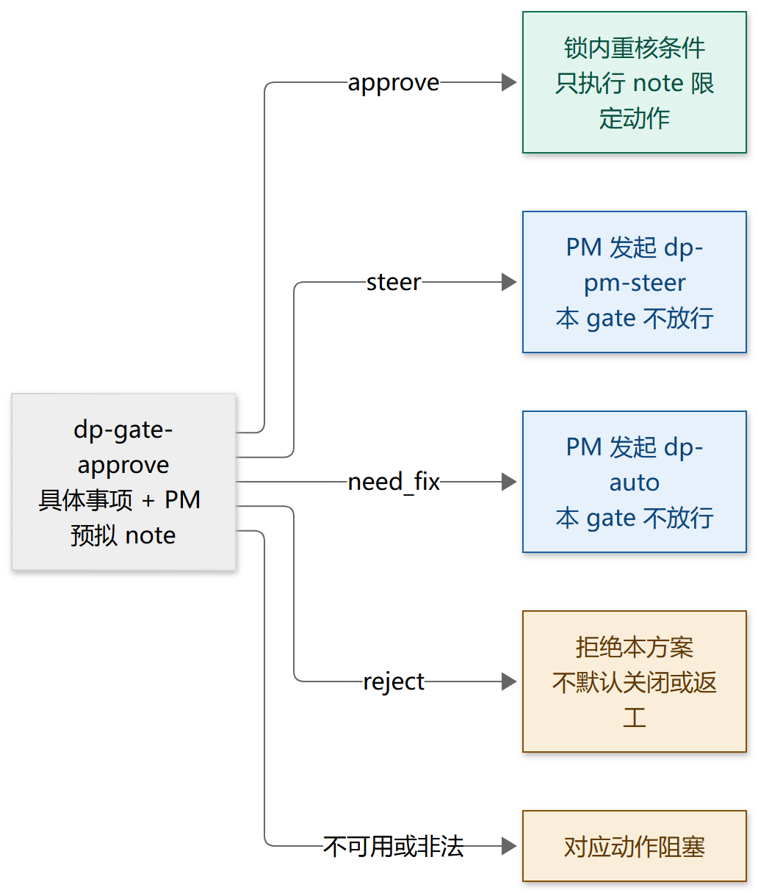

mermaid 源码

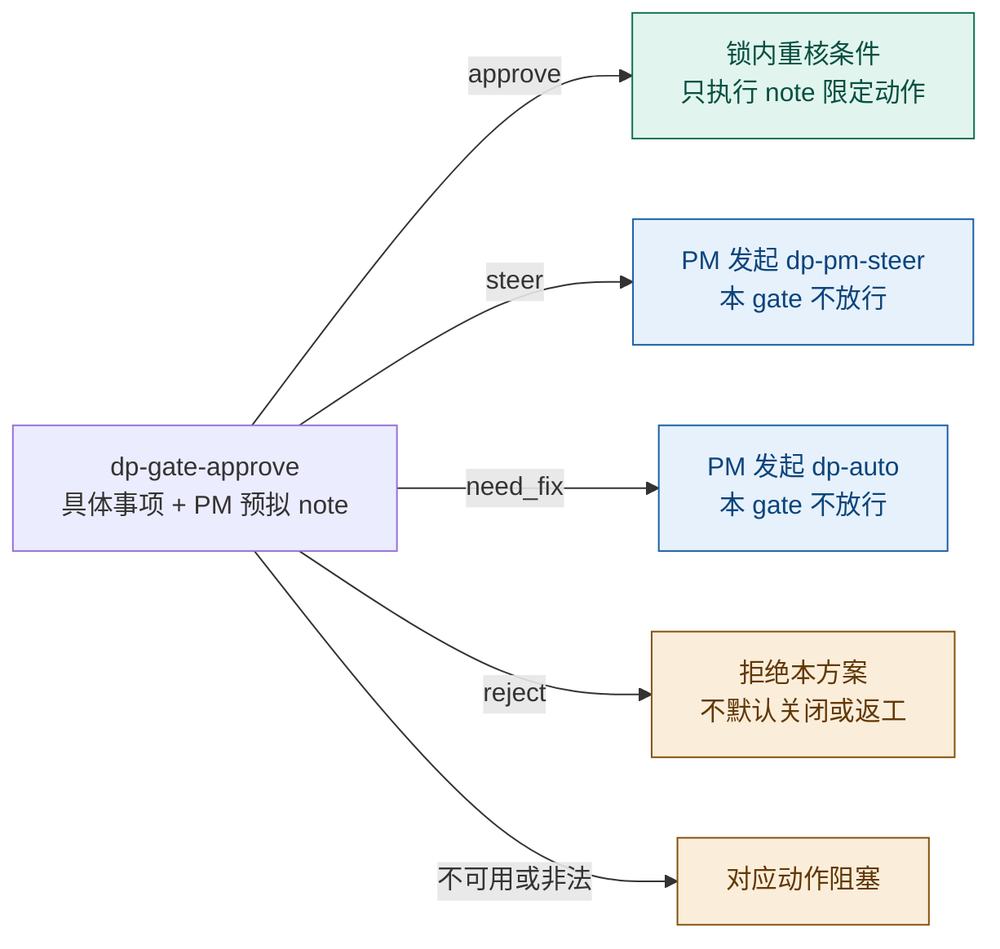

autopilot 的 stage 启动 / 关闭、停滞处置、软轮次追加、goal 变更、跨 key 修复、冻结契约变更、halted 恢复等场景都落到同一个 gate 入口，按具体事项判断；同一事项、同一证据版本不重复审批。

### 决策怎么进、结果怎么出

每次决策走同一个闭环：调用方 **prepare**（识别分支、收集事实、组装选项、生成决策本）→ **decide**（校验输入、派发、回收答案，不执行动作）→ 调用方 **apply**（签收、按授权执行、写回状态）。详见 [决策闭环设计](./decision-loop-design.md)。

几条硬约束：

- **选择不等于执行**。模型只返回合法选项；实际动作由调用方在执行前重核条件后完成，执行、结算、任务完成各自留证。
- **理由有出处**。模型同时从 PM 预备的依据清单中选出理由，文本来源标明是 PM 预备，与送审前的 PM note 分开保存。
- **失败就阻塞**。材料不全、服务不可用、无有效选择时，对应动作停下并留下原因，不默认选第一个候选，也不换通道绕过。
- **授权在人手里**。授权约束是只读文件，机器不能写；自动熔断后的恢复走隔离通道，被熔断的链路不能自批解锁。

---

## 三层如何咬合：一次「不等人」的推进

把三层串起来看一次流转——Worker 在执行中发现条件不足：

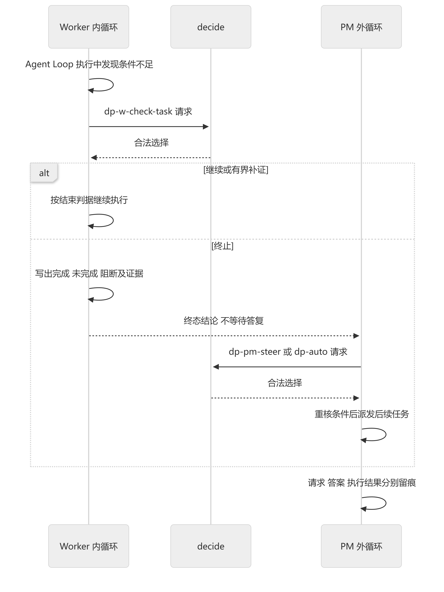

mermaid 源码

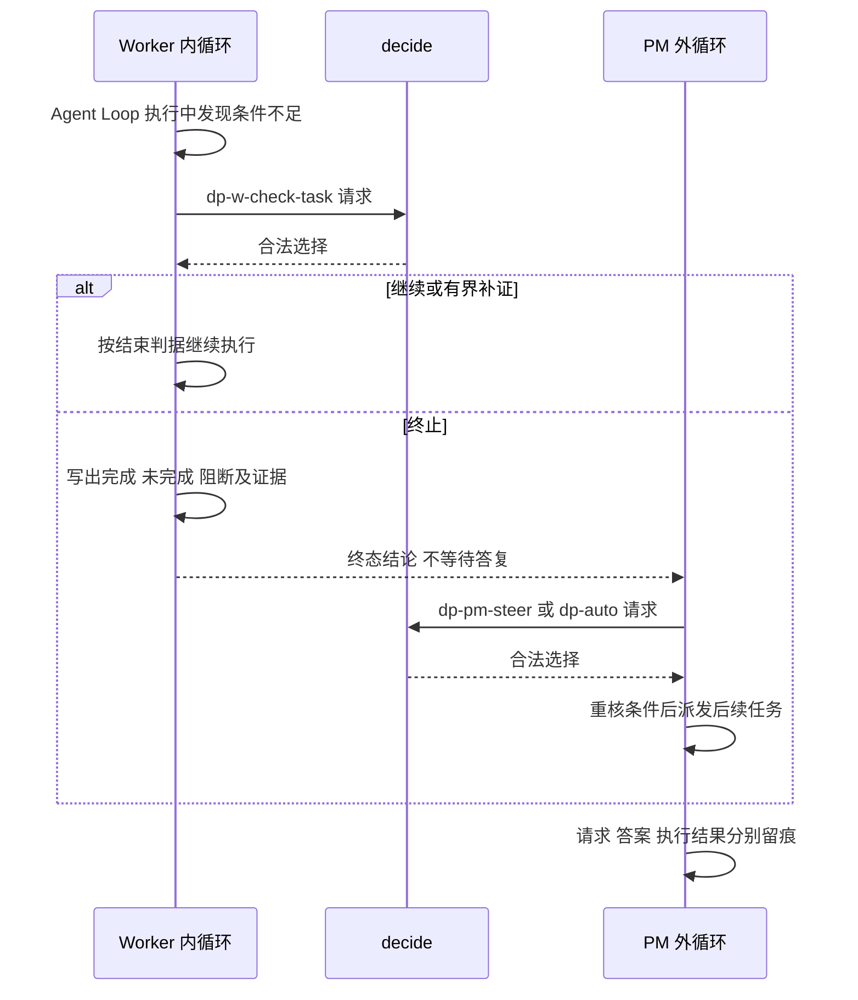

**内循环负责执行和自查，外循环负责吸收终态和组织后续，决策层只负责在给定选项里做选择。** 任何一方崩溃重启，只要文件在，状态就能重建。

---

## 设计取舍：这套机制的几条「性格」

| 性格 | 体现 | 为什么 |
| --- | --- | --- |
| **文件即状态，无中心内存** | 外循环纯读文件派生，monitor 零写 API | 断点重开 = 正常重开；多进程崩溃互不影响 |
| **进程级隔离** | 每个 worker 是独立 pi 进程，凭证按需下发 | 一个 worker 崩了不拖累其他；安全边界清晰 |
| **入口按职责收敛** | 8 个入口，旧编号只读、无别名 | 调用方知道该问谁；不会误调已退役入口 |
| **选择与执行分离** | decide 不执行动作，apply 前重核条件 | 模型答错也无法直接产生副作用 |
| **失败即阻塞** | 不默认选项、不换通道 | 宁可停下来，也不把不可信结果当成决定 |
| **授权只在人** | 只读授权文件，熔断恢复隔离 | 自动化不能自己给自己扩权 |
| **留痕可审计** | 决策本、答案、执行结果分别记录 | 每次自动推进都能回溯到证据与责任 |

---

## 结语

Multi-Workers 的三层循环，本质是在回答一个递进的问题链：

- **Agent Loop**：怎么让一个 Agent 把一步做对？
- **Autopilot**：怎么让一群 Agent 并行推进一个项目？
- **Decide**：推进中的决策分支，怎么交给机器选，又不让机器越权？

从 25 个编号收敛到 8 个职责入口，换来的是清楚的调用位置、明确的选项和可核对的结果。贯穿始终的主线没有变：**自动化的边界要可控、可回退、可审计**。

---

*本文基于 Multi-Workers 仓库源码与 `mw-dp-consolidation` 设计文档整理；8 入口为已批准目标设计，迁移完成情况以仓库当前版本为准。*
