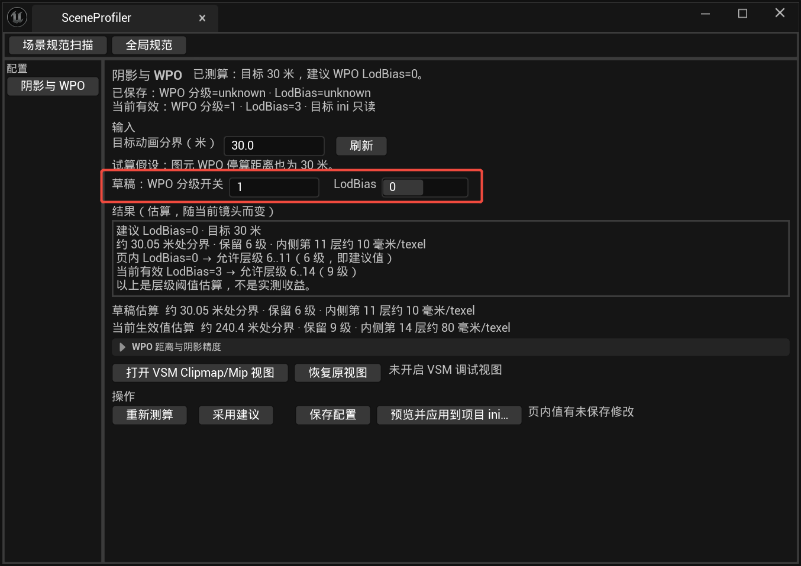

# UE Editor 布局参考

图一展示了一个配置和测算面板。标题旁先给测算摘要，下面依次展示已保存值和当前有效值。输入、草稿、估算、折叠详情和操作区都有可读的边界。草稿行中字段文字紧邻对应控件。截图红框为评审标注。

复用的是阅读顺序和状态归属。字段和导航随工具的任务而定，例如：

| 面板 | 默认布局 | 成功 | 失败或不可用 |
| --- | --- | --- | --- |
| 批量资产校验 | 筛选和范围 → 资产表 → 选中项详情 → 导出或修复 | 摘要与表中受影响资产对应 | 失效资产标在对应行，保留其他资产的校验结果 |
| 导入设置对话框 | 来源 → 导入选项 → 影响预览 → 导入 | 显示新建或替换的资产 | 在路径旁说明不可读原因，保留导入选项 |
| Details 定制 | 属性分组 → 字段和单位 → 就地状态 | 变更反馈贴近属性 | 多选混合值和只读分别有明确文字，独立的字段仍可编辑 |
