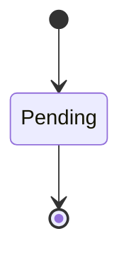

# {{MODULE}} 设计（草稿）

## 模块职责与环境

填写职责、依赖、运行环境、约束和非目标。

## 静态结构及依赖

下图仅说明规范包查询入口。用真实业务结构替换，引用实际AST节点；禁止把模板图当成已完成设计。

[T-ASK] [N:query]

## 数据模型与接口契约

填写数据归属、单位、接口输入输出、状态、不变量及错误处理。

## 主要 Flow

替换为模块业务主流程，并关联AST节点。

## 生命周期

填写启动、运行、取消、失败恢复与清理，并关联AST节点。

## 持久化、失败与可观察结果

填写保存边界、事务/恢复策略、错误与日志。

## AST 辅助及设计验证

源码节点由agent/catalog.py生成。术语事实来源是源码声明；说明来自人工维护的catalog.json。当前为draft，完成真实业务设计与流程节点引用后才将module.json中的design_status设为ready。

## 设计更新规则

修改前保存设计基线；先推演需求后的设计和调用影响面，再实现。更新受影响流程、接口和术语说明，运行catalog.py查看差异再--write。新/变更testcase或gate退回proposed，待人确认。默认按影响面最小回归，仅摘要输出；失败后展开，完整证据落盘。不得把配置检查当成业务测试已运行。

更新规则：新增真实 UE 测试必须进入 testcase 和对应影响面 gate；修改前保存 v2 基线，修改后用 agent/change_record.py 登记绑定基线及当前输入的工程记录。旧日志不能替代本轮证据，新增或改变判据须逐项人工确认。
